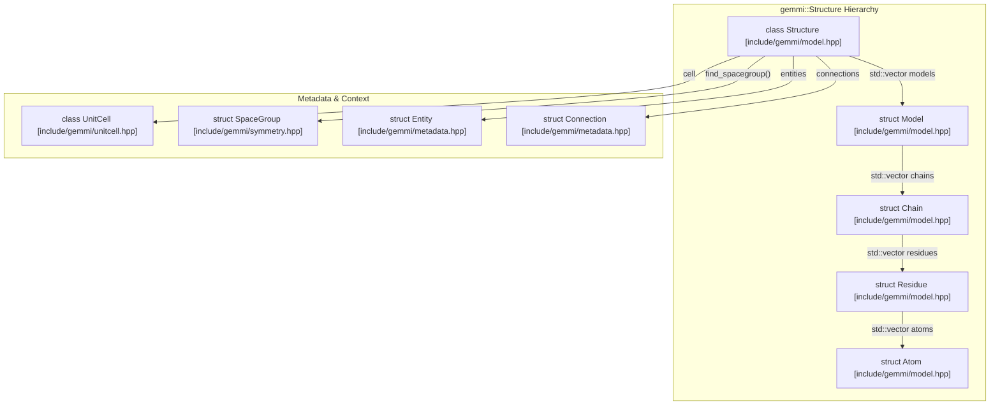
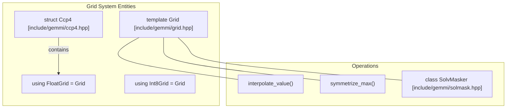
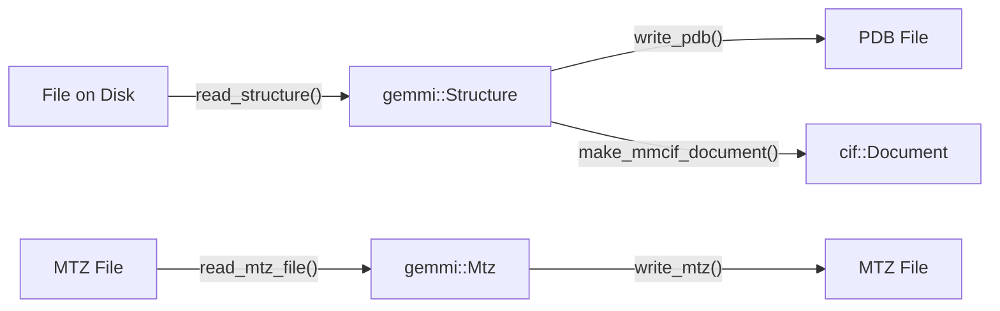

# Key Features

Relevant source files

The following files were used as context for generating this wiki page:

- [.github/workflows/wheels2.yml](.github/workflows/wheels2.yml)
- [README.md](README.md)
- [docs/conf.py](docs/conf.py)
- [docs/gemmi-help.txt](docs/gemmi-help.txt)
- [docs/index.rst](docs/index.rst)
- [docs/install.rst](docs/install.rst)
- [docs/misc.rst](docs/misc.rst)
- [docs/mol.rst](docs/mol.rst)
- [docs/wcn-help.txt](docs/wcn-help.txt)
- [include/gemmi/mmcif.hpp](include/gemmi/mmcif.hpp)
- [include/gemmi/mmdb.hpp](include/gemmi/mmdb.hpp)
- [include/gemmi/model.hpp](include/gemmi/model.hpp)
- [include/gemmi/pdb.hpp](include/gemmi/pdb.hpp)
- [include/gemmi/to_mmcif.hpp](include/gemmi/to_mmcif.hpp)
- [include/gemmi/to_pdb.hpp](include/gemmi/to_pdb.hpp)
- [include/gemmi/version.hpp](include/gemmi/version.hpp)
- [pyproject.toml](pyproject.toml)
- [python/mol.cpp](python/mol.cpp)
- [run-tests.sh](run-tests.sh)
- [tests/test_mol.py](tests/test_mol.py)
- [tools/compare_wheels.py](tools/compare_wheels.py)
- [tools/linux-wheels.sh](tools/linux-wheels.sh)
- [tools/release.txt](tools/release.txt)

GEMMI (Genome and Macromolecular Models & Information) is a comprehensive library for structural biology with a focus on crystallography and macromolecular structures. This page summarizes the main capabilities and features of the library, providing an overview of its core components, file format support, and programming interfaces.

## Core Data Structures

Gemmi is built around several fundamental data structures that form the basis for all other functionality.

### Macromolecular Structure Representation

The `Structure` system provides a complete hierarchical representation of macromolecular structures, following the standard organization found in PDB/mmCIF files. It uses a specialized container system to manage models, chains, residues, and atoms.

**Bridge: Natural Language to Code Entity Space (Molecular Hierarchy)**

Sources: [include/gemmi/model.hpp:136-222](), [include/gemmi/model.hpp:882-1056](), [python/mol.cpp:132-154](), [docs/mol.rst:8-18]()

The `Structure` class is the root container. Key features include:
- **Models**: Supports multiple alternative models (e.g., from NMR or different refinement runs) [include/gemmi/model.hpp:886]().
- **Alternative Conformations**: Handles `altloc` at the `Atom` level [include/gemmi/model.hpp:139]() and provides `AtomGroup`/`ResidueGroup` proxies for grouping alternatives [include/gemmi/model.hpp:184-200]().
- **Crystallographic Context**: Stores `UnitCell` for coordinate transformations and `SpaceGroup` for symmetry [include/gemmi/model.hpp:891-893]().

### 3D Volumetric Data Representation

The Grid system provides a framework for handling 3D volumetric data, such as electron density maps, using the `Grid` template class.

Sources: [include/gemmi/grid.hpp:311-565](), [python/grid.cpp:77-150](), [docs/grid.rst:7-32]()

## File Format Support

Gemmi supports a wide array of crystallographic and structural formats through specialized parsers and writers.

### Coordinate and Chemical Formats
- **mmCIF (PDBx/mmCIF)**: Primary format, handled via `populate_structure_from_block` [include/gemmi/mmcif.hpp:16]().
- **PDB**: Legacy format support including Hybrid-36 serial numbers and large chain ID extensions [include/gemmi/pdb.hpp:7-11]().
- **mmJSON**: JSON representation of macromolecular data [python/mol.cpp:99]().
- **ChemComp**: Reading from Chemical Component Dictionary (CCD) or Monomer Library [include/gemmi/mmcif.hpp:39-44]().

### Reflection and Map Formats
- **MTZ**: Standard binary format for reflections, managed by the `Mtz` class [python/mtz.cpp:79]().
- **CCP4 Maps**: Volumetric data format for electron density [include/gemmi/ccp4.hpp]().
- **XDS**: Support for `XDS_ASCII` conversion to MTZ [docs/gemmi-help.txt:44]().

**Bridge: Natural Language to Code Entity Space (I/O Operations)**

Sources: [include/gemmi/pdb.hpp:34-60](), [include/gemmi/mmcif.hpp:16-30](), [include/gemmi/to_pdb.hpp:51-61](), [include/gemmi/to_mmcif.hpp:58-71](), [docs/mol.rst:105-124]()

## Advanced Crystallographic Tools

### Symmetry and Unit Cells
Gemmi implements sophisticated symmetry handling:
- **Space Groups**: Lookup by H-M name, Hall symbol, or number [include/gemmi/symmetry.hpp]().
- **Operations**: `Op` class for 3x3 matrices and translation vectors [include/gemmi/symmetry.hpp]().
- **Niggli Reduction**: Lattice reduction tools in `unitcell.hpp`.

### Chemical Analysis and Refinement
- **Neighbor Search**: Uses `NeighborSearch` and `SubCells` for fast spatial queries [docs/gemmi-help.txt:16]().
- **Topology**: The `crd` command prepares topology for Refmac [docs/gemmi-help.txt:19]().
- **Restraints**: `AceDrg` integration for filling restraint values [docs/gemmi-help.txt:20]().

## Programming Interfaces

### C++ Library
A header-only core (with some optional compiled components) providing high-performance primitives. It requires C++11 or later [include/gemmi/version.hpp]().

### Python Bindings
Gemmi provides extensive Python bindings using `nanobind`. These bindings are designed for performance, often providing direct access to C++ memory via NumPy [python/mol.cpp:1-20]().
- **NumPy Integration**: Grids and reflection data can be viewed as NumPy arrays.
- **Ease of Use**: Functions like `gemmi.read_structure()` handle format detection and decompression (`.gz`) automatically [docs/mol.rst:188-194]().

### Command Line Interface (CLI)
The `gemmi` executable provides a suite of subcommands for common tasks:
- `convert`: Format conversion (e.g., mmCIF to PDB) [docs/gemmi-help.txt:18]().
- `mtz2cif` / `cif2mtz`: Reflection data conversion [docs/gemmi-help.txt:14,32]().
- `sfcalc`: Structure factor calculation from models [docs/gemmi-help.txt:38]().
- `blobs`: Unmodeled density detection [docs/gemmi-help.txt:12]().

Sources: [docs/gemmi-help.txt:1-45](), [python/mol.cpp:74-128](), [run-tests.sh:5-10]()

---