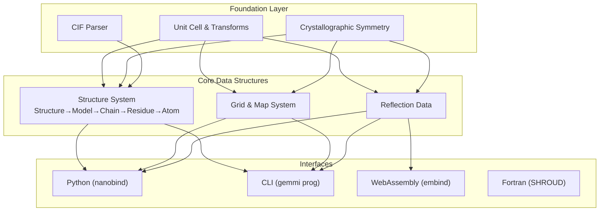
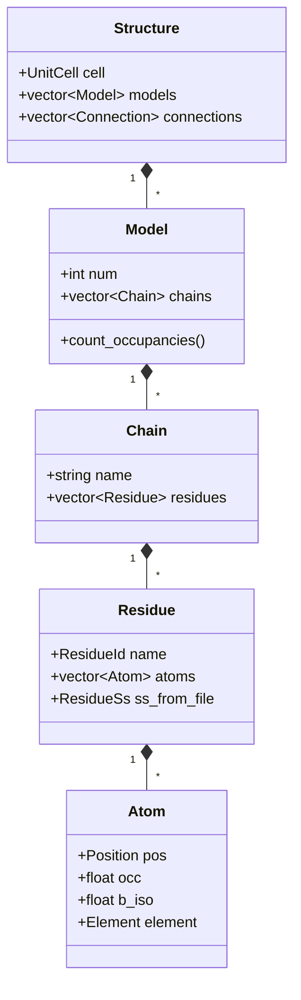
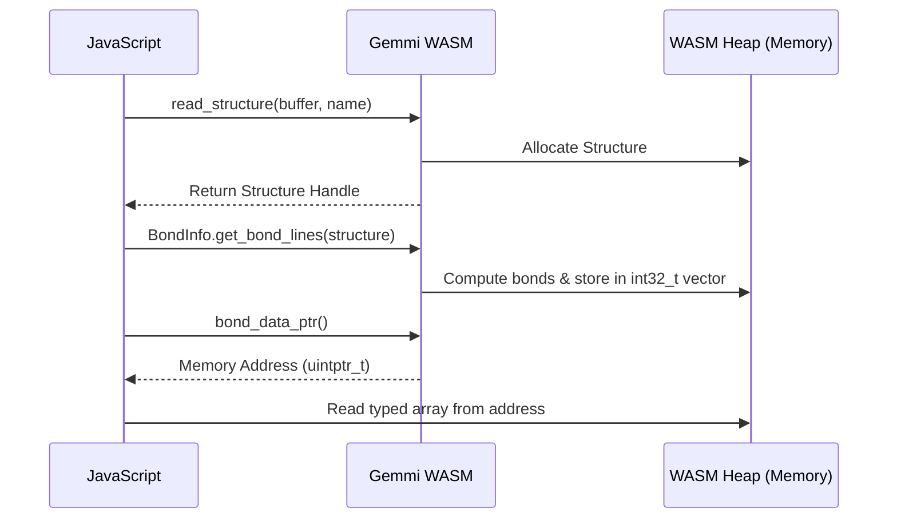
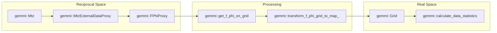

# Architecture Overview

Relevant source files

The following files were used as context for generating this wiki page:

- [.gitignore](.gitignore)
- [CMakeLists.txt](CMakeLists.txt)
- [fortran/ftest.f90](fortran/ftest.f90)
- [python/common.h](python/common.h)
- [python/gemmi.cpp](python/gemmi.cpp)
- [wasm/Makefile](wasm/Makefile)
- [wasm/README.md](wasm/README.md)
- [wasm/cell.cpp](wasm/cell.cpp)
- [wasm/common.h](wasm/common.h)
- [wasm/gemmi.cpp](wasm/gemmi.cpp)
- [wasm/gemmi.d.ts](wasm/gemmi.d.ts)
- [wasm/mol.cpp](wasm/mol.cpp)
- [wasm/mol.test.js](wasm/mol.test.js)
- [wasm/mtz.d.ts](wasm/mtz.d.ts)
- [wasm/mtz_fft.cpp](wasm/mtz_fft.cpp)
- [wasm/mtz_fft.test.js](wasm/mtz_fft.test.js)
- [wasm/package.json](wasm/package.json)
- [wasm/pre.js](wasm/pre.js)

This document describes the high-level architecture of the GEMMI (Genome and Macromolecular Models & Information) library, explaining the main components and how they interact. GEMMI is a comprehensive library for structural biology, providing tools for working with atomic models, electron density maps, crystallographic symmetry, and crystallographic data.

## Core Architecture

GEMMI is organized as a layered architecture. The core logic is implemented in C++ as a header-only library, supplemented by a compiled C++ library for heavier operations, Python bindings via `nanobind`, and WebAssembly (WASM) interfaces via `embind`.

| Component | Implementation | Primary Role |
| :--- | :--- | :--- |
| **Header-only Core** | C++ (`include/gemmi/*.hpp`) | High-performance crystallographic math, symmetry, and data structures. |
| **Compiled Library** | C++ (`src/*.cpp`) | Heavier I/O, complex algorithms, and shared symbols for bindings. |
| **Python Bindings** | C++ / `nanobind` (`python/`) | High-level scripting interface with NumPy integration. |
| **CLI Tools** | C++ (`prog/`) | Standalone utilities like `gemmi mtz2cif` or `gemmi contact`. |
| **WASM Bindings** | C++ / `embind` (`wasm/`) | Browser-based execution for molecular viewers and web tools. |

Sources: [CMakeLists.txt:21-29](), [python/gemmi.cpp:159-165](), [wasm/Makefile:15-26]()

### High-Level Component Interaction

Sources: [include/gemmi/model.hpp:1-1056](), [python/common.h:27-48](), [wasm/common.h:7-11](), [CMakeLists.txt:21-25]()

## Structure System

The `Structure` system represents macromolecular data hierarchically. In C++, this is defined in `include/gemmi/model.hpp`. The WASM interface maps these to JavaScript classes using `embind`.

In the WASM implementation, the hierarchy is exposed through `at()` methods and `length` properties to facilitate efficient traversal in JavaScript environments.

Sources: [wasm/gemmi.d.ts:56-108](), [wasm/mol.cpp:40-56](), [include/gemmi/model.hpp:883-1056]()

## Python Bindings via Nanobind

The Python bindings use `nanobind` to bridge C++ entities to Python. The implementation is modular, with specialized `add_*` functions for different domains.

| Function | Source File | Purpose |
| :--- | :--- | :--- |
| `add_mol` | `python/mol.cpp` | Binds `Structure`, `Model`, `Chain`, etc. |
| `add_grid` | `python/grid.cpp` | Binds 3D density grids and NumPy integration. |
| `add_mtz` | `python/mtz.cpp` | Binds MTZ reflection data reading/writing. |
| `add_cif` | `python/cif.cpp` | Binds the CIF DOM (Document, Block, Table). |

The bindings also include specialized logic for Pythonic indexing and NumPy array views. For example, `normalize_index` handles negative indices in Python lists.

Sources: [python/common.h:27-48](), [python/common.h:69-72](), [python/gemmi.cpp:159-180]()

## WebAssembly (WASM) Architecture

The WASM build uses Emscripten to compile a subset of the C++ library for use in browsers. It includes a custom `BondInfo` and `SelectionResult` system to optimize data transfer between the WASM heap and JavaScript.

Key WASM components:
- **`MtzFft`**: Performs Fast Fourier Transforms on MTZ data to generate maps directly in the browser.
- **`Isosurface`**: Extracts mesh data (vertices/triangles) from grids for 3D visualization.
- **`BondInfo`**: Uses the `MonLib` (Monomer Library) to calculate connectivity for visualization.

Sources: [wasm/mol.cpp:110-178](), [wasm/mtz_fft.cpp:119-198](), [wasm/gemmi.d.ts:148-174](), [wasm/Makefile:15-26]()

## Build System and Integration

Gemmi uses CMake as its primary build system. It is designed to be flexible, supporting standalone builds, `scikit-build-core` for Python wheels, and Emscripten for WASM.

- **`gemmi_headers`**: An INTERFACE target for the header-only core.
- **`gemmi_cpp`**: The compiled library containing non-templated code and third-party dependencies (e.g., `zlib`, `pocketfft`).
- **`gemmi_ext`**: The Python extension module created via `nanobind_add_module`.

Sources: [CMakeLists.txt:21-29](), [CMakeLists.txt:121-164](), [python/gemmi.cpp:159-162]()

## Data Flow: Reflection to Map

A common architectural pattern in Gemmi is the transformation of reciprocal space data (reflections) to real space data (grids/maps).

This flow is utilized in both the Python `sf` module and the WASM `mtz_fft` module to generate electron density maps for visualization or refinement.

Sources: [wasm/mtz_fft.cpp:29-60](), [python/common.h:48](), [include/gemmi/fourier.hpp:1-50]()

---