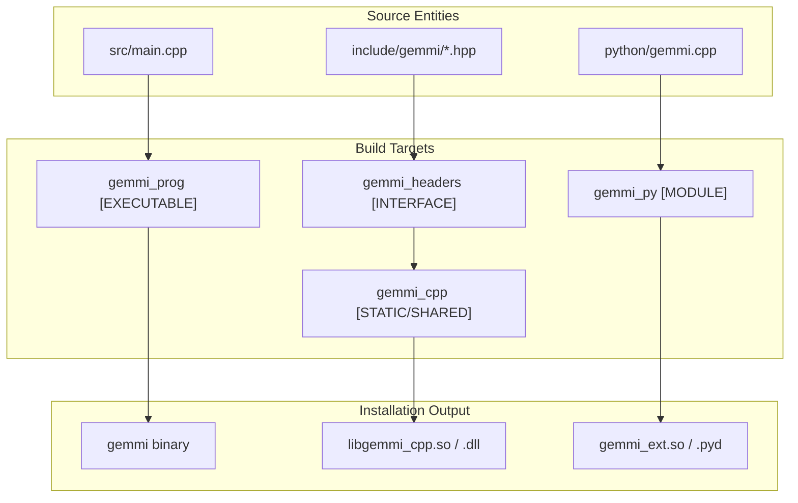
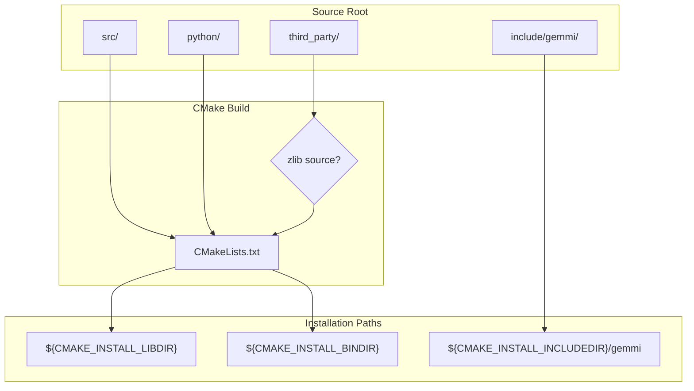

# Installation and Setup

<details>
<summary>Relevant source files</summary>

The following files were used as context for generating this wiki page:

- [CMakeLists.txt](CMakeLists.txt)
- [README.md](README.md)
- [docs/conf.py](docs/conf.py)
- [docs/index.rst](docs/index.rst)
- [docs/install.rst](docs/install.rst)
- [docs/misc.rst](docs/misc.rst)
- [docs/wcn-help.txt](docs/wcn-help.txt)
- [python/common.h](python/common.h)
- [python/gemmi.cpp](python/gemmi.cpp)

</details>


This page covers the installation and configuration of the Gemmi library, a comprehensive toolkit for structural biology and crystallography. Instructions are provided for different installation methods, platform-specific considerations, and configuration options.

For information about using Gemmi after installation, see the [Core Data Structures](#3) and [Command Line Interface](#6) documentation.

## Installation Methods Overview

Gemmi can be installed in multiple ways, depending on your needs:

1.  **Python package** - Install through pip (Python bindings only).
2.  **Build from source** - Full installation with C++ library, command-line tools, and optional Python/Fortran bindings.
3.  **Conda** - Available via `conda-forge`.
4.  **CCP4 Suite** - Included in standard CCP4 distributions.

### Component Relationship Diagram

The following diagram maps high-level installation targets to their corresponding code entities and build artifacts.

**Gemmi Build Artifact Mapping**

Sources: [CMakeLists.txt:21-32](), [CMakeLists.txt:217-221](), [CMakeLists.txt:268-270](), [docs/install.rst:46-56]()

## System Requirements

### Core Requirements
- **C++14 compatible compiler**: Minimum requirement for the core library [docs/install.rst:55-56]().
- **C++17 compatible compiler**: Required if building Python bindings from source [docs/install.rst:94-95]().
- **CMake 3.15 or newer**: Required for the build system [CMakeLists.txt:1-1]().

### Python Bindings Requirements
- **Python 3.8 or newer** [docs/install.rst:96-96]().
- **nanobind**: Used for generating high-performance bindings [python/common.h:11-11]().
- **scikit-build-core**: Used for pip-based source builds [docs/install.rst:128-128]().

Sources: [CMakeLists.txt:1-10](), [docs/install.rst:7-100](), [python/common.h:20-22]()

## Python Installation

The simplest way to install the Gemmi Python module is via `pip`.

### From PyPI
```bash
pip install gemmi
```
This typically downloads binary wheels. If no wheel matches, it compiles from source using `scikit-build-core` [docs/install.rst:86-95]().

### From Source (Git)
```bash
pip install git+https://github.com/project-gemmi/gemmi.git
```
You can pass CMake arguments during pip installation:
```bash
pip install . --config-settings="cmake.args=-DFETCH_ZLIB_NG=ON"
```
Sources: [docs/install.rst:118-136](), [CMakeLists.txt:14-19]()

For more details, see [Python Installation](#2.2).

## Building from Source

Building from source provides access to the C++ library and the `gemmi` command-line utility.

### Basic Build Process
1. **Configure**: `cmake -B build -DCMAKE_BUILD_TYPE=Release`
2. **Build**: `cmake --build build -j4`
3. **Install**: `cmake --install build`

### Build Configuration Options

Gemmi uses several CMake options to manage dependencies and features:

| Option | Default | Description |
|--------|---------|-------------|
| `BUILD_SHARED_LIBS` | ON | Build shared library [CMakeLists.txt:21]() |
| `BUILD_GEMMI_PROGRAM` | ON | Build `gemmi` command-line tool [CMakeLists.txt:22]() |
| `USE_PYTHON` | OFF | Build Python bindings [CMakeLists.txt:25]() |
| `USE_ZLIB_NG` | OFF | Use system `zlib-ng` [CMakeLists.txt:26]() |
| `FETCH_ZLIB_NG` | OFF | Download and build `zlib-ng` statically [CMakeLists.txt:27]() |
| `INTERNAL_ZLIB` | OFF | Use bundled `zlib` subset [CMakeLists.txt:28]() |
| `USE_FORTRAN` | OFF | Build Fortran bindings (experimental) [CMakeLists.txt:24]() |

### Dependency Management (zlib)
Gemmi can handle `zlib` in four ways, prioritized by CMake logic:
1. `FETCH_ZLIB_NG`: Downloads `zlib-ng` from GitHub [CMakeLists.txt:121-152]().
2. `USE_ZLIB_NG`: Searches for a system-installed `zlib-ng` [CMakeLists.txt:153-155]().
3. `INTERNAL_ZLIB`: Uses code in `third_party/zlib` [CMakeLists.txt:157-164]().
4. Default: Searches for system `zlib`; falls back to `third_party/zlib` if not found [docs/install.rst:66-67]().

Sources: [CMakeLists.txt:21-32](), [CMakeLists.txt:121-164](), [docs/install.rst:58-72]()

For more details, see [Building from Source](#2.1).

## Platform-Specific Considerations

### Windows
- **Unicode**: Use `-DUSE_WMAIN=ON` (default) to enable Unicode argument support in the command-line program [CMakeLists.txt:31-32]().
- **DLLs**: When linking against `zlib` DLLs, the DLL must be in the same directory as the executable. Static linking via `-DFETCH_ZLIB_NG=ON` is recommended [docs/install.rst:69-72]().

### WebAssembly (WASM)
Gemmi can be compiled with Emscripten. The project provides two paths:
1. **Embind**: Exposes C++ classes like `Structure` and `Mtz` to JavaScript [docs/install.rst:183-197]().
2. **C API**: Used for high-performance web tools in the separate `wasm` repository [docs/install.rst:203-214]().

Sources: [CMakeLists.txt:31-32](), [docs/install.rst:75-77](), [docs/install.rst:171-214]()

## Verifying Installation

### Command-Line Interface
Check the version of the installed `gemmi` utility:
```bash
gemmi --version
```
Sources: [docs/gemmi-help.txt:6-6]()

### Python Module
Verify the module and version:
```python
import gemmi
print(gemmi.__version__)
```
Sources: [python/gemmi.cpp:165-165]()

## Installation Architecture

The following diagram illustrates how the build system connects source files to the final installed environment.

**Gemmi Installation Flow**

Sources: [CMakeLists.txt:12-19](), [CMakeLists.txt:121-164](), [docs/install.rst:19-56]()

---