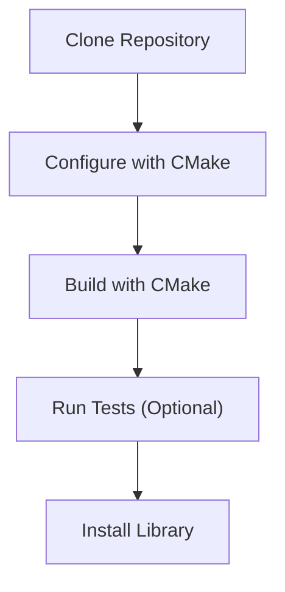
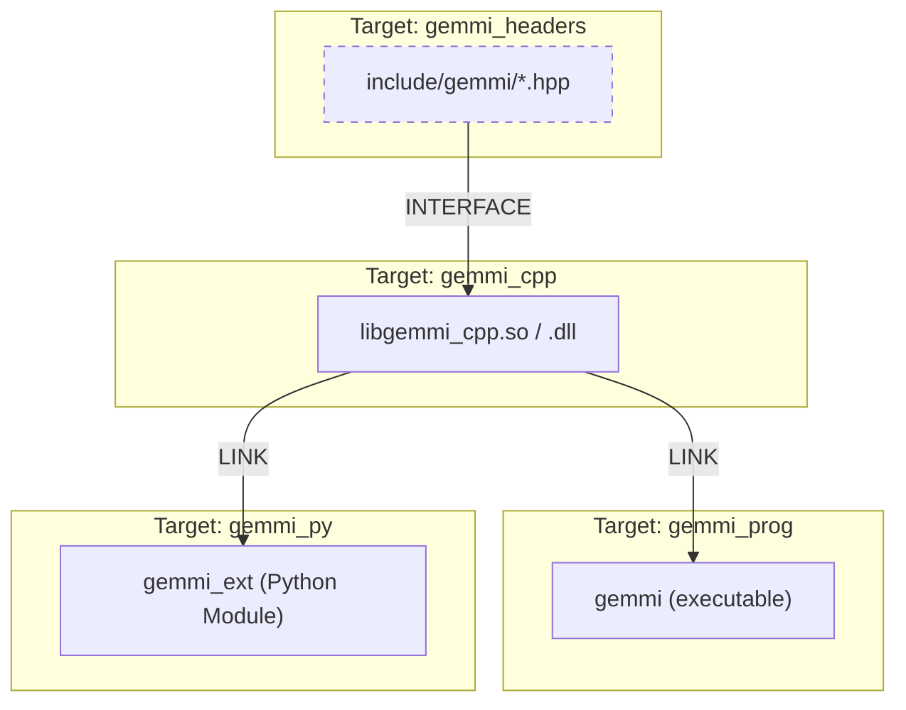
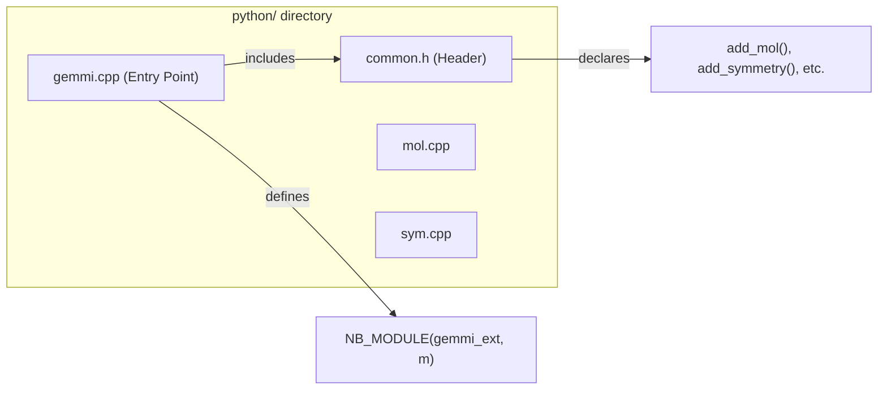

# Building from Source

<details>
<summary>Relevant source files</summary>

The following files were used as context for generating this wiki page:

- [.appveyor.yml](.appveyor.yml)
- [.github/workflows/ci.yml](.github/workflows/ci.yml)
- [.github/workflows/testwheel.yml](.github/workflows/testwheel.yml)
- [CMakeLists.txt](CMakeLists.txt)
- [python/common.h](python/common.h)
- [python/gemmi.cpp](python/gemmi.cpp)

</details>


This document explains how to build the GEMMI (Genome and Macromolecular Models & Information) library from source code. If you're only interested in installing the Python package, see [Python Installation](2.2).

## Prerequisites

To build GEMMI from source, you need:

- C++ compiler with C++14 support (GCC 5+, Clang 3.4+, MSVC 2019+) [CMakeLists.txt:52]()
- CMake 3.15 or newer [CMakeLists.txt:1]()
- (Optional) Python 3.9+ with development headers for Python bindings [python/common.h:20-22]()
- (Optional) zlib or zlib-ng development files [CMakeLists.txt:153-164]()

## Build Process Overview

GEMMI uses CMake as its build system. The build process consists of the following main steps:



Sources: [CMakeLists.txt:1-10](), [.github/workflows/ci.yml:45-58]()

## Basic Usage

### Getting the Source Code

Clone the repository from GitHub:

```bash
git clone --recursive https://github.com/project-gemmi/gemmi.git
cd gemmi
```

### Configuring and Building

Create a build directory and run CMake configuration:

```bash
mkdir build
cd build
cmake ..
```

Then build the project:

```bash
cmake --build . -j 4
```

To install:

```bash
sudo cmake --install .
```

Sources: [.github/workflows/ci.yml:45-58](), [.github/workflows/ci.yml:134-144]()

## Build Configuration Options

GEMMI offers many configuration options through CMake. Here are the most important ones:

| Option | Default | Description |
|--------|---------|-------------|
| `BUILD_SHARED_LIBS` | ON | Build shared library instead of static [CMakeLists.txt:21]() |
| `BUILD_GEMMI_PROGRAM` | ON | Build the `gemmi` command-line program [CMakeLists.txt:22]() |
| `INSTALL_DEV_FILES` | ON | Install C++ headers, CMake configs, static lib [CMakeLists.txt:23]() |
| `USE_PYTHON` | OFF | Build Python bindings [CMakeLists.txt:25]() |
| `USE_FORTRAN` | OFF | Build Fortran bindings [CMakeLists.txt:24]() |
| `USE_ZLIB_NG` | OFF | Use `zlib-ng` instead of `zlib` [CMakeLists.txt:26]() |
| `FETCH_ZLIB_NG` | OFF | Download and build `zlib-ng` statically [CMakeLists.txt:27]() |
| `INTERNAL_ZLIB` | OFF | Use subset of zlib distributed with gemmi [CMakeLists.txt:28]() |
| `CMAKE_BUILD_TYPE` | Release | Build type (Debug, Release, MinSizeRel, RelWithDebInfo) [CMakeLists.txt:115-118]() |

Sources: [CMakeLists.txt:21-43](), [CMakeLists.txt:115-118]()

## Library Components and Targets

The build system defines several targets that represent different layers of the library.

### Code Entity Relationship

The following diagram maps CMake targets to the source entities they encompass:



Sources: [CMakeLists.txt:206-212](), [CMakeLists.txt:214-223](), [CMakeLists.txt:324-342](), [CMakeLists.txt:471-479]()

## Dependency Management

### Zlib and Zlib-ng
GEMMI requires zlib for handling compressed files (e.g., `.gz` structures or MTZ files). It supports three modes:
1. **System Zlib**: Found via `find_package(ZLIB)` [CMakeLists.txt:159]().
2. **Internal Zlib**: Uses a bundled subset in `third_party/zlib` [CMakeLists.txt:162]().
3. **Zlib-ng**: A performance-optimized version. Can be used if already installed (`USE_ZLIB_NG`) or fetched automatically during build (`FETCH_ZLIB_NG`) [CMakeLists.txt:121-155]().

### Python Bindings (nanobind)
The Python bindings require `nanobind`. If `USE_PYTHON` is enabled, CMake searches for the `nanobind` package or expects it to be available in the environment [python/common.h:11]().

Sources: [CMakeLists.txt:121-164](), [python/common.h:11-25]()

## Platform-Specific Instructions

### Linux
Standard GCC/Clang builds. Ensure `libz-dev` is installed for system zlib support [.github/workflows/ci.yml:130]().

### macOS
Supports both Intel and Apple Silicon. Uses `AppleClang` by default [.github/workflows/ci.yml:7-18]().

### Windows
Supports MSVC (Visual Studio 2019/2022) and MinGW. 
- For MSVC: `cmake -G "Visual Studio 17 2022" -A x64` [.appveyor.yml:6-9]().
- For Unicode support in the CLI: `USE_WMAIN` is ON by default [CMakeLists.txt:31]().

Sources: [.github/workflows/ci.yml:130](), [.appveyor.yml:6-26](), [CMakeLists.txt:31-33]()

## Building Python Bindings

The Python module `gemmi_ext` is built using `nanobind` and links against `libgemmi_cpp`.

### Module Structure



The `NB_MODULE` macro in `python/gemmi.cpp` initializes the extension and imports the base `gemmi` Python package to inject C++ classes [python/gemmi.cpp:159-165]().

Sources: [python/gemmi.cpp:159-180](), [python/common.h:27-48]()

## Testing the Build

GEMMI includes a comprehensive test suite accessible via CMake:

```bash
# Run all tests
cmake --build . --target check
# Or via ctest
ctest --output-on-failure
```

Python tests can be run independently:
```bash
python3 -m unittest discover -v -s tests/
```

Sources: [.github/workflows/ci.yml:54](), [.github/workflows/ci.yml:61-62](), [.github/workflows/ci.yml:143-145]()

---