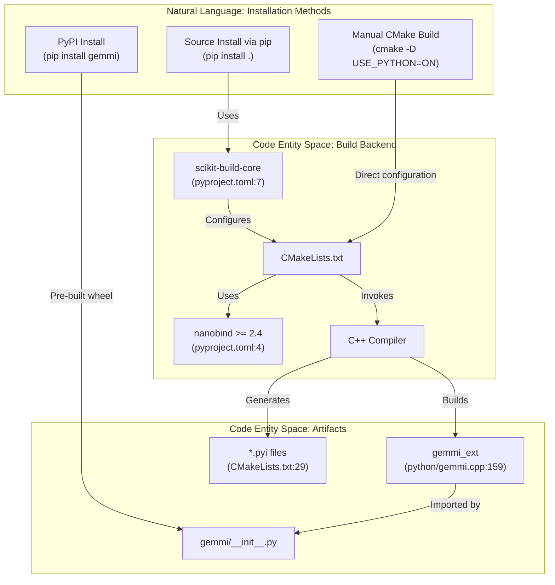
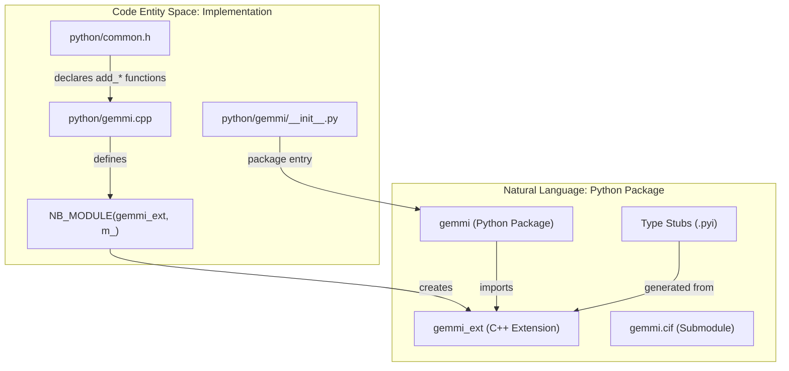

# Python Installation

<details>
<summary>Relevant source files</summary>

The following files were used as context for generating this wiki page:

- [.github/workflows/wheels2.yml](.github/workflows/wheels2.yml)
- [CMakeLists.txt](CMakeLists.txt)
- [docs/gemmi-help.txt](docs/gemmi-help.txt)
- [include/gemmi/mmdb.hpp](include/gemmi/mmdb.hpp)
- [include/gemmi/version.hpp](include/gemmi/version.hpp)
- [pyproject.toml](pyproject.toml)
- [python/common.h](python/common.h)
- [python/gemmi.cpp](python/gemmi.cpp)
- [run-tests.sh](run-tests.sh)
- [tools/compare_wheels.py](tools/compare_wheels.py)
- [tools/linux-wheels.sh](tools/linux-wheels.sh)
- [tools/release.txt](tools/release.txt)

</details>


This document explains how to install and use the Python bindings for Gemmi. Python bindings allow you to use Gemmi's functionality directly from Python programs, leveraging `nanobind` for efficient C++/Python interoperation.

## Pre-built Wheels Installation

The simplest way to install Gemmi is using `pip` with pre-built wheels:

```bash
pip install gemmi
```

This automatically fetches and installs the appropriate binary package for your platform from PyPI. Gemmi currently supports Python 3.9 and newer [pyproject.toml:13]().

For development versions, you can install directly from GitHub:

```bash
pip install git+https://github.com/project-gemmi/gemmi.git
```

Sources: [pyproject.toml:10-13](), [tools/release.txt:13-20]()

## Installation Architecture

Gemmi uses `scikit-build-core` as the build backend to bridge the Python packaging ecosystem with the CMake build system.



Sources: [pyproject.toml:1-7](), [CMakeLists.txt:14-19](), [python/gemmi.cpp:159-162]()

## Building from Source using pip

You can build Gemmi from source using `pip`, which requires:

- C++17 compiler (required for full support, especially on macOS [pyproject.toml:99-100]())
- Python 3.9 or later [pyproject.toml:13]()
- CMake 3.15 or later [CMakeLists.txt:1]()

To install from source:

```bash
git clone https://github.com/project-gemmi/gemmi.git
cd gemmi
pip install .
```

This uses `scikit-build-core` to handle the `pyproject.toml` configuration, which defines `USE_PYTHON="ON"` and `GENERATE_STUBS="ON"` by default during the build process [pyproject.toml:74-77]().

Sources: [pyproject.toml:1-13](), [pyproject.toml:74-77](), [CMakeLists.txt:1-9]()

## Building from Source using CMake

For more control, you can use CMake directly. The `USE_PYTHON` option must be enabled:

```bash
cmake -D USE_PYTHON=ON ..
make gemmi_py
```

The `gemmi_py` target specifically builds the Python bindings [run-tests.sh:31-34](). If `Python_EXECUTABLE` is defined and `SKBUILD` is not (manual build), `USE_PYTHON` is forced to `ON` [CMakeLists.txt:56-58]().

Sources: [CMakeLists.txt:25](), [CMakeLists.txt:56-59](), [run-tests.sh:31-34]()

## Module Structure

The Python package is structured as a hybrid of Python code and a compiled C++ extension.



Sources: [python/gemmi.cpp:159-165](), [python/common.h:27-48](), [CMakeLists.txt:29]()

### Extension Registration
The C++ extension `gemmi_ext` is initialized in `python/gemmi.cpp` using the `NB_MODULE` macro [python/gemmi.cpp:159](). An unusual setup is used where importing `gemmi_ext` adds classes and functions directly to the `gemmi` namespace [python/gemmi.cpp:160-162]().

The binding is modularized into several `add_*` functions (e.g., `add_cif`, `add_mtz`, `add_grid`) declared in `python/common.h` [python/common.h:27-48]() and implemented across various `.cpp` files in the `python/` directory.

## Verifying Installation

To verify the installation and check the version:

```python
import gemmi
print(gemmi.__version__)
```

The version string is sourced from `include/gemmi/version.hpp` [include/gemmi/version.hpp:8]() and exposed via `gemmi.__version__` in the extension module [python/gemmi.cpp:165]().

To run the comprehensive test suite:

```bash
python -m unittest discover -s tests
```

Sources: [python/gemmi.cpp:165](), [run-tests.sh:52](), [include/gemmi/version.hpp:8]()

## Python Version and Platform Support

Gemmi uses `cibuildwheel` to generate wheels for a wide variety of environments [pyproject.toml:92-98]().

| Category | Supported / Configured Values |
|----------|-------------------------------|
| **Python** | >= 3.9 [pyproject.toml:13]() |
| **OS** | Ubuntu (22.04, 24.04), Windows 2022, macOS (14, 15) [.github/workflows/wheels2.yml:27]() |
| **Arch** | x86_64, arm64, Intel [.github/workflows/wheels2.yml:27]() |
| **Dependencies** | nanobind >= 2.4, scikit-build-core [pyproject.toml:1-6]() |

Sources: [pyproject.toml:1-13](), [.github/workflows/wheels2.yml:27]()

## Development and Advanced Configuration

Advanced build flags can be passed via `SKBUILD_CMAKE_ARGS` [pyproject.toml:98]():

- `FETCH_ZLIB_NG=ON`: Downloads and statically links `zlib-ng` for better performance [CMakeLists.txt:121-122]().
- `GENERATE_STUBS=ON`: Automatically creates `.pyi` files during the build [CMakeLists.txt:29]().
- `STANDALONE_PYTHON_MODULE=ON`: Avoids linking the Python module to a shared `libgemmi_cpp` library, simplifying distribution [CMakeLists.txt:32]().

Sources: [CMakeLists.txt:29-32](), [pyproject.toml:98]()

---