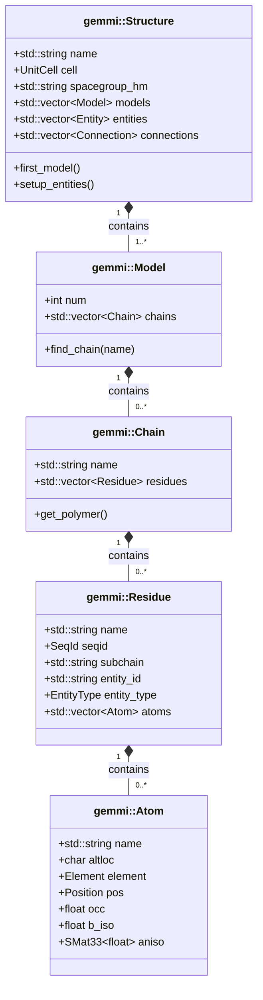
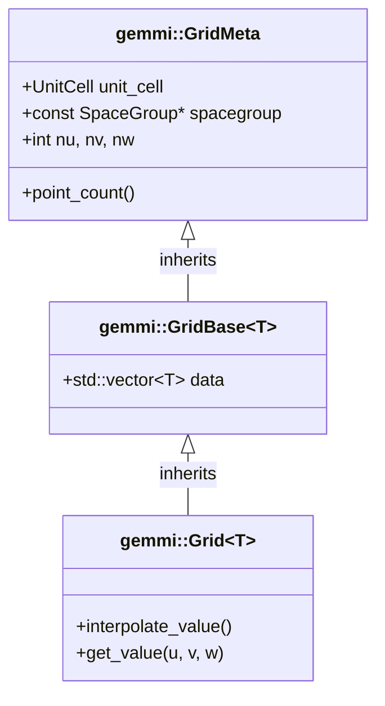
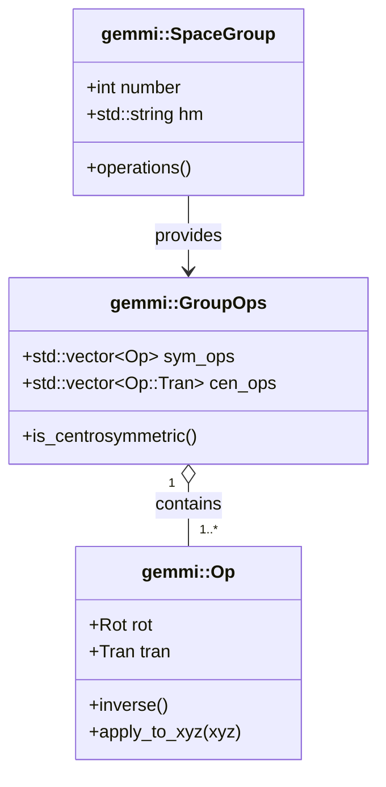
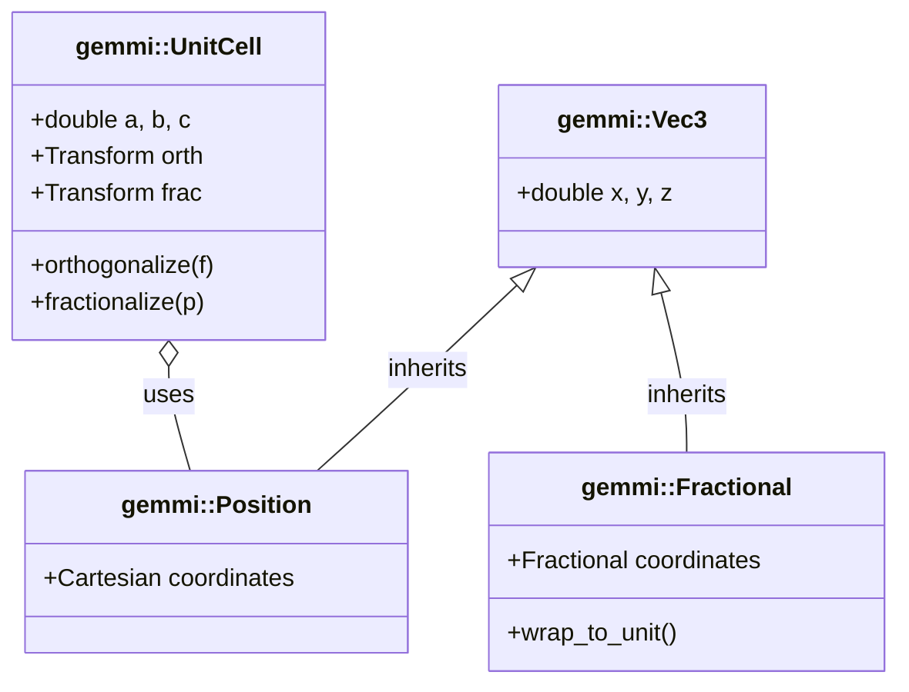

# Core Data Structures

Relevant source files

The following files were used as context for generating this wiki page:

- [docs/code/sym.cpp](docs/code/sym.cpp)
- [docs/mol.rst](docs/mol.rst)
- [docs/symmetry.rst](docs/symmetry.rst)
- [include/gemmi/calculate.hpp](include/gemmi/calculate.hpp)
- [include/gemmi/cellred.hpp](include/gemmi/cellred.hpp)
- [include/gemmi/floodfill.hpp](include/gemmi/floodfill.hpp)
- [include/gemmi/math.hpp](include/gemmi/math.hpp)
- [include/gemmi/mmcif.hpp](include/gemmi/mmcif.hpp)
- [include/gemmi/model.hpp](include/gemmi/model.hpp)
- [include/gemmi/pdb.hpp](include/gemmi/pdb.hpp)
- [include/gemmi/symmetry.hpp](include/gemmi/symmetry.hpp)
- [include/gemmi/to_mmcif.hpp](include/gemmi/to_mmcif.hpp)
- [include/gemmi/to_pdb.hpp](include/gemmi/to_pdb.hpp)
- [include/gemmi/twin.hpp](include/gemmi/twin.hpp)
- [include/gemmi/unitcell.hpp](include/gemmi/unitcell.hpp)
- [prog/sg.cpp](prog/sg.cpp)
- [python/mol.cpp](python/mol.cpp)
- [python/sym.cpp](python/sym.cpp)
- [python/unitcell.cpp](python/unitcell.cpp)
- [src/calculate.cpp](src/calculate.cpp)
- [src/symmetry.cpp](src/symmetry.cpp)
- [tests/main.cpp](tests/main.cpp)
- [tests/test_mol.py](tests/test_mol.py)
- [tests/test_symmetry.py](tests/test_symmetry.py)
- [tests/test_twin.py](tests/test_twin.py)
- [tests/test_unitcell.py](tests/test_unitcell.py)

This document provides an overview of the fundamental data structures in the Gemmi library, which forms the backbone of its crystallographic computing capabilities. These core data structures include macromolecular model representations, grid systems for volumetric data, crystallographic symmetry operations, and unit cell definitions.

## Structure Hierarchy

Gemmi uses a hierarchical organization for macromolecular structures that follows the standard PDB hierarchy.

The hierarchy starts with `Structure`, which contains multiple `Model` instances. Each `Model` contains `Chain` objects, each `Chain` contains `Residue` objects, and each `Residue` contains `Atom` objects. For details, see [Structure and Model System](#3.1).

### Structure
The top-level container representing a macromolecular structure [include/gemmi/model.hpp:882-1056](). It holds global information such as the unit cell, space group, and entity information.

### Model
Represents a single conformation of the structure [include/gemmi/model.hpp:718-868](). Multi-model files are common in NMR or ensembles.

### Chain
Represents a polymer chain, ligand, or water molecules [include/gemmi/model.hpp:482-610]().

### Residue
An amino acid, nucleotide, or ligand [include/gemmi/model.hpp:183-288](). It contains metadata like `entity_id` and `label_seq`.

### Atom
The basic unit containing coordinates (`pos`), occupancy (`occ`), and thermal parameters (`b_iso`, `aniso`) [include/gemmi/model.hpp:119-164]().

**Sources:** [include/gemmi/model.hpp:119-1056](), [docs/mol.rst:1-100]()

## Grid System

Gemmi's grid system handles 3D volumetric data such as electron density maps and masks.

The system is built on `GridMeta` (metadata), `GridBase` (data storage), and `Grid` (interpolation and logic). For details, see [Grid and Map System](#3.2).

**Sources:** [include/gemmi/grid.hpp:168-550]()

## Symmetry System

The symmetry system represents crystallographic symmetry operations and space groups.

### Op
Represents a symmetry operation using an integer rotation matrix and translation vector with a fixed denominator `DEN=24` [include/gemmi/symmetry.hpp:30-216]().

### GroupOps
A collection of `Op` objects representing a symmetry group [include/gemmi/symmetry.hpp:254-478]().

### SpaceGroup
High-level representation of a space group including symbols and lookup tables [include/gemmi/symmetry.hpp:1089-1184](). For details, see [Symmetry Operations](#3.3).

**Sources:** [include/gemmi/symmetry.hpp:30-1184](), [python/sym.cpp:15-150]()

## Unit Cell and Coordinates

Gemmi provides primitives for handling unit cell parameters and coordinate transformations.

### UnitCell
Stores cell parameters and pre-calculated `Transform` matrices for converting between `Position` (orthogonal) and `Fractional` coordinates [include/gemmi/unitcell.hpp:165-374](). For details, see [Unit Cell and Coordinate Transformations](#3.4).

**Sources:** [include/gemmi/unitcell.hpp:32-374](), [include/gemmi/math.hpp:142-489]()

## Reflection Data

Reflection data is handled primarily through the `Mtz` class for binary files and `AsuData` for organized reciprocal space data. For details, see [Reflection Data](#3.5).

**Sources:** [include/gemmi/model.hpp:27-28](), [python/unitcell.cpp:103-180]()

---