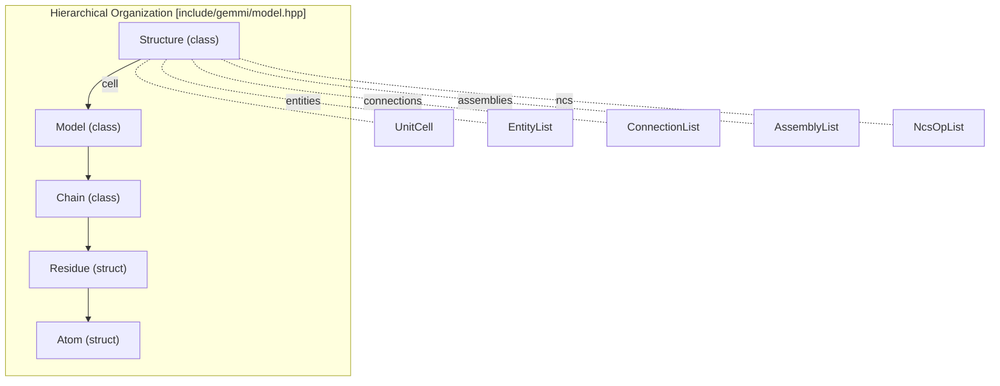
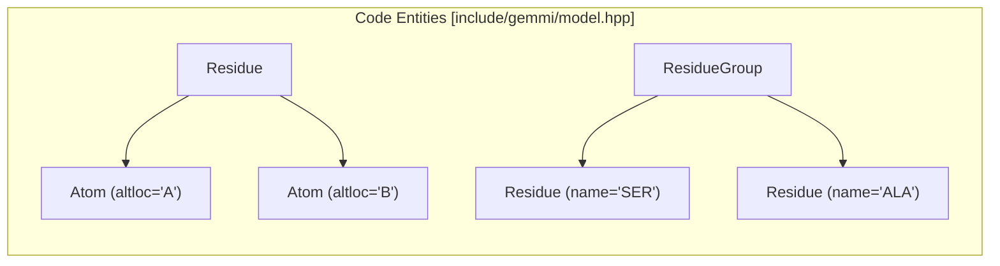
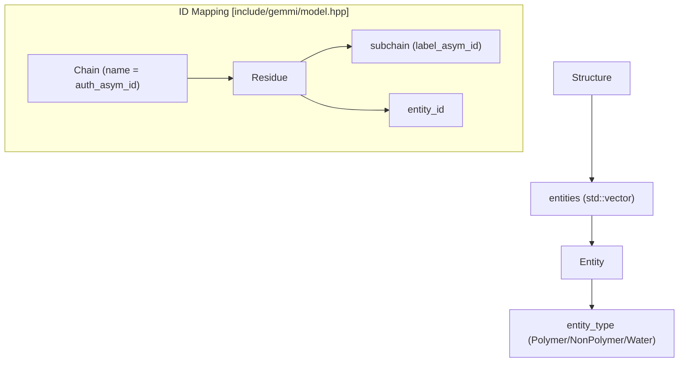

# Structure and Model System

Relevant source files

The following files were used as context for generating this wiki page:

- [docs/mol.rst](docs/mol.rst)
- [include/gemmi/iterator.hpp](include/gemmi/iterator.hpp)
- [include/gemmi/metadata.hpp](include/gemmi/metadata.hpp)
- [include/gemmi/mmcif.hpp](include/gemmi/mmcif.hpp)
- [include/gemmi/model.hpp](include/gemmi/model.hpp)
- [include/gemmi/pdb.hpp](include/gemmi/pdb.hpp)
- [include/gemmi/select.hpp](include/gemmi/select.hpp)
- [include/gemmi/seqid.hpp](include/gemmi/seqid.hpp)
- [include/gemmi/serialize.hpp](include/gemmi/serialize.hpp)
- [include/gemmi/span.hpp](include/gemmi/span.hpp)
- [include/gemmi/to_mmcif.hpp](include/gemmi/to_mmcif.hpp)
- [include/gemmi/to_pdb.hpp](include/gemmi/to_pdb.hpp)
- [python/meta.cpp](python/meta.cpp)
- [python/meta.h](python/meta.h)
- [python/mol.cpp](python/mol.cpp)
- [src/mmcif.cpp](src/mmcif.cpp)
- [src/pdb.cpp](src/pdb.cpp)
- [src/select.cpp](src/select.cpp)
- [src/to_mmcif.cpp](src/to_mmcif.cpp)
- [tests/test_misc.py](tests/test_misc.py)
- [tests/test_mol.py](tests/test_mol.py)
- [tools/check_serialize.py](tools/check_serialize.py)

The Structure and Model System is the core component of Gemmi that represents macromolecular structures in memory. It provides a comprehensive, hierarchical data model for working with structural biology data, including proteins, nucleic acids, ligands, and solvent molecules.

## Structure Hierarchy Overview

The Structure and Model System is organized as a hierarchical data structure that reflects the standard organization of macromolecular structures:

### Data Entity Hierarchy

Sources: [include/gemmi/model.hpp:136-1056](), [docs/mol.rst:1-27]()

This hierarchy mirrors the organization used in the PDB and mmCIF formats:

1.  **Structure**: The top-level container ([include/gemmi/model.hpp:883]()) representing a complete macromolecular structure.
2.  **Model**: Alternative models (e.g., NMR ensembles) ([include/gemmi/model.hpp:718]()).
3.  **Chain**: Distinct polymer chains or groups of water molecules ([include/gemmi/model.hpp:482]()).
4.  **Residue**: Individual residues or chemical components ([include/gemmi/model.hpp:200]()).
5.  **Atom**: Individual atoms with coordinates and properties ([include/gemmi/model.hpp:136]()).

## Alternative Conformations and Microheterogeneities

Gemmi handles alternative atom locations and microheterogeneities (point mutations) through the `altloc` field and specialized proxy objects.

### Conformer Logic

Sources: [include/gemmi/model.hpp:136-164](), [include/gemmi/model.hpp:423-440](), [docs/mol.rst:69-100]()

Gemmi provides three primary ways to handle these:
1.  **Manual Handling**: Access the `altloc` field directly in the `Atom` struct [include/gemmi/model.hpp:139]().
2.  **Filtering**: Use `remove_alternative_conformations()` to strip all but the first conformer [python/mol.cpp:5]().
3.  **Grouping**: Use `ResidueGroup` and `AtomGroup` proxy objects to iterate over sets of alternatives [include/gemmi/model.hpp:183-197]().

## Key Classes and Implementation

### Structure
The `Structure` class is the root container. It manages global metadata and structural data.
*   **Space Group & Cell**: Stores `UnitCell` and `SpaceGroup` info [include/gemmi/model.hpp:886-887]().
*   **Entities**: Managed via `entities` (vector of `Entity`) [include/gemmi/model.hpp:891]().
*   **Models**: Stored in a `std::vector<Model>` [include/gemmi/model.hpp:905]().

### Model
A `Model` represents one coordinate set.
*   **Subchains**: Implements `get_subchain()` to find residues by `label_asym_id` [include/gemmi/model.hpp:753]().
*   **Global Iteration**: `all()` returns a proxy for iterating over all atoms as `CRA` (Chain-Residue-Atom) triples [include/gemmi/model.hpp:852]().

### Residue
The `Residue` struct inherits from `ResidueId` [include/gemmi/model.hpp:200]().
*   **Metadata**: Stores `subchain` (`label_asym_id`), `entity_id`, and `label_seq` [include/gemmi/model.hpp:204-206]().
*   **Atoms**: Contains a `std::vector<Atom>` [include/gemmi/model.hpp:214]().

### Atom
The `Atom` struct is the leaf node [include/gemmi/model.hpp:136]().
*   **Properties**: Includes `pos` (`Position`), `occ` (occupancy), `b_iso`, and `aniso` (`SMat33<float>`) [include/gemmi/model.hpp:147-151]().
*   **Charge**: Stored as a `signed char` [include/gemmi/model.hpp:140]().

## Subchain and Entity System

Gemmi distinguishes between `auth_asym_id` (traditional PDB Chain ID) and `label_asym_id` (mmCIF Subchain ID).

Sources: [include/gemmi/model.hpp:467-480](), [include/gemmi/metadata.hpp:127-142](), [docs/mol.rst:15-27]()

The `setup_entities()` function is critical for populating these relationships from files that lack explicit entity categories [docs/mol.rst:151-164]().

## Selection and Navigation

The system supports complex selections via the `Selection` class [python/mol.cpp:84]().

### CRA (Chain-Residue-Atom)
The `CRA` struct provides a pointer-based reference to a specific atom within the hierarchy, allowing for efficient navigation without searching [python/mol.cpp:115-127]().

### Sequence ID (SeqId)
`SeqId` handles residue numbering, including insertion codes [include/gemmi/seqid.hpp](). It supports string parsing (e.g., "10A") and comparison [python/meta.cpp:28-44]().

## File I/O Integration

The model system is closely integrated with PDB and mmCIF parsers.

| Format | Reader Function | File Reference |
| :--- | :--- | :--- |
| **PDB** | `read_pdb_file()` | [include/gemmi/pdb.hpp:62]() |
| **mmCIF** | `make_structure_from_block()` | [include/gemmi/mmcif.hpp:18]() |
| **CCD** | `make_residue_from_chemcomp_block()` | [include/gemmi/mmcif.hpp:49]() |

### Output Options
*   **PdbWriteOptions**: Controls `TER` records, `SSBOND`, and `LINK` records [include/gemmi/to_pdb.hpp:13-30]().
*   **MmcifOutputGroups**: Toggles specific mmCIF categories during serialization [include/gemmi/to_mmcif.hpp:13-57]().

## Common Operations

### Modification Functions
*   **Renumbering**: `renumber_models()` [include/gemmi/mmcif.hpp:74]().
*   **Merging**: `merge_chain_parts()` joins discontinuous chain segments [include/gemmi/model.hpp:948]().
*   **Cleaning**: `remove_empty_children()` prunes the hierarchy [include/gemmi/model.hpp:126]().

### Calculation Functions
*   **B-factors**: `b_eq()` calculates equivalent isotropic B-factors from anisotropic tensors [include/gemmi/model.hpp:163]().
*   **Mass**: `calculate_mass()` (via `calculate.hpp`) [python/mol.cpp:4]().

Sources: [include/gemmi/model.hpp](), [python/mol.cpp](), [docs/mol.rst](), [include/gemmi/metadata.hpp]().

---