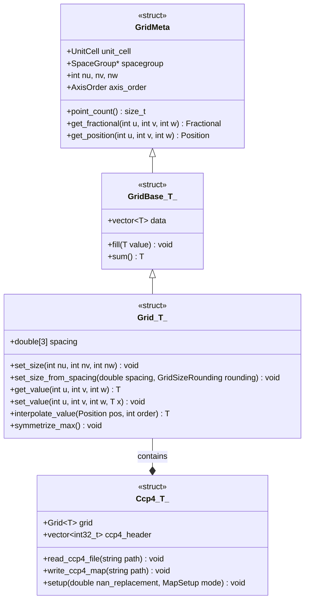
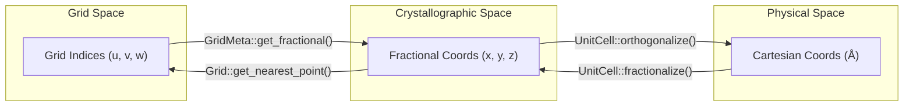

# Grid and Map System

Relevant source files

The following files were used as context for generating this wiki page:

- [docs/blobs-help.txt](docs/blobs-help.txt)
- [docs/grid.rst](docs/grid.rst)
- [docs/map-help.txt](docs/map-help.txt)
- [docs/mask-help.txt](docs/mask-help.txt)
- [docs/sf2map-help.txt](docs/sf2map-help.txt)
- [include/gemmi/blob.hpp](include/gemmi/blob.hpp)
- [include/gemmi/ccp4.hpp](include/gemmi/ccp4.hpp)
- [include/gemmi/dirwalk.hpp](include/gemmi/dirwalk.hpp)
- [include/gemmi/glob.hpp](include/gemmi/glob.hpp)
- [include/gemmi/grid.hpp](include/gemmi/grid.hpp)
- [include/gemmi/gz.hpp](include/gemmi/gz.hpp)
- [include/gemmi/input.hpp](include/gemmi/input.hpp)
- [include/gemmi/json.hpp](include/gemmi/json.hpp)
- [include/gemmi/solmask.hpp](include/gemmi/solmask.hpp)
- [include/gemmi/util.hpp](include/gemmi/util.hpp)
- [prog/blobs.cpp](prog/blobs.cpp)
- [prog/mask.cpp](prog/mask.cpp)
- [python/grid.cpp](python/grid.cpp)
- [src/gz.cpp](src/gz.cpp)
- [src/json.cpp](src/json.cpp)
- [tests/test_grid.py](tests/test_grid.py)
- [third_party/sajson.h](third_party/sajson.h)
- [tools/FindZLIB_NG.cmake](tools/FindZLIB_NG.cmake)

The Grid and Map System in Gemmi provides functionality for handling 3D volumetric data, particularly electron density maps used in macromolecular crystallography and cryo-EM. This system enables storage, manipulation, and analysis of grid-based data with support for crystallographic symmetry and unit cell transformations. For handling reflection data, see [3.5 Reflection Data]().

## Core Data Structures

The Grid and Map System is built on a hierarchy of classes that provide increasingly specialized functionality. The system uses a Fortran-style contiguous data layout where the first index (u) changes fastest [docs/grid.rst:22-24]().

### Grid Entity Hierarchy

The following diagram maps the logical concepts of the volumetric system to their specific C++ class implementations.

Title: Grid System Entity Mapping

Sources: [include/gemmi/grid.hpp:168-172](), [include/gemmi/grid.hpp:237-241](), [include/gemmi/grid.hpp:311-315](), [include/gemmi/ccp4.hpp:242-246]()

### GridMeta
`GridMeta` is the base struct containing essential grid metadata including the `UnitCell`, `SpaceGroup`, and dimensions `nu`, `nv`, `nw` [include/gemmi/grid.hpp:168-172](). It handles the mapping of grid indices to fractional and orthogonal space [include/gemmi/grid.hpp:175-182]().

### GridBase<T>
`GridBase<T>` extends `GridMeta` with a `std::vector<T>` for data storage [include/gemmi/grid.hpp:237-241](). It defines the `Point` helper class which bundles coordinates with a pointer to the value [include/gemmi/grid.hpp:244-252]().

### Grid<T>
`Grid<T>` is the primary class for density manipulation. It adds `spacing` (precalculated distance between grid planes) [include/gemmi/grid.hpp:313]() and complex operations like interpolation and symmetry handling.

### Ccp4<T>
`Ccp4<T>` encapsulates a `Grid<T>` and the raw `ccp4_header` words [include/gemmi/ccp4.hpp:242-246](). It provides the high-level API for reading and writing standard CCP4/MRC files [include/gemmi/ccp4.hpp:360-490]().

## Coordinate Systems and Transformations

The system bridges discrete grid indices with physical space using the `UnitCell` [include/gemmi/grid.hpp:15]().

Title: Coordinate Space Flow

Sources: [include/gemmi/grid.hpp:176-182](), [include/gemmi/grid.hpp:412-426]()

## Creating and Setting Up Grids

### Size Determination
Grids can be sized manually via `set_size()` or automatically via `set_size_from_spacing()` [include/gemmi/grid.hpp:352-384](). The latter uses `good_grid_size()` to ensure the dimensions are:
1. Compatible with the `SpaceGroup` symmetry factors [include/gemmi/grid.hpp:104-112]().
2. "FFT-friendly" by having small prime factors (2, 3, 5) [include/gemmi/grid.hpp:45-52]().
3. Equal for symmetry-related directions [include/gemmi/grid.hpp:90-101]().

### From a Structure
The `setup_from<Structure>` method initializes grid dimensions and unit cell parameters directly from a molecular model [include/gemmi/grid.hpp:341-350]().

## Data Manipulation and Interpolation

### Access Methods
*   **Wrapping Access**: `get_value(u, v, w)` and `set_value(u, v, w, x)` use `modulo` to handle periodic boundary conditions (PBC) automatically [include/gemmi/grid.hpp:387-401]().
*   **Fast Access**: `index_q(u, v, w)` provides the fastest index calculation but assumes the point is within the primary unit cell [include/gemmi/grid.hpp:209-211]().

### Interpolation
Gemmi supports multiple interpolation orders [include/gemmi/grid.hpp:437-440]():
1.  **Order 0**: Nearest neighbor.
2.  **Order 1**: Trilinear interpolation [include/gemmi/grid.hpp:445-468]().
3.  **Order 3**: Tricubic interpolation using Catmull–Rom splines for smoother density representation [include/gemmi/grid.hpp:470-554]().

## Symmetry Operations

The `Grid` class can enforce crystallographic symmetry across the volume. If a `SpaceGroup` is assigned, `symmetrize_max()`, `symmetrize_min()`, `symmetrize_avg()`, and `symmetrize_sum()` iterate through all symmetry-equivalent positions to harmonize values [include/gemmi/grid.hpp:719-781]().

## Solvent Masking and Blobs

### Solvent Masking
The `SolventMasker` and associated functions in `solmask.hpp` generate masks based on atomic coordinates [include/gemmi/solmask.hpp:1-12]().
*   **Atomic Radii**: Supports various sets including `VanDerWaals`, `Cctbx`, and `Refmac` [include/gemmi/solmask.hpp:14]().
*   **mask_points_in_radius**: Marks all grid points within a specific radius of atoms in a `Model` [include/gemmi/solmask.hpp:107-129]().

### Blob Detection
The `find_blobs_by_flood_fill` function identifies connected regions of density above a certain threshold [include/gemmi/blob.hpp:26](). It returns a vector of `Blob` objects containing the centroid, peak position, and volume [python/grid.cpp:26-27]().

## CCP4 Map Format Handling

The `Ccp4` class handles the binary I/O for the CCP4/MRC map format [include/gemmi/ccp4.hpp:3]().

| Feature | Description | Code Reference |
| :--- | :--- | :--- |
| **Modes** | Supports Mode 0 (int8), 1 (int16), 2 (float32), 6 (uint16), and 12 (float16) | [include/gemmi/ccp4.hpp:27-50](), [include/gemmi/ccp4.hpp:413-430]() |
| **Axis Order** | Supports reordering axes to XYZ (standard) or ZYX | [include/gemmi/ccp4.hpp:58-62](), [include/gemmi/ccp4.hpp:113-124]() |
| **Header** | Provides methods to read/write specific header words (e.g., `header_i32(1)` for NX) | [include/gemmi/ccp4.hpp:74-111]() |
| **Symmetry** | Reads/writes symmetry operations to the extended header | [include/gemmi/ccp4.hpp:193-195]() |

Sources: [include/gemmi/ccp4.hpp:242-490]()

## Python Integration

Gemmi exposes grid functionality to Python via `FloatGrid` (for density) and `Int8Grid` (for masks) [docs/grid.rst:36-38]().

*   **NumPy Integration**: The `array` property provides a zero-copy NumPy view of the grid data [python/grid.cpp:61-65]().
*   **Flexible Interpolation**: `interpolate_position_array` allows batch interpolation of coordinate arrays using NumPy [python/grid.cpp:173-181]().
*   **Isosurface Extraction**: `extract_isosurface` implements the Marching Cubes algorithm to generate mesh data from the grid [python/grid.cpp:24-25]().

Sources: [python/grid.cpp:43-162](), [python/grid.cpp:217-255](), [docs/grid.rst:108-122]()

---