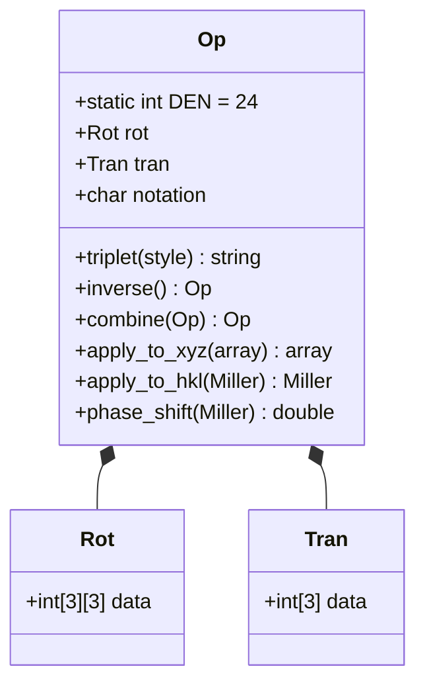
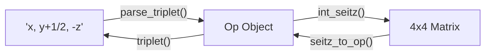
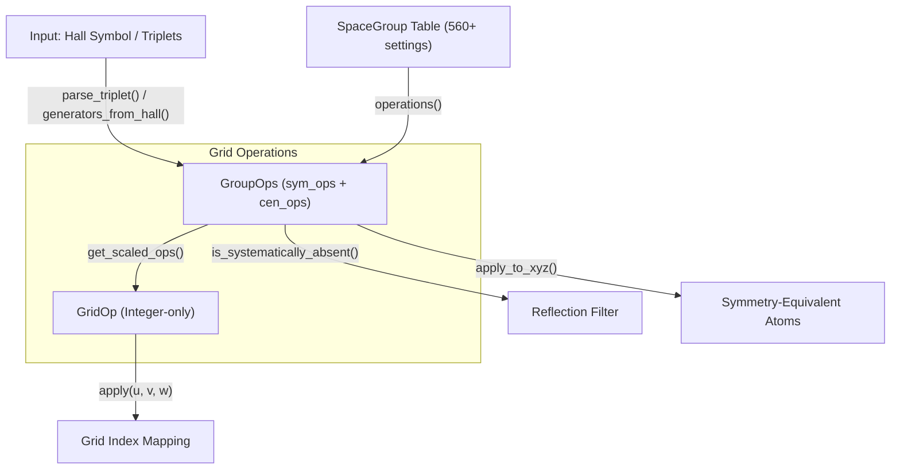

# Symmetry Operations

Relevant source files

The following files were used as context for generating this wiki page:

- [docs/code/sym.cpp](docs/code/sym.cpp)
- [docs/contents-help.txt](docs/contents-help.txt)
- [docs/sg-help.txt](docs/sg-help.txt)
- [docs/symmetry.rst](docs/symmetry.rst)
- [include/gemmi/asudata.hpp](include/gemmi/asudata.hpp)
- [include/gemmi/asumask.hpp](include/gemmi/asumask.hpp)
- [include/gemmi/atof.hpp](include/gemmi/atof.hpp)
- [include/gemmi/atox.hpp](include/gemmi/atox.hpp)
- [include/gemmi/recgrid.hpp](include/gemmi/recgrid.hpp)
- [include/gemmi/symmetry.hpp](include/gemmi/symmetry.hpp)
- [include/gemmi/third_party/pocketfft_hdronly.h](include/gemmi/third_party/pocketfft_hdronly.h)
- [python/recgrid.cpp](python/recgrid.cpp)
- [python/sym.cpp](python/sym.cpp)
- [src/symmetry.cpp](src/symmetry.cpp)
- [tests/test_symmetry.py](tests/test_symmetry.py)

This page covers crystallographic symmetry operations in the Gemmi library, explaining their representation, manipulation, and application. Symmetry operations define how coordinates and Miller indices transform in a crystal.

## 1. Symmetry Representation: The Op Class

Gemmi represents a single symmetry operation (or a change-of-basis transformation) using the `Op` struct. It consists of a $3 \times 3$ rotation matrix and a translation vector.

### Internal Data Structure
To avoid floating-point issues, Gemmi uses integer arithmetic with a fixed denominator `DEN = 24`. This denominator is chosen because it is a multiple of 2, 3, 4, 6, 8, and 12, allowing exact representation of all standard crystallographic translations and change-of-basis operations [include/gemmi/symmetry.hpp:31-33]().

- **`rot`**: A $3 \times 3$ array of integers. The actual rotation matrix is $rot / DEN$ [include/gemmi/symmetry.hpp:35]().
- **`tran`**: An array of 3 integers. The actual translation is $tran / DEN$ [include/gemmi/symmetry.hpp:36]().
- **`notation`**: A flag identifying the coordinate system. `'x'` denotes real space (XYZ), while `'h'` denotes reciprocal space (HKL) [include/gemmi/symmetry.hpp:37-39]().

Sources: [include/gemmi/symmetry.hpp:30-46](), [python/sym.cpp:25-46]()

## 2. Parsing and Generation

Symmetry operations are most commonly instantiated from coordinate triplets or Seitz matrices.

### Coordinate Triplets
The `parse_triplet` function converts strings like `"x, y+1/2, -z"` into an `Op` object [include/gemmi/symmetry.hpp:109-129](). It handles:
- Fractions (e.g., `1/2`, `2/3`).
- Decimal fractions found in some CIF files (e.g., `0.5-x`) [src/symmetry.cpp:59-65]().
- Different notations: `x,y,z`, `h,k,l`, or `a,b,c` [src/symmetry.cpp:180-188]().

### Seitz Matrices
Gemmi can convert to and from 4x4 Seitz matrices, which combine rotation and translation into a single affine transformation matrix [include/gemmi/symmetry.hpp:159-174]().

Sources: [src/symmetry.cpp:20-129](), [include/gemmi/symmetry.hpp:159-174](), [python/sym.cpp:49-68]()

## 3. Group Operations: GroupOps

The `GroupOps` class represents a symmetry group, typically associated with a space group. It explicitly separates centering vectors from general symmetry operations to optimize calculations [include/gemmi/symmetry.hpp:254-260]().

### Class Structure
- **`sym_ops`**: A vector of `Op` objects representing the site-symmetry operations [include/gemmi/symmetry.hpp:261]().
- **`cen_ops`**: A vector of `Tran` (integer triplets) representing lattice centering (e.g., $(1/2, 1/2, 1/2)$ for I-centering) [include/gemmi/symmetry.hpp:262]().

### Key Group Functions
| Function | Description |
| :--- | :--- |
| `order()` | Returns the total number of operations ($sym\_ops.size() \times cen\_ops.size()$) [include/gemmi/symmetry.hpp:269](). |
| `is_centrosymmetric()` | Checks if the group contains an inversion center [include/gemmi/symmetry.hpp:309](). |
| `is_systematically_absent(hkl)` | Determines if a reflection is absent due to glide planes or screw axes [include/gemmi/symmetry.hpp:371](). |
| `epsilon_factor(hkl)` | Calculates the epsilon factor (statistical weight) for a reflection [include/gemmi/symmetry.hpp:359](). |

Sources: [include/gemmi/symmetry.hpp:254-389](), [python/sym.cpp:94-139]()

## 4. Space Groups and Hall Symbols

Gemmi includes an extensive table of space group settings (560+ entries) derived from CCP4's `syminfo.lib` and `sgtbx` [docs/symmetry.rst:9-26]().

### SpaceGroup Lookup
Space groups can be retrieved by:
1. **Name/H-M Symbol**: `find_spacegroup_by_name("P 21 21 21")` [docs/symmetry.rst:60-71]().
2. **Number**: `find_spacegroup_by_number(19)` [docs/symmetry.rst:128-133]().
3. **Operations**: `find_spacegroup_by_ops(group_ops)` [docs/symmetry.rst:161-165]().

### Hall Symbols
Hall symbols provide a concise, unambiguous way to generate all symmetry operations of a group. Gemmi uses `generators_from_hall` to parse these symbols into `GroupOps` [include/gemmi/symmetry.hpp:510-520]().

Sources: [docs/symmetry.rst:6-187](), [include/gemmi/symmetry.hpp:477-510]()

## 5. Reciprocal Space Operations

### Reciprocal ASU (Asymmetric Unit)
The `ReciprocalAsu` class defines the boundaries of the asymmetric unit in reciprocal space. It is used to reduce any Miller index $H$ to its representative index $H_{asu}$ in the primary ASU [include/gemmi/symmetry.hpp:713-720]().

- **`is_in(hkl)`**: Checks if a reflection is within the ASU [include/gemmi/symmetry.hpp:725]().
- **`to_asu(hkl, gops)`**: Returns the representative HKL and the symmetry operation index used to reach it [include/gemmi/symmetry.hpp:734]().

### Phase Shifts and Twinning
When a symmetry operation is applied to a reflection, it may introduce a phase shift $\Delta\phi = -2\pi (h \cdot t)$ [include/gemmi/symmetry.hpp:154-157]().
For twinning, Gemmi provides `Twinning` structures to handle twin laws (symmetry operations relating different domains) and calculate twin fractions [include/gemmi/symmetry.hpp:814-830]().

Sources: [include/gemmi/symmetry.hpp:713-810](), [include/gemmi/asudata.hpp:156-168]()

## 6. Implementation and Data Flow

The following diagram illustrates how symmetry data flows from raw input (triplets/symbols) to the application on structural data.

Sources: [include/gemmi/symmetry.hpp:254-308](), [include/gemmi/asumask.hpp:83-107](), [docs/symmetry.rst:55-71]()

---