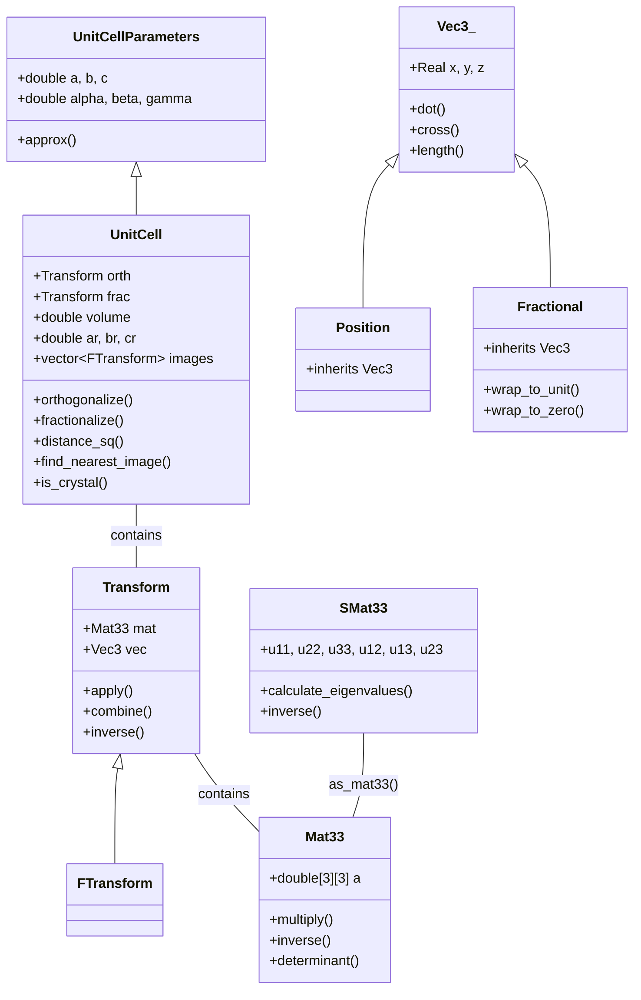
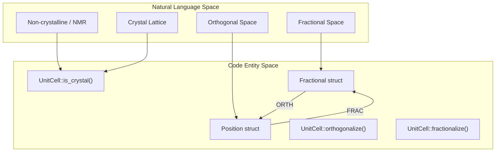

# Unit Cell and Coordinate Transformations

<details>
<summary>Relevant source files</summary>

The following files were used as context for generating this wiki page:

- [include/gemmi/c4322.hpp](include/gemmi/c4322.hpp)
- [include/gemmi/calculate.hpp](include/gemmi/calculate.hpp)
- [include/gemmi/cellred.hpp](include/gemmi/cellred.hpp)
- [include/gemmi/elem.hpp](include/gemmi/elem.hpp)
- [include/gemmi/floodfill.hpp](include/gemmi/floodfill.hpp)
- [include/gemmi/formfact.hpp](include/gemmi/formfact.hpp)
- [include/gemmi/it92.hpp](include/gemmi/it92.hpp)
- [include/gemmi/math.hpp](include/gemmi/math.hpp)
- [include/gemmi/resinfo.hpp](include/gemmi/resinfo.hpp)
- [include/gemmi/seqtools.hpp](include/gemmi/seqtools.hpp)
- [include/gemmi/twin.hpp](include/gemmi/twin.hpp)
- [include/gemmi/unitcell.hpp](include/gemmi/unitcell.hpp)
- [prog/sg.cpp](prog/sg.cpp)
- [python/elem.cpp](python/elem.cpp)
- [python/unitcell.cpp](python/unitcell.cpp)
- [src/calculate.cpp](src/calculate.cpp)
- [src/resinfo.cpp](src/resinfo.cpp)
- [tests/main.cpp](tests/main.cpp)
- [tests/test_elem.py](tests/test_elem.py)
- [tests/test_sf.py](tests/test_sf.py)
- [tests/test_twin.py](tests/test_twin.py)
- [tests/test_unitcell.py](tests/test_unitcell.py)
- [tools/resinfo.py](tools/resinfo.py)

</details>


This page documents the fundamental components within GEMMI for working with unit cells and coordinate transformations in crystallography. It covers the representation of unit cells, conversion between coordinate systems, distance calculations with periodic boundary conditions, lattice reduction, and mathematical primitives.

## Core Concepts and Class Architecture

In crystallography, a unit cell is defined by its parameters (lengths a, b, c and angles α, β, γ) and provides the foundation for crystal structure representation. GEMMI implements this through the `UnitCell` class and related coordinate systems.



Sources: [include/gemmi/unitcell.hpp:137-165](), [include/gemmi/unitcell.hpp:32-45](), [include/gemmi/unitcell.hpp:50-74](), [include/gemmi/math.hpp:58-114](), [include/gemmi/math.hpp:130-245](), [include/gemmi/math.hpp:393-420](), [include/gemmi/math.hpp:422-550]()

## Mathematical Primitives

GEMMI relies on several low-level mathematical structures for 3D linear algebra:

*   **`Vec3` / `Vec3f`**: Template-based 3D vectors (double and float versions). Includes standard operations like `dot()`, `cross()`, and `length()`. [include/gemmi/math.hpp:58-118]()
*   **`Mat33`**: A 3x3 matrix primarily used for rotation and orthogonalization. Supports matrix multiplication (`multiply()`), inversion (`inverse()`), and determinant calculation. [include/gemmi/math.hpp:130-245]()
*   **`SMat33`**: A symmetric 3x3 matrix, efficient for storing Atomic Displacement Parameters (ADPs) or metric tensors. It provides `calculate_eigenvalues()` using a closed-form solution for 3x3 symmetric matrices. [include/gemmi/math.hpp:422-550]()
*   **`Transform`**: Combines a `Mat33` (rotation/scaling) and a `Vec3` (translation). [include/gemmi/math.hpp:393-420]()

Sources: [include/gemmi/math.hpp:58-550]()

## Coordinate Systems

Crystallography uses two primary coordinate systems represented by specialized classes inheriting from `Vec3`:

1.  **Fractional Coordinates** (`Fractional` class): Positions expressed as fractions of unit cell dimensions. Includes utility methods like `wrap_to_unit()` (shifts coordinates into the [0, 1) range). [include/gemmi/unitcell.hpp:50-74]()
2.  **Orthogonal Coordinates** (`Position` class): Cartesian coordinates in Ångstroms. [include/gemmi/unitcell.hpp:32-45]()



Sources: [include/gemmi/unitcell.hpp:32-74](), [include/gemmi/unitcell.hpp:187-187](), [include/gemmi/unitcell.hpp:391-407]()

## Unit Cell Initialization and Properties

A `UnitCell` is initialized with six parameters: $a, b, c, \alpha, \beta, \gamma$. [include/gemmi/unitcell.hpp:167-171]()

| Property | Description | Implementation |
| :--- | :--- | :--- |
| `volume` | Unit cell volume in ų | [include/gemmi/unitcell.hpp:208-211]() |
| `orth` | Orthogonalization `Transform` | [include/gemmi/unitcell.hpp:232-234]() |
| `frac` | Fractionalization `Transform` | [include/gemmi/unitcell.hpp:241-243]() |
| `ar, br, cr` | Reciprocal cell dimensions $a^*, b^*, c^*$ | [include/gemmi/unitcell.hpp:214-216]() |
| `is_crystal()` | Checks if cell is not a dummy 1x1x1 cell | [include/gemmi/unitcell.hpp:187-187]() |

The orthogonalization follows the Niggli-it (or PDB) convention where the $a$-axis is collinear with the Cartesian $x$-axis. [include/gemmi/unitcell.hpp:223-234]()

Sources: [include/gemmi/unitcell.hpp:165-245]()

## Periodic Boundary Conditions and Nearest Images

GEMMI handles the periodic nature of crystals through "minimum image" conventions.

*   **`distance_sq(pos1, pos2)`**: Calculates the squared distance between two points, accounting for periodic boundary conditions by finding the closest periodic image. [include/gemmi/unitcell.hpp:433-439]()
*   **`find_nearest_image()`**: Returns a `NearestImage` object containing the shortest distance, the symmetry operation used, and the periodic shift ($n_a, n_b, n_c$). [include/gemmi/unitcell.hpp:446-508]()
*   **`wrap_to_unit()`**: Shifts a `Fractional` coordinate by integers so that $0 \le x, y, z < 1$. [include/gemmi/unitcell.hpp:60-62]()

### NearestImage Structure
```cpp
struct NearestImage {
  double dist_sq;
  int pbc_shift[3]; // integer shifts along cell axes
  int sym_idx;      // index into UnitCell::images
  std::string symmetry_code(bool underscore); // e.g., "1_555"
};
```
Sources: [include/gemmi/unitcell.hpp:79-108](), [include/gemmi/unitcell.hpp:446-508]()

## Lattice Reduction and Twinning

GEMMI includes tools for lattice analysis, primarily located in `cellred.hpp` and `twin.hpp`.

*   **Niggli Reduction**: Implemented via `NiggliReduction` (referenced in `cellred.hpp`) to find a unique, standardized primitive cell. [include/gemmi/cellred.hpp:1-15]()
*   **Selling-Delaunay Reduction**: Used for lattice characterization.
*   **Twinning**: `find_lattice_2fold_ops()` identifies potential twin laws by searching for 2-fold operations that approximately map the lattice to itself within a given `max_obliq` (obliquity) tolerance. [include/gemmi/twin.hpp:147-150]()

Sources: [include/gemmi/twin.hpp:147-153](), [include/gemmi/cellred.hpp:1-15]()

## Miller Indices and Resolution

The `UnitCell` class maps Miller indices ($h, k, l$) to reciprocal space distances:

*   **`calculate_1_d2(hkl)`**: Calculates $1/d^2 = 4(\sin \theta / \lambda)^2$. [include/gemmi/unitcell.hpp:565-573]()
*   **`calculate_d(hkl)`**: Calculates the resolution $d$ in Ångstroms. [include/gemmi/unitcell.hpp:575-578]()
*   **`get_hkl_limits(dmin)`**: Returns the maximum $h, k, l$ indices possible for a given resolution limit. [include/gemmi/unitcell.hpp:600-607]()

Sources: [include/gemmi/unitcell.hpp:565-607]()

## Python Bindings

The Python API exposes these mathematical primitives and unit cell operations with NumPy integration.

```python
import gemmi
import numpy as np

cell = gemmi.UnitCell(50, 60, 70, 90, 90, 90)
# Convert to numpy array
mat = np.array(cell.orth.mat) 

# Distance with PBC
d2 = cell.distance_sq(gemmi.Position(1,1,1), gemmi.Position(49,59,69))
```

Sources: [python/unitcell.cpp:103-183](), [python/unitcell.cpp:259-341]()

---