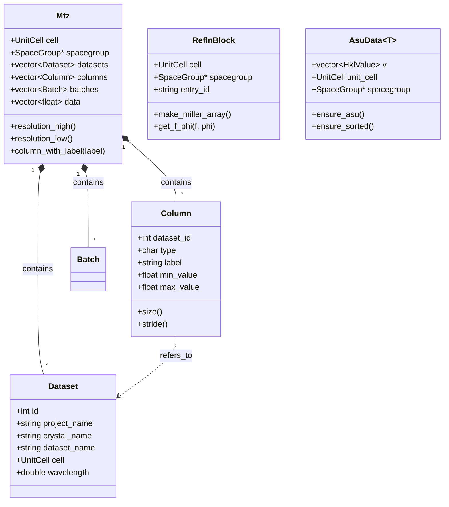
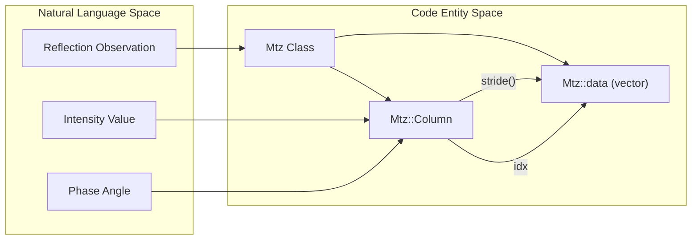

# Reflection Data

Relevant source files

The following files were used as context for generating this wiki page:

- [docs/ecalc-help.txt](docs/ecalc-help.txt)
- [docs/hkl.rst](docs/hkl.rst)
- [docs/mtz-help.txt](docs/mtz-help.txt)
- [include/gemmi/asudata.hpp](include/gemmi/asudata.hpp)
- [include/gemmi/binner.hpp](include/gemmi/binner.hpp)
- [include/gemmi/ecalc.hpp](include/gemmi/ecalc.hpp)
- [include/gemmi/fourier.hpp](include/gemmi/fourier.hpp)
- [include/gemmi/mtz.hpp](include/gemmi/mtz.hpp)
- [include/gemmi/recgrid.hpp](include/gemmi/recgrid.hpp)
- [include/gemmi/stats.hpp](include/gemmi/stats.hpp)
- [prog/ecalc.cpp](prog/ecalc.cpp)
- [prog/mtz.cpp](prog/mtz.cpp)
- [python/hkl.cpp](python/hkl.cpp)
- [python/mtz.cpp](python/mtz.cpp)
- [python/recgrid.cpp](python/recgrid.cpp)
- [src/mtz.cpp](src/mtz.cpp)
- [tests/test_hkl.py](tests/test_hkl.py)
- [tools/gen_reciprocal_asu.py](tools/gen_reciprocal_asu.py)

This page documents the crystallographic reflection data handling in the Gemmi library. Reflection data contains Miller indices ($h,k,l$) with associated values, including experimental measurements like intensities and their error estimates, as well as derived quantities used throughout crystallographic computing.

## Supported File Formats

Gemmi supports four primary reflection file formats:

1.  **MTZ files**: The standard binary format in macromolecular crystallography. [docs/hkl.rst:9-9]()
2.  **Structure factor mmCIF files**: Used for data archiving in the Protein Data Bank (PDB). [docs/hkl.rst:10-11]()
3.  **XDS ASCII format**: Output from the XDS image processing software. [docs/hkl.rst:12-12]()
4.  **Small molecule CIF files**: Usually with the `.hkl` extension. [docs/hkl.rst:13-13]()

## Core Data Classes

The following diagram bridges the natural language concepts of reflection data to the specific C++ classes and Python entities used in the codebase.

### Code Entity Space: Reflection Handling

Sources: [include/gemmi/mtz.hpp:71-126](), [include/gemmi/asudata.hpp:139-154](), [python/hkl.cpp:79-88]()

## MTZ Data Structure

The `Mtz` class represents the MTZ format, which stores all numbers as 32-bit floats. [docs/hkl.rst:28-29]()

### Hierarchical Organization
MTZ files organize columns into a hierarchy: **Project -> Crystal -> Dataset -> Column**. [docs/hkl.rst:37-37](). In Gemmi, this is flattened for easier access:
*   `Mtz::columns` is a flat list of all data columns. [docs/hkl.rst:40-40]()
*   `Mtz::datasets` is a list of datasets containing metadata (cell, wavelength). [docs/hkl.rst:40-41]()
*   Each `Column` object maintains a `dataset_id` to link back to its parent dataset. [include/gemmi/mtz.hpp:82-82]()

### Data Access Flow

Sources: [include/gemmi/mtz.hpp:171-175](), [include/gemmi/mtz.hpp:94-97]()

### Unmerged Data and Batches
Unmerged MTZ files contain multiple observations per reflection. The `Batch` struct stores metadata for individual diffraction images, including the orientation matrix (U) and goniostat scan axes. [include/gemmi/mtz.hpp:128-169]()
*   `M/ISYM` column: Encodes the symmetry operation used to move the reflection into the ASU. [include/gemmi/mtz.hpp:27-28]()
*   `UnmergedHklMover`: A helper struct to manage HKL indices in unmerged files. [include/gemmi/mtz.hpp:29-45]()

## AsuData and ReflnBlock

While `Mtz` is format-specific, `AsuData` and `ReflnBlock` provide more abstract ways to handle reflections.

### AsuData
`AsuData<T>` is a container for Miller indices paired with values of type `T` (e.g., `float`, `complex<float>`, or `ValueSigma`). [include/gemmi/asudata.hpp:139-140]()
*   **ensure_asu()**: Moves all reflections into the reciprocal asymmetric unit using symmetry operations. [include/gemmi/asudata.hpp:156-168]()
*   **ensure_sorted()**: Sorts reflections by Miller indices ($h < k < l$). [include/gemmi/asudata.hpp:151-154]()

### ReflnBlock (mmCIF)
The `ReflnBlock` class is used for mmCIF structure factors. It provides methods to extract data as NumPy-compatible arrays. [python/hkl.cpp:79-105]()
*   `make_miller_array()`: Returns an $N \times 3$ array of $h,k,l$ indices. [python/hkl.cpp:97-99]()
*   `make_d_array()`: Calculates $d$-spacings for all reflections. [python/hkl.cpp:103-105]()

## Fourier Transforms and Grids

Gemmi facilitates the transformation between reciprocal space (reflections) and real space (density maps) using Fast Fourier Transforms (FFT).

### FFT Pipeline
1.  **get_size_for_hkl()**: Determines the optimal grid size based on the maximum Miller indices and desired sample rate. [include/gemmi/fourier.hpp:48-74]()
2.  **get_f_phi_on_grid()**: Maps $F$ (amplitude) and $\phi$ (phase) values onto a `ReciprocalGrid`. [include/gemmi/fourier.hpp:170-172]()
3.  **transform_f_phi_grid_to_map()**: Performs the inverse FFT to produce a real-space grid. [python/hkl.cpp:135-151]()

### Grid Axis Order
Gemmi supports different axis orders for grids, typically `XYZ` or `ZYX`. [include/gemmi/fourier.hpp:142-148](). The `half_l` parameter is used for Hermitian symmetry in FFTs, storing only $l \ge 0$ to save space. [include/gemmi/fourier.hpp:167-168]()

Sources: [include/gemmi/fourier.hpp:131-150](), [python/hkl.cpp:115-134]()

## Merging Statistics and Binning

### Resolution Binning
The `Binner` class divides reflections into resolution shells (bins). [include/gemmi/binner.hpp:14-14]()
*   **Methods**: Supports `EqualCount` (equal number of reflections per bin) or spacing based on $d^*$, $(d^*)^2$, or $(d^*)^3$. [include/gemmi/binner.hpp:15-20]()
*   **setup()**: Initializes bin limits based on the unit cell and reflection data. [include/gemmi/binner.hpp:87-99]()

### Statistics
Gemmi provides utilities for calculating correlations between reflection datasets:
*   `calculate_hkl_value_correlation()`: Correlation between scalar values (e.g., intensities). [include/gemmi/asudata.hpp:66-73]()
*   `calculate_hkl_complex_correlation()`: Correlation between complex structure factors. [include/gemmi/asudata.hpp:77-84]()

Sources: [include/gemmi/binner.hpp:22-85](), [include/gemmi/asudata.hpp:17-41]()

## MTZ Operations

Gemmi includes several high-level operations for MTZ files:
*   **reindex()**: Applies a symmetry operator to change the indexing of the reflections and updates the unit cell/space group. [src/mtz.cpp:476-476]()
*   **ensure_asu()**: Standardizes all reflections into the asymmetric unit, applying necessary phase shifts to complex columns like phases or Hendrickson-Lattman coefficients. [src/mtz.cpp:429-430]()
*   **expand_to_p1()**: Generates all symmetry-equivalent reflections, effectively converting the data to space group $P1$. [src/mtz.cpp:531-531]()

Sources: [src/mtz.cpp:429-572](), [include/gemmi/mtz.hpp:212-230]()

---