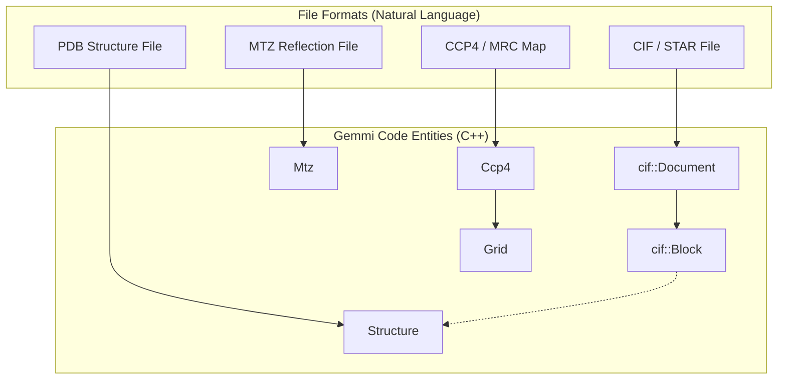
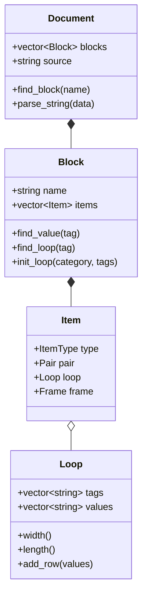

# File Formats and I/O

<details>
<summary>Relevant source files</summary>

The following files were used as context for generating this wiki page:

- [docs/cif.rst](docs/cif.rst)
- [docs/components.cif](docs/components.cif)
- [include/gemmi/ccp4.hpp](include/gemmi/ccp4.hpp)
- [include/gemmi/cifdoc.hpp](include/gemmi/cifdoc.hpp)
- [include/gemmi/dirwalk.hpp](include/gemmi/dirwalk.hpp)
- [include/gemmi/glob.hpp](include/gemmi/glob.hpp)
- [include/gemmi/gz.hpp](include/gemmi/gz.hpp)
- [include/gemmi/input.hpp](include/gemmi/input.hpp)
- [include/gemmi/json.hpp](include/gemmi/json.hpp)
- [include/gemmi/mmread.hpp](include/gemmi/mmread.hpp)
- [include/gemmi/to_cif.hpp](include/gemmi/to_cif.hpp)
- [include/gemmi/util.hpp](include/gemmi/util.hpp)
- [python/cif.cpp](python/cif.cpp)
- [src/gz.cpp](src/gz.cpp)
- [src/json.cpp](src/json.cpp)
- [tests/test_cif.py](tests/test_cif.py)
- [third_party/sajson.h](third_party/sajson.h)
- [tools/FindZLIB_NG.cmake](tools/FindZLIB_NG.cmake)

</details>


This page documents the file input/output capabilities of the Gemmi library, covering supported formats and how to read, write, and manipulate them. Gemmi provides a unified abstraction for crystallographic data, with high-performance parsers for CIF (STAR), MTZ, CCP4 maps, and PDB formats.

For information about specific structure models and higher-level functionality, see [Core Data Structures](#3) and [Chemical and Structural Analysis](#5).

## Supported File Formats

Gemmi supports a wide array of crystallographic and structural formats through a combination of dedicated classes and conversion utilities.

| Format | Description | Read | Write | Main Classes |
|--------|-------------|------|-------|-------------|
| **CIF 1.1** | Crystallographic Information File (STAR) | ✓ | ✓ | `cif::Document`, `cif::Block`, `cif::Item` |
| **mmCIF** | Macromolecular CIF (PDBx) | ✓ | ✓ | `cif::Document`, `Structure` |
| **MTZ** | CCP4 Reflection data format | ✓ | ✓ | `Mtz` |
| **CCP4/MRC** | 3D Density Maps and Masks | ✓ | ✓ | `Ccp4<T>` |
| **PDB** | Protein Data Bank (Legacy) | ✓ | ✓ | `Structure` |
| **mmJSON** | JSON representation of mmCIF | ✓ | ✓ | `cif::Document` |
| **CCD** | Chemical Component Dictionary | ✓ | - | `ChemComp` |

Sources: [include/gemmi/cifdoc.hpp:3-5](), [include/gemmi/ccp4.hpp:1-4](), [include/gemmi/mmread.hpp:19-27]()

## File Format Hierarchy and Core Entities

The following diagram bridges the natural language format names to the internal Gemmi C++ entities used to represent them.



Sources: [include/gemmi/cifdoc.hpp:235-237](), [include/gemmi/ccp4.hpp:201-205](), [include/gemmi/mmread.hpp:48-57]()

## CIF Parsing and Manipulation

Gemmi's CIF parser is a high-performance implementation supporting CIF 1.1 and STAR constructs like `save_` frames and `global_` keywords. It uses a Document Object Model (DOM) approach.

### CIF Data Model
The CIF DOM consists of a `cif::Document` containing multiple `cif::Block` objects. Each block contains `cif::Item` entries, which can be single key-value `Pair` objects, tabular `Loop` objects, or `Frame` objects.



For detailed usage on DOM manipulation, Table abstractions, and JSON interconversion, see **[CIF Parsing and Manipulation](#4.1)**.

Sources: [include/gemmi/cifdoc.hpp:36-42](), [include/gemmi/cifdoc.hpp:127-130](), [include/gemmi/cifdoc.hpp:235-250](), [python/cif.cpp:111-125]()

## MTZ Files

The `Mtz` class handles the binary reflection data format common in the CCP4 suite. It manages metadata (headers), history, and columns of floating-point data.

*   **Structure**: An `Mtz` object contains `Mtz::Column` and `Mtz::Dataset` definitions.
*   **Data Access**: Data is stored in a flat `std::vector<float>`, with methods to retrieve Miller indices (`get_hkl`) for each row.
*   **Symmetry**: Integrates with `SpaceGroup` for ASU checks and reindexing.

For details on reading/writing, column types, and NumPy integration, see **[MTZ Files](#4.2)**.

Sources: [include/gemmi/mtz.hpp:71-102](), [include/gemmi/mtz.hpp:454-460]()

## CCP4 Maps

Density maps are handled by the `Ccp4<T>` class, which wraps a `Grid<T>` with CCP4-specific header information.

*   **Axis Ordering**: Supports reordering axes (X, Y, Z) via `MapSetup` modes.
*   **Header Access**: Provides raw and helper methods (e.g., `header_float`, `header_i32`) to access the 256-word CCP4 header.
*   **Symmetry**: Handles space group information and symmetry-constrained grid expansion.

For documentation on map I/O, axis reordering, and interpolation, see **[CCP4 Maps](#4.4)**.

Sources: [include/gemmi/ccp4.hpp:58-64](), [include/gemmi/ccp4.hpp:74-88](), [include/gemmi/ccp4.hpp:201-210]()

## File Format Conversion

Gemmi provides high-level functions to bridge different data representations, such as converting a `cif::Document` into a macromolecular `Structure`.

### Coordinate Format Detection
Gemmi can automatically detect file formats from file extensions or content using `coor_format_from_ext` and `coor_format_from_content`.

```cpp
// Detect format from first few bytes
CoorFormat format = coor_format_from_content(buffer, end);
// Read structure regardless of format
Structure st = read_structure(BasicInput("model.pdb.gz"));
```

### Conversion Capabilities
*   **PDB ↔ mmCIF**: Structural data conversion including metadata and standard residues.
*   **MTZ ↔ mmCIF**: Conversion of reflection data between binary and text formats.
*   **CIF ↔ JSON**: Serialization of CIF documents to mmJSON/CIF-JSON.

For guides on specific conversion workflows and CLI tools like `mtz2cif`, see **[MTZ to CIF Conversion](#4.3)** and **[File Format Conversion](#4.5)**.

Sources: [include/gemmi/mmread.hpp:19-27](), [include/gemmi/mmread.hpp:30-46](), [include/gemmi/mmread.hpp:85-114](), [python/cif.cpp:170-182]()

## Input Abstraction and Compression

Gemmi uses an `AnyStream` abstraction to support transparent reading from various sources.

*   **FileStream**: Standard file I/O.
*   **MemoryStream**: Reading from memory buffers.
*   **GzStream**: Transparent decompression of `.gz` files using zlib.
*   **MaybeGzipped**: A helper class that detects `.gz` extensions and selects the appropriate stream.

Sources: [include/gemmi/input.hpp:18-28](), [include/gemmi/input.hpp:42-44](), [include/gemmi/gz.hpp:19-30](), [include/gemmi/gz.hpp:32-48]()

---