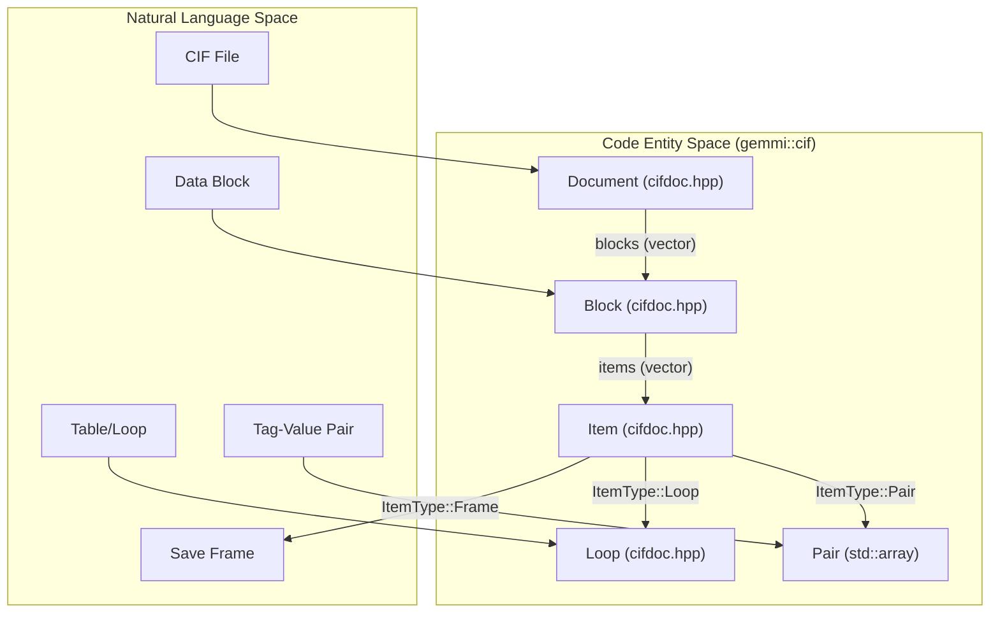
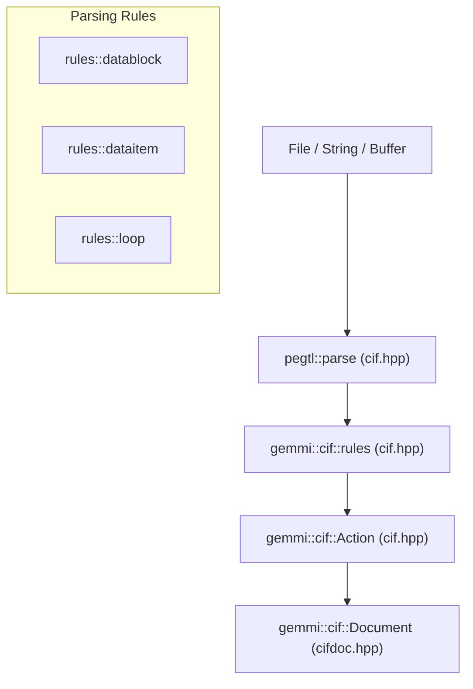

# CIF Parsing and Manipulation

<details>
<summary>Relevant source files</summary>

The following files were used as context for generating this wiki page:

- [docs/Makefile](docs/Makefile)
- [docs/cif.rst](docs/cif.rst)
- [docs/cif2json-help.txt](docs/cif2json-help.txt)
- [docs/components.cif](docs/components.cif)
- [docs/json2cif-help.txt](docs/json2cif-help.txt)
- [include/gemmi/cif.hpp](include/gemmi/cif.hpp)
- [include/gemmi/cifdoc.hpp](include/gemmi/cifdoc.hpp)
- [include/gemmi/fileutil.hpp](include/gemmi/fileutil.hpp)
- [include/gemmi/read_cif.hpp](include/gemmi/read_cif.hpp)
- [include/gemmi/to_cif.hpp](include/gemmi/to_cif.hpp)
- [include/gemmi/to_json.hpp](include/gemmi/to_json.hpp)
- [prog/cif2json.cpp](prog/cif2json.cpp)
- [prog/json2cif.cpp](prog/json2cif.cpp)
- [python/cif.cpp](python/cif.cpp)
- [src/read_cif.cpp](src/read_cif.cpp)
- [src/to_json.cpp](src/to_json.cpp)
- [tests/3wup.json.gz](tests/3wup.json.gz)
- [tests/misc.cif](tests/misc.cif)
- [tests/misc.json](tests/misc.json)
- [tests/test_cif.py](tests/test_cif.py)
- [tests/test_cif_json.py](tests/test_cif_json.py)
- [third_party/optionparser.h](third_party/optionparser.h)

</details>


## Overview

This page documents the CIF (Crystallographic Information File) parsing and manipulation functionality in Gemmi. CIF is a subset of the STAR format used extensively in crystallography. Gemmi provides a C++ header-only core and Python bindings for reading, writing, and manipulating CIF documents via a Document Object Model (DOM).

For higher-level functions that understand the semantics of specific CIF dictionaries (like PDBx/mmCIF or chemical components), see [Structure and Model System (3.1)](), [Reflection Data (3.5)](), and [Chemical Components (5.2)]().

Sources: [docs/cif.rst:1-13](), [include/gemmi/cifdoc.hpp:1-7]()

## CIF Format Basics

CIF files consist of data blocks, tag-value pairs, and loops (tables). Gemmi's parser supports the CIF 1.1 specification, including save frames and STAR keywords like `global_` and `stop_`.

- **Data Blocks**: Begin with `data_` followed by a block name.
- **Pairs**: A tag (starting with `_`) followed by a single value.
- **Loops**: Tabular data starting with `loop_`, followed by column tags and then values.
- **Null Values**: Represented by `.` (not applicable) or `?` (unknown).

Sources: [docs/cif.rst:16-80](), [docs/cif.rst:125-145](), [include/gemmi/cifdoc.hpp:76-79]()

## DOM Architecture

Gemmi represents a CIF file using a hierarchical Document Object Model. The central class is `gemmi::cif::Document`, which contains a vector of `Block` objects.

### Code Entity Space Mapping

The following diagram maps the logical CIF structure to the C++ classes and members in `gemmi/cifdoc.hpp`.


Sources: [include/gemmi/cifdoc.hpp:36-42](), [include/gemmi/cifdoc.hpp:120-120](), [include/gemmi/cifdoc.hpp:449-455](), [include/gemmi/cifdoc.hpp:1099-1102]()

### Key Classes and Data Structures

| Class | Description | Key Members/Methods |
| :--- | :--- | :--- |
| `Document` | Represents the entire file. | `blocks`, `find_block()`, `add_new_block()`, `sole_block()` |
| `Block` | A `data_` or `save_` section. | `items`, `find_value()`, `find_loop()`, `set_pair()`, `init_loop()` |
| `Item` | A generic container for CIF content. | `type` (ItemType), `pair`, `loop`, `frame` |
| `Loop` | Represents a `loop_` table. | `tags`, `values`, `width()`, `length()`, `add_row()` |
| `Table` | An abstraction over Loops and Pairs. | `find_column()`, `find_row()`, `append_row()` |
| `Column` | A view of a single tag's values. | `length()`, `operator[]`, `str()` |

Sources: [include/gemmi/cifdoc.hpp:127-142](), [include/gemmi/cifdoc.hpp:239-250](), [include/gemmi/cifdoc.hpp:449-505](), [include/gemmi/cifdoc.hpp:1099-1112]()

## Parsing Logic and Data Flow

Gemmi uses the PEGTL library for parsing. The grammar is defined in `include/gemmi/cif.hpp` using rules that match the CIF 1.1 specification.



### Parser Options and Robustness
The parser can be configured with `check_level` to handle non-standard CIF files:
- **Level 2 (Strict)**: Errors on empty loops or empty block names.
- **Level 1 (Default)**: Tolerates minor common errors.
- **Level 0 (Relaxed)**: Tolerates missing values in pairs and duplicate tags.

Sources: [include/gemmi/cif.hpp:35-146](), [docs/cif.rst:160-205](), [include/gemmi/read_cif.hpp:13-18]()

## Serialization and I/O

### Writing CIF
Writing is controlled by `WriteOptions`, which manages formatting styles such as PDBx-style (with `#` separators) or aligned columns.

| Option | Description |
| :--- | :--- |
| `prefer_pairs` | Writes single-row loops as tag-value pairs. |
| `align_pairs` | Reserves space for tags to align values vertically. |
| `align_loops` | Calculates column widths to align values in tables. |
| `compact` | Minimizes blank lines between categories. |

Sources: [include/gemmi/to_cif.hpp:24-35](), [include/gemmi/to_cif.hpp:151-201]()

### JSON Interconversion
Gemmi supports two JSON flavors for CIF data:
1.  **mmJSON**: Used by PDBj, where categories are grouped into objects.
2.  **CIF-JSON (COMCIFS)**: A standardized draft format where values are always arrays.

Conversion is handled by `write_json_to_stream` in `src/to_json.cpp` and `read_mmjson` in `src/read_cif.cpp`.

Sources: [include/gemmi/to_json.hpp:13-42](), [python/cif.cpp:170-182](), [include/gemmi/read_cif.hpp:15-15]()

## Manipulation API

### Value Handling
Gemmi provides helper functions to convert the raw strings stored in the DOM into C++ types:
- `as_string(val)`: Handles quotes and semi-colon blocks.
- `as_int(val)`: Converts to integer, handles nulls.
- `as_number(val)`: (via `numb.hpp`) Parses floats with optional standard uncertainties.

Sources: [include/gemmi/cifdoc.hpp:76-118]()

### Table and Column Abstraction
The `Table` class allows unified access to data regardless of whether it is stored as a `Loop` or a set of `Pair` items. This is particularly useful for mmCIF where data might be a single row (pairs) or multiple rows (loop).

```cpp
// C++ Example: Accessing atom coordinates
gemmi::cif::Table table = block.find("_atom_site.", {"id", "Cartn_x", "Cartn_y", "Cartn_z"});
for (auto row : table) {
    std::string id = row[0];
    double x = gemmi::atof(row[1].c_str());
}
```

Sources: [include/gemmi/cifdoc.hpp:239-250](), [docs/cif.rst:1057-1110]()

## Python Bindings

The Python API mirrors the C++ DOM but adds Pythonic features like slicing, iteration, and dictionary-like access for blocks.

- `Document` behaves like a list of `Block` objects.
- `Block` behaves like a list of `Item` objects, but also supports tag lookup.
- `Table` rows support both index and tag-based access.

Sources: [python/cif.cpp:111-132](), [python/cif.cpp:201-220](), [tests/test_cif.py:10-25]()

---