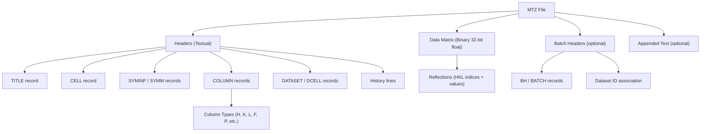
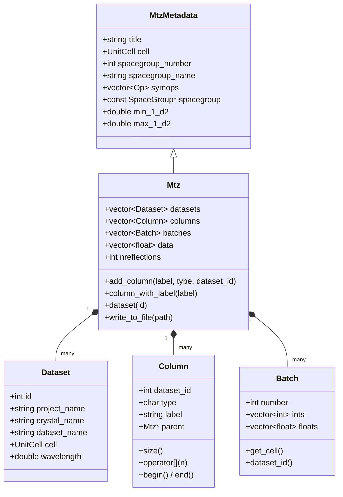
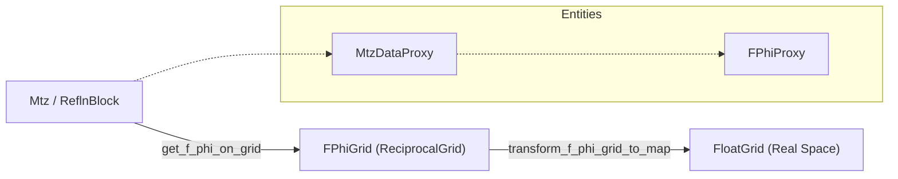

# MTZ Files

<details>
<summary>Relevant source files</summary>

The following files were used as context for generating this wiki page:

- [docs/hkl.rst](docs/hkl.rst)
- [docs/mtz-help.txt](docs/mtz-help.txt)
- [docs/reindex-help.txt](docs/reindex-help.txt)
- [include/gemmi/fourier.hpp](include/gemmi/fourier.hpp)
- [include/gemmi/mtz.hpp](include/gemmi/mtz.hpp)
- [include/gemmi/xds2mtz.hpp](include/gemmi/xds2mtz.hpp)
- [include/gemmi/xds_ascii.hpp](include/gemmi/xds_ascii.hpp)
- [prog/mtz.cpp](prog/mtz.cpp)
- [prog/reindex.cpp](prog/reindex.cpp)
- [prog/xds2mtz.cpp](prog/xds2mtz.cpp)
- [python/hkl.cpp](python/hkl.cpp)
- [python/mtz.cpp](python/mtz.cpp)
- [src/mtz.cpp](src/mtz.cpp)
- [src/xds_ascii.cpp](src/xds_ascii.cpp)
- [tests/test_hkl.py](tests/test_hkl.py)
- [tools/gen_reciprocal_asu.py](tools/gen_reciprocal_asu.py)

</details>


This document describes the MTZ file format and its implementation in the GEMMI library. MTZ is a binary file format widely used in macromolecular crystallography for storing reflection data (diffraction intensities, structure factors, phases, and other crystallographic quantities).

## MTZ File Structure

MTZ (Macromolecular Toolkit Zurich) files store crystallographic reflection data along with associated metadata. The format consists of textual headers and a binary data table where all numbers are stored in 32-bit floating point format [docs/hkl.rst:25-30]().

### Component Overview



Sources: [docs/hkl.rst:25-49](), [include/gemmi/mtz.hpp:47-69](), [src/mtz.cpp:178-326]()

### Data Organization: Merged vs Unmerged
Gemmi distinguishes between two primary MTZ types [docs/hkl.rst:31-49]():
- **Merged Files**: Single record per ($hkl$) reflection. Data is grouped hierarchically (Project -> Crystal -> Dataset -> Column), though Gemmi flattens this into lists of columns and datasets for easier access.
- **Unmerged Files**: Multi-record files. The `BATCH` column links records to diffraction images (batches), which in turn store the dataset ID.

Sources: [docs/hkl.rst:31-49](), [include/gemmi/mtz.hpp:27-45]()

### Column Types
MTZ files use single-letter codes to indicate the type of data in each column [include/gemmi/mtz.hpp:100-102]():

| Type | Description |
|------|-------------|
| **H** | Miller index (integer) |
| **F** | Structure factor amplitude |
| **P** | Phase in degrees |
| **J** | Intensity |
| **Q** | Standard deviation |
| **I** | Integer value (e.g., Free-R flag) |
| **Y** | M/ISYM (symmetry operation index for unmerged data) |

Sources: [include/gemmi/mtz.hpp:100-102](), [src/mtz.cpp:255-267]()

## GEMMI MTZ Class Structure

The `Mtz` class is the central entity for handling reflection data, inheriting metadata properties and containing the actual data vectors.

### Code Entity Mapping



Sources: [include/gemmi/mtz.hpp:47-203](), [python/mtz.cpp:81-113]()

## Working with MTZ Files

### Reading and Writing
In C++, standalone functions `read_mtz_file` and `read_mtz` are provided [docs/hkl.rst:53-56](). In Python, `gemmi.read_mtz_file()` is used [docs/hkl.rst:61-66]().

```cpp
// C++ Example
gemmi::Mtz mtz = gemmi::read_mtz_file("data.mtz");
mtz.write_to_file("output.mtz");
```

```python
# Python Example
import gemmi
mtz = gemmi.read_mtz_file('data.mtz')
mtz.write_to_file('output.mtz')
```

Sources: [docs/hkl.rst:50-75](), [include/gemmi/mtz.hpp:431-451]()

### Column Access and Manipulation
Columns can be retrieved by label or type. Gemmi provides a specialized `rfree_column()` helper that searches for common Free-R flag labels (FREE, RFREE, etc.) [docs/hkl.rst:194-203]().

- **Adding Columns**: `Mtz::add_column()` allows inserting new data streams into the reflection table [include/gemmi/mtz.hpp:243-255]().
- **Removing Columns**: `Mtz::remove_column()` handles the deletion and subsequent data array resizing [include/gemmi/mtz.hpp:264-270]().

Sources: [docs/hkl.rst:171-203](), [include/gemmi/mtz.hpp:81-126]()

### NumPy Integration
In Python, `Mtz` and `Mtz.Column` provide an `.array` property that returns a NumPy view of the underlying data [python/mtz.cpp:65-76]().
- `mtz.array`: A 2D array of shape `(nreflections, ncolumns)`.
- `column.array`: A 1D array of the specific column data.

Sources: [python/mtz.cpp:65-76](), [python/mtz.cpp:94-97]()

## Fourier Transforms and Grids

Gemmi facilitates the transformation of MTZ map coefficients (F, PHI) into real-space maps using Fast Fourier Transforms (FFT) via the `pocketfft` library [include/gemmi/fourier.hpp:15-20]().

### Data Flow: Reflections to Map



Key Functions:
- `get_f_phi_on_grid()`: Populates a reciprocal grid from MTZ columns [include/gemmi/fourier.hpp:169-200]().
- `transform_f_phi_to_map()`: High-level function to go directly from MTZ to a real-space map [python/hkl.cpp:135-151]().
- `get_size_for_hkl()`: Calculates the optimal grid size based on resolution and sample rate [include/gemmi/fourier.hpp:47-74]().

Sources: [include/gemmi/fourier.hpp:1-200](), [python/hkl.cpp:106-151]()

## Integration with Other Formats

Gemmi supports converting other reflection formats to MTZ:
- **XDS**: `xds_to_mtz` converts XDS_ASCII files (merged or unmerged) into MTZ objects [prog/xds2mtz.cpp:130]().
- **mmCIF**: `CifToMtz` and `MtzToCif` classes handle conversion between MTZ and reflection CIF files [python/hkl.cpp:16-17]().

Sources: [include/gemmi/xds_ascii.hpp:62-80](), [prog/xds2mtz.cpp:1-168]()

## Command-Line Interface: `gemmi mtz`

The `gemmi mtz` tool provides a comprehensive interface for inspecting MTZ files:
- `--stats`: Recalculates column statistics (min, max, mean, completeness) [prog/mtz.cpp:57-58]().
- `--batches`: Dumps detailed batch header information [prog/mtz.cpp:48-49]().
- `--tsv`: Exports all reflections to a tab-separated format [prog/mtz.cpp:54-56]().
- `--check-asu`: Validates if reflections are within the correct reciprocal asymmetric unit [prog/mtz.cpp:63-64]().

Sources: [prog/mtz.cpp:29-69](), [docs/mtz-help.txt:1-22]()

---