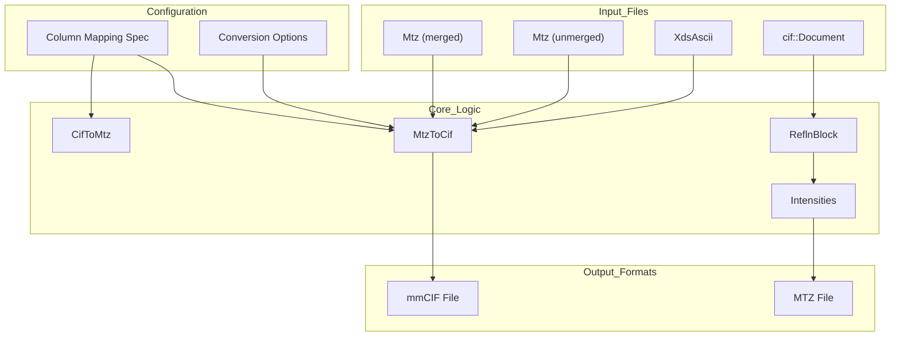
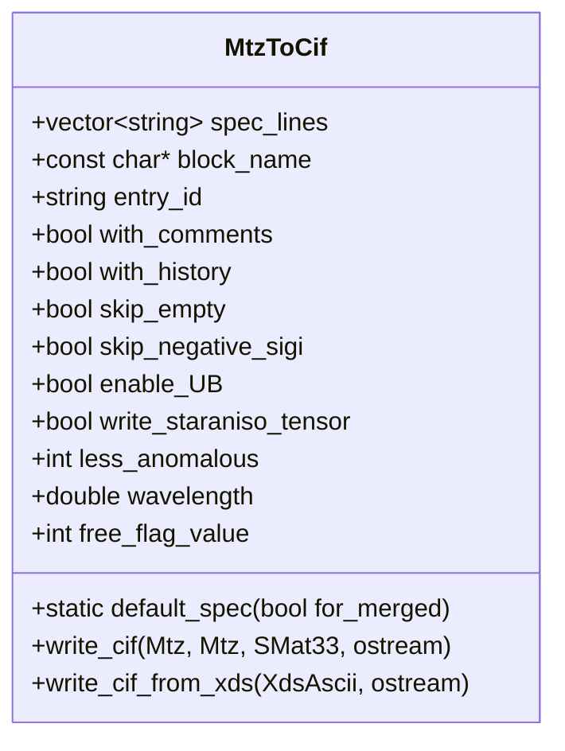
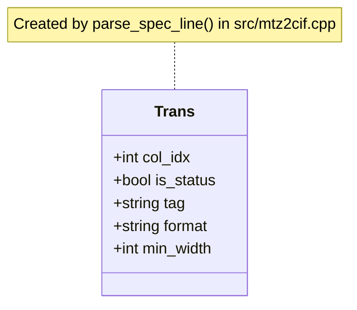

# MTZ to CIF Conversion

<details>
<summary>Relevant source files</summary>

The following files were used as context for generating this wiki page:

- [docs/cif2mtz-help.txt](docs/cif2mtz-help.txt)
- [docs/cif2mtz-spec.txt](docs/cif2mtz-spec.txt)
- [docs/merge-help.txt](docs/merge-help.txt)
- [docs/mtz2cif-help.txt](docs/mtz2cif-help.txt)
- [docs/program.rst](docs/program.rst)
- [examples/refln-stats.py](examples/refln-stats.py)
- [include/gemmi/cif2mtz.hpp](include/gemmi/cif2mtz.hpp)
- [include/gemmi/intensit.hpp](include/gemmi/intensit.hpp)
- [include/gemmi/mtz2cif.hpp](include/gemmi/mtz2cif.hpp)
- [include/gemmi/refln.hpp](include/gemmi/refln.hpp)
- [prog/cif2mtz.cpp](prog/cif2mtz.cpp)
- [prog/merge.cpp](prog/merge.cpp)
- [prog/mtz2cif.cpp](prog/mtz2cif.cpp)
- [src/intensit.cpp](src/intensit.cpp)
- [src/mtz2cif.cpp](src/mtz2cif.cpp)
- [tests/cif.cpp](tests/cif.cpp)

</details>


## Purpose and Scope

This document describes GEMMI's functionality for converting crystallographic reflection data between the binary MTZ format and the text-based mmCIF format. This conversion is essential for structural biology workflows, particularly for data deposition to repositories like the Protein Data Bank (PDB), which require mmCIF format for structure factors. The library provides both C++ APIs (`MtzToCif`, `CifToMtz`) and command-line utilities (`mtz2cif`, `cif2mtz`) to facilitate these transformations.

For information about general MTZ file handling, see [MTZ Files](4.2), and for other file format conversions, see [File Format Conversion](4.5).

## Overview of MTZ to CIF Conversion

The conversion system handles transformation of both merged and unmerged reflection data. It supports various configuration options and provides flexible mapping between MTZ columns and mmCIF data items using specification files.

### Workflow Diagram



Sources:
- [include/gemmi/mtz2cif.hpp:22-96]()
- [include/gemmi/cif2mtz.hpp:142-181]()
- [include/gemmi/refln.hpp:18-150]()
- [include/gemmi/intensit.hpp:76-198]()

## Core Components

### MtzToCif Class

The `MtzToCif` class manages the conversion from MTZ to mmCIF. It handles metadata extraction (cell, symmetry, history) and reflection loop generation.



Sources:
- [include/gemmi/mtz2cif.hpp:22-42]()
- [include/gemmi/mtz2cif.hpp:93-96]()

### CifToMtz and ReflnBlock

Conversion from CIF to MTZ relies on `ReflnBlock` to wrap mmCIF loops and `Intensities` to handle the data transfer and merging if necessary.

| Class/Struct | Role |
|--------------|------|
| `ReflnBlock` | Provides a high-level view of a CIF block containing `_refln` or `_diffrn_refln` loops. [include/gemmi/refln.hpp:18-28]() |
| `Intensities` | Intermediate container for reflection data (H, K, L, I, Sigma) used during import/export. [include/gemmi/intensit.hpp:76-118]() |
| `CifToMtz` | Defines default mappings for mmCIF tags to MTZ column labels and types. [include/gemmi/cif2mtz.hpp:142-181]() |

Sources:
- [include/gemmi/refln.hpp:18-150]()
- [include/gemmi/intensit.hpp:76-198]()
- [include/gemmi/cif2mtz.hpp:142-181]()

## Column Mapping System

### Column Specification Format

The conversion uses a specification to map MTZ columns to CIF data items. Each specification line follows this format:
`[FLAG] COLUMN TYPE TAG [FORMAT]` or `$SPECIAL TAG`.

- **FLAG**: `?` (optional column), `&` (conditional on previous). [docs/mtz2cif-help.txt:46-51]()
- **COLUMN**: MTZ column label. [docs/mtz2cif-help.txt:52-53]()
- **TYPE**: MTZ column type (e.g., 'J' for intensity, 'F' for amplitude). [include/gemmi/mtz2cif.hpp:48-56]()
- **TAG**: CIF tag name (part after `_refln.`). [docs/mtz2cif-help.txt:55]()
- **$SPECIAL**: Variables like `$counter` (reflection ID), `$dataset` (sweep ID), or `$image`. [src/mtz2cif.cpp:158-172]()

### Translation Recipe

Internally, the `MtzToCif` parser creates a `Trans` recipe to drive the writing process.



Sources:
- [src/mtz2cif.cpp:101-107]()
- [src/mtz2cif.cpp:116-203]()

## Conversion Process

### MTZ to CIF Flow

1. **Metadata Extraction**: Extracts `UnitCell` and `SpaceGroup` from MTZ header. [src/mtz2cif.cpp:67-96]()
2. **Recipe Preparation**: Parses `spec_lines` or uses `default_spec()`. [src/mtz2cif.cpp:204-232]()
3. **Loop Generation**: Iterates through MTZ reflections. If `skip_empty` is true, it checks for `NAN` values in specified columns. [src/mtz2cif.cpp:381-528]()
4. **Unmerged Metadata**: If unmerged data is present, it gathers sweep info from `BATCH` headers to populate `_diffrn` categories. [src/mtz2cif.cpp:234-283]()

### CIF to MTZ Flow

1. **Block Identification**: Locates the correct `cif::Block` by name or index. [prog/cif2mtz.cpp:86-98]()
2. **Anomalous Transcription**: If old-style anomalous data is detected (separate HKL and -H-K-L reflections), it is transcribed to modern `pdbx_F_plus/minus` tags. [include/gemmi/cif2mtz.hpp:53-139]()
3. **Intensity Import**: The `Intensities` class imports data from `ReflnBlock`. [include/gemmi/intensit.hpp:182-188]()
4. **MTZ Generation**: `Intensities::prepare_merged_mtz` creates the final `Mtz` object. [include/gemmi/intensit.hpp:197-197]()

## Special Features

### STARANISO Support

Gemmi can read and write anisotropic B tensor information processed by STARANISO.
- **MTZ to CIF**: Reads tensor from MTZ history and writes `_reflns.pdbx_aniso_B_tensor_*`. [src/mtz2cif.cpp:532-559]()
- **CIF to MTZ**: Reads from `_reflns.pdbx_aniso_B_tensor_eigen` table. [src/intensit.cpp:69-93]()

### Validation and Merging

- **`validate_merged_intensities`**: Compares two sets of intensities (e.g., from merged and unmerged MTZ) to calculate correlation. [src/mtz2cif.cpp:864-1028]()
- **`Intensities::merge_in_place`**: Merges multi-record (unmerged) data using inverse-variance weighting. [src/intensit.cpp:181-186]()

Sources:
- [src/mtz2cif.cpp:864-1028]()
- [src/intensit.cpp:181-186]()
- [prog/merge.cpp:1-60]()

## Command Line Usage

### mtz2cif

Converts MTZ to SF-mmCIF.
```bash
gemmi mtz2cif --depo merged.mtz unmerged.mtz output.cif
```
- `--depo`: Prepares a combined merged/unmerged file for PDB deposition. [docs/mtz2cif-help.txt:25]()
- `--less-ano`: Skips anomalous columns. [docs/mtz2cif-help.txt:21-23]()

### cif2mtz

Converts SF-mmCIF to MTZ.
```bash
gemmi cif2mtz -b block_name input.cif output.mtz
```
- `--refln-to`: Controls how the `refln` category is interpreted (`normal`, `friedel`, `unmerged`, `auto`). [docs/cif2mtz-help.txt:20-21]()
- `--asu`: Moves reflections into a specific ASU (CCP4 or TNT). [docs/cif2mtz-help.txt:23]()

Sources:
- [docs/mtz2cif-help.txt:1-63]()
- [docs/cif2mtz-help.txt:1-40]()

---