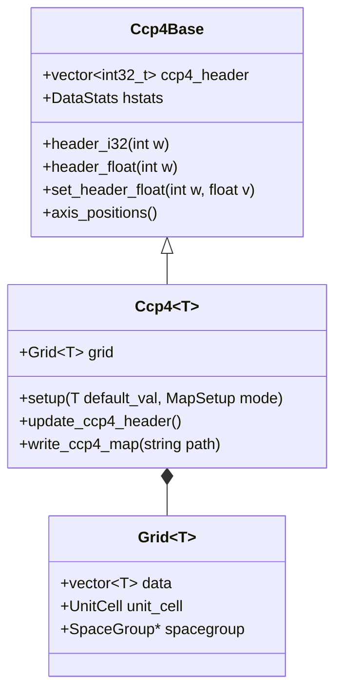
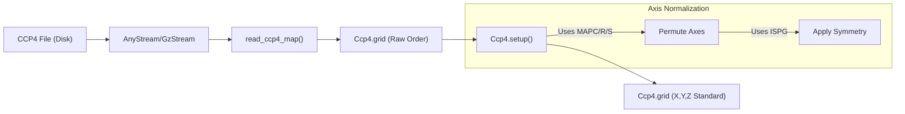

# CCP4 Maps

<details>
<summary>Relevant source files</summary>

The following files were used as context for generating this wiki page:

- [docs/map-help.txt](docs/map-help.txt)
- [docs/map2sf-help.txt](docs/map2sf-help.txt)
- [docs/mask-help.txt](docs/mask-help.txt)
- [fortran/Makefile](fortran/Makefile)
- [fortran/gemmi.yaml](fortran/gemmi.yaml)
- [fortran/write.cpp](fortran/write.cpp)
- [include/gemmi/ccp4.hpp](include/gemmi/ccp4.hpp)
- [include/gemmi/dirwalk.hpp](include/gemmi/dirwalk.hpp)
- [include/gemmi/glob.hpp](include/gemmi/glob.hpp)
- [include/gemmi/gz.hpp](include/gemmi/gz.hpp)
- [include/gemmi/input.hpp](include/gemmi/input.hpp)
- [include/gemmi/json.hpp](include/gemmi/json.hpp)
- [include/gemmi/util.hpp](include/gemmi/util.hpp)
- [prog/map.cpp](prog/map.cpp)
- [prog/map2sf.cpp](prog/map2sf.cpp)
- [prog/mixmtz.cpp](prog/mixmtz.cpp)
- [python/ccp4.cpp](python/ccp4.cpp)
- [src/gz.cpp](src/gz.cpp)
- [src/json.cpp](src/json.cpp)
- [third_party/sajson.h](third_party/sajson.h)
- [tools/FindZLIB_NG.cmake](tools/FindZLIB_NG.cmake)

</details>


This document describes the CCP4/MRC map file handling in Gemmi. It covers the `Ccp4` class, header manipulation, axis ordering, and the integration between volumetric grids and the CCP4 file format.

## Overview

The CCP4 format is the standard for storing 3D density maps in macromolecular crystallography and cryo-electron microscopy (MRC). Gemmi provides a high-level `Ccp4<T>` template class (where `T` is typically `float` or `int8_t`) that wraps a `Grid<T>` and manages the format-specific metadata.

### Supported Modes
The CCP4 format defines several data modes. Gemmi primarily handles:
*   **Mode 0**: 8-bit signed integers (`int8_t`), typically used for masks. [include/gemmi/ccp4.hpp:242-243]()
*   **Mode 1**: 16-bit signed integers (`int16_t`). [include/gemmi/ccp4.hpp:244-245]()
*   **Mode 2**: 32-bit floating point (`float`), the standard for electron density. [include/gemmi/ccp4.hpp:246-247]()
*   **Mode 6**: 16-bit unsigned integers (`uint16_t`). [include/gemmi/ccp4.hpp:251-252]()
*   **Mode 12**: 16-bit floats (`float16`), often used in modern MRC files to save space. Gemmi provides a `float16_type` for decoding these. [include/gemmi/ccp4.hpp:26-51]()

Sources: [include/gemmi/ccp4.hpp:240-277](), [python/ccp4.cpp:59-66]()

## Class Architecture

The implementation is split into a non-templated base class for header management and a templated class for data handling.

**CCP4 Map Entity Relationship**

Sources: [include/gemmi/ccp4.hpp:64-111](), [include/gemmi/ccp4.hpp:235-238]()

### Header Access
The CCP4 header consists of 256 4-byte words. Gemmi provides methods to access these using 1-based indexing as defined in the CCP4/MRC specifications. [include/gemmi/ccp4.hpp:71-93]()

Key header fields handled by `Ccp4Base`:
*   **Dimensions**: Words 1-3 (NX, NY, NZ). [include/gemmi/ccp4.hpp:177]()
*   **Axis Mapping**: Words 17-19 (MAPC, MAPR, MAPS) define which grid axis (1, 2, or 3) corresponds to X, Y, and Z. [include/gemmi/ccp4.hpp:113-124]()
*   **Skew Transformation**: Words 25-37 (LSKFLG, SKWMAT, SKWTRN). [include/gemmi/ccp4.hpp:151-163]()
*   **Origin**: Words 50-52, used primarily in MRC format. [include/gemmi/ccp4.hpp:166-168]()

Sources: [include/gemmi/ccp4.hpp:64-200]()

## Setup and Axis Ordering

When reading a CCP4 map, the data is stored on disk in an arbitrary axis order (e.g., Z-fastest or X-fastest). Gemmi's `setup()` function standardizes this.

### MapSetup Modes
The `MapSetup` enum controls how the raw data is transformed into the internal `Grid`:
1.  **Full**: Reorders axes to X,Y,Z and expands the data to cover the entire unit cell using symmetry operations found in the header. [include/gemmi/ccp4.hpp:59]()
2.  **NoSymmetry**: Reorders axes and expands to the full cell, but ignores symmetry (filling gaps with a default value). [include/gemmi/ccp4.hpp:60]()
3.  **ReorderOnly**: Only ensures the internal memory layout matches X,Y,Z order without changing the spatial extent. [include/gemmi/ccp4.hpp:61]()

**Data Flow: File to Grid**

Sources: [include/gemmi/ccp4.hpp:58-62](), [include/gemmi/ccp4.hpp:392-446]()

## Reading and Writing

Gemmi supports transparent decompression of `.gz` files via `GzStream` if zlib is available. [include/gemmi/gz.hpp:19-30]()

### Reading
The `read_ccp4_map` function reads the header, determines the data mode, and populates the grid. If `setup` is true, it immediately normalizes the grid. [include/gemmi/ccp4.hpp:492-494]()

### Writing
To write a map:
1.  The `update_ccp4_header()` method must be called to sync grid parameters (unit cell, dimensions, statistics) back into the `ccp4_header` vector. [include/gemmi/ccp4.hpp:248-266]()
2.  `write_ccp4_map()` serializes the header and the grid data to disk. [include/gemmi/ccp4.hpp:476-490]()

Sources: [include/gemmi/ccp4.hpp:476-500](), [src/gz.cpp:79-98]()

## Python Bindings

The Python API provides `Ccp4Map` (for `float`) and `Ccp4Mask` (for `int8_t`). These classes inherit from `Ccp4Base`, allowing direct header manipulation from Python. [python/ccp4.cpp:43-57]()

```python
import gemmi

# Read map and automatically setup (reorder to XYZ, expand symmetry)
ccp4 = gemmi.read_ccp4_map("map.ccp4", setup=True)

# Access the underlying FloatGrid
grid = ccp4.grid
print(f"Grid shape: {grid.nu}, {grid.nv}, {grid.nw}")

# Access header values directly
mean_density = ccp4.header_float(22)

# Write back
ccp4.update_ccp4_header()
ccp4.write_ccp4_map("output.ccp4")
```

Sources: [python/ccp4.cpp:14-72]()

## CLI Tools
Gemmi includes command-line utilities for map inspection and manipulation:
*   `gemmi map`: Summarizes header info, checks symmetry, or transposes maps. [docs/map-help.txt:1-18]()
*   `gemmi mask`: Generates bulk-solvent masks in CCP4 format from coordinate files. [docs/mask-help.txt:1-23]()
*   `gemmi map2sf`: Converts map data to structure factors (MTZ). [prog/map2sf.cpp:1-20]()

Sources: [docs/map-help.txt:1-18](), [docs/mask-help.txt:1-23]()

---