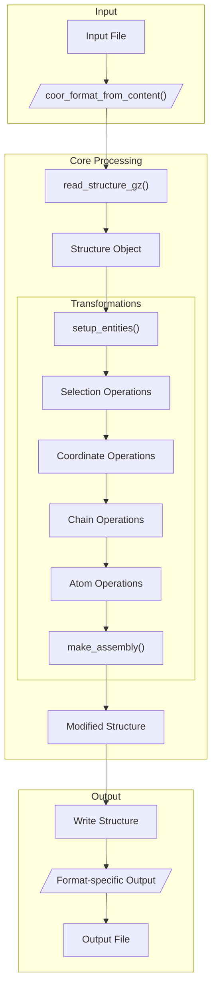
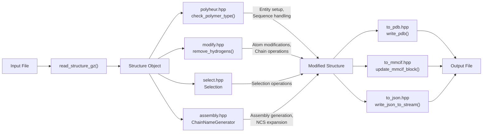

# File Format Conversion

<details>
<summary>Relevant source files</summary>

The following files were used as context for generating this wiki page:

- [docs/convert-help.txt](docs/convert-help.txt)
- [include/gemmi/assembly.hpp](include/gemmi/assembly.hpp)
- [include/gemmi/logger.hpp](include/gemmi/logger.hpp)
- [include/gemmi/mmread.hpp](include/gemmi/mmread.hpp)
- [include/gemmi/modify.hpp](include/gemmi/modify.hpp)
- [include/gemmi/polyheur.hpp](include/gemmi/polyheur.hpp)
- [include/gemmi/small.hpp](include/gemmi/small.hpp)
- [include/gemmi/smcif.hpp](include/gemmi/smcif.hpp)
- [prog/convert.cpp](prog/convert.cpp)
- [python/read.cpp](python/read.cpp)
- [python/write.cpp](python/write.cpp)
- [src/assembly.cpp](src/assembly.cpp)
- [src/polyheur.cpp](src/polyheur.cpp)
- [tests/2242624.cif](tests/2242624.cif)
- [tests/2242624.hkl](tests/2242624.hkl)
- [tests/test_smallmol.py](tests/test_smallmol.py)

</details>


This document covers the file format conversion capabilities in Gemmi, which allow transforming structural biology data between different file formats while optionally applying various modifications to the structural data. For information about specific file formats like CIF parsing or MTZ files, see the dedicated pages: [CIF Parsing and Manipulation](#4.1), [MTZ Files](#4.2), and [MTZ to CIF Conversion](#4.3).

## Overview

Gemmi provides a flexible system for converting between macromolecular structure file formats, including PDB, mmCIF, and mmJSON. Beyond simple format conversion, the system offers extensive options for modifying structures during the conversion process - from removing specific atoms to generating biological assemblies.

The conversion functionality is accessible through:
- The command-line interface (`gemmi convert`)
- The C++ API (implemented in `prog/convert.cpp`)
- The Python API (via `read_structure` and various `write_*` methods)

This document focuses on both the command-line utility and the underlying implementation logic.

Sources: [prog/convert.cpp:1-24](), [docs/convert-help.txt:1-67](), [python/read.cpp:56-120]()

## Supported File Formats

| Format | Description | Read | Write |
|--------|-------------|------|-------|
| PDB | Protein Data Bank legacy format | ✓ | ✓ |
| mmCIF | Macromolecular Crystallographic Information File | ✓ | ✓ |
| mmJSON | mmCIF data represented in JSON format | ✓ | ✓ |
| chemcomp | Chemical component coordinates from CCD or monomer library | ✓ | ✗ |

The format is typically inferred from the file extension using `coor_format_from_ext` or by inspecting file content via `coor_format_from_content`.

Sources: [docs/convert-help.txt:64-66](), [prog/convert.cpp:176-186](), [include/gemmi/mmread.hpp:19-46]()

## Architecture

The file format conversion system connects multiple components of the Gemmi library to transform structural data.

### Conversion Workflow



Sources: [prog/convert.cpp:302-546](), [include/gemmi/mmread.hpp:60-114](), [include/gemmi/polyheur.hpp:140-145]()

### Data Flow and Key Components



Sources: [prog/convert.cpp:10-17](), [include/gemmi/polyheur.hpp:10-26](), [include/gemmi/modify.hpp:16-51]()

## Command Line Interface

The `gemmi convert` command follows this general syntax:

```
gemmi convert [options] INPUT_FILE OUTPUT_FILE
```

Input and output formats are automatically determined from file extensions but can be specified explicitly with `--from` and `--to` options. When the output file is specified as `-`, the output is written to standard output (default format: pdb).

Sources: [docs/convert-help.txt:1-67]()

## Conversion Options

### Structure Modification Options

| Option | Description | Code Entity |
|--------|-------------|-------------|
| `--minimal` | Write only the most essential records | `PdbWriteOptions::minimal()` |
| `--shorten` | Shorten chain names to 1 or 2 characters | `shorten_chain_names()` |
| `--rename-chain` | Rename chain OLD to NEW | `rename_chain()` |
| `--anisou` | Add or remove ANISOU records | `remove_anisou()` / `ensure_anisou()` |
| `--assign-records` | Re-assign ATOM/HETATM records | `assign_het_flags()` |

Sources: [docs/convert-help.txt:33-50](), [include/gemmi/modify.hpp:65-83](), [include/gemmi/polyheur.hpp:148-159](), [include/gemmi/assembly.hpp:121-121]()

### Macromolecular Operations

| Option | Description | Code Entity |
|--------|-------------|-------------|
| `--apply-symop` | Apply operation (e.g., '-x,y+1/2,-z') | `transform_pos_and_adp()` |
| `--expand-ncs` | Expand strict NCS | `expand_ncs()` |
| `--assembly` | Output bioassembly with specified ID | `make_assembly()` |
| `--remove-h` | Remove hydrogens | `remove_hydrogens()` |
| `--remove-waters` | Remove waters | `remove_waters()` |
| `--remove-lig-wat` | Remove ligands and waters | `remove_ligands_and_waters()` |

Sources: [docs/convert-help.txt:51-62](), [include/gemmi/modify.hpp:43-51](), [include/gemmi/polyheur.hpp:162-177](), [include/gemmi/assembly.hpp:90-91]()

## Key Functionality

### Polymer Heuristics and Connectivity

Gemmi uses distance-based and tabulated checks to identify polymer types and connectivity. This is critical for assigning `entity_type` (Polymer, NonPolymer, Water).

- **Peptide Bonds**: Checked via `in_peptide_bond_distance` (approx 1.341 Å). [include/gemmi/polyheur.hpp:39-44]()
- **Nucleotide Bonds**: Checked via `in_nucleotide_bond_distance` (approx 1.6 Å). [include/gemmi/polyheur.hpp:47-52]()
- **Polymer Type**: `check_polymer_type` classifies chains as `PeptideL`, `Rna`, `Dna`, etc., by counting residue kinds. [src/polyheur.cpp:10-66]()

### Assembly Generation

The `make_assembly` function generates biological assemblies by applying operations from `struct Assembly` to a `Model`. [include/gemmi/assembly.hpp:90-91]()

#### Chain Name Generation
When generating copies, unique names are required. The `ChainNameGenerator` handles this:
- **Short**: Uses single characters (A-Z, a-z, 0-9) then two-character names. [include/gemmi/assembly.hpp:34-60]()
- **AddNumber**: Appends a numeric suffix. [include/gemmi/assembly.hpp:62-70]()
- **Dup**: Duplicates the name (used when segment IDs distinguish them). [include/gemmi/assembly.hpp:73-76]()

### Small Molecule Conversion

Small molecule CIF files (SMCIF) are handled via `SmallStructure`.
- **Read**: `make_small_structure_from_block` parses `_atom_site_*` and symmetry tags. [include/gemmi/smcif.hpp:16-92]()
- **Write**: `make_cif_block_from_small_structure` serializes back to mmCIF format. [include/gemmi/smcif.hpp:130-167]()

## Python API Usage

The Python bindings provide high-level functions for reading and writing structural data.

```python
import gemmi

# Reading
st = gemmi.read_structure("input.pdb")

# Modifications
st.remove_hydrogens()
st.remove_waters()

# Writing to different formats
st.write_pdb("output.pdb")
doc = st.make_mmcif_document()
doc.write_file("output.cif")
```

Sources: [python/read.cpp:84-93](), [python/write.cpp:97-130]()

## Implementation Details

### Data Structures for Conversion

| Class | Purpose | Source |
|-------|---------|--------|
| `Structure` | Root container for molecular data | [include/gemmi/model.hpp]() |
| `PdbWriteOptions` | Configuration for PDB serialization | [include/gemmi/to_pdb.hpp]() |
| `MmcifOutputGroups` | Selection of categories for mmCIF output | [include/gemmi/to_mmcif.hpp]() |
| `ChainNameGenerator` | Logic for avoiding chain name collisions | [include/gemmi/assembly.hpp:18-80]() |

### Connectivity Fallbacks
The library provides three levels of connectivity checks:
1. `are_connected()`: Strict distance check for C-N or O3'-P. [include/gemmi/polyheur.hpp:55-61]()
2. `are_connected2()`: Heuristic check using only CA or P atoms (approx 5.0 Å or 7.5 Å). [include/gemmi/polyheur.hpp:64-83]()
3. `are_connected3()`: Combination of the above with fallbacks. [include/gemmi/polyheur.hpp:86-103]()

Sources: [include/gemmi/polyheur.hpp:38-103]()

---