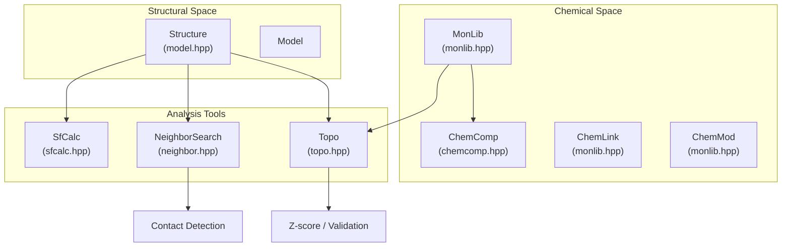
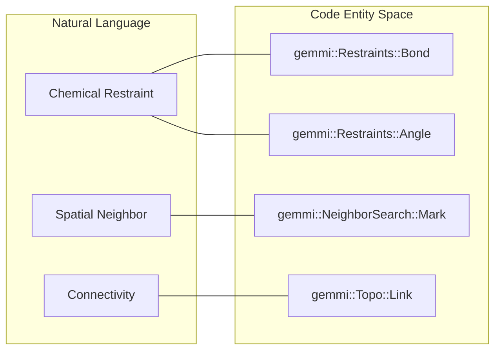

# Chemical and Structural Analysis

Relevant source files

The following files were used as context for generating this wiki page:

- [benchmarks/pdb.cpp](benchmarks/pdb.cpp)
- [docs/analysis.rst](docs/analysis.rst)
- [include/gemmi/chemcomp.hpp](include/gemmi/chemcomp.hpp)
- [include/gemmi/ener_lib.hpp](include/gemmi/ener_lib.hpp)
- [include/gemmi/linkhunt.hpp](include/gemmi/linkhunt.hpp)
- [include/gemmi/monlib.hpp](include/gemmi/monlib.hpp)
- [include/gemmi/neighbor.hpp](include/gemmi/neighbor.hpp)
- [include/gemmi/topo.hpp](include/gemmi/topo.hpp)
- [python/monlib.cpp](python/monlib.cpp)
- [python/search.cpp](python/search.cpp)
- [src/ener_lib.cpp](src/ener_lib.cpp)
- [src/monlib.cpp](src/monlib.cpp)
- [tools/pdb_ids.txt](tools/pdb_ids.txt)

This document covers Gemmi's chemical and structural analysis system, providing a high-level overview of functionality for working with chemical components, restraints, topology, and neighbor search. These tools form the foundation for analyzing molecular structures in terms of their chemical properties, conformational aspects, and spatial relationships.

## Overview of Chemical and Structural Analysis

The chemical and structural analysis system in Gemmi provides tools to work with:

1.  **Chemical Components** - Representations of monomers (residues) with their atom compositions and restraints.
2.  **Monomer Library** - A collection of chemical components, links, and modifications (typically from the CCP4/Refmac library).
3.  **Topology** - The application of restraints to structural models to define a connectivity and geometry network.
4.  **Structure Factors** - Calculation of structure factors and electron density from atomic models.
5.  **Neighbor Search** - Efficient spatial indexing for contact detection and distance calculations.

Sources: [include/gemmi/chemcomp.hpp:19-29](), [include/gemmi/monlib.hpp:83-89](), [include/gemmi/topo.hpp:23-203](), [include/gemmi/neighbor.hpp:19-52]()

## Sub-Topics and Detailed Documentation

### 5.1 Topology and Restraints
The topology system (centered around the `Topo` class) applies restraints from a monomer library to a specific `Model`. It manages the creation of `Bond`, `Angle`, `Torsion`, `Chirality`, and `Plane` objects that link `Atom` pointers to their ideal values. This system is used for Z-score calculation, hydrogen placement via riding models, and generating refinement inputs.

For details, see [Topology and Restraints](#5.1).
Sources: [include/gemmi/topo.hpp:23-111]()

### 5.2 Chemical Components
The `ChemComp` class represents the ideal chemical definition of a monomer, typically parsed from mmCIF dictionaries (like the PDB Chemical Component Dictionary). It defines atom types, partial charges, and standard restraints for a single residue type.

For details, see [Chemical Components](#5.2).
Sources: [include/gemmi/chemcomp.hpp:326-412]()

### 5.3 Monomer Library
The `MonLib` class acts as a container for `ChemComp` definitions, `ChemLink` (links between residues), and `ChemMod` (modifications). It includes logic for "link hunting" to automatically identify covalent bonds between residues based on distance and chemical compatibility.

For details, see [Monomer Library](#5.3).
Sources: [include/gemmi/monlib.hpp:83-102](), [include/gemmi/linkhunt.hpp:17-32]()

### 5.4 Structure Factor Calculation
Gemmi provides high-performance tools for structure factor calculation (`sfcalc`) and density generation (`dencalc`). It supports various form factor tables (IT92, C4322), neutron scattering lengths, and bulk solvent correction using the Babinet principle.

For details, see [Structure Factor Calculation](#5.4).

### 5.5 Neighbor Search and Contacts
Spatial analysis is handled by the `NeighborSearch` class, which uses a cell-linked list (binning) algorithm. It efficiently finds atoms within a specified radius, handling crystallographic symmetry, periodic boundary conditions (PBC), and alternative conformations.

For details, see [Neighbor Search and Contacts](#5.5).
Sources: [include/gemmi/neighbor.hpp:19-52](), [docs/analysis.rst:4-40]()

## Key Code Entities

| Entity | Role | File |
| :--- | :--- | :--- |
| `gemmi::Topo` | Manages applied restraints for a specific model | [include/gemmi/topo.hpp:23]() |
| `gemmi::ChemComp` | Idealized chemical definition of a monomer | [include/gemmi/chemcomp.hpp:326]() |
| `gemmi::MonLib` | Library of monomers, links, and modifications | [include/gemmi/monlib.hpp:83]() |
| `gemmi::NeighborSearch` | Spatial index for fast atom lookup | [include/gemmi/neighbor.hpp:19]() |
| `gemmi::Restraints` | Container for bond, angle, torsion, chiral, and plane rules | [include/gemmi/chemcomp.hpp:29]() |

Sources: [include/gemmi/chemcomp.hpp:75-107](), [include/gemmi/neighbor.hpp:21-52](), [include/gemmi/topo.hpp:90-111]()

---