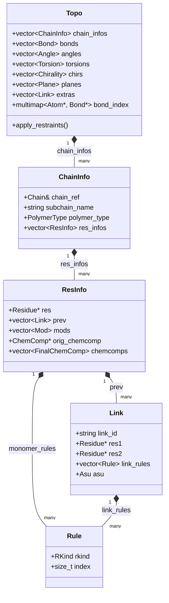
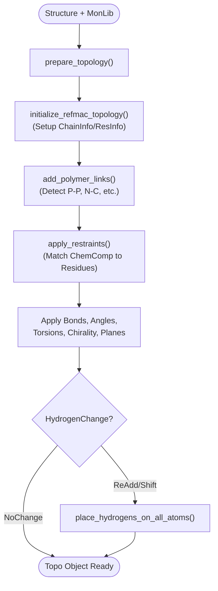

# Topology and Restraints

Relevant source files

The following files were used as context for generating this wiki page:

- [docs/h-help.txt](docs/h-help.txt)
- [docs/rmsz-help.txt](docs/rmsz-help.txt)
- [include/gemmi/chemcomp.hpp](include/gemmi/chemcomp.hpp)
- [include/gemmi/crd.hpp](include/gemmi/crd.hpp)
- [include/gemmi/riding_h.hpp](include/gemmi/riding_h.hpp)
- [include/gemmi/topo.hpp](include/gemmi/topo.hpp)
- [prog/h.cpp](prog/h.cpp)
- [prog/monlib_opt.cpp](prog/monlib_opt.cpp)
- [prog/monlib_opt.h](prog/monlib_opt.h)
- [prog/rmsz.cpp](prog/rmsz.cpp)
- [python/topo.cpp](python/topo.cpp)
- [src/crd.cpp](src/crd.cpp)
- [src/riding_h.cpp](src/riding_h.cpp)
- [src/topo.cpp](src/topo.cpp)

This page describes the topology and restraint system in Gemmi, which is used to manage molecular geometry restraints in macromolecular structures. The system provides functionality for applying standard geometric restraints from monomer libraries to molecular models, validating structures against these restraints, and adjusting atom positions (particularly hydrogens).

## Core Concepts

The topology system provides a representation of chemical restraints applied to a molecular model. It bridges the chemical component definitions (see [Chemical Components](5.2) and [Monomer Library](5.3)) with the 3D atomic structure, creating a connected network of atoms with appropriate geometric targets.

### Topology

A topology in Gemmi refers to a collection of residues with restraints applied to them. It determines:

1. How atoms connect within and between residues.
2. What geometric restraints should be applied to these connections.
3. How residues are modified (e.g., phosphorylation, methylation).
4. How residues are linked together (e.g., peptide bonds, disulfide bridges).

### Restraints

Restraints are geometric targets for molecular models, defining ideal values for:

- **Bond lengths**: Target distance between two atoms.
- **Bond angles**: Target angle between three atoms.
- **Torsion (dihedral) angles**: Target angle between four atoms.
- **Chirality**: Stereochemical configuration around a central atom.
- **Planarity**: Co-planarity of a set of atoms.

Each restraint type includes an ideal value and an estimated standard deviation (ESD) that determines its weight in refinement or validation.

Sources: [include/gemmi/topo.hpp:3-22](), [include/gemmi/chemcomp.hpp:21-29]()

## System Architecture

The topology system is organized around the central `Topo` class, which relates molecular structures to chemical restraints.

### Code Entity Space Mapping

The following diagram maps high-level topology concepts to the specific C++ classes and data structures used in the implementation.

Sources: [include/gemmi/topo.hpp:23-208]()

### Topo Class
The `Topo` class is the main container for a topology:
- It contains applied restraints organized by type (`bonds`, `angles`, etc.) [[include/gemmi/topo.hpp:198-202]]().
- It maintains information about the molecular structure through `ChainInfo` objects [[include/gemmi/topo.hpp:166-182]]().
- It provides functionality to calculate Z-scores for geometry validation [[include/gemmi/topo.hpp:38-73]]().
- It includes indices (`bond_index`, `angle_index`, etc.) to quickly look up restraints by the atoms involved [[include/gemmi/topo.hpp:204-207]]().

### Structure Representation
The topology system uses a hierarchical representation of the molecular structure:
1. `ChainInfo`: Represents a sub-chain in the structure [[include/gemmi/topo.hpp:166]]().
2. `ResInfo`: Contains information about a residue, its original `ChemComp`, applied `Mod` (modifications), and `Link` objects to previous residues [[include/gemmi/topo.hpp:128-163]]().
3. `Link`: Represents a connection between residues (e.g., polymer links or "extras" like disulfide bonds) [[include/gemmi/topo.hpp:90-111]]().

## Geometric Restraint Types

Gemmi defines five main types of geometric restraints within the `Topo` class, each wrapping a reference to a restraint definition from a `ChemComp`.

| Restraint Type | Class | Atom Count | Key Calculation |
| :--- | :--- | :--- | :--- |
| **Bond** | `Topo::Bond` | 2 | `atoms[0]->pos.dist(atoms[1]->pos)` |
| **Angle** | `Topo::Angle` | 3 | `calculate_angle(atoms[0..2])` |
| **Torsion** | `Topo::Torsion` | 4 | `calculate_dihedral(atoms[0..3])` |
| **Chirality** | `Topo::Chirality` | 4 | `calculate_chiral_volume(atoms[0..3])` |
| **Plane** | `Topo::Plane` | N | `find_best_plane(atoms)` |

### Z-Score Calculation
For validation purposes (e.g., the `gemmi rmsz` tool), each restraint type implements a `calculate_z()` method.
- **Bonds**: $|d_{calc} - d_{ideal}| / esd$ [[include/gemmi/topo.hpp:38]]().
- **Angles**: Calculated via `angle_z` which handles degree-to-radian conversion [[include/gemmi/topo.hpp:47]]().
- **Torsion**: Handles periodicity using `360. / period` [[include/gemmi/topo.hpp:57]]().
- **Chirality**: Compares the calculated chiral volume against the ideal volume sign [[include/gemmi/topo.hpp:67-73]]().

Sources: [include/gemmi/topo.hpp:31-82](), [prog/rmsz.cpp:96-203]()

## The Topology Pipeline

The process of moving from a raw `Structure` and `MonLib` to a fully restrained `Topo` object is handled by the `prepare_topology` pipeline.

### 1. Initializing Topology
`initialize_refmac_topology()` sets up the `ChainInfo` and `ResInfo` structures. It identifies polymer types and assigns `ChemComp` definitions to each residue [[src/topo.cpp:120-134]]().

### 2. Link Detection
`add_polymer_links` automatically detects standard polymer connections based on the `PolymerType` [[src/topo.cpp:189-212]](). For non-standard links (e.g., metal coordination or covalent ligands), Gemmi uses `add_automatic_links` which performs a `NeighborSearch` to identify proximal atoms [[src/crd.cpp:72-120]]().

### 3. Hydrogen Placement
Gemmi can automatically place or shift hydrogen atoms based on restraints using `riding_h.cpp` logic:
- **Placement**: `place_hydrogens()` uses geometric rules (e.g., tetrahedral, planar, or linear) to calculate $H$ positions based on bonded heavy atoms [[src/riding_h.cpp:159-168]]().
- **Trilateration**: For complex cases (e.g., $CH_2$ in a ring), Gemmi uses `trilaterate` or `position_from_two_angles` to find the intersection of distance spheres [[src/riding_h.cpp:63-97]]().
- **Adjustment**: `adjust_hydrogen_distances()` scales $X-H$ bond lengths to match the ideal values in the library [[python/topo.cpp:146-147]]().

Sources: [src/topo.cpp:120-212](), [src/riding_h.cpp:159-478](), [include/gemmi/topo.hpp:255-270]()

## Refmac CRD Generation

The topology system is also responsible for generating "prepared" files for the Refmac refinement program. The function `prepare_refmac_crd` converts the internal `Topo` and `Structure` data into a specific mmCIF-style format (`.crd`) [[src/crd.cpp:124-221]]().

- **Calculated Flags**: Refmac-specific flags (e.g., "R" for riding hydrogens) are assigned via `refmac_calc_flag` [[src/crd.cpp:59-70]]().
- **Entity Setup**: Ensures entities are correctly assigned and subchains are named according to Refmac conventions (e.g., using `_` as a separator) [[src/crd.cpp:25-48]]().

Sources: [include/gemmi/crd.hpp:5-24](), [src/crd.cpp:124-221]()

## CLI Tools

Two primary command-line tools utilize the topology system:

1.  **`gemmi rmsz`**: Validates structure geometry. It creates a `Topo` object, calculates Z-scores for all restraints, and reports deviations exceeding a cutoff (default: 2.0) [[prog/rmsz.cpp:208-215]]().
2.  **`gemmi h`**: Manages hydrogen atoms. It uses the `HydrogenChange` enum to control whether hydrogens are removed, re-added, or simply shifted to ideal positions [[prog/h.cpp:85-95]]().

Sources: [prog/rmsz.cpp:1-215](), [prog/h.cpp:1-173]()

---