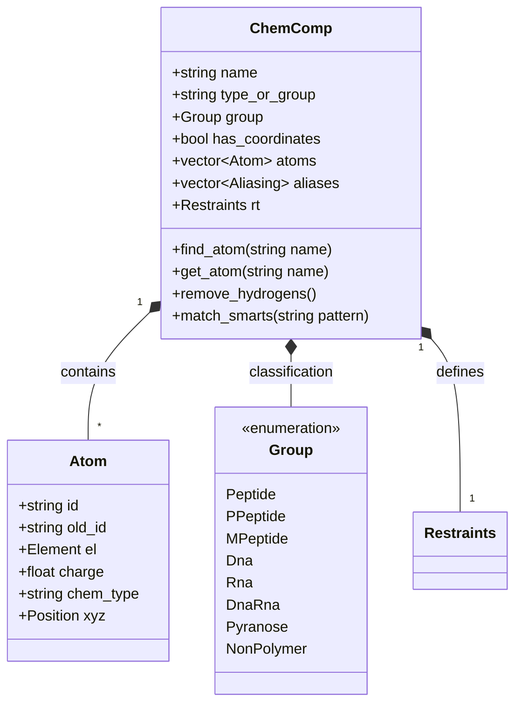
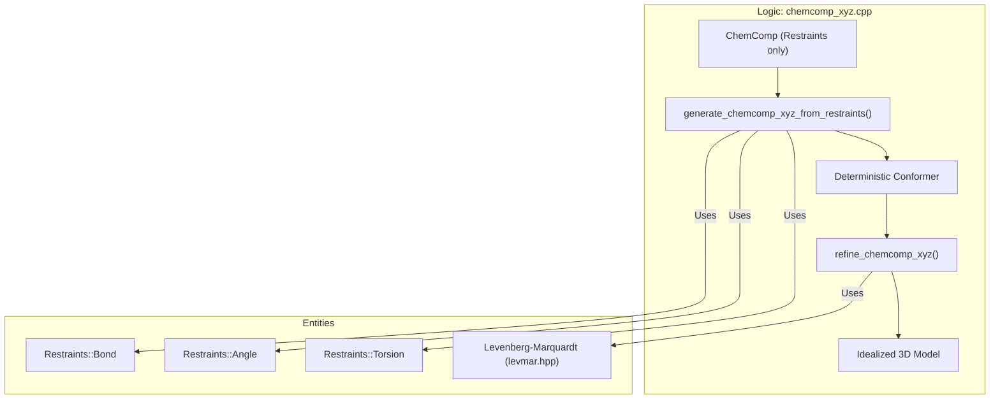

# Chemical Components

<details>
<summary>Relevant source files</summary>

The following files were used as context for generating this wiki page:

- [docs/chemistry.rst](docs/chemistry.rst)
- [docs/headers.rst](docs/headers.rst)
- [include/gemmi/ace_carborane.hpp](include/gemmi/ace_carborane.hpp)
- [include/gemmi/ace_internal.hpp](include/gemmi/ace_internal.hpp)
- [include/gemmi/cc_adj.hpp](include/gemmi/cc_adj.hpp)
- [include/gemmi/chemcomp.hpp](include/gemmi/chemcomp.hpp)
- [include/gemmi/chemcomp_xyz.hpp](include/gemmi/chemcomp_xyz.hpp)
- [include/gemmi/smarts.hpp](include/gemmi/smarts.hpp)
- [include/gemmi/topo.hpp](include/gemmi/topo.hpp)
- [src/ace_carborane.cpp](src/ace_carborane.cpp)
- [src/cc_adj.cpp](src/cc_adj.cpp)
- [src/chemcomp_xyz.cpp](src/chemcomp_xyz.cpp)
- [src/smarts.cpp](src/smarts.cpp)
- [tests/ccd/ALA.cif](tests/ccd/ALA.cif)
- [tests/ccd/ASP.cif](tests/ccd/ASP.cif)
- [tests/ccd/ATP.cif](tests/ccd/ATP.cif)
- [tests/ccd/CYS.cif](tests/ccd/CYS.cif)
- [tests/ccd/HEM.cif](tests/ccd/HEM.cif)
- [tests/ccd/HIS.cif](tests/ccd/HIS.cif)
- [tests/ccd/SEC.cif](tests/ccd/SEC.cif)
- [tests/ccd/TRP.cif](tests/ccd/TRP.cif)
- [tests/ccd/TYR.cif](tests/ccd/TYR.cif)
- [tests/test_ace.py](tests/test_ace.py)
- [tests/test_chemcomp.py](tests/test_chemcomp.py)
- [tests/test_monlib.py](tests/test_monlib.py)
- [tools/ace_xyz_checks.py](tools/ace_xyz_checks.py)
- [tools/chemcomp_cycle_rescue.py](tools/chemcomp_cycle_rescue.py)
- [tools/chemcomp_xyz_stats.py](tools/chemcomp_xyz_stats.py)

</details>


Chemical Components in Gemmi represent molecular entities that serve as monomers in the Refmac monomer library or the PDB Chemical Component Dictionary (CCD). This system provides detailed access to atom composition, bonding patterns, and geometric restraints required for structural analysis and refinement.

For information about the Monomer Library, which manages collections of these components, see [Monomer Library](5.3).

## Overview

In structural biology, chemical components are the building blocks of macromolecules (amino acids, nucleotides) or ligands. Gemmi provides functionality to:

- Parse chemical component definitions from CIF/mmCIF files.
- Access atom properties and connectivity.
- Handle geometric restraints (bonds, angles, torsions, chirality, planes).
- Perform SMARTS matching against component structures.
- Generate idealized 3D coordinates from restraints.

Chemical components are primarily represented by the `ChemComp` class.

Sources: [include/gemmi/chemcomp.hpp:3-5](), [include/gemmi/chemcomp.hpp:326-507]()

## The ChemComp Class

The `ChemComp` class encapsulates the identity, composition, and topology of a chemical entity.

### Class Architecture



Sources: [include/gemmi/chemcomp.hpp:326-376](), [include/gemmi/chemcomp.hpp:428-460]()

### Properties and Classification
- **Identity**: The `name` (e.g., "ALA") and `group` (e.g., `Group::Peptide`) define the component's role in a polymer. [include/gemmi/chemcomp.hpp:326-340]()
- **Atoms**: Stored in `atoms` (vector of `ChemComp::Atom`). Each atom includes an `id`, element `el`, partial `charge`, and a `chem_type` used for restraint lookup. [include/gemmi/chemcomp.hpp:342-354]()
- **Coordinates**: If `has_coordinates` is true, the `xyz` field in atoms contains 3D positions (often "ideal" or "example" coordinates from the CCD). [include/gemmi/chemcomp.hpp:354-358]()

## Restraints System

The `Restraints` struct (stored as `ChemComp::rt`) contains the geometric rules that govern the molecule's conformation.

### Restraint Types

| Type | Data Structure | Description |
| :--- | :--- | :--- |
| **Bond** | `Restraints::Bond` | Distance between two atoms, including `BondType` (Single, Double, Aromatic, etc.). |
| **Angle** | `Restraints::Angle` | Angle between three atoms in degrees. |
| **Torsion** | `Restraints::Torsion` | Dihedral angle between four atoms with a `period`. |
| **Chirality** | `Restraints::Chirality` | Chiral volume sign (Positive/Negative) for a center and three neighbors. |
| **Plane** | `Restraints::Plane` | A set of atoms constrained to a flat surface. |

Sources: [include/gemmi/chemcomp.hpp:75-149]()

### Atom Identification in Restraints
Restraints use `AtomId`, which contains the atom name and a `comp` index. The `comp` index (1 or 2) is used in **links** to distinguish between atoms in the first or second residue of a connection. For a standard `ChemComp`, `comp` is always 1.

Sources: [include/gemmi/chemcomp.hpp:30-66]()

## Chemical Analysis and Matching

### SMARTS Matching
Gemmi supports searching chemical components using SMARTS patterns via the `match_smarts()` method. This is useful for identifying functional groups or validating chemical types.

```cpp
// Example: Finding aromatic carbons in benzene
auto matches = cc.match_smarts("[c]"); 
```

Sources: [include/gemmi/chemcomp.hpp:422-424](), [include/gemmi/smarts.hpp:14-20]()

### Atom Classification
The function `assign_chemcomp_ccp4_types(cc)` automatically assigns `chem_type` (e.g., "CH1", "C") to atoms based on their element and connectivity if the types are missing.

Sources: [include/gemmi/ccp4ener.hpp:10-15]()

## Coordinate Generation and Refinement

Gemmi can generate 3D coordinates for a `ChemComp` solely from its restraint list (bonds, angles, torsions).

### Coordinate Generation Flow



Sources: [include/gemmi/chemcomp_xyz.hpp:12-18](), [src/chemcomp_xyz.cpp:17-152]()

- **`generate_chemcomp_xyz_from_restraints`**: Uses a tree-traversal approach to place atoms based on Z-matrix-like logic. [include/gemmi/chemcomp_xyz.hpp:14]()
- **`refine_chemcomp_xyz`**: Minimizes the difference between calculated and restraint values using the Levenberg-Marquardt algorithm. [include/gemmi/chemcomp_xyz.hpp:18]()

## Chemical Adjustments (AceDRG Pipeline)

Gemmi includes a port of the AceDRG chemical adjustment logic in `cc_adj.cpp`. This is used to normalize chemical components, such as:
- Adjusting terminal carboxylates (removing HXT and setting charge).
- Adding N-terminal H3 hydrogens to amino acids.
- Syncing angles after hydrogen modification.

Sources: [include/gemmi/cc_adj.hpp:12-16](), [src/cc_adj.cpp:106-157](), [src/cc_adj.cpp:161-218]()

## Usage Examples

### Parsing a Component from mmCIF
```cpp
#include <gemmi/chemcomp.hpp>
#include <gemmi/read_cif.hpp>

auto doc = gemmi::cif::read_file("ALA.cif");
gemmi::ChemComp cc = gemmi::make_chemcomp_from_block(doc.sole_block());

// Check for a specific bond
if (cc.rt.are_bonded("CA", "CB")) {
    const auto& bond = cc.rt.get_bond("CA", "CB");
    double ideal_dist = bond.value;
}
```
Sources: [include/gemmi/chemcomp.hpp:583-585](), [include/gemmi/chemcomp.hpp:173-176]()

### Generating Coordinates (Python)
```python
import gemmi

cc = gemmi.make_chemcomp_from_block(block)
# Places atoms in 3D space based on bonds/angles/torsions
num_placed = gemmi.generate_chemcomp_xyz_from_restraints(cc)
# Refine to minimize restraint violations
gemmi.refine_chemcomp_xyz(cc)
```
Sources: [tools/ace_xyz_checks.py:84-86](), [include/gemmi/chemcomp_xyz.hpp:14-18]()

## Summary of Key Functions

| Function | Source | Description |
| :--- | :--- | :--- |
| `make_chemcomp_from_block` | `chemcomp.hpp` | Parses a `cif::Block` into a `ChemComp` object. |
| `make_structure_from_chemcomp_block` | `chemcomp.hpp` | Converts a CCD-style CIF block directly into a `Structure` model. |
| `apply_chemical_adjustments` | `cc_adj.hpp` | Normalizes chemical state (charges, hydrogens). |
| `match_smarts` | `chemcomp.hpp` | Returns a list of atom indices matching a SMARTS string. |

Sources: [include/gemmi/chemcomp.hpp:583-678](), [include/gemmi/cc_adj.hpp:13](), [include/gemmi/chemcomp.hpp:422-424]()

---