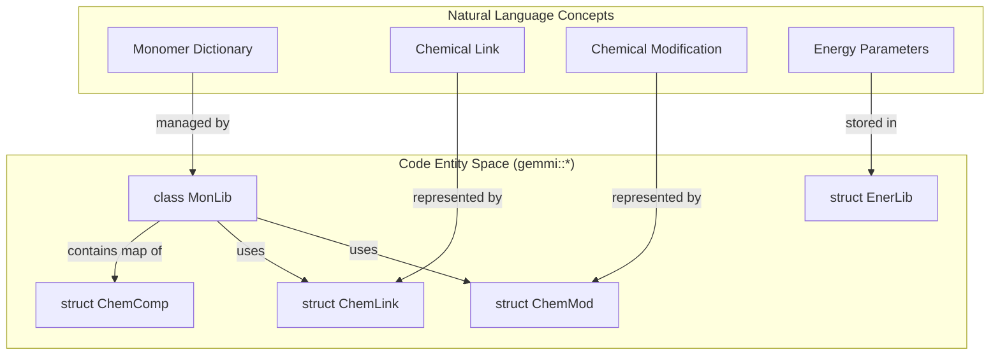
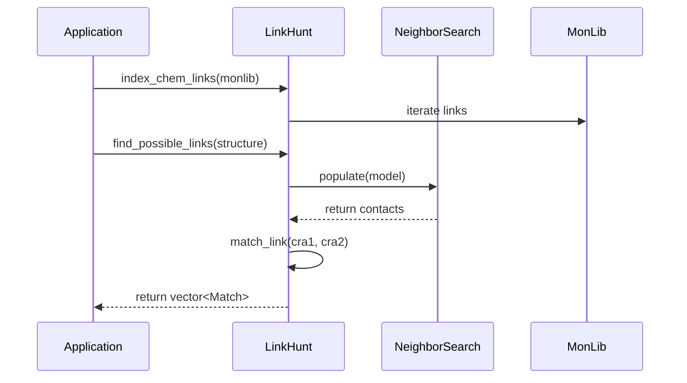
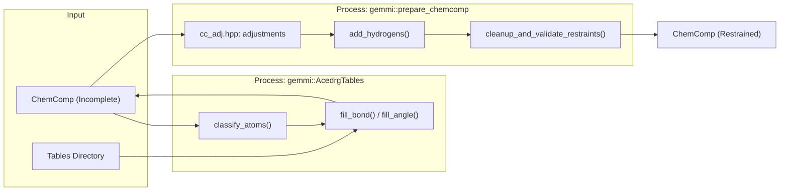

# Monomer Library

<details>
<summary>Relevant source files</summary>

The following files were used as context for generating this wiki page:

- [docs/drg-help.txt](docs/drg-help.txt)
- [docs/mondiff-help.txt](docs/mondiff-help.txt)
- [include/gemmi/ace_cc.hpp](include/gemmi/ace_cc.hpp)
- [include/gemmi/ace_graph.hpp](include/gemmi/ace_graph.hpp)
- [include/gemmi/acedrg_tables.hpp](include/gemmi/acedrg_tables.hpp)
- [include/gemmi/ener_lib.hpp](include/gemmi/ener_lib.hpp)
- [include/gemmi/linkhunt.hpp](include/gemmi/linkhunt.hpp)
- [include/gemmi/monlib.hpp](include/gemmi/monlib.hpp)
- [include/gemmi/to_chemcomp.hpp](include/gemmi/to_chemcomp.hpp)
- [prog/drg.cpp](prog/drg.cpp)
- [prog/mondiff.cpp](prog/mondiff.cpp)
- [python/chemcomp.cpp](python/chemcomp.cpp)
- [python/monlib.cpp](python/monlib.cpp)
- [src/ace_cc.cpp](src/ace_cc.cpp)
- [src/ace_graph.cpp](src/ace_graph.cpp)
- [src/acedrg_tables.cpp](src/acedrg_tables.cpp)
- [src/ener_lib.cpp](src/ener_lib.cpp)
- [src/monlib.cpp](src/monlib.cpp)
- [tests/ace_graph.cpp](tests/ace_graph.cpp)

</details>


## Purpose and Scope

The Monomer Library in Gemmi provides access to chemical component dictionaries, link definitions, and modification descriptions (typically from the Refmac/CCP4 monomer library). It enables applications to understand the chemical properties of residues, determine correct connectivity between components, and apply appropriate restraints for structure refinement. This module also includes the `AcedrgTables` system for statistical restraint lookup and the `LinkHunt` utility for automated connectivity detection.

## Overview of the Monomer Library

The Monomer Library manages four main types of data:

1.  **Monomers** (`ChemComp`): Chemical component definitions (amino acids, nucleotides, ligands).
2.  **Links** (`ChemLink`): Definitions for covalent connections between residues (e.g., peptide bonds, disulfides).
3.  **Modifications** (`ChemMod`): Rules for modifying chemical components (e.g., terminal capping).
4.  **Energy Library** (`EnerLib`): Dictionary of atom types and standard bond/vdw parameters.

### Natural Language to Code Entity Space: MonLib Architecture

This diagram maps high-level chemical concepts to the specific C++ classes and data structures used in Gemmi.



Sources: [include/gemmi/monlib.hpp:83-101](), [include/gemmi/monlib.hpp:30-60](), [include/gemmi/monlib.hpp:62-81]()

## Data Structures

### MonLib Class
The `MonLib` class [include/gemmi/monlib.hpp:83-200]() is the central coordinator. It maintains maps of monomers, links, and modifications, usually indexed by their 3-letter codes or identifiers.

| Member | Type | Description |
| :--- | :--- | :--- |
| `monomers` | `std::map<std::string, ChemComp>` | Loaded chemical components. |
| `links` | `std::map<std::string, ChemLink>` | Link definitions (e.g., TRANS, SS). |
| `modifications` | `std::map<std::string, ChemMod>` | Modifications (e.g., NH2, OC). |
| `ener_lib` | `EnerLib` | Atom types and bond length dictionary. |

### Chemical Links (ChemLink)
A `ChemLink` [include/gemmi/monlib.hpp:30-60]() defines a bond between two residues. It consists of two `Side` structures [include/gemmi/monlib.hpp:31-47]() which define the matching criteria (residue name or group) and a `Restraints` object containing the geometry.

### Chemical Modifications (ChemMod)
A `ChemMod` [include/gemmi/monlib.hpp:62-81]() defines how to alter an existing `ChemComp`. It contains `AtomMod` entries [include/gemmi/monlib.hpp:63-70]() that can change atom IDs, elements, or charges. The `apply_to()` function [include/gemmi/monlib.hpp:80-80]() executes these changes on a target `ChemComp`.

## Link Hunting and Matching

Gemmi provides sophisticated logic to match residues in a structure to the appropriate library link.

### match_link
The `match_link` function [include/gemmi/monlib.hpp:102-150]() iterates through all loaded `links` to find the most specific match for a pair of atoms in two residues. It accounts for:
*   **Residue Groups**: Matching by group (e.g., `Peptide`, `DnaRna`) [include/gemmi/monlib.hpp:36-41]().
*   **Specificity**: Links targeting specific residues (3-letter codes) score higher than group-based links [include/gemmi/monlib.hpp:42-46]().
*   **Aliasing**: Handling alternative atom naming via `ChemComp::Aliasing` [include/gemmi/monlib.hpp:22-28]().

### LinkHunt
The `LinkHunt` class [include/gemmi/linkhunt.hpp:17-176]() automates the discovery of links in a 3D structure.



Sources: [include/gemmi/linkhunt.hpp:33-90](), [include/gemmi/linkhunt.hpp:92-175]()

## Statistical Restraints (AceDRG / AcedrgTables)

Gemmi implements a port of the AceDRG `codClassify` system via `AcedrgTables`. This allows generating or filling missing restraints (bonds, angles) using statistical data derived from the Crystallography Open Database (COD) or CSD.

### Implementation Details
*   **Atom Classification**: `classify_atoms()` [src/acedrg_tables.cpp:1063-1100]() assigns hybridization [include/gemmi/acedrg_tables.hpp:27-36]() and COD-style class strings (e.g., `C[6a](C[6a]C[6a])`).
*   **Table Lookup**: `fill_restraints()` [src/acedrg_tables.cpp:1422-1460]() looks up bond lengths and angles in `.table` files.
*   **Geometry Assignment**: It can assign metal coordination geometries [include/gemmi/acedrg_tables.hpp:42-56]() like `OCTAHEDRAL` or `TETRAHEDRAL`.

### Data Flow: Restraint Generation Pipeline
This diagram shows how `AcedrgTables` and `prepare_chemcomp` interact to produce a finalized restraint set.



Sources: [src/acedrg_tables.cpp:1422-1460](), [src/ace_cc.cpp:1470-1550](), [src/ace_cc.cpp:159-250]()

## Command Line Tools

### gemmi drg
The `drg` tool [prog/drg.cpp]() is a standalone utility to fill missing restraints in a monomer CIF file.
*   **Usage**: `gemmi drg -t /path/to/tables input.cif output.cif` [prog/drg.cpp:29-60]().
*   **Functionality**: It loads `AcedrgTables`, classifies atoms, and updates the `_chem_comp_bond` and `_chem_comp_angle` categories [prog/drg.cpp:218-280]().

### gemmi mondiff
The `mondiff` tool [prog/mondiff.cpp]() compares two monomer restraint files and reports differences in bond lengths, angles, chiralities, and atom types [prog/mondiff.cpp:155-250]().

## Python API Usage

The `MonLib` and `ChemComp` structures are exposed via `nanobind`.

```python
import gemmi

# 1. Load the library
monlib = gemmi.MonLib()
monlib.read_monomer_lib("/path/to/monomers", ["ALA", "GLY"])

# 2. Access Monomers and Links
cc = monlib.monomers["ALA"]
link = monlib.get_link("TRANS")

# 3. Use AceDRG tables for statistical lookup
tables = gemmi.AcedrgTables()
tables.load_tables("/path/to/acedrg/tables")
tables.fill_restraints(cc)
```

Sources: [python/monlib.cpp:109-157](), [python/chemcomp.cpp:48-172]()

---