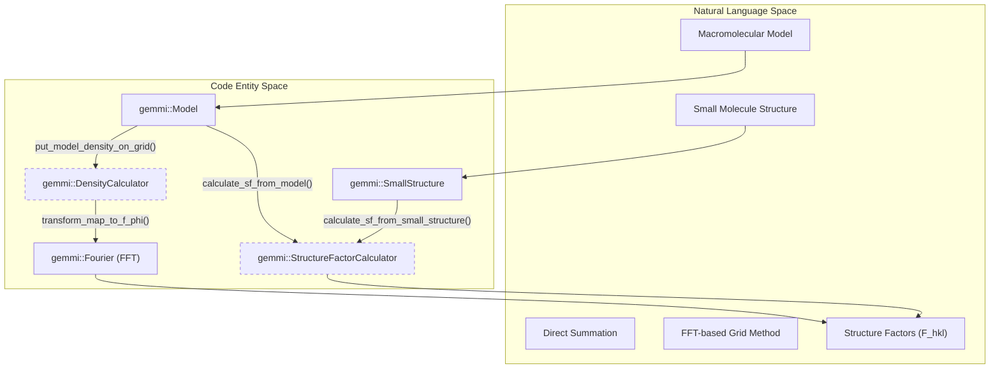
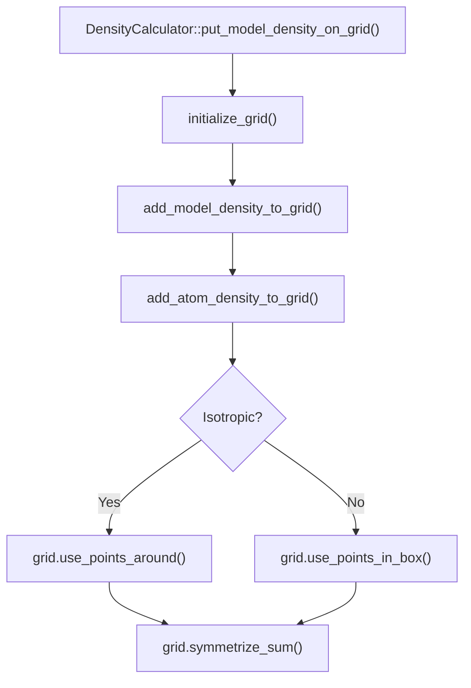

# Structure Factor Calculation

<details>
<summary>Relevant source files</summary>

The following files were used as context for generating this wiki page:

- [docs/sfcalc-help.txt](docs/sfcalc-help.txt)
- [include/gemmi/c4322.hpp](include/gemmi/c4322.hpp)
- [include/gemmi/dencalc.hpp](include/gemmi/dencalc.hpp)
- [include/gemmi/elem.hpp](include/gemmi/elem.hpp)
- [include/gemmi/formfact.hpp](include/gemmi/formfact.hpp)
- [include/gemmi/fprime.hpp](include/gemmi/fprime.hpp)
- [include/gemmi/interop.hpp](include/gemmi/interop.hpp)
- [include/gemmi/it92.hpp](include/gemmi/it92.hpp)
- [include/gemmi/levmar.hpp](include/gemmi/levmar.hpp)
- [include/gemmi/mmcif_impl.hpp](include/gemmi/mmcif_impl.hpp)
- [include/gemmi/neutron92.hpp](include/gemmi/neutron92.hpp)
- [include/gemmi/scaling.hpp](include/gemmi/scaling.hpp)
- [include/gemmi/sfcalc.hpp](include/gemmi/sfcalc.hpp)
- [prog/sfcalc.cpp](prog/sfcalc.cpp)
- [python/scaling.cpp](python/scaling.cpp)
- [python/sf.cpp](python/sf.cpp)
- [src/fprime.cpp](src/fprime.cpp)
- [tests/test_elem.py](tests/test_elem.py)
- [tests/test_prog.py](tests/test_prog.py)
- [tests/test_sf.py](tests/test_sf.py)

</details>


This document describes the structure factor calculation functionality in Gemmi, a key component used for calculating the Fourier transform of atomic models. Structure factors are essential in crystallography for comparing calculated models with experimental diffraction data. Gemmi offers both direct calculation methods for small structures and FFT-based methods for macromolecular structures.

## Overview

Structure factors represent the scattering of X-rays, electrons, or neutrons by atoms in a crystal. Gemmi supports multiple calculation methods:

1.  **Direct calculation** - computes structure factors by summing contributions from individual atoms, suitable for small molecule structures.
2.  **FFT-based calculation** - more efficient for macromolecular structures by calculating density on a grid and applying Fast Fourier Transform.

### System Architecture: Calculation Flow

The following diagram maps the high-level calculation logic to the specific C++ classes and headers responsible for the operations.



Sources: [include/gemmi/sfcalc.hpp:1-146](), [include/gemmi/dencalc.hpp:1-209](), [python/sf.cpp:15-65]()

## Direct Structure Factor Calculation

Direct calculation computes structure factors by explicit summation over all atoms in the structure. This is implemented in `include/gemmi/sfcalc.hpp`.

### The StructureFactorCalculator Class

The main class for direct structure factor calculation is `StructureFactorCalculator` [include/gemmi/sfcalc.hpp:28](). It is templated on a `Table` type which defines the scattering factor coefficients (e.g., `IT92` for X-rays, `C4322` for electrons).

| Method | Description |
| :--- | :--- |
| `calculate_sf_from_model` | Sums contributions from all atoms in a `gemmi::Model`. [include/gemmi/sfcalc.hpp:99]() |
| `calculate_sf_from_small_structure` | Sums contributions from a `gemmi::SmallStructure`. [include/gemmi/sfcalc.hpp:128]() |
| `calculate_sf_part` | Calculates the geometric part: $exp(2\pi i \mathbf{r} \cdot \mathbf{s})$. [include/gemmi/sfcalc.hpp:21]() |
| `get_scattering_factor` | Retrieves $f(s)$ from the coefficient table, adding $f'$ from `addends`. [include/gemmi/sfcalc.hpp:40]() |

### Handling Atomic Displacement Parameters (ADPs)

The calculator handles both isotropic and anisotropic ADPs:
*   **Isotropic**: Uses $exp(-B \cdot sin^2\theta/\lambda^2)$ via `dwf_iso`. [include/gemmi/sfcalc.hpp:51-56]()
*   **Anisotropic**: Uses the tensor form $exp(-2\pi^2 \mathbf{s}^T \mathbf{U} \mathbf{s})$ via `dwf_aniso`. [include/gemmi/sfcalc.hpp:62-69]()

Sources: [include/gemmi/sfcalc.hpp:28-143]()

## FFT-Based Structure Factor Calculation

For macromolecular structures, Gemmi uses a density-on-grid approach followed by FFT. This logic is primarily contained in `include/gemmi/dencalc.hpp`.

### The DensityCalculator Class

`DensityCalculator` [include/gemmi/dencalc.hpp:78]() manages the mapping of atomic coordinates and form factors onto a `gemmi::Grid`.



Key attributes:
*   **rate**: Shannon rate for grid spacing (default 1.5). [include/gemmi/dencalc.hpp:83]()
*   **blur**: Constant B-factor added to all atoms for Gaussian blurring. [include/gemmi/dencalc.hpp:84]()
*   **cutoff**: Density level below which atomic contribution is ignored. [include/gemmi/dencalc.hpp:85]()

Sources: [include/gemmi/dencalc.hpp:78-189]()

## Form Factors and Scattering Coefficients

Gemmi includes several built-in tables for scattering factors:

*   **X-ray (IT92)**: 9-coefficient (4 Gaussians + constant) Cromer-Mann parameters from International Tables Vol C. [include/gemmi/it92.hpp:27]()
*   **Electron (C4322)**: 5-Gaussian approximation from Peng et al. [include/gemmi/c4322.hpp:18]()
*   **Neutron (Neutron92)**: Fermi lengths for neutron scattering. [include/gemmi/neutron92.hpp:17]()
*   **Mott-Bethe**: Converts X-ray scattering factors to electron scattering factors. [include/gemmi/sfcalc.hpp:122]()

### Anomalous Scattering (f' and f'')
Anomalous scattering is handled via the `Addends` class [include/gemmi/addends.hpp]().
*   **f'**: Added directly to the real part of the scattering factor in `get_scattering_factor`. [include/gemmi/sfcalc.hpp:45]()
*   **f''**: Used to calculate anomalous maps or contributions when requested. [prog/sfcalc.cpp:96]()

Sources: [include/gemmi/it92.hpp:9-12](), [python/sf.cpp:84-96]()

## Scaling and Bulk Solvent Correction

Experimental data often requires scaling and bulk solvent correction to match calculated structure factors. This is implemented in `include/gemmi/scaling.hpp`.

### Scaling Parameters
The `Scaling` struct [include/gemmi/scaling.hpp:72]() manages:
*   `k_overall`: Overall scale factor.
*   `b_star`: Anisotropic scale matrix (stored as $B^*$ in fractional space). [include/gemmi/scaling.hpp:88]()
*   `k_sol`, `b_sol`: Bulk solvent parameters for the Babinet-principle based correction: $k_{sol} exp(-B_{sol} \cdot s^2)$. [include/gemmi/scaling.hpp:94-95]()

### Optimization
Gemmi uses the Levenberg-Marquardt algorithm (`LevMar`) to fit these parameters against observed data. [include/gemmi/levmar.hpp:167](), [include/gemmi/scaling.hpp:111-136]()

Sources: [include/gemmi/scaling.hpp:72-150](), [include/gemmi/levmar.hpp:167-212]()

## Command Line Interface: sfcalc

The `sfcalc` command provides a front-end to these calculations.

### Usage and Options
The tool supports both direct and FFT methods. If `--dmin` is provided, it defaults to FFT; otherwise, it uses direct calculation.

| Flag | Purpose |
| :--- | :--- |
| `--for` | Radiation type: `xray`, `electron`, `neutron`, `mott-bethe`. [docs/sfcalc-help.txt:18]() |
| `--hkl` | Calculate specific $F_{hkl}$ directly. [docs/sfcalc-help.txt:16]() |
| `--rate` | Grid oversampling rate for FFT. [docs/sfcalc-help.txt:30]() |
| `--compare` | RMSE and R-factor comparison with a reflection file. [docs/sfcalc-help.txt:55]() |
| `--scale-to` | Perform anisotropic scaling against an MTZ file. [docs/sfcalc-help.txt:38]() |

Sources: [docs/sfcalc-help.txt:1-61](), [prog/sfcalc.cpp:33-154]()

### Example CLI Output
```bash
$ gemmi sfcalc --compare=tests/2242624.hkl tests/2242624.cif
RMSE=0.019256  0.2252%  max|dF|=0.04785  R=0.191%  sum(F^2)_ratio=1.00094
```
Sources: [tests/test_prog.py:67-71]()

---