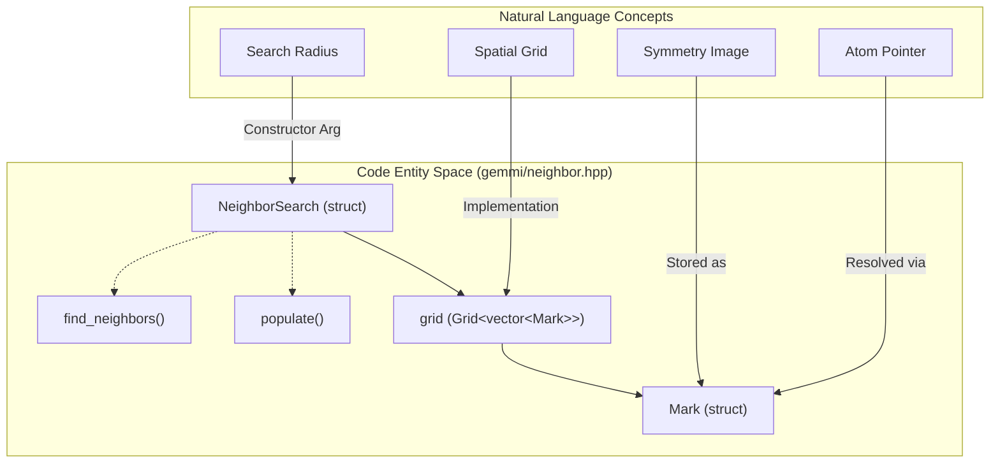
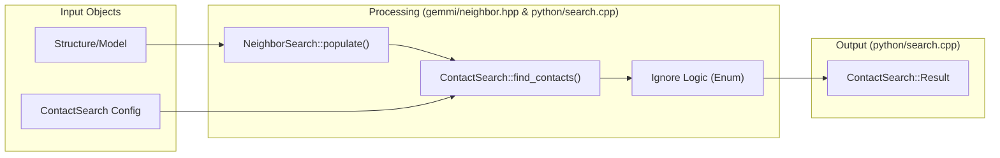

# Neighbor Search and Contacts

<details>
<summary>Relevant source files</summary>

The following files were used as context for generating this wiki page:

- [benchmarks/pdb.cpp](benchmarks/pdb.cpp)
- [docs/align-help.txt](docs/align-help.txt)
- [docs/analysis.rst](docs/analysis.rst)
- [docs/contact-help.txt](docs/contact-help.txt)
- [examples/check_conn.cpp](examples/check_conn.cpp)
- [include/gemmi/align.hpp](include/gemmi/align.hpp)
- [include/gemmi/neighbor.hpp](include/gemmi/neighbor.hpp)
- [include/gemmi/qcp.hpp](include/gemmi/qcp.hpp)
- [prog/align.cpp](prog/align.cpp)
- [prog/contact.cpp](prog/contact.cpp)
- [prog/contents.cpp](prog/contents.cpp)
- [python/align.cpp](python/align.cpp)
- [python/search.cpp](python/search.cpp)
- [src/align.cpp](src/align.cpp)
- [tests/disulf.cpp](tests/disulf.cpp)
- [tests/test_align.py](tests/test_align.py)
- [tools/pdb_ids.txt](tools/pdb_ids.txt)

</details>


This page documents Gemmi's neighbor search functionality, which efficiently finds atoms or sites near a specified position in 3D space. It also covers the contact search system that builds upon the neighbor search to identify pairs of atoms that are in contact with each other. These capabilities are essential for analyzing molecular structures, identifying interactions, and working with crystallographic data.

## Overview of Neighbor Search

Gemmi implements the cell technique (also known as cell lists, binning, or bucketing) for efficient fixed-radius neighbor search. This method divides the unit cell or the region occupied by a molecule into small cells, where each cell contains a list of atoms in its area. This spatial decomposition allows for fast lookup of atoms near a specified point.

The implementation is encapsulated in the `NeighborSearch` struct [include/gemmi/neighbor.hpp:19-19](). It is designed to handle complex crystallographic requirements, including symmetry, non-standard settings, and alternative locations.

### Natural Language to Code Entity Space: Neighbor Search

The following diagram maps high-level neighbor search concepts to specific classes and methods in the Gemmi codebase.

**Neighbor Search Architecture**


Sources: [include/gemmi/neighbor.hpp:19-54](), [docs/analysis.rst:9-33]()

## The NeighborSearch Class

The `NeighborSearch` class forms the core of the neighbor search functionality. It stores a `Grid` of `Mark` objects, where each `Mark` represents an atom (or its symmetry image) at a specific coordinate.

### Mark Structure
The `Mark` struct [include/gemmi/neighbor.hpp:21-52]() is the fundamental unit stored in the search grid. It contains:
- `pos`: The `Position` (orthogonal coordinates) of the atom image [include/gemmi/neighbor.hpp:22-22]().
- `altloc`: The alternative location indicator [include/gemmi/neighbor.hpp:23-23]().
- `image_idx`: The index of the symmetry operation used (0 for identity) [include/gemmi/neighbor.hpp:25-25]().
- `chain_idx`, `residue_idx`, `atom_idx`: Integer indices used to retrieve the original `CRA` (Chain-Residue-Atom) triple from a `Model` [include/gemmi/neighbor.hpp:26-28]().

### Initialization and Population
The constructor initializes the grid size based on the provided search radius and unit cell [include/gemmi/neighbor.hpp:63-68]().

```cpp
// C++ Signature
NeighborSearch::NeighborSearch(Model& model, const UnitCell& cell, double radius);
```

To fill the grid with data, use `populate()` or `add_chain()` [include/gemmi/neighbor.hpp:76-78](). These methods iterate through the model and create `Mark` entries for the identity and all symmetry images within the unit cell.

Sources: [include/gemmi/neighbor.hpp:19-81](), [docs/analysis.rst:42-66]()

### Search Methods
`NeighborSearch` provides several high-level search functions:

| Method | Purpose | Source |
| :--- | :--- | :--- |
| `find_atoms` | Finds all `Mark` objects within `radius` of a `Position`. | [include/gemmi/neighbor.hpp:115-126]() |
| `find_neighbors` | Finds neighbors of a specific `Atom` object, respecting `altloc`. | [include/gemmi/neighbor.hpp:128-130]() |
| `find_nearest_atom` | Finds the single closest `Mark` to a `Position`. | [include/gemmi/neighbor.hpp:155-177]() |
| `for_each` | Low-level template function that executes a callback for every neighbor. | [include/gemmi/neighbor.hpp:96-107]() |

## Contact Search

The `ContactSearch` class [python/search.cpp:80-80]() automates the process of finding interactions between different residues or symmetry mates. It uses `NeighborSearch` as its underlying engine but adds chemical intelligence, such as atomic radii and exclusion rules.

### Configuration and Filters
`ContactSearch` allows fine-grained control over which contacts are reported:
- **Exclusion Levels**: Using the `Ignore` enum, users can skip contacts within the same residue, adjacent residues, or the same chain [python/search.cpp:101-106]().
- **Atomic Radii**: Radii can be configured globally or per-element using `setup_atomic_radii()` and `set_radius()` [python/search.cpp:91-97]().
- **Occupancy**: The `min_occupancy` threshold filters out low-confidence atoms [python/search.cpp:90-90]().

### Natural Language to Code Entity Space: Contacts

This diagram illustrates how the contact detection process flows through the system.

**Contact Detection Data Flow**


Sources: [python/search.cpp:80-115](), [docs/analysis.rst:305-312]()

## Command Line Interface: `gemmi contact`

The `gemmi contact` command provides a CLI interface for the contact search functionality. It is useful for rapid analysis of PDB/mmCIF files.

### Key Options
- `-d, --maxdist=D`: Sets the global maximum distance [docs/contact-help.txt:8-8]().
- `--ignore=N`: Sets the exclusion level (1=residue, 2=adjacent, 3=chain, 4=ASU) [docs/contact-help.txt:12-13]().
- `--nosym`: Ignores contacts between symmetry-related molecules [docs/contact-help.txt:14-14]().
- `--cov`: Uses covalent radii sums instead of a fixed distance [docs/contact-help.txt:9-9]().

Sources: [docs/contact-help.txt:1-24](), [prog/contact.cpp]()

## Sequence Alignment and Superposition

While not strictly neighbor search, the `gemmi/align.hpp` header provides structural analysis tools that often follow contact detection, such as calculating RMSD between sets of coordinates.

- `calculate_superposition`: Computes the optimal rotation and translation to align two sets of residues [include/gemmi/align.hpp:73-80]().
- `align_sequence_to_polymer`: Uses dynamic programming to map a sequence string to a structural polymer [include/gemmi/align.hpp:38-69]().

Sources: [include/gemmi/align.hpp:1-170](), [python/align.cpp:12-97]()

## Performance and Benchmarking

Gemmi includes microbenchmarks for neighbor search operations to ensure efficiency.
- `neighbor_search_ctor`: Measures the time to bin atoms into the grid [benchmarks/pdb.cpp:38-45]().
- `neighbor_search_find`: Measures the performance of radial lookups [benchmarks/pdb.cpp:47-57]().

Benchmarks show that `NeighborSearch` is significantly faster than brute-force distance checks for large structures [benchmarks/pdb.cpp:168-171]().

Sources: [benchmarks/pdb.cpp:38-71](), [tests/disulf.cpp:114-135]()

---