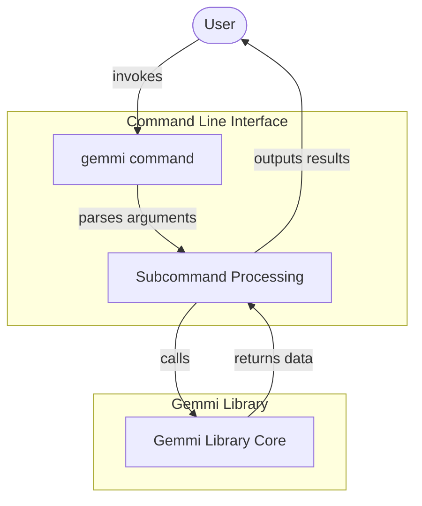
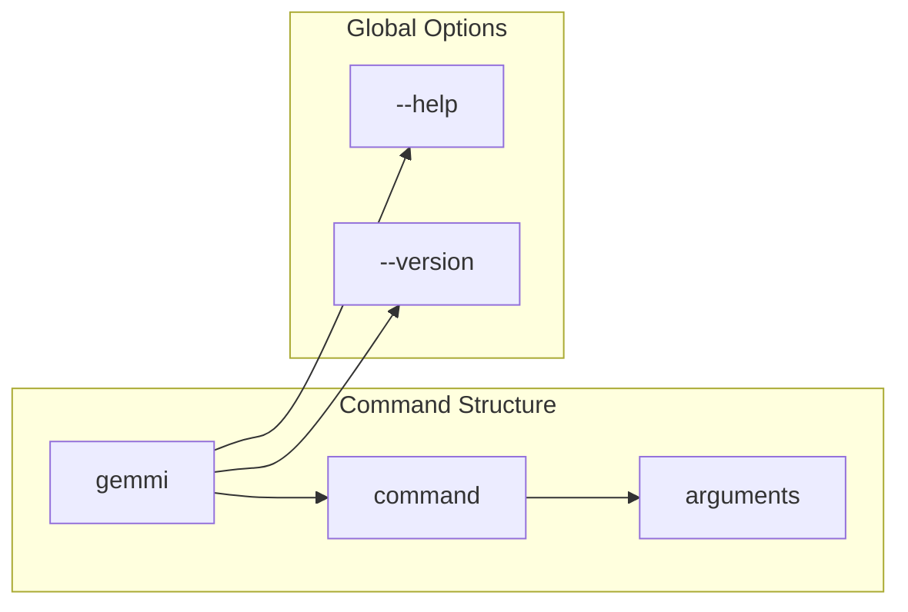
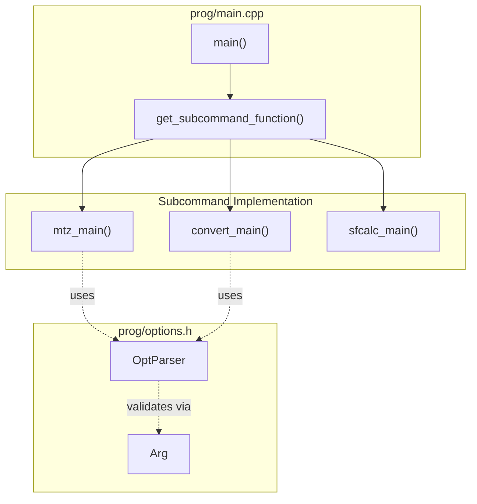

# Command Line Interface

<details>
<summary>Relevant source files</summary>

The following files were used as context for generating this wiki page:

- [.github/workflows/wheels2.yml](.github/workflows/wheels2.yml)
- [docs/gemmi-help.txt](docs/gemmi-help.txt)
- [docs/grep-help.txt](docs/grep-help.txt)
- [docs/set-help.txt](docs/set-help.txt)
- [include/gemmi/mmdb.hpp](include/gemmi/mmdb.hpp)
- [include/gemmi/version.hpp](include/gemmi/version.hpp)
- [prog/grep.cpp](prog/grep.cpp)
- [prog/main.cpp](prog/main.cpp)
- [prog/options.cpp](prog/options.cpp)
- [prog/options.h](prog/options.h)
- [prog/set.cpp](prog/set.cpp)
- [prog/wcn.cpp](prog/wcn.cpp)
- [pyproject.toml](pyproject.toml)
- [run-tests.sh](run-tests.sh)
- [tools/compare_wheels.py](tools/compare_wheels.py)
- [tools/docs-help.sh](tools/docs-help.sh)
- [tools/linux-wheels.sh](tools/linux-wheels.sh)
- [tools/release.txt](tools/release.txt)

</details>


This document provides a comprehensive guide to the Gemmi command-line interface (CLI), which allows users to access the library's functionality without writing code. For information about using Gemmi from Python, see the [Python API](#7) page.

## Overview

The Gemmi CLI is a unified executable that provides access to multiple crystallographic computing tools through a subcommand structure. It allows users to manipulate macromolecular structures, process reflection data, convert between file formats, and perform various crystallographic operations directly from the command line.

The program is built as a single binary where the `main` function [prog/main.cpp:122-124]() identifies the requested subcommand and dispatches it to a specific `*_main` function [prog/main.cpp:188-192]().



Sources: [docs/gemmi-help.txt:1-43](), [prog/main.cpp:88-98](), [prog/main.cpp:122-124]()

## Command Structure

The Gemmi CLI uses a subcommand pattern where the main `gemmi` executable is followed by a specific command and its arguments:

```bash
gemmi [--version] [--help] <command> [<args>]
```

All subcommands are registered in a `subcommands` array [prog/main.cpp:55-90]() which maps command strings to their respective implementation functions. For example, the `mtz` command maps to `mtz_main` [prog/main.cpp:30]().

All subcommands have their own help pages, accessible via:
```bash
gemmi <command> --help
```



Sources: [docs/gemmi-help.txt:8-9](), [prog/main.cpp:55-90](), [prog/main.cpp:183-201]()

## Available Commands

Gemmi CLI provides over 40 specialized commands. Detailed documentation is split into the following child pages:

### Structure Manipulation Commands
For details, see [Structure Manipulation Commands](#6.1).

These commands handle coordinate data and molecular models. Key utilities include:
*   `convert`: The primary tool for PDB/mmCIF/JSON interconversion [prog/main.cpp:63]().
*   `set`: A versatile tool for modifying coordinate files, analogous to `pdbset` [prog/main.cpp:81]().
*   `h`: Specialized tool for adding or removing hydrogen atoms [prog/main.cpp:69]().
*   `rmsz`: Geometry validation against the monomer library [prog/main.cpp:80]().

### Reflection Data Commands
For details, see [Reflection Data Commands](#6.2).

These commands process reciprocal space data. Key utilities include:
*   `mtz`: Displays header information and statistics for MTZ files [prog/main.cpp:76]().
*   `cif2mtz` / `mtz2cif`: Bi-directional conversion between mmCIF and MTZ [prog/main.cpp:59, 77]().
*   `merge`: Merging intensities from reflection files [prog/main.cpp:74]().
*   `sfcalc`: Calculation of structure factors from atomic models [prog/main.cpp:83]().

### Map and Grid Commands
For details, see [Map and Grid Commands](#6.3).

These commands manipulate 3D volumetric data. Key utilities include:
*   `map`: Information and modification of CCP4/MRC maps [prog/main.cpp:71]().
*   `sf2map` / `map2sf`: Fourier transforms between map coefficients and real-space grids [prog/main.cpp:82, 72]().
*   `mask`: Generation of bulk-solvent masks [prog/main.cpp:73]().

### CIF and JSON Utilities
Commands for low-level data manipulation:
*   `grep`: High-performance searching for tags in CIF files [docs/grep-help.txt:2-4]().
*   `validate`: Syntax validation for CIF 1.1 [prog/main.cpp:87]().
*   `cif2json` / `json2cif`: Translation between mmCIF and mmJSON formats [prog/main.cpp:58, 70]().

Sources: [docs/gemmi-help.txt:10-42](), [prog/main.cpp:52-86](), [docs/grep-help.txt:1-33]()

## Command Line Processing Architecture

Gemmi uses a custom option parser `OptParser` [prog/options.h:68-97]() which wraps a lean C++ option parser. This system handles various argument types including integers, floats, and colon-separated pairs [prog/options.cpp:70-182]().



Sources: [prog/main.cpp:106-111](), [prog/options.h:41-97](), [prog/options.cpp:70-150]()

## Version and Environment

The CLI version is tracked in `GEMMI_VERSION` [include/gemmi/version.hpp:8](). 

The CLI can also resolve PDB codes automatically if the `PDB_DIR` environment variable is set. The `coordinate_input_file` helper [prog/options.h:78]() and `expand_if_pdb_code` [prog/options.cpp:12]() handle the logic of expanding a 4-letter code into a full filesystem path.

Sources: [include/gemmi/version.hpp:8](), [prog/options.h:78](), [prog/options.cpp:12]()

## Distribution and Installation

The Gemmi CLI is distributed as part of the core library. It is built by default when using the `gemmi_prog` target in CMake [run-tests.sh:28]().

For Python users, the CLI is bundled within the `gemmi` package [pyproject.toml:11](). When installed via `pip`, the `gemmi` command is typically added to the user's PATH.

Sources: [run-tests.sh:27-30](), [pyproject.toml:11, 98]()

---