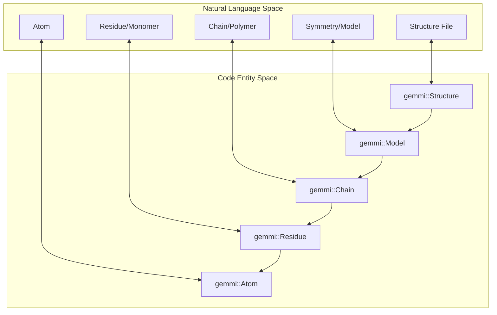
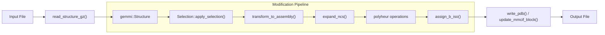
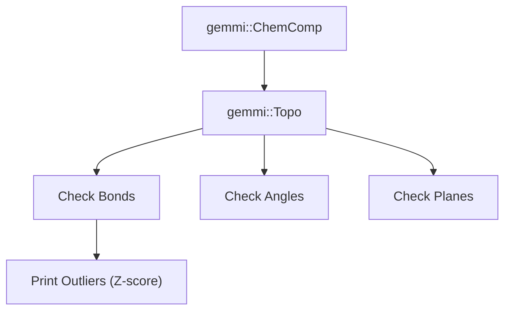

# Structure Manipulation Commands

<details>
<summary>Relevant source files</summary>

The following files were used as context for generating this wiki page:

- [docs/align-help.txt](docs/align-help.txt)
- [docs/convert-help.txt](docs/convert-help.txt)
- [docs/h-help.txt](docs/h-help.txt)
- [docs/rmsz-help.txt](docs/rmsz-help.txt)
- [docs/ss-help.txt](docs/ss-help.txt)
- [docs/tags-help.txt](docs/tags-help.txt)
- [docs/validate-help.txt](docs/validate-help.txt)
- [include/gemmi/align.hpp](include/gemmi/align.hpp)
- [include/gemmi/assembly.hpp](include/gemmi/assembly.hpp)
- [include/gemmi/ddl.hpp](include/gemmi/ddl.hpp)
- [include/gemmi/dssp.hpp](include/gemmi/dssp.hpp)
- [include/gemmi/logger.hpp](include/gemmi/logger.hpp)
- [include/gemmi/modify.hpp](include/gemmi/modify.hpp)
- [include/gemmi/polyheur.hpp](include/gemmi/polyheur.hpp)
- [include/gemmi/qcp.hpp](include/gemmi/qcp.hpp)
- [include/gemmi/seqalign.hpp](include/gemmi/seqalign.hpp)
- [prog/align.cpp](prog/align.cpp)
- [prog/contents.cpp](prog/contents.cpp)
- [prog/convert.cpp](prog/convert.cpp)
- [prog/h.cpp](prog/h.cpp)
- [prog/monlib_opt.cpp](prog/monlib_opt.cpp)
- [prog/monlib_opt.h](prog/monlib_opt.h)
- [prog/rmsz.cpp](prog/rmsz.cpp)
- [prog/ss.cpp](prog/ss.cpp)
- [prog/tags.cpp](prog/tags.cpp)
- [prog/validate.cpp](prog/validate.cpp)
- [prog/validate_mon.cpp](prog/validate_mon.cpp)
- [python/align.cpp](python/align.cpp)
- [src/align.cpp](src/align.cpp)
- [src/assembly.cpp](src/assembly.cpp)
- [src/ddl.cpp](src/ddl.cpp)
- [src/dssp.cpp](src/dssp.cpp)
- [src/polyheur.cpp](src/polyheur.cpp)
- [tests/mmcif_pdbx_v50_frag.dic](tests/mmcif_pdbx_v50_frag.dic)
- [tests/test_align.py](tests/test_align.py)

</details>


## Purpose and Scope

This page documents the commands and operations available in Gemmi for manipulating macromolecular structural data. The primary tool is the `gemmi convert` utility, which facilitates format conversion (PDB, mmCIF, mmJSON) and structural modification. Additional specialized commands such as `h`, `align`, `ss`, `rmsz`, and `validate` provide targeted analysis and manipulation capabilities.

## Overview of the Convert Command

The `gemmi convert` command is the central utility for structural transformations. It parses input files into a `gemmi::Structure` object, applies requested modifications, and serializes the result.

```bash
gemmi convert [options] INPUT_FILE OUTPUT_FILE
```

Sources: [docs/convert-help.txt:1-5](), [prog/convert.cpp:23-26]()

## Structure Hierarchy and Code Entities

To manipulate structures, Gemmi utilizes a hierarchical data model. The following diagram bridges the natural language structural concepts to the specific C++ classes used in the implementation.

### Mapping Concepts to Code Entities



Sources: [include/gemmi/model.hpp:10-15](), [include/gemmi/polyheur.hpp:10-13]()

## Structural Manipulation Operations

The `convert` utility executes a sequence of operations on the `Structure` object before output.

### Data Flow of Structural Modifications



Sources: [prog/convert.cpp:13-18](), [prog/convert.cpp:302-546](), [include/gemmi/mmread_gz.hpp:13-14]()

### Key Modification Options

| Category | Option | Implementation Function |
| :--- | :--- | :--- |
| **Selection** | `--select`, `--remove` | `gemmi::Selection` [include/gemmi/select.hpp:14-15]() |
| **Assembly** | `--assembly`, `--expand-ncs` | `gemmi::make_assembly`, `gemmi::expand_ncs` [include/gemmi/assembly.hpp:90-123]() |
| **Hydrogen** | `--remove-h` | `gemmi::remove_hydrogens` [include/gemmi/modify.hpp:43-51]() |
| **Solvent** | `--remove-waters` | `gemmi::remove_waters` [include/gemmi/polyheur.hpp:162-169]() |
| **Naming** | `--rename-chain` | `gemmi::rename_chain` [include/gemmi/modify.hpp:158-174]() |
| **B-factors** | `-B`, `--scale-biso` | `gemmi::assign_b_iso` [include/gemmi/modify.hpp:56-62]() |

Sources: [prog/convert.cpp:52-70](), [include/gemmi/modify.hpp:3-10]()

## Specialized Manipulation Commands

Beyond `convert`, Gemmi provides specialized tools for specific structural tasks.

### Hydrogen Management (`h`)
The `h` command handles hydrogen placement and removal. It uses the `gemmi::remove_hydrogens` function for deletion and can utilize chemical dictionaries for placement.
Sources: [prog/h.cpp:1-10](), [docs/h-help.txt:1-5]()

### Secondary Structure (`ss`)
The `ss` command assigns secondary structure (helices and sheets) using the DSSP algorithm or other heuristics.
- **Implementation**: `gemmi::Dssp` class.
- **Data Flow**: Reads structure -> runs `Dssp::calculate()` -> updates `Structure::helices` and `Structure::sheets`.
Sources: [include/gemmi/dssp.hpp:5-15](), [prog/ss.cpp:1-10]()

### Sequence and Residue Analysis (`seq`, `residues`)
- `residues`: Lists all residues in the structure, often used for auditing.
- `seq`: Extracts the polymer sequence. It uses `gemmi::make_one_letter_sequence` which relies on `gemmi::check_polymer_type` to identify if a chain is a peptide or nucleotide.
Sources: [include/gemmi/polyheur.hpp:105-106](), [src/polyheur.cpp:68-80]()

### Alignment and RMSD (`align`, `rmsz`)
- `align`: Performs structural alignment. It uses the `gemmi::align_sequences` function for sequence-based pre-alignment and `gemmi::superpose` for 3D coordinate alignment.
- `rmsz`: Calculates the Root Mean Square Z-score for bond lengths and angles against a monomer library (e.g., Refmac dictionary).
Sources: [include/gemmi/seqalign.hpp:195-200](), [prog/rmsz.cpp:1-10](), [include/gemmi/qcp.hpp:5-10]()

## Validation and Dictionary Checks

The `validate` command checks CIF/mmCIF files against DDL1 or DDL2 dictionaries.

### Validation Implementation Details
The `gemmi::cif::Ddl` class is the core engine for validation. It indexes the dictionary and checks the target document for:
1. **Mandatory Tags**: Ensuring required items are present.
2. **Unique Keys**: Validating that category keys do not have duplicates in loops.
3. **Parent-Child Relationships**: Checking referential integrity between linked items.
4. **Monomer Specifics**: Validating chemical restraints (bonds, angles, planes) if the `--monomer` flag is used.

Sources: [include/gemmi/ddl.hpp:17-47](), [prog/validate.cpp:168-185](), [prog/validate_mon.cpp:6-16]()

### Monomer Validation Pipeline
When validating monomer files (`-m`), Gemmi uses the `ChemComp` class to represent chemical components and `Topo` to represent the resulting topology.



Sources: [prog/validate_mon.cpp:8-15](), [prog/validate_mon.cpp:97-144]()

---