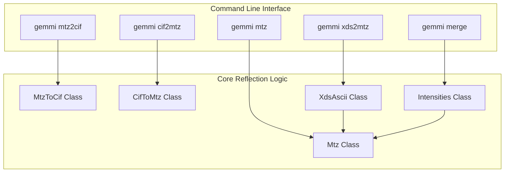
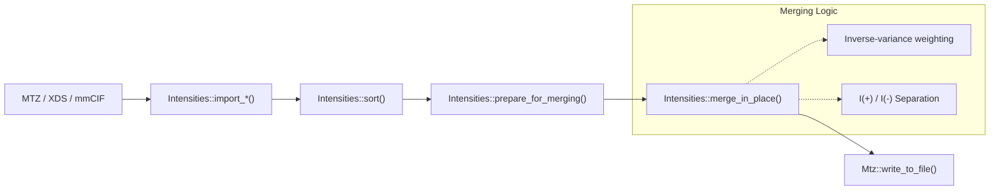

# Reflection Data Commands

Relevant source files

The following files were used as context for generating this wiki page:

- [docs/cif2mtz-help.txt](docs/cif2mtz-help.txt)
- [docs/cif2mtz-spec.txt](docs/cif2mtz-spec.txt)
- [docs/ecalc-help.txt](docs/ecalc-help.txt)
- [docs/fprime-help.txt](docs/fprime-help.txt)
- [docs/merge-help.txt](docs/merge-help.txt)
- [docs/mtz2cif-help.txt](docs/mtz2cif-help.txt)
- [docs/program.rst](docs/program.rst)
- [docs/reindex-help.txt](docs/reindex-help.txt)
- [examples/refln-stats.py](examples/refln-stats.py)
- [include/gemmi/binner.hpp](include/gemmi/binner.hpp)
- [include/gemmi/cif2mtz.hpp](include/gemmi/cif2mtz.hpp)
- [include/gemmi/ecalc.hpp](include/gemmi/ecalc.hpp)
- [include/gemmi/intensit.hpp](include/gemmi/intensit.hpp)
- [include/gemmi/mtz2cif.hpp](include/gemmi/mtz2cif.hpp)
- [include/gemmi/refln.hpp](include/gemmi/refln.hpp)
- [include/gemmi/stats.hpp](include/gemmi/stats.hpp)
- [include/gemmi/xds2mtz.hpp](include/gemmi/xds2mtz.hpp)
- [include/gemmi/xds_ascii.hpp](include/gemmi/xds_ascii.hpp)
- [prog/cif2mtz.cpp](prog/cif2mtz.cpp)
- [prog/ecalc.cpp](prog/ecalc.cpp)
- [prog/fprime.cpp](prog/fprime.cpp)
- [prog/merge.cpp](prog/merge.cpp)
- [prog/mtz2cif.cpp](prog/mtz2cif.cpp)
- [prog/reindex.cpp](prog/reindex.cpp)
- [prog/xds2mtz.cpp](prog/xds2mtz.cpp)
- [src/intensit.cpp](src/intensit.cpp)
- [src/mtz2cif.cpp](src/mtz2cif.cpp)
- [src/xds_ascii.cpp](src/xds_ascii.cpp)
- [tests/cif.cpp](tests/cif.cpp)

This page documents the command-line utilities in GEMMI for handling reflection data. Reflection data consists of diffraction observations (intensities or amplitudes) collected from crystallographic experiments, typically stored in formats like MTZ, SF-mmCIF, or XDS ASCII.

## Overview of Reflection Commands

GEMMI provides a suite of tools for inspecting, converting, and processing reflection data. These tools are built upon core classes like `gemmi::Mtz`, `gemmi::XdsAscii`, and `gemmi::Intensities`.

Sources: [include/gemmi/mtz.hpp:71-170](), [include/gemmi/mtz2cif.hpp:22-96](), [include/gemmi/cif2mtz.hpp:142-181](), [include/gemmi/intensit.hpp:76-118]()

## Conversion Commands

### mtz2cif and cif2mtz
These commands handle the conversion between the binary MTZ format and the text-based mmCIF format. `mtz2cif` is primarily used for preparing data for PDB deposition.

*   **mtz2cif**: Uses the `MtzToCif` class to map MTZ columns to mmCIF tags using a specification ("spec").
*   **cif2mtz**: Uses the `CifToMtz` class to read `_refln` or `_diffrn_refln` loops and create an MTZ file.

#### Translation Specification
The mapping is controlled by a spec format: `[FLAG] COLUMN TYPE TAG [FORMAT]`.
*   `FLAG`: `?` (optional column), `&` (dependent on previous).
*   `COLUMN`: MTZ label (e.g., `FP|F-obs`).
*   `TYPE`: MTZ type code (e.g., `F` for amplitude, `J` for intensity).
*   `TAG`: mmCIF tag (e.g., `F_meas_au`).

Sources: [include/gemmi/mtz2cif.hpp:43-91](), [src/mtz2cif.cpp:97-203](), [include/gemmi/cif2mtz.hpp:142-181](), [docs/mtz2cif-help.txt:38-63]()

### xds2mtz
Converts XDS output (`XDS_ASCII.HKL` or `INTEGRATE.HKL`) to MTZ format. It uses the `XdsAscii` structure to parse metadata (cell, symmetry, beam direction) and reflection records.

*   **Metadata Handling**: Captures `UNIT_CELL_CONSTANTS`, `SPACE_GROUP_NUMBER`, and `WAVELENGTH` [include/gemmi/xds_ascii.hpp:23-60]().
*   **Corrections**: Can apply polarization corrections and eliminate overloads based on `MAXC` values [prog/xds2mtz.cpp:87-124]().

Sources: [include/gemmi/xds_ascii.hpp:62-170](), [prog/xds2mtz.cpp:56-167]()

## Data Processing Commands

### merge
The `merge` command processes unmerged (multi-record) data into merged mean or anomalous intensities. It is centered around the `Intensities` class.

#### Data Flow in Merging

Sources: [include/gemmi/intensit.hpp:158-171](), [src/intensit.cpp:162-185](), [prog/merge.cpp:80-147]()

### ecalc
Calculates normalized structure factors (E-values). This is typically used for heavy-atom location or direct methods. It scales intensities/amplitudes such that the mean $<E^2> = 1$ in resolution shells.

Sources: [include/gemmi/ecalc.hpp:1-20](), [prog/ecalc.cpp:1-50]()

### reindex
Changes the indexing of reflections based on a transformation matrix or symmetry operation. It updates both the Miller indices ($h, k, l$) and the unit cell parameters.

Sources: [prog/reindex.cpp:1-60]()

### fprime and bfit
*   **fprime**: Calculates $f'$ and $f''$ anomalous scattering factors for a given element and wavelength using the Brennan-Cowan or Cromer-Liberman tables.
*   **bfit**: Fits B-factors to reflection data, often used for scaling or analysis of overall temperature factors.

Sources: [prog/fprime.cpp:1-40](), [include/gemmi/stats.hpp:1-30]()

## Internal Data Structures

### The Intensities Class
`Intensities` is the primary container for processing raw reflection data before it is finalized into an MTZ object.

| Member | Type | Description |
| :--- | :--- | :--- |
| `data` | `std::vector<Refl>` | Array of reflection records ($h,k,l$, value, sigma, sign) |
| `spacegroup` | `const SpaceGroup*` | Crystallographic symmetry |
| `unit_cell` | `UnitCell` | Geometry of the crystal |
| `staraniso_b` | `AnisoScaling` | Anisotropic scaling tensor (often from STARANISO) |

Sources: [include/gemmi/intensit.hpp:76-118](), [src/intensit.cpp:29-67]()

### Resolution Binning
The `Binner` class is used by commands like `merge --stats` to partition reflections into resolution shells for statistical analysis (R-merge, CC1/2).

*   **Methods**: Supports `EqualCount`, `Dstar` ($1/d$), `Dstar2` ($1/d^2$), and `Dstar3` ($1/d^3$) [include/gemmi/binner.hpp:15-20]().
*   **Statistics**: `MergingStats` aggregates data per bin to calculate $R_{pim}$, $R_{meas}$, and $CC^*$ [include/gemmi/intensit.hpp:33-71]().

Sources: [include/gemmi/binner.hpp:22-85](), [include/gemmi/intensit.hpp:167-168]()

## Summary Table of CLI Tools

| Command | Primary Class | Purpose |
| :--- | :--- | :--- |
| `mtz` | `Mtz` | Inspect headers, statistics, and metadata. |
| `mtz2cif` | `MtzToCif` | Convert MTZ to SF-mmCIF for PDB deposition. |
| `cif2mtz` | `CifToMtz` | Convert SF-mmCIF back to MTZ. |
| `xds2mtz` | `XdsAscii` | Import XDS integration results into MTZ. |
| `merge` | `Intensities` | Average multiple observations; calculate merging stats. |
| `reindex` | `Mtz` | Apply coordinate transformations to indices and cell. |
| `ecalc` | `Mtz` | Generate normalized structure factors (E). |

Sources: [prog/mtz.cpp:29-68](), [prog/mtz2cif.cpp:1-50](), [prog/cif2mtz.cpp:1-50](), [prog/xds2mtz.cpp:56-167](), [prog/merge.cpp:21-61]()

---