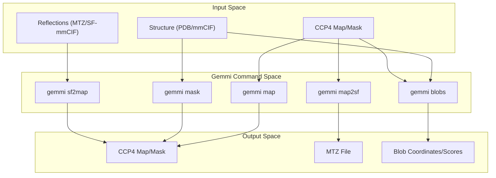
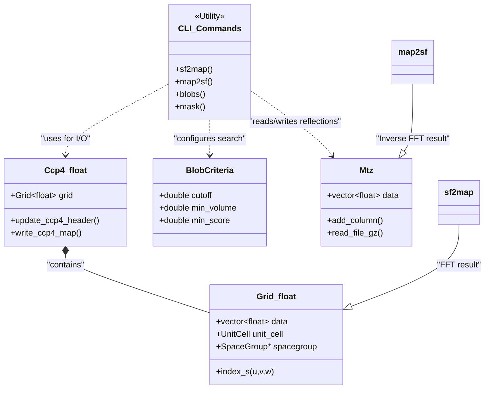

# Map and Grid Commands

Relevant source files

The following files were used as context for generating this wiki page:

- [docs/blobs-help.txt](docs/blobs-help.txt)
- [docs/map-help.txt](docs/map-help.txt)
- [docs/map2sf-help.txt](docs/map2sf-help.txt)
- [docs/mask-help.txt](docs/mask-help.txt)
- [docs/sf2map-help.txt](docs/sf2map-help.txt)
- [fortran/Makefile](fortran/Makefile)
- [fortran/gemmi.yaml](fortran/gemmi.yaml)
- [fortran/write.cpp](fortran/write.cpp)
- [include/gemmi/blob.hpp](include/gemmi/blob.hpp)
- [prog/blobs.cpp](prog/blobs.cpp)
- [prog/map.cpp](prog/map.cpp)
- [prog/map2sf.cpp](prog/map2sf.cpp)
- [prog/mapcoef.cpp](prog/mapcoef.cpp)
- [prog/mapcoef.h](prog/mapcoef.h)
- [prog/mixmtz.cpp](prog/mixmtz.cpp)
- [prog/sf2map.cpp](prog/sf2map.cpp)
- [python/ccp4.cpp](python/ccp4.cpp)

This page documents GEMMI's command-line tools for working with 3D volumetric data on a grid, particularly electron density maps, masks in the CCP4/MRC format, and blob detection. For information about the underlying Grid API and concepts, see [Grid and Map System](3.2).

## Overview of Map and Grid Commands

GEMMI provides several commands for manipulating volumetric data:

- `map`: View information, summarize statistics, or modify CCP4 maps. [prog/map.cpp:11-12]()
- `mask`: Generate bulk-solvent masks from coordinate files. [docs/mask-help.txt:1-6]()
- `sf2map`: Calculate maps from structure factors (MTZ/mmCIF map coefficients). [prog/sf2map.cpp:1-6]()
- `map2sf`: Convert CCP4 maps to structure factor columns in MTZ files. [prog/map2sf.cpp:1-3]()
- `blobs`: Search for unmodelled density peaks using flood-fill algorithms. [include/gemmi/blob.hpp:3-4]()

Sources: [docs/sf2map-help.txt:1-6](), [docs/mask-help.txt:1-6](), [docs/blobs-help.txt:1-5](), [docs/map-help.txt:1-3]()

## The `map` Command

The `map` command is the primary utility for inspecting and transforming existing CCP4 maps.

### Functionality and Implementation
The tool utilizes the `Ccp4<T>` template (where `T` is typically `float` or `int8_t`) to parse the file header and data. [python/ccp4.cpp:14-17](). Key features include:
- **Summary**: `print_info` displays header metadata including grid sampling (`mx, my, mz`), cell dimensions, and space group. [prog/map.cpp:46-83]()
- **Statistics**: Calculates min, max, mean, RMS, and median from the grid data. [prog/map.cpp:87-98]()
- **Symmetry Validation**: `--check-symmetry` compares values at symmetric points to ensure consistency. [prog/map-help.txt:10-10]()
- **Masking**: `--write-mask` creates a 0/1 mask by thresholding values, either by an explicit value or a target fraction of the volume. [prog/map.cpp:36-42]()

Sources: [prog/map.cpp:46-141](), [docs/map-help.txt:1-18]()

## The `mask` Command

The `mask` command creates a bulk-solvent mask where the macromolecule volume is typically set to 0 and solvent to 1. [docs/mask-help.txt:5-6]()

### Key Parameters
- **Radii Sets**: Supports compatibility modes for different refinement programs via `--refmac-compat` and `--cctbx-compat`. [docs/mask-help.txt:20-21]()
- **Probe/Shrink**: Uses a VdW radius + $R_{probe}$ (default 1.0Å) and a subsequent $R_{shrink}$ (default 1.1Å) to define the solvent boundary. [docs/mask-help.txt:14-15]()
- **Island Removal**: `--island-limit` removes isolated mask regions smaller than a specified volume. [docs/mask-help.txt:16-16]()

Sources: [docs/mask-help.txt:1-23]()

## Structure Factors and Maps: `sf2map` and `map2sf`

These tools bridge reciprocal space (reflections) and real space (grids).

### `sf2map` (Reciprocal to Real)
This tool searches for standard map coefficients:
- **2mFo-DFc**: Looks for MTZ labels `FWT/PHWT` or `2FOFCWT/PH2FOFCWT`. [docs/sf2map-help.txt:8-10]()
- **mFo-DFc**: (Difference maps) Uses `-d` to find `DELFWT/PHDELWT`. [docs/sf2map-help.txt:11-13]()

The implementation uses `read_sf_and_fft_to_map` which performs the Fast Fourier Transform (FFT) to generate the `Grid<float>`. [prog/sf2map.cpp:76-78](). It can also apply a box mask around a structure using `--mapmask`. [prog/sf2map.cpp:88-107]()

### `map2sf` (Real to Reciprocal)
Performs the inverse operation using `transform_map_to_f_phi`. [prog/map2sf.cpp:71-71](). It can either create a new MTZ file or add columns to an existing "base" file using `-b`. [prog/map2sf.cpp:33-34]()

Sources: [prog/sf2map.cpp:67-109](), [prog/map2sf.cpp:48-125](), [prog/mapcoef.cpp:56-93]()

## Blob Detection: The `blobs` Command

The `blobs` command identifies peaks of unmodelled density, similar to CCP4 PEAKMAX. [include/gemmi/blob.hpp:3-4]()

### Algorithm: Flood Fill
The core logic resides in `find_blobs_by_flood_fill`. [include/gemmi/blob.hpp:82-84](). 
1. **Masking**: It creates an ASU mask to ensure each blob is only counted once. [include/gemmi/blob.hpp:91-91]()
2. **Expansion**: Starting from a point above the `cutoff`, it uses a 6-neighbor move set to find all contiguous points above the threshold. [include/gemmi/blob.hpp:108-130]()
3. **Symmetry Handling**: It uses `GridOp` to check if a blob's neighbor is a symmetry mate already processed in the ASU. [include/gemmi/blob.hpp:121-126]()

### Blob Properties
Each detected `Blob` contains:
- `volume`: Total volume in ų. [include/gemmi/blob.hpp:19-19]()
- `score`: Integrated density (sum of values * volume per point). [include/gemmi/blob.hpp:20-20]()
- `centroid`: Orthogonal coordinates of the density-weighted center. [include/gemmi/blob.hpp:22-22]()

Sources: [include/gemmi/blob.hpp:18-137](), [prog/blobs.cpp:90-182]()

## Data Flow and Code Entities

The following diagram maps the CLI commands to the underlying C++ classes and data structures.

Sources: [python/ccp4.cpp:15-33](), [include/gemmi/blob.hpp:18-32](), [prog/map2sf.cpp:72-121](), [prog/sf2map.cpp:76-81]()

### Summary Table of Map Commands

| Command | Primary Input | Primary Output | Key Implementation Header |
| :--- | :--- | :--- | :--- |
| `map` | CCP4 Map | CCP4 Map / Info | `gemmi/ccp4.hpp` |
| `mask` | PDB/mmCIF | CCP4 Mask (Mode 0) | `gemmi/solmask.hpp` |
| `sf2map` | MTZ/mmCIF | CCP4 Map (Mode 2) | `gemmi/fourier.hpp` |
| `map2sf` | CCP4 Map | MTZ/mmCIF | `gemmi/fourier.hpp` |
| `blobs` | Map + Model | Text List | `gemmi/blob.hpp` |

Sources: [python/ccp4.cpp:61-71](), [prog/sf2map.cpp:11-12](), [prog/map2sf.cpp:9-12](), [prog/blobs.cpp:6-12]()

---