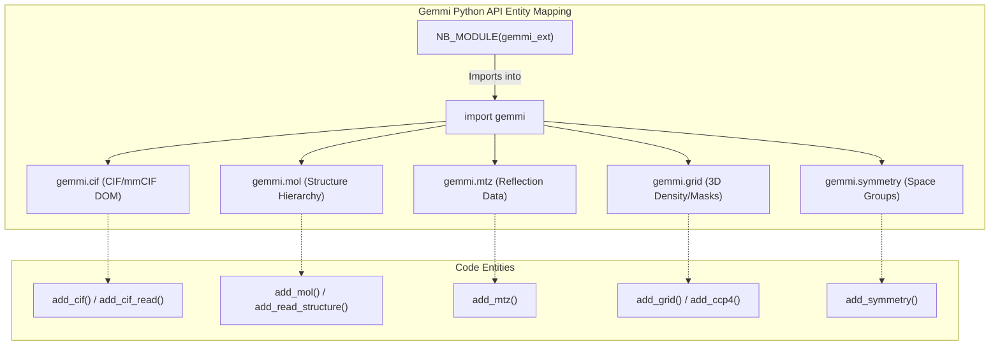
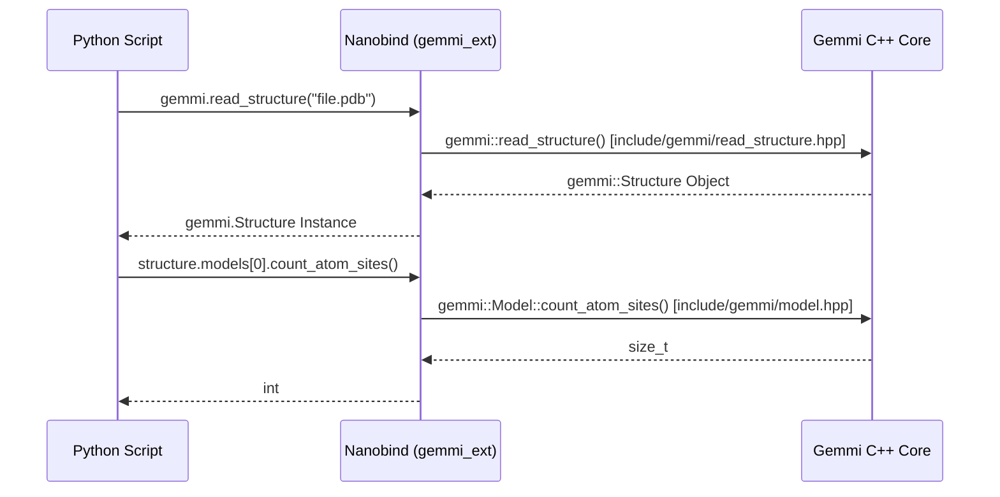

# Python API

Relevant source files

The following files were used as context for generating this wiki page:

- [.github/workflows/wheels2.yml](.github/workflows/wheels2.yml)
- [CMakeLists.txt](CMakeLists.txt)
- [docs/gemmi-help.txt](docs/gemmi-help.txt)
- [include/gemmi/mmdb.hpp](include/gemmi/mmdb.hpp)
- [include/gemmi/version.hpp](include/gemmi/version.hpp)
- [pyproject.toml](pyproject.toml)
- [python/common.h](python/common.h)
- [python/gemmi.cpp](python/gemmi.cpp)
- [run-tests.sh](run-tests.sh)
- [tools/compare_wheels.py](tools/compare_wheels.py)
- [tools/linux-wheels.sh](tools/linux-wheels.sh)
- [tools/release.txt](tools/release.txt)

This page provides a high-level overview of the Gemmi Python bindings. Gemmi is designed to be a fast and comprehensive library for macromolecular crystallography, and its Python API allows for efficient data manipulation, file I/O, and crystallographic calculations directly within Python environments.

The bindings are implemented using **nanobind** [python/common.h:11-25](), ensuring high performance and seamless integration with C++ structures.

## Module Organization

The `gemmi` package is organized into several sub-modules that map to specific crystallographic and structural biology domains.

Sources: [python/gemmi.cpp:159-165](), [python/common.h:27-49]()

## Core Components

### 1. Macromolecular Structures
The `gemmi.Structure` class is the central container for coordinate data, following the hierarchy: `Structure` → `Model` → `Chain` → `Residue` → `Atom`.
* **Key Functions**: `read_structure()`, `setup_entities()`, and `write_pdb()`/`write_mmcif()`.
* **Details**: For manipulation, selections, and hierarchy traversal, see [Working with Structures in Python](#7.1).

### 2. Grids and Maps
Gemmi handles 3D volumetric data through the `Grid` classes (e.g., `FloatGrid`, `Int8Grid`). It supports reading and writing CCP4/MRC map files.
* **Key Classes**: `Ccp4` (map wrapper), `Grid`, `UnitCell`.
* **Details**: For interpolation, masking, and NumPy integration, see [Grid and Map Operations in Python](#7.2).

### 3. Reflection Data
Reflection data (intensities, amplitudes, phases) is managed primarily through the `Mtz` class or `AsuData` for generic reciprocal space data.
* **Key Classes**: `Mtz`, `ReflnBlock`, `MtzToCif`.
* **Details**: For HKL manipulation and Fourier transforms, see [Reflection Data in Python](#7.3).

### 4. Crystallographic Symmetry
Symmetry operations are represented by the `Op` class, while `SpaceGroup` provides access to the International Tables for Crystallography data.
* **Key Classes**: `SpaceGroup`, `GroupOps`, `Op`.
* **Details**: For space group lookup and coordinate transformations, see [Symmetry Operations in Python](#7.4).

## System Architecture

The Python API bridges high-level Python calls to the underlying C++ header-only core.

Sources: [python/gemmi.cpp:170-180](), [python/common.h:61-71]()

## Utility Modules

Gemmi provides several utility functions and classes in the top-level module:
* **File Walking**: `CifWalk` and `CoorFileWalk` for iterating over directories and expanding PDB codes [python/gemmi.cpp:48-57]().
* **Sequence Tools**: Functions for one-letter codes and sequence weight calculations [python/gemmi.cpp:78-82]().
* **Statistics**: The `Correlation` class for calculating CC and R-factors across data bins [python/gemmi.cpp:85-154]().
* **Constants**: Physical constants such as `hc` (Planck's constant * speed of light) [python/gemmi.cpp:64]().

| Feature | Python Entity | C++ Source |
| :--- | :--- | :--- |
| PDB ID expansion | `expand_if_pdb_code` | [include/gemmi/pdb_id.hpp:6-7]() |
| FASTA reading | `read_pir_or_fasta` | [include/gemmi/pirfasta.hpp:8]() |
| Error Handling | `tao::pegtl::parse_error` | [python/gemmi.cpp:177-179]() |

Sources: [python/gemmi.cpp:47-155](), [python/common.h:27-49]()

---