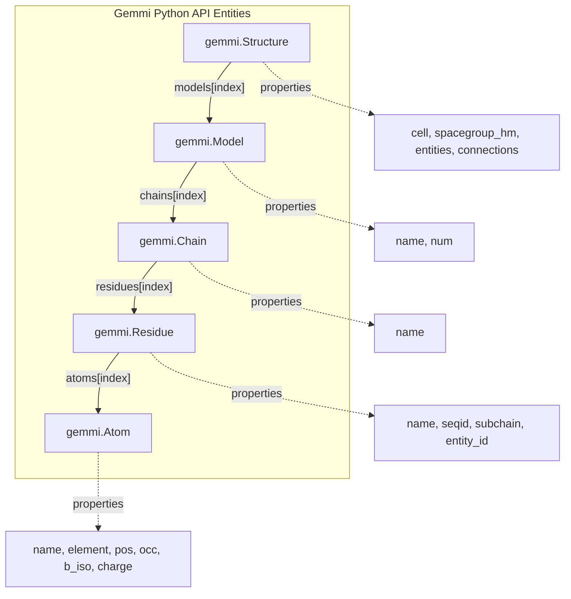
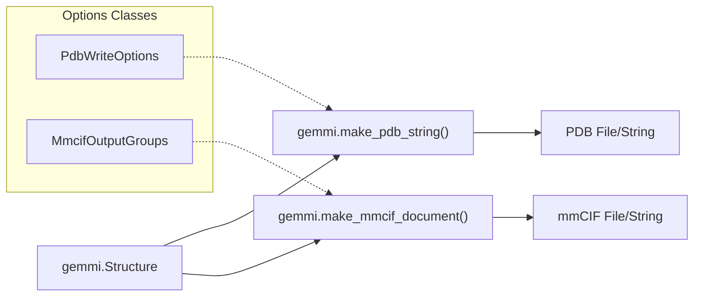

# Working with Structures in Python

<details>
<summary>Relevant source files</summary>

The following files were used as context for generating this wiki page:

- [docs/mol.rst](docs/mol.rst)
- [examples/aafreq.py](examples/aafreq.py)
- [examples/col_order.py](examples/col_order.py)
- [examples/matthews.py](examples/matthews.py)
- [examples/monomers.py](examples/monomers.py)
- [examples/simple_search.py](examples/simple_search.py)
- [examples/weight.py](examples/weight.py)
- [include/gemmi/flat.hpp](include/gemmi/flat.hpp)
- [include/gemmi/metadata.hpp](include/gemmi/metadata.hpp)
- [include/gemmi/mmcif.hpp](include/gemmi/mmcif.hpp)
- [include/gemmi/model.hpp](include/gemmi/model.hpp)
- [include/gemmi/pdb.hpp](include/gemmi/pdb.hpp)
- [include/gemmi/pymol_select.hpp](include/gemmi/pymol_select.hpp)
- [include/gemmi/serialize.hpp](include/gemmi/serialize.hpp)
- [include/gemmi/small.hpp](include/gemmi/small.hpp)
- [include/gemmi/smcif.hpp](include/gemmi/smcif.hpp)
- [include/gemmi/to_mmcif.hpp](include/gemmi/to_mmcif.hpp)
- [include/gemmi/to_pdb.hpp](include/gemmi/to_pdb.hpp)
- [python/meta.cpp](python/meta.cpp)
- [python/meta.h](python/meta.h)
- [python/mol.cpp](python/mol.cpp)
- [python/read.cpp](python/read.cpp)
- [python/small.cpp](python/small.cpp)
- [python/write.cpp](python/write.cpp)
- [src/flat.cpp](src/flat.cpp)
- [src/mmcif.cpp](src/mmcif.cpp)
- [src/pdb.cpp](src/pdb.cpp)
- [src/to_mmcif.cpp](src/to_mmcif.cpp)
- [tests/2242624.cif](tests/2242624.cif)
- [tests/2242624.hkl](tests/2242624.hkl)
- [tests/test_mol.py](tests/test_mol.py)
- [tests/test_smallmol.py](tests/test_smallmol.py)
- [tools/check_serialize.py](tools/check_serialize.py)

</details>


This page documents how to use Gemmi's Python bindings to work with macromolecular structure models. The `Structure` class and its components (`Model`, `Chain`, `Residue`, `Atom`) form the core system for representing biological macromolecules. This hierarchy allows users to navigate, analyze, and modify structural data programmatically.

## Structure Hierarchy

The structure model in Gemmi follows a hierarchical organization that mirrors the standard biological and crystallographic organization of macromolecular models.

### Relationship to Code Entities

The structure hierarchy directly maps to Gemmi's class hierarchy in the Python API. The following diagram bridges the biological concepts to the specific classes defined in the codebase.

**Diagram: Mapping Biological Structure to Gemmi Classes**

Sources: [include/gemmi/model.hpp:136-1056](), [python/mol.cpp:78-84]()

## Reading and Writing Structures

### Reading Structures
Gemmi supports reading multiple file formats, including mmCIF, PDB, and mmJSON. The `read_structure` function is the primary entry point, capable of detecting formats from file extensions or content.

| Function | Description | Source |
| :--- | :--- | :--- |
| `gemmi.read_structure(path)` | Reads a coordinate file into a `Structure` object. | [python/read.cpp:84-93]() |
| `gemmi.read_pdb(path)` | Specifically reads a PDB file with `PdbReadOptions`. | [python/read.cpp:114-119]() |
| `gemmi.make_structure_from_block(block)` | Creates a structure from an existing mmCIF `cif.Block`. | [python/read.cpp:94-95]() |

Sources: [python/read.cpp:84-120](), [include/gemmi/model.hpp:88-90]()

### Writing Structures
Structures can be serialized back to various formats using dedicated writer functions.

**Diagram: Data Flow for Structure Serialization**

Sources: [include/gemmi/to_pdb.hpp:5-54](), [include/gemmi/to_mmcif.hpp:13-64]()

## Navigating the Structure

Traversing the hierarchy in Python utilizes standard indexing and iteration protocols.

### Direct Access and Iteration
*   **Structure to Model**: `st[0]` or `for model in st:`.
*   **Model to Chain**: `model[0]` or `model['A']`.
*   **Chain to Residue**: `chain[0]` or `chain.residues`.
*   **Residue to Atom**: `residue[0]` or `residue.atoms`.

Sources: [python/mol.cpp:162-166](), [python/mol.cpp:227-234](), [python/mol.cpp:317-327](), [python/mol.cpp:469-475]()

### Selection and Filtering
Gemmi provides the `Selection` class for complex queries (e.g., selecting by chain name, residue range, or atom element).

```python
import gemmi
st = gemmi.read_structure('file.pdb')
sel = gemmi.Selection(chain_names=['A'], elements=[gemmi.Element('C')])
for cra in sel.models(st[0]):
    print(cra.atom.name)
```
Sources: [python/mol.cpp:579-626](), [include/gemmi/model.hpp:842-845]()

## Modifying Structures

The Python API allows for both high-level transformations and low-level attribute modifications.

### Structural Modifications
The following functions in the `gemmi` namespace (implemented in `modify.hpp` and bound in `mol.cpp`) facilitate common cleanup tasks:

*   `remove_waters(structure)`: Deletes residues identified as water. [python/mol.cpp:174-176]()
*   `remove_hydrogens(structure)`: Removes all hydrogen atoms. [python/mol.cpp:201-203]()
*   `remove_alternative_conformations(structure)`: Keeps only the primary conformer (blank or 'A'). [python/mol.cpp:195-197]()

### Example: Mutating Residues
Users can modify attributes like atom names or elements directly during iteration.

```python
for model in st:
    for chain in model:
        for residue in chain:
            if residue.name == 'MET':
                residue.name = 'MSE'
                for atom in residue:
                    if atom.name == 'SD':
                        atom.name = 'SE'
                        atom.element = gemmi.Element('Se')
```
Sources: [docs/mol.rst:41-54](), [include/gemmi/model.hpp:136-150]()

## Metadata and Properties

### Unit Cell and Symmetry
The `Structure` object contains crystallographic metadata:
*   `st.cell`: A `UnitCell` object managing dimensions and angles. [python/mol.cpp:136]()
*   `st.spacegroup_hm`: The Hermann-Mauguin symbol of the space group. [python/mol.cpp:137]()

### Entities and Connections
*   `st.entities`: List of `Entity` objects describing chemical components (polymers, non-polymers, water). [python/mol.cpp:141]()
*   `st.connections`: List of `Connection` objects representing bonds like disulfides or links. [python/mol.cpp:142]()

Sources: [include/gemmi/model.hpp:883-917](), [python/mol.cpp:136-142](), [python/meta.cpp:127-165]()

## Important Usage Notes

### setup_entities()
It is highly recommended to call `st.setup_entities()` after reading a structure. This function populates the `entities` list and assigns `subchain` and `entity_id` to residues based on heuristics if they are missing from the input file. This is critical for functions that depend on polymer/ligand classification.

Sources: [docs/mol.rst:151-163](), [include/gemmi/model.hpp:952-964]()

### Coordinate Formats
The `CoorFormat` enum determines how Gemmi interprets the input:
*   `CoorFormat.Pdb`: Standard PDB format.
*   `CoorFormat.Mmcif`: PDBx/mmCIF format.
*   `CoorFormat.ChemComp`: Chemical Component Dictionary (CCD) files.

Sources: [include/gemmi/model.hpp:88-90](), [python/mol.cpp:94-100]()

---