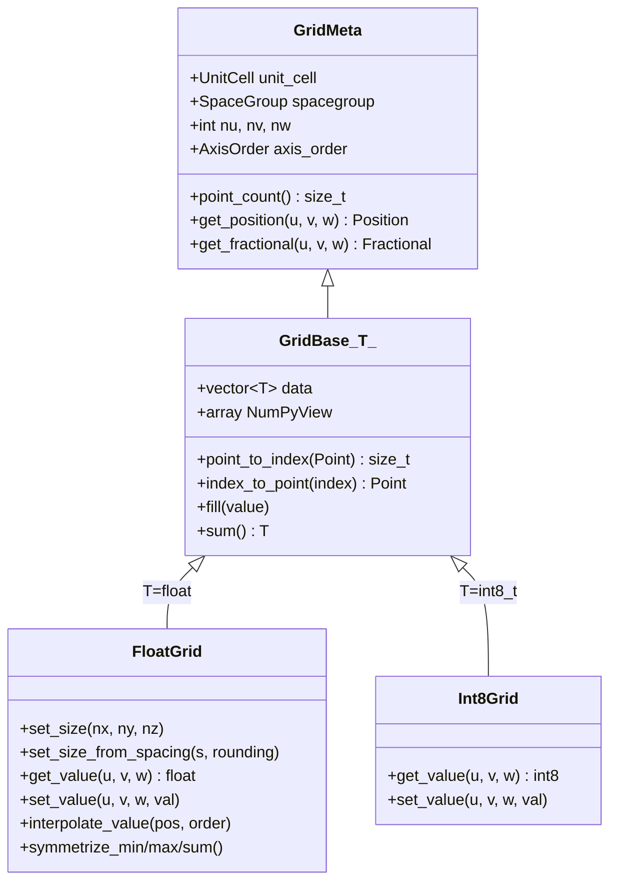

# Grid and Map Operations in Python

<details>
<summary>Relevant source files</summary>

The following files were used as context for generating this wiki page:

- [docs/grid.rst](docs/grid.rst)
- [docs/img/patterson_slice.png](docs/img/patterson_slice.png)
- [docs/map2sf-help.txt](docs/map2sf-help.txt)
- [examples/cif_i_sigi.py](examples/cif_i_sigi.py)
- [examples/map2mtz.py](examples/map2mtz.py)
- [examples/maskcheck.py](examples/maskcheck.py)
- [examples/maskdiff.py](examples/maskdiff.py)
- [examples/merge_mtz_mmcif.py](examples/merge_mtz_mmcif.py)
- [examples/patterson_slice.py](examples/patterson_slice.py)
- [fortran/Makefile](fortran/Makefile)
- [fortran/gemmi.yaml](fortran/gemmi.yaml)
- [fortran/write.cpp](fortran/write.cpp)
- [include/gemmi/grid.hpp](include/gemmi/grid.hpp)
- [include/gemmi/solmask.hpp](include/gemmi/solmask.hpp)
- [prog/map.cpp](prog/map.cpp)
- [prog/map2sf.cpp](prog/map2sf.cpp)
- [prog/mask.cpp](prog/mask.cpp)
- [prog/mixmtz.cpp](prog/mixmtz.cpp)
- [python/ccp4.cpp](python/ccp4.cpp)
- [python/grid.cpp](python/grid.cpp)
- [tests/test_grid.py](tests/test_grid.py)

</details>


This documentation covers how to work with three-dimensional volumetric data (grids) and electron density maps in GEMMI's Python API. Grids in GEMMI are used to represent electron density maps, solvent masks, and other volumetric data in crystallography. This page focuses specifically on the Python interface for creating, manipulating, and analyzing grid data.

For information about the underlying C++ implementation, see [Core Data Structures]() and specifically [Grid and Map System](). For command-line tools related to maps and grids, see [Map and Grid Commands]().

## Grid Classes and Hierarchy

GEMMI provides a hierarchy of grid classes in Python, with specialized grids for different data types. The base metadata and common functionality are defined in `GridMeta` and `GridBase`.

### Grid Class Structure


Sources: [include/gemmi/grid.hpp:168-216](), [include/gemmi/grid.hpp:218-285](), [python/grid.cpp:43-75](), [python/grid.cpp:78-162]()

### Available Grid Types

GEMMI provides several grid types in Python, each optimized for different use cases:

| Grid Type | Data Type | Typical Use |
|-----------|-----------|-------------|
| `FloatGrid` | 32-bit floating point | Electron density maps |
| `Int8Grid` | 8-bit integers (-128 to 127) | Binary masks |
| `ComplexGrid` | Complex numbers | Fourier transforms |

The choice of grid type affects available operations. For example, only `FloatGrid` supports interpolation and normalization operations.

Sources: [python/grid.cpp:217-257](), [docs/grid.rst:34-37]()

## Creating and Initializing Grids

There are several ways to create grid objects in Python, including direct initialization or from NumPy arrays.

### Initialization Methods
```python
import gemmi
import numpy

# Empty grid with specified dimensions
grid = gemmi.FloatGrid(12, 12, 12)

# Creating from a 3D NumPy array (Fortran-style contiguous preferred)
arr = numpy.zeros((30, 31, 32), dtype=numpy.float32)
grid2 = gemmi.FloatGrid(arr)

# Setting grid size based on desired spacing and rounding
grid.set_unit_cell(gemmi.UnitCell(40, 50, 40, 90, 90, 90))
grid.set_size_from_spacing(1.2, gemmi.GridSizeRounding.Nearest)
```

Sources: [python/grid.cpp:87-104](), [docs/grid.rst:65-91]()

## Basic Grid Operations

### Accessing and Modifying Grid Values

Grid values can be accessed using `get_value` and `set_value`, which support periodic boundary conditions (PBC) by wrapping indices.

```python
# Accessing values with index wrapping
grid.set_value(1, 1, 1, 7.0)
val = grid.get_value(-11, 13, 25) # Returns 7.0 if grid size is 12x12x12
```

### Grid Point Objects
The `Point` helper class bundles coordinates and a pointer to the value.

```python
point = grid.get_point(6, 6, 6)
print(point.u, point.v, point.w, point.value)

# Coordinate conversions
frac = grid.point_to_fractional(point)
pos = grid.point_to_position(point)
```

Sources: [python/grid.cpp:48-58](), [docs/grid.rst:101-106](), [docs/grid.rst:209-245]()

### NumPy Integration
The `array` property provides a NumPy view of the grid data without copying. The layout is Fortran-style contiguous (X is fast, Z is slow).

```python
# Access as NumPy array
view = grid.array
print(view.shape) # (nu, nv, nw)

# Subarray operations
sub = grid.get_subarray(start=[0,0,0], shape=[5,5,5])
grid.set_subarray(sub, start=[10,10,10])
```

Sources: [python/grid.cpp:34-40](), [python/grid.cpp:132-146](), [docs/grid.rst:108-122]()

## Symmetry Operations

GEMMI grids understand crystallographic symmetry. After setting the `spacegroup` property, `symmetrize` functions apply operations to all symmetry-equivalent grid points.

```python
grid.spacegroup = gemmi.find_spacegroup_by_name('P2')
grid.symmetrize_max() # Set all equivalent points to the maximum value found among them
grid.symmetrize_sum() # Sum values of equivalent points (multiplies on special positions)
```

Sources: [include/gemmi/grid.hpp:719-781](), [docs/grid.rst:140-171]()

## Interpolation

GEMMI supports interpolation at arbitrary fractional or orthogonal positions.

| Method | Order | Implementation |
|--------|-------|----------------|
| Nearest | 0 | Returns value of the closest grid point |
| Trilinear | 1 | Standard linear interpolation |
| Tricubic | 3 | Catmull–Rom spline interpolation |

```python
# Interpolate at a position
val = grid.interpolate_value(gemmi.Position(1.2, 3.4, 5.6), order=1)

# Batch interpolation using NumPy arrays
positions = numpy.array([[0,0,0], [5,5,5]], dtype=numpy.float64)
values = grid.interpolate_position_array(positions)
```

Sources: [include/gemmi/grid.hpp:153-158](), [python/grid.cpp:168-212](), [docs/grid.rst:342-463]()

## CCP4 Maps and I/O

The `Ccp4Map` (for `FloatGrid`) and `Ccp4Mask` (for `Int8Grid`) classes handle file I/O for CCP4/MRC formats.

### Reading and Writing Maps
```python
# Read map and setup grid (reordering axes to XYZ)
m = gemmi.read_ccp4_map('file.ccp4', setup=True)
grid = m.grid

# Write map
m.update_ccp4_header()
m.write_ccp4_map('output.ccp4')
```

Sources: [python/ccp4.cpp:59-72](), [docs/grid.rst:752-816]()

## Specialized Operations

### Solvent Masking
The `SolventMasker` class generates masks for bulk solvent regions based on atomic radii.

```python
masker = gemmi.SolventMasker(gemmi.AtomicRadiiSet.Cctbx)
masker.rprobe = 1.0
masker.rshrink = 1.1

grid = gemmi.Int8Grid()
grid.setup_from(structure, spacing=0.5)
masker.put_mask_on_int8_grid(grid, structure[0])
```

Sources: [include/gemmi/solmask.hpp:107-130](), [include/gemmi/solmask.hpp:356-426](), [examples/maskcheck.py:37-44]()

### Blob Detection
Find connected regions of density above a specified threshold.

```python
# Find blobs
blobs = gemmi.find_blobs_by_flood_fill(grid, cutoff=0.5, min_volume=10.0)

for blob in blobs:
    print(blob.centroid, blob.volume, blob.peak_value)
```

Sources: [python/grid.cpp:295-306](), [docs/grid.rst:600-632]()

### Masked ASU
`MaskedGrid` provides an iterator and mask array for the asymmetric unit (ASU).

```python
asu = grid.masked_asu()
mask_view = asu.mask_array # 1 for ASU points, 0 otherwise
for point in asu:
    # Iterates only over points in the ASU
    pass
```

Sources: [python/grid.cpp:152-160](), [docs/grid.rst:476-508]()

---