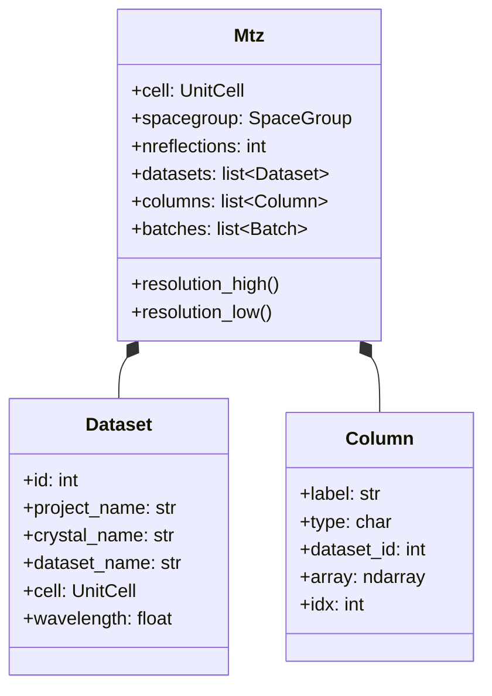
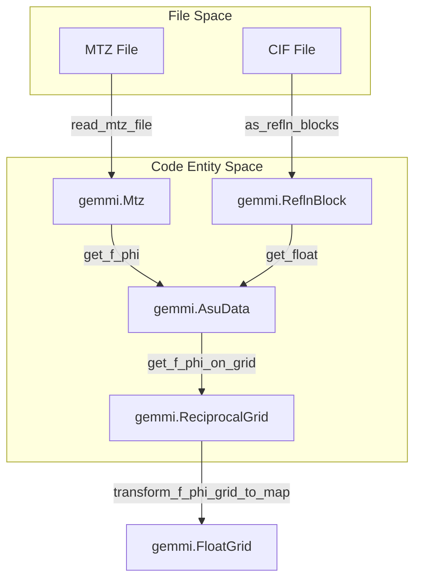

# Reflection Data in Python

<details>
<summary>Relevant source files</summary>

The following files were used as context for generating this wiki page:

- [docs/hkl.rst](docs/hkl.rst)
- [docs/img/patterson_slice.png](docs/img/patterson_slice.png)
- [examples/cif_i_sigi.py](examples/cif_i_sigi.py)
- [examples/map2mtz.py](examples/map2mtz.py)
- [examples/maskcheck.py](examples/maskcheck.py)
- [examples/maskdiff.py](examples/maskdiff.py)
- [examples/merge_mtz_mmcif.py](examples/merge_mtz_mmcif.py)
- [examples/patterson_slice.py](examples/patterson_slice.py)
- [include/gemmi/asudata.hpp](include/gemmi/asudata.hpp)
- [include/gemmi/fourier.hpp](include/gemmi/fourier.hpp)
- [include/gemmi/mtz.hpp](include/gemmi/mtz.hpp)
- [include/gemmi/recgrid.hpp](include/gemmi/recgrid.hpp)
- [python/hkl.cpp](python/hkl.cpp)
- [python/mtz.cpp](python/mtz.cpp)
- [python/recgrid.cpp](python/recgrid.cpp)
- [tests/test_hkl.py](tests/test_hkl.py)

</details>


This page documents how to work with crystallographic reflection data in the Gemmi Python API. It covers reading, manipulating, and analyzing reflection data from various file formats including MTZ, SF-mmCIF, and XDS ASCII.

## Overview

Gemmi supports four primary reflection file formats [docs/hkl.rst:7-13]():
1.  **MTZ files**: Binary format, most popular in macromolecular crystallography.
2.  **Structure factor mmCIF files**: Used for archiving in the PDB.
3.  **XDS ASCII format**: Output from XDS image processing.
4.  **Small molecule structure factor CIF files**: Usually with `.hkl` extension.

Reflection files store Miller indices ($hkl$) with associated values such as intensities, structure factor amplitudes ($F$), phases ($\phi$), and error estimates ($\sigma$) [docs/hkl.rst:15-20]().

## Working with MTZ Files

The `Mtz` class handles MTZ files, which consist of textual headers and a binary data table where values are stored as 32-bit floats [docs/hkl.rst:28-30]().

### Reading and Writing MTZ Files

```python
import gemmi

# Read MTZ file
mtz = gemmi.read_mtz_file('example.mtz')

# Read metadata only (fast)
mtz_meta = gemmi.read_mtz_file('example.mtz', with_data=False)

# Write to file
mtz.write_to_file('output.mtz')

# Write to bytes object
data_bytes = mtz.write_to_bytes()
```
Sources: [docs/hkl.rst:61-75](), [python/mtz.cpp:117-120](), [tests/test_hkl.py:78-85]().

### MTZ Object Structure

The `Mtz` object organizes data into `datasets`, `columns`, and `batches` [include/gemmi/mtz.hpp:171-174]().


Sources: [include/gemmi/mtz.hpp:71-175](), [python/mtz.cpp:81-113]().

### Accessing Columns and Data

Columns can be accessed by label or type. Gemmi provides specialized lookups for common columns like R-free flags [docs/hkl.rst:171-203]().

```python
# Access by label
col = mtz.column_with_label('FP')

# Access R-free column (searches for FREE, RFREE, etc.)
free_col = mtz.rfree_column()

# Get all columns of a specific type (e.g., 'Q' for standard deviation)
sigmas = mtz.columns_with_type('Q')

# Get all labels
labels = mtz.column_labels()
```
Sources: [docs/hkl.rst:171-203](), [python/mtz.cpp:122-137]().

### NumPy Integration

The `Mtz` class provides direct access to data as NumPy arrays for high-performance manipulation [docs/hkl.rst:353-355]().

| Method | Description |
| :--- | :--- |
| `mtz.array` | Returns the entire data table as a 2D NumPy array `(nreflections, ncolumns)`. |
| `column.array` | Returns a single column as a 1D NumPy array. |
| `mtz.make_miller_array()` | Returns an `(nreflections, 3)` integer array of HKL indices. |
| `mtz.make_d_array()` | Returns a 1D array of d-spacings (Å) for each reflection. |

```python
# Example: Using pandas with MTZ data
import pandas as pd
df = pd.DataFrame(mtz.array, columns=mtz.column_labels())
```
Sources: [python/mtz.cpp:65-76](), [python/mtz.cpp:141-162](), [examples/merge_mtz_mmcif.py:12-15]().

## Working with SF-mmCIF Files

Reflection data in CIF format is accessed via the `ReflnBlock` class [python/hkl.cpp:79]().

```python
# Read CIF and get reflection blocks
doc = gemmi.cif.read('data.cif')
blocks = gemmi.as_refln_blocks(doc)
rb = blocks[0]

# Access metadata
print(rb.cell, rb.spacegroup)

# Access data as arrays
hkl = rb.make_miller_array()
f_obs = rb.make_float_array('_refln.F_meas_au')
```
Sources: [docs/hkl.rst:803-847](), [python/hkl.cpp:81-105]().

## AsuData and Fourier Transforms

`AsuData` is a container for reflections that have been moved to the reciprocal asymmetric unit (ASU) and sorted [include/gemmi/asudata.hpp:139-140]().

### Creating AsuData
You can extract ASU-compliant data from an `Mtz` or `ReflnBlock`:
```python
# Extract complex map coefficients (F and phi)
asu_complex = mtz.get_f_phi('FWT', 'PHWT')

# Extract float values with sigmas
asu_sig = mtz.get_value_sigma('FP', 'SIGFP')
```
Sources: [python/mtz.cpp:171-185](), [python/hkl.cpp:152-166]().

### Fourier Transforms (FFT)
Gemmi can transform map coefficients to real-space grids using `pocketfft` [include/gemmi/fourier.hpp:19-20]().

```python
# 1. Determine optimal grid size
grid_size = mtz.get_size_for_hkl(sample_rate=1.5)

# 2. Get coefficients on a reciprocal grid
rec_grid = mtz.get_f_phi_on_grid('FWT', 'PHWT', grid_size)

# 3. Transform to real-space FloatGrid
real_grid = gemmi.transform_f_phi_grid_to_map(rec_grid)
```
Sources: [include/gemmi/fourier.hpp:47-74](), [python/hkl.cpp:106-151](), [tests/test_hkl.py:127-144]().

## Merging Statistics and Binning

### Binner
The `Binner` class divides reflections into resolution shells for statistical analysis [include/gemmi/binner.hpp:19]().

```python
binner = gemmi.Binner()
# Setup 10 bins using equal-volume (Dstar3) method
binner.setup(10, gemmi.Binner.Method.Dstar3, mtz)

# Get bin index for each reflection
bins = binner.get_bins(mtz)
```
Sources: [python/hkl.cpp:324-345](), [tests/test_hkl.py:148-150]().

### Correlation and Merging
Gemmi can calculate correlations between different datasets [include/gemmi/asudata.hpp:65-84]().

```python
# Calculate correlation between two AsuData objects
corr = asu1.calculate_correlation(asu2)
print(corr.coefficient())
```
Sources: [python/recgrid.cpp:41-50](), [include/gemmi/asudata.hpp:17-41]().

## Summary of Key Classes


Sources: [docs/hkl.rst:30-33](), [python/hkl.cpp:79-81](), [include/gemmi/asudata.hpp:139](), [include/gemmi/recgrid.hpp:21]().

---