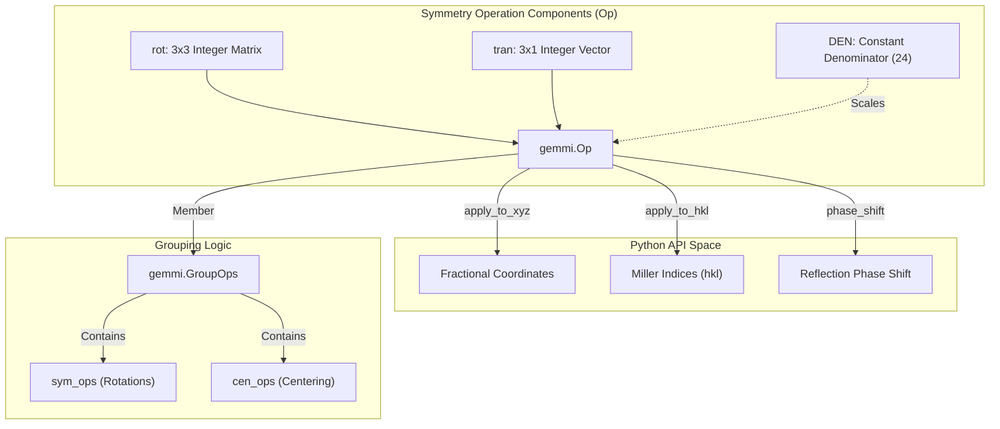

# Symmetry Operations in Python

<details>
<summary>Relevant source files</summary>

The following files were used as context for generating this wiki page:

- [docs/code/sym.cpp](docs/code/sym.cpp)
- [docs/symmetry.rst](docs/symmetry.rst)
- [include/gemmi/calculate.hpp](include/gemmi/calculate.hpp)
- [include/gemmi/cellred.hpp](include/gemmi/cellred.hpp)
- [include/gemmi/floodfill.hpp](include/gemmi/floodfill.hpp)
- [include/gemmi/math.hpp](include/gemmi/math.hpp)
- [include/gemmi/symmetry.hpp](include/gemmi/symmetry.hpp)
- [include/gemmi/twin.hpp](include/gemmi/twin.hpp)
- [include/gemmi/unitcell.hpp](include/gemmi/unitcell.hpp)
- [prog/sg.cpp](prog/sg.cpp)
- [python/sym.cpp](python/sym.cpp)
- [python/unitcell.cpp](python/unitcell.cpp)
- [src/calculate.cpp](src/calculate.cpp)
- [src/symmetry.cpp](src/symmetry.cpp)
- [tests/main.cpp](tests/main.cpp)
- [tests/test_symmetry.py](tests/test_symmetry.py)
- [tests/test_twin.py](tests/test_twin.py)
- [tests/test_unitcell.py](tests/test_unitcell.py)

</details>


This page documents how to work with crystallographic symmetry operations in Gemmi's Python interface. It covers creating, manipulating, and applying symmetry operations via the `Op` class, managing sets of operations with `GroupOps`, and utilizing space group lookup functions.

## Overview of Crystallographic Symmetry Operations

In crystallography, symmetry operations describe how atomic positions or reflections are related to each other. Each operation consists of a rotation component (represented as a 3×3 integer matrix) and a translation component (an integer vector). Gemmi implements these in the `Op` class, which handles both real-space (xyz) and reciprocal-space (hkl) transformations.



Sources: [include/gemmi/symmetry.hpp:26-192](), [python/sym.cpp:25-85]()

## The Op Class

The `Op` class is the fundamental unit of symmetry in Gemmi. It uses a fixed denominator `DEN = 24` [include/gemmi/symmetry.hpp:31-31]() to store fractional translations as integers, ensuring exact precision for standard crystallographic offsets (1/2, 1/3, 1/4, 1/6, 1/8, 1/12).

### Creating and Parsing Operations

Operations are most commonly initialized from coordinate triplets or Seitz matrices.

```python
import gemmi

# 1. From a triplet string (standard xyz notation)
op = gemmi.Op("-y, x-y, z+1/3")

# 2. Identity operation
identity = gemmi.Op() 

# 3. Using the global parser
op_parsed = gemmi.parse_triplet("x+1/2, -y, -z")
```

Sources: [python/sym.cpp:26-31](), [python/sym.cpp:87-88](), [tests/test_symmetry.py:109-116]()

### Key Properties and Methods

| Property/Method | Description |
|-----------------|-------------|
| `rot` | 3x3 integer rotation matrix [python/sym.cpp:34-34](). |
| `tran` | 3-element integer translation vector (numerators) [python/sym.cpp:35-36](). |
| `triplet(style)`| Returns string representation (e.g., "x,-y,z") [python/sym.cpp:40-40](). |
| `inverse()` | Returns the mathematical inverse of the operation [python/sym.cpp:41-41](). |
| `wrap()` | Wraps translation components to the [0, 1) range [python/sym.cpp:42-42](). |
| `apply_to_xyz(v)`| Transforms a 3-element coordinate list/tuple [python/sym.cpp:69-69](). |
| `apply_to_hkl(h)`| Transforms Miller indices (integers) [python/sym.cpp:70-70](). |
| `phase_shift(h)`| Calculates the phase shift $2\pi(h \cdot t)$ [python/sym.cpp:71-71](). |
| `float_seitz()` | Returns a 4x4 float Seitz matrix [python/sym.cpp:68-68](). |

Sources: [python/sym.cpp:32-85](), [include/gemmi/symmetry.hpp:30-185]()

## Group Operations (GroupOps)

The `GroupOps` class represents the full set of symmetry operations for a space group, internally partitioned into pure symmetry operations (`sym_ops`) and centering vectors (`cen_ops`) [python/sym.cpp:106-108]().

### Creating GroupOps

```python
# From a list of Op objects
group = gemmi.GroupOps([gemmi.Op("x,y,z"), gemmi.Op("-x,y+1/2,-z")])

# From a Hall symbol (the most robust way to define a group)
group_hall = gemmi.symops_from_hall("P 2yb") 
```

Sources: [python/sym.cpp:94-96](), [python/sym.cpp:166-168](), [tests/test_symmetry.py:183-190]()

### Symmetry Analysis Functions

`GroupOps` provides high-level crystallographic queries:

*   **Centrosymmetry**: `is_centrosymmetric()` checks for an inversion center [python/sym.cpp:113-113]().
*   **Systematic Absences**: `is_systematically_absent(hkl)` returns `True` if a reflection is extinguished by symmetry [python/sym.cpp:127-127]().
*   **Epsilon Factor**: `epsilon_factor(hkl)` calculates the reflection multiplicity [python/sym.cpp:119-119]().
*   **Centric Reflections**: `is_reflection_centric(hkl)` checks if a reflection is centric [python/sym.cpp:114-114]().

Gemmi provides optimized "array" versions of these functions that accept NumPy arrays of Miller indices for bulk processing [python/sym.cpp:120-130]().

Sources: [python/sym.cpp:109-139](), [include/gemmi/symmetry.hpp:254-489]()

## Space Group Lookup and Management

Gemmi includes a comprehensive table of over 560 space group settings [docs/symmetry.rst:9-32]().

### Lookup Functions

```python
# Search by name (H-M symbol or short name)
sg = gemmi.find_spacegroup_by_name("P 21 21 21")

# Search by number (standard IT number or CCP4 number)
sg_num = gemmi.find_spacegroup_by_number(19)

# Search by operations (useful for identifying unknown groups)
sg_ops = gemmi.find_spacegroup_by_ops(group_ops)
```

Sources: [python/sym.cpp:141-152](), [docs/symmetry.rst:55-72]()

### SpaceGroup Class Structure

The `SpaceGroup` class provides metadata about the group:
*   `number`: The international space group number (1-230) [docs/symmetry.rst:12-12]().
*   `hm`: Hermann-Mauguin symbol [docs/symmetry.rst:16-17]().
*   `hall`: Hall symbol used for operation generation [docs/symmetry.rst:20-21]().
*   `operations()`: Returns a `GroupOps` object containing all symmetry operations [python/sym.cpp:153-154]().

Sources: [python/sym.cpp:141-160](), [docs/symmetry.rst:9-54]()

## Coordinate and Matrix Math

Symmetry operations often interact with unit cell transformations. Gemmi provides several vector and matrix primitives in Python.

### Primitive Types

*   **Vec3**: A 3D vector (x, y, z) supporting standard arithmetic and `dot()`/`cross()` products [python/unitcell.cpp:104-139]().
*   **Mat33**: A 3x3 matrix used for rotation and orthogonalization [python/unitcell.cpp:140-179]().
*   **SMat33d / SMat33f**: Symmetric 3x3 matrices (double/float), typically used for anisotropic displacement parameters (ADPs) [python/unitcell.cpp:181-182]().

### Transforming Coordinates

```python
cell = gemmi.UnitCell(10, 20, 30, 90, 90, 90)
op = gemmi.Op("-x, y, z")

# Fractional to Orthogonal
frac_pos = gemmi.Fractional(0.1, 0.2, 0.3)
orth_pos = cell.orthogonalize(frac_pos)

# Apply symmetry to fractional coordinates
sym_frac = op.apply_to_xyz(frac_pos)
```

Sources: [python/unitcell.cpp:104-182](), [include/gemmi/unitcell.hpp:49-74](), [include/gemmi/math.hpp:58-131]()

## Twinning and Lattice Symmetry

Gemmi can identify potential twinning laws by analyzing the lattice symmetry of a reduced cell.

*   **find_lattice_2fold_ops**: Searches for 2-fold rotation axes that approximately map the lattice to itself within a given obliquity threshold [include/gemmi/twin.hpp:147-151]().
*   **calculate_cos_obliquity**: Calculates the deviation from perfect symmetry for a potential twin law [include/gemmi/twin.hpp:132-143]().

Sources: [include/gemmi/twin.hpp:5-155](), [python/unitcell.cpp:14-14]()

---