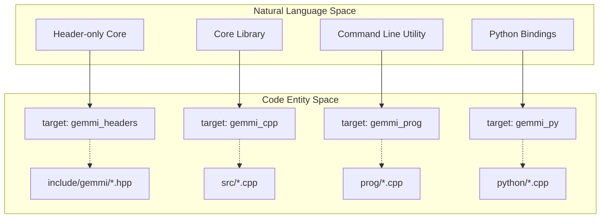
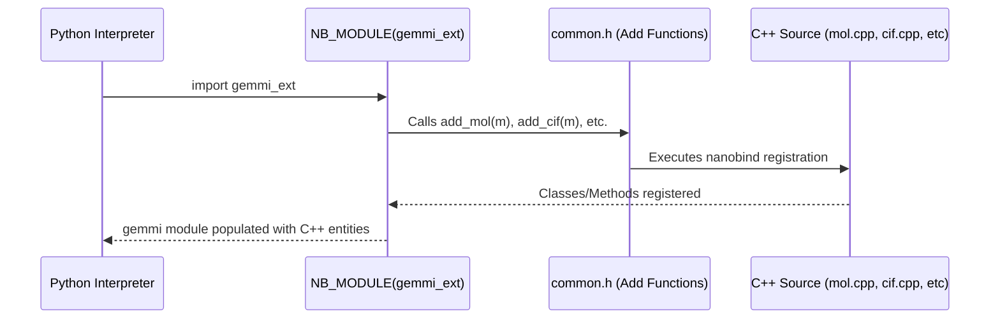

# Developer Guide

Relevant source files

The following files were used as context for generating this wiki page:

- [.appveyor.yml](.appveyor.yml)
- [.github/workflows/ci.yml](.github/workflows/ci.yml)
- [.github/workflows/testwheel.yml](.github/workflows/testwheel.yml)
- [.github/workflows/wheels2.yml](.github/workflows/wheels2.yml)
- [CMakeLists.txt](CMakeLists.txt)
- [docs/gemmi-help.txt](docs/gemmi-help.txt)
- [include/gemmi/mmdb.hpp](include/gemmi/mmdb.hpp)
- [include/gemmi/version.hpp](include/gemmi/version.hpp)
- [pyproject.toml](pyproject.toml)
- [python/common.h](python/common.h)
- [python/gemmi.cpp](python/gemmi.cpp)
- [run-tests.sh](run-tests.sh)
- [tools/compare_wheels.py](tools/compare_wheels.py)
- [tools/linux-wheels.sh](tools/linux-wheels.sh)
- [tools/release.txt](tools/release.txt)

This developer guide provides essential information for developers who want to contribute to GEMMI (Genome and Macromolecular Models & Information) or understand its internal code organization. It covers build systems, code structure, Python bindings, and testing infrastructure.

## Build System Overview

GEMMI uses CMake as its primary build system to manage the compilation of the C++ library, command-line tools, and Python bindings across Linux, macOS, and Windows.

### System Architecture: Code to Build Targets
The following diagram maps high-level system components to their respective C++ source entities and CMake targets.

Sources: [CMakeLists.txt:206-215](), [CMakeLists.txt:324-342](), [CMakeLists.txt:471-496]()

### Key Build Options
Developers can customize the build using CMake options. Notable flags include:

| Option | Default | Description |
|--------|---------|-------------|
| `BUILD_SHARED_LIBS` | ON | Build shared library (`libgemmi_cpp`) |
| `USE_PYTHON` | OFF | Enable Python binding generation |
| `USE_ZLIB_NG` | OFF | Use `zlib-ng` for improved performance |
| `FETCH_ZLIB_NG` | OFF | Automatically download and build `zlib-ng` |
| `GENERATE_STUBS` | ON | Create `.pyi` type stubs for Python |

Sources: [CMakeLists.txt:21-43]()

For more details, see [Build System](#8.2).

## Python Bindings Internals

GEMMI uses `nanobind` to expose C++ functionality to Python. The bindings are modularized to keep compilation units manageable.

### Binding Registration Pattern
The `gemmi_ext` module is initialized in `python/gemmi.cpp`. It imports the base `gemmi` Python package and injects C++ classes into it.

Sources: [python/gemmi.cpp:159-165](), [python/common.h:27-48]()

### Indexing and Slicing
Pythonic 0-based indexing and negative indices are handled via helper functions like `normalize_index` and `delitem_slice` to ensure compatibility with C++ containers.
Sources: [python/common.h:61-94]()

For more details, see [Python Bindings](#8.3).

## CI/CD and Quality Assurance

The project maintains a rigorous CI pipeline using GitHub Actions and AppVeyor.

### CI Workflow Orchestration
The `run-tests.sh` script serves as a local entry point for the same checks performed in CI, including building, unit testing, and documentation generation.

| Script Action | Command | Description |
|---------------|---------|-------------|
| Full Suite | `./run-tests.sh a` | Runs all tests, benchmarks, and style checks |
| Python Only | `./run-tests.sh P` | Compiles only Python bindings |
| Valgrind | `./run-tests.sh v` | Runs tests under memory leak detection |
| Documentation| `./run-tests.sh doctest` | Validates code snippets in docs |

Sources: [run-tests.sh:27-45](), [run-tests.sh:122-128]()

### Automated Pipelines
- **GitHub Actions**: Handles Linux (Ubuntu 22.04/24.04), macOS (Intel/Silicon), and Windows builds.
- **cibuildwheel**: Used in `Wheels2` workflow to generate binary wheels for PyPI.
- **AppVeyor**: Specialized Windows testing for MSVC and MinGW.

Sources: [.github/workflows/ci.yml:5-155](), [.github/workflows/wheels2.yml:22-38](), [.appveyor.yml:4-26]()

For more details, see [CI/CD Pipeline](#8.1).

## WebAssembly and Alternative Bindings

Beyond Python, GEMMI supports:
- **WebAssembly (WASM)**: For browser-based molecular viewers (e.g., using Emscripten).
- **Fortran/C**: Via SHROUD-generated interfaces, allowing legacy integration.
- **MMDB Integration**: Conversion between `gemmi::Structure` and `mmdb::Manager`.

Sources: [run-tests.sh:158-162](), [include/gemmi/mmdb.hpp:3-15](), [CMakeLists.txt:92-98]()

For more details, see [WebAssembly and Alternative Language Bindings](#8.4).

---