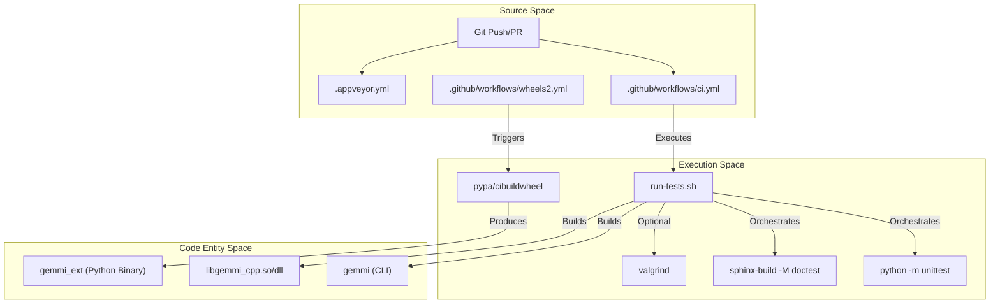
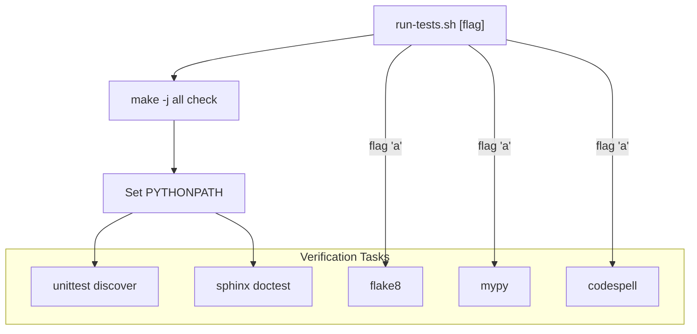

# CI/CD Pipeline

Relevant source files

The following files were used as context for generating this wiki page:

- [.appveyor.yml](.appveyor.yml)
- [.github/codeql.yml](.github/codeql.yml)
- [.github/workflows/ci.yml](.github/workflows/ci.yml)
- [.github/workflows/codeql.yml](.github/workflows/codeql.yml)
- [.github/workflows/testwheel.yml](.github/workflows/testwheel.yml)
- [.github/workflows/wheels2.yml](.github/workflows/wheels2.yml)
- [docs/gemmi-help.txt](docs/gemmi-help.txt)
- [include/gemmi/mmdb.hpp](include/gemmi/mmdb.hpp)
- [include/gemmi/version.hpp](include/gemmi/version.hpp)
- [pyproject.toml](pyproject.toml)
- [run-tests.sh](run-tests.sh)
- [tools/compare_wheels.py](tools/compare_wheels.py)
- [tools/linux-wheels.sh](tools/linux-wheels.sh)
- [tools/release.txt](tools/release.txt)

This document provides a technical overview of the continuous integration and continuous deployment (CI/CD) pipeline used in the Gemmi project. It covers the automated build, test, and deployment processes across multiple platforms and configurations to ensure code quality and cross-platform compatibility.

## Overview

Gemmi employs a multi-tiered CI strategy using:

1.  **GitHub Actions**: The primary CI platform supporting Linux (x86_64 and ARM64), macOS (Intel and Apple Silicon), and Windows builds.
2.  **AppVeyor**: Secondary CI platform focusing on specialized Windows environments (MSVC 2019/2022 and MinGW).
3.  **cibuildwheel**: Orchestrates the production of binary Python wheels across a matrix of architectures and Python versions.
4.  **CodeQL**: Performs automated static analysis for security and code quality.

The pipeline automatically builds, tests, and packages Gemmi to ensure the library functions correctly in diverse environments, from high-performance servers to browser-based WebAssembly environments.

### CI Pipeline Orchestration

The following diagram illustrates the data flow from a code change to the generation of verified artifacts.

**Figure 1: CI/CD Data Flow and Entity Mapping**

Sources: [.github/workflows/ci.yml:1-5](), [.github/workflows/wheels2.yml:1-10](), [.appveyor.yml:1-3](), [run-tests.sh:1-12]()

---

## GitHub Actions Configuration

GitHub Actions is the primary CI service. The workflow is defined in `.github/workflows/ci.yml` and triggers on both `push` and `pull_request` events [.github/workflows/ci.yml:1-3]().

### Platform Matrix and Jobs

| Job ID | Environment | Compiler/Tooling | Key Targets |
|:---|:---|:---|:---|
| `macos15` | macOS 15 | Apple Clang, Python 3 | Python Wheels, Doctests [.github/workflows/ci.yml:6-12]() |
| `macos13` | macOS 15 Intel | CMake, C++14 | `gemmi` CLI, `libgemmi` [.github/workflows/ci.yml:39-54]() |
| `windows2022`| Windows 2022 | Python 3.13 | Python Bindings [.github/workflows/ci.yml:71-82]() |
| `ubuntu2404arm`| Ubuntu ARM64 | g++, gfortran | ARM64 Python Tests [.github/workflows/ci.yml:94-103]() |
| `ubuntu2204` | Ubuntu 22.04 | g++, nanobind | Shared Libs, `check` target [.github/workflows/ci.yml:120-143]() |
| `ubuntu2204_clang8`| Ubuntu 22.04 | Clang 13 | sdist build, `gemmi-*.tar.gz` [.github/workflows/ci.yml:153-180]() |
| `ubuntu2404` | Ubuntu 24.04 | Valgrind, CMake | Memory Leak Analysis [.github/workflows/ci.yml:188-210]() |

### Memory and Static Analysis
For Linux builds, Gemmi utilizes `valgrind` to detect memory leaks and invalid accesses during the execution of both C++ and Python test suites [run-tests.sh:123-128](). Additionally, `CodeQL` is configured to run weekly, filtering out specific noise such as float equality or complex blocks [.github/codeql.yml:1-15]().

Sources: [.github/workflows/ci.yml:5-210](), [run-tests.sh:123-128](), [.github/codeql.yml:1-15]()

---

## AppVeyor Pipeline

AppVeyor provides deep coverage for Windows environments, testing various `CMAKE_GENERATOR` and `CMAKE_CONFIG` combinations [.appveyor.yml:1-26]().

### Build Configurations
*   **Visual Studio 17 2022**: Uses C++20 and Python 3.11 with shared libraries and `zlib-ng` [.appveyor.yml:5-11]().
*   **Visual Studio 16 2019**: Uses C++17 and Python 3.10 with static libraries via `vcpkg` [.appveyor.yml:13-19]().
*   **MinGW64**: Uses `MSYS Makefiles` and GCC 8.1.0 to ensure compatibility with the MinGW toolchain [.appveyor.yml:21-26]().

The AppVeyor script explicitly handles `vcpkg` dependency installation for `zlib` and `zlib-ng` [.appveyor.yml:34-35]() and verifies the Python environment before running `unittest discover` [.appveyor.yml:49-53]().

Sources: [.appveyor.yml:1-53]()

---

## Python Wheel Building

Gemmi uses `cibuildwheel` (v2/v3) to generate binary wheels for PyPI. This is managed in `.github/workflows/wheels2.yml` and is usually triggered via `workflow_dispatch` [.github/workflows/wheels2.yml:1-7]().

### Configuration via pyproject.toml
The wheel building process is highly customized in `pyproject.toml`:
*   **Build System**: Uses `scikit-build-core` and `nanobind` [pyproject.toml:1-7]().
*   **Environment Variables**: `SKBUILD_CMAKE_ARGS` are set to disable the standalone program and dev files while enabling `FETCH_ZLIB_NG` for optimized performance [pyproject.toml:97-98]().
*   **Compatibility**: Sets `MACOSX_DEPLOYMENT_TARGET = "10.14"` to ensure broad macOS compatibility [pyproject.toml:100]().
*   **Skip Logic**: Skips PyPy, 32-bit builds, and specific musl-linux versions to reduce build time [.github/workflows/wheels2.yml:12-16]().

### Artifact Merging
After wheels are built on separate OS runners (Ubuntu, Windows, macOS), a `merge` job consolidates all `.whl` files into a single `cibw-wheels` artifact for deployment [.github/workflows/wheels2.yml:47-57]().

Sources: [.github/workflows/wheels2.yml:1-57](), [pyproject.toml:1-107]()

---

## The run-tests.sh Orchestration Script

The `run-tests.sh` script is the central entry point for local development and CI execution. It handles environment detection, compilation, and various test suites [run-tests.sh:1-13]().

### Key Functions and Flags
*   **Build Selection**:
    *   `G`: Only build the `gemmi_prog` (CLI) [run-tests.sh:27-30]().
    *   `P`: Only build `gemmi_py` (Python bindings) [run-tests.sh:31-34]().
*   **Test Suites**:
    *   `unittest`: Standard Python unit tests [run-tests.sh:52]().
    *   `doctest`: Runs code snippets found in the documentation using Sphinx [run-tests.sh:58]().
    *   `v`: Executes tests under `valgrind` [run-tests.sh:123-128]().
*   **Specialized Checks**:
    *   `m`: Compiles and runs mmdb conversion examples to verify `gemmi/mmdb.hpp` integration [run-tests.sh:89-108]().
    *   `h`: Verifies that every header file can be compiled independently [run-tests.sh:110-120]().
    *   `w`: Checks if WebAssembly (WASM) targets can be built [run-tests.sh:158-162]().

**Figure 2: Test Orchestration Flow**

Sources: [run-tests.sh:1-175](), [include/gemmi/mmdb.hpp:1-15]()

---

## Release Process

The release process is a manual sequence supported by the CI infrastructure, documented in `tools/release.txt`.

1.  **Version Update**: Update `GEMMI_VERSION` in `include/gemmi/version.hpp` [include/gemmi/version.hpp:8]().
2.  **Full Test**: Run `./run-tests.sh a` to perform all automated checks [tools/release.txt:8]().
3.  **Source Distribution**: Build and verify the `sdist` using `python3 -m build --sdist` [tools/release.txt:15]().
4.  **Wheel Generation**: Trigger the `wheels2.yml` workflow on GitHub Actions [tools/release.txt:24]().
5.  **Validation**: Use `tools/compare_wheels.py` to ensure consistency across generated binary packages [tools/release.txt:28]().
6.  **Deployment**: Upload artifacts to PyPI using `twine` [tools/release.txt:29-30]().

Sources: [tools/release.txt:1-35](), [include/gemmi/version.hpp:1-10]()

---