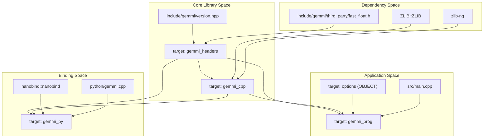
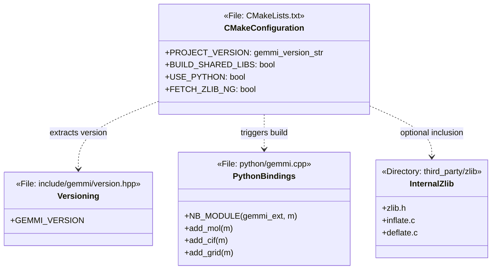

# Build System

Relevant source files

The following files were used as context for generating this wiki page:

- [CMakeLists.txt](CMakeLists.txt)
- [include/gemmi/third_party/fast_float.h](include/gemmi/third_party/fast_float.h)
- [python/common.h](python/common.h)
- [python/gemmi.cpp](python/gemmi.cpp)
- [third_party/zlib/NOTE](third_party/zlib/NOTE)
- [third_party/zlib/crc32.c](third_party/zlib/crc32.c)
- [third_party/zlib/gzguts.h](third_party/zlib/gzguts.h)
- [third_party/zlib/gzlib.c](third_party/zlib/gzlib.c)
- [third_party/zlib/gzread.c](third_party/zlib/gzread.c)
- [third_party/zlib/inffast.c](third_party/zlib/inffast.c)
- [third_party/zlib/inflate.c](third_party/zlib/inflate.c)
- [third_party/zlib/inflate.h](third_party/zlib/inflate.h)
- [third_party/zlib/inftrees.c](third_party/zlib/inftrees.c)
- [third_party/zlib/inftrees.h](third_party/zlib/inftrees.h)
- [third_party/zlib/zconf.h](third_party/zlib/zconf.h)
- [third_party/zlib/zlib.h](third_party/zlib/zlib.h)
- [third_party/zlib/zutil.h](third_party/zlib/zutil.h)
- [tools/upstream-check.py](tools/upstream-check.py)

## Purpose and Scope

This document provides a detailed technical overview of the CMake build system used by the Gemmi library. It covers the target hierarchy, dependency management (specifically `zlib` and `zlib-ng`), compilation options, and the integration of third-party libraries. The build system is designed to support a header-only core, a compiled C++ library, command-line utilities, and Python bindings.

## Build System Architecture

Gemmi utilizes CMake (minimum version 3.15) to manage its build process [CMakeLists.txt:1-1](). The architecture is modular, allowing users to build only the headers, the full C++ library, the CLI tools, or the Python bindings.

### Target Hierarchy and Data Flow

The following diagram illustrates the relationship between the primary CMake targets and the source entities they encompass.

**Gemmi Target Dependency Graph**

Sources: [CMakeLists.txt:206-215](), [CMakeLists.txt:270-280](), [CMakeLists.txt:451-460](), [python/gemmi.cpp:159-165]()

## Build Configuration Options

The build behavior is controlled via several CMake options. These flags determine which components are compiled and how dependencies are resolved.

| Option | Default | Description |
| :--- | :--- | :--- |
| `BUILD_SHARED_LIBS` | `ON` | Build shared library (`libgemmi_cpp`) [CMakeLists.txt:21-21](). |
| `BUILD_GEMMI_PROGRAM` | `ON` | Build the `gemmi` command-line tool [CMakeLists.txt:22-22](). |
| `USE_PYTHON` | `OFF` | Build Python bindings using nanobind [CMakeLists.txt:25-25](). |
| `USE_ZLIB_NG` | `OFF` | Use `zlib-ng` for better performance [CMakeLists.txt:26-26](). |
| `FETCH_ZLIB_NG` | `OFF` | Automatically download and build `zlib-ng` [CMakeLists.txt:27-27](). |
| `INTERNAL_ZLIB` | `OFF` | Use the bundled zlib source in `third_party/zlib` [CMakeLists.txt:28-28](). |
| `STANDALONE_PYTHON_MODULE` | `ON` | Include Gemmi code directly in the Python extension [CMakeLists.txt:32-32](). |

Sources: [CMakeLists.txt:21-43]()

## Dependency Management

Gemmi has a critical dependency on `zlib` for handling compressed file formats (e.g., `.gz` CIF or CCP4 maps). The build system provides four ways to satisfy this:

1.  **System ZLIB**: Found via `find_package(ZLIB)` [CMakeLists.txt:159-159]().
2.  **Internal ZLIB**: Uses the source code provided in `third_party/zlib/` [CMakeLists.txt:161-163](). This is a fallback if no system zlib is found.
3.  **System ZLIB-NG**: Enabled via `USE_ZLIB_NG` and found via `find_package(ZLIB_NG)` [CMakeLists.txt:153-155]().
4.  **Fetched ZLIB-NG**: Enabled via `FETCH_ZLIB_NG`. It uses `FetchContent` to download `zlib-ng` from GitHub and builds it as a static library with `POSITION_INDEPENDENT_CODE` enabled [CMakeLists.txt:121-140]().

### Third-Party Libraries
Gemmi bundles several small third-party libraries as headers to minimize external dependencies:
*   **fast_float**: High-performance string-to-floating-point conversion [include/gemmi/third_party/fast_float.h:1-180]().
*   **nanobind**: Used for efficient C++/Python bindings [python/common.h:11-24]().
*   **zlib**: Bundled source for environments without a system-wide compression library [third_party/zlib/zlib.h:1-50]().

Sources: [CMakeLists.txt:121-164](), [tools/upstream-check.py:10-24]()

## Compiled Targets

### gemmi_cpp (Library)
This is the primary compiled target. It includes implementations for complex algorithms like symmetry operations, CCP4 map handling, and structural alignments [CMakeLists.txt:206-235]().
*   **Sources**: `src/align.cpp`, `src/assembly.cpp`, `src/calculate.cpp`, `src/ccp4.cpp`, `src/symmetry.cpp`, etc [CMakeLists.txt:217-230]().
*   **Visibility**: Symbols are hidden by default using `CMAKE_CXX_VISIBILITY_PRESET hidden` to reduce binary size and avoid conflicts [CMakeLists.txt:64-66]().

### gemmi_prog (CLI)
The command-line interface is built as an "all-in-one" executable.
*   **Logic**: The `GEMMI_ALL_IN_ONE` macro is defined, which allows `src/main.cpp` to dispatch to various subcommand implementations [CMakeLists.txt:284-284]().
*   **Object Library**: A helper target `options` (OBJECT) is used to share common CLI argument parsing code across subcommands [CMakeLists.txt:270-272]().

### gemmi_py (Python Bindings)
The Python module is built using `nanobind_add_module` [CMakeLists.txt:491-491]().
*   **Modular Registration**: The binding code is split into multiple files (e.g., `python/mol.cpp`, `python/cif.cpp`). These are unified in `python/gemmi.cpp` which calls registration functions like `add_mol(m)` and `add_cif(m)` [python/common.h:27-48]().
*   **Exception Translation**: Custom translators convert C++ `std::system_error` to Python `IOError` and `tao::pegtl::parse_error` to `ValueError` [python/gemmi.cpp:170-181]().

Sources: [CMakeLists.txt:206-547](), [python/gemmi.cpp:159-181](), [python/common.h:27-48]()

## Build System Entity Mapping

The following diagram maps high-level build concepts to specific files and variables within the CMake environment.

**Code Entity Space Mapping**

Sources: [CMakeLists.txt:3-9](), [CMakeLists.txt:21-28](), [python/gemmi.cpp:159-162](), [python/common.h:27-48]()

## Installation and Deployment

Gemmi supports standard CMake installation via `GNUInstallDirs`.
*   **Headers**: Installed to `${CMAKE_INSTALL_INCLUDEDIR}` [CMakeLists.txt:561-561]().
*   **Library**: Installed to `${CMAKE_INSTALL_LIBDIR}` [CMakeLists.txt:564-564]().
*   **CMake Config**: Generates `gemmi-config.cmake` to allow other projects to use `find_package(gemmi)` [CMakeLists.txt:589-605]().
*   **Python**: When building with `scikit-build-core`, the installation path is adjusted to `SKBUILD_PLATLIB_DIR` [CMakeLists.txt:14-19]().

Sources: [CMakeLists.txt:12-19](), [CMakeLists.txt:557-616]()

---