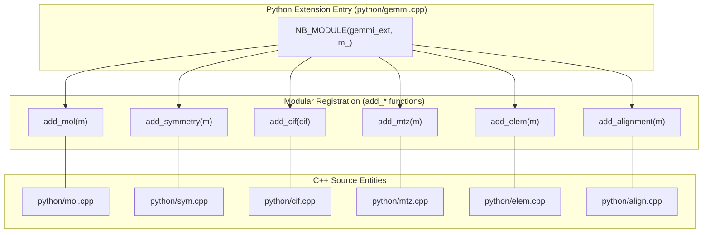
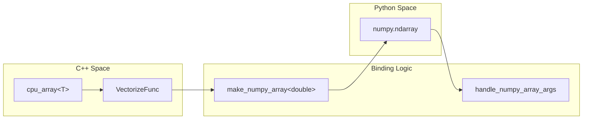

# Python Bindings

Relevant source files

The following files were used as context for generating this wiki page:

- [CMakeLists.txt](CMakeLists.txt)
- [docs/align-help.txt](docs/align-help.txt)
- [include/gemmi/align.hpp](include/gemmi/align.hpp)
- [include/gemmi/qcp.hpp](include/gemmi/qcp.hpp)
- [include/gemmi/resinfo.hpp](include/gemmi/resinfo.hpp)
- [include/gemmi/seqtools.hpp](include/gemmi/seqtools.hpp)
- [prog/align.cpp](prog/align.cpp)
- [prog/contents.cpp](prog/contents.cpp)
- [python/align.cpp](python/align.cpp)
- [python/common.h](python/common.h)
- [python/elem.cpp](python/elem.cpp)
- [python/gemmi.cpp](python/gemmi.cpp)
- [src/align.cpp](src/align.cpp)
- [src/resinfo.cpp](src/resinfo.cpp)
- [tests/test_align.py](tests/test_align.py)
- [tools/resinfo.py](tools/resinfo.py)

This page provides technical documentation on the implementation of GEMMI's Python bindings. These bindings leverage the **nanobind** library to expose C++ functionality to Python with high efficiency and minimal overhead.

## Architecture and Registration Pattern

The GEMMI Python bindings are organized into a modular architecture where the C++ core is exposed through a series of `add_*` functions. Each function is responsible for registering a specific subset of the library's functionality (e.g., symmetry, molecular models, or grids).

The main entry point for the extension is the `NB_MODULE(gemmi_ext, m_)` macro located in `python/gemmi.cpp`. Unlike standard patterns, GEMMI imports the base `gemmi` Python module and injects attributes into it, effectively extending the namespace from the compiled C++ extension.

### Modular Architecture Diagram
The following diagram maps the registration functions to their respective C++ implementation files and how they aggregate into the Python module.

Sources: [python/gemmi.cpp:159-204](), [python/common.h:27-49]()

## Index Normalization and Slice Handling

To provide a "Pythonic" experience, GEMMI implements manual index normalization and slice support for C++ containers. This ensures that negative indices (e.g., `-1` for the last element) and Python `slice` objects work as expected.

### Key Utilities in `python/common.h`
*   `c_index(int index, size_t size)`: Converts a Python-style index to a C++ index. It handles negative values by adding the container size and throws `nb::index_error()` if the result is out of bounds. [python/common.h:61-67]()
*   `normalize_index(int index, const T& container)`: A template wrapper that calls `c_index` using the container's `.size()`. [python/common.h:69-71]()
*   `getitem_slice(Items& items, const nb::slice& slice)`: Computes the start, stop, and step of a slice and returns a `nb::list` containing the sliced items. [python/common.h:97-103]()
*   `delitem_slice(Items& items, const nb::slice& slice)`: Handles the deletion of elements via slices, with special logic for non-contiguous steps to maintain index integrity during removal. [python/common.h:86-94]()

Sources: [python/common.h:60-103]()

## NumPy Integration

GEMMI integrates deeply with NumPy for numerical operations, particularly for reflection data and grid manipulation. 

### Data Flow: C++ to NumPy
The bindings use `make_numpy_array<T>` (defined in `array.h`) to wrap C++ memory or create new arrays for Python consumption. For example, the `VectorizeFunc` struct in `python/gemmi.cpp` demonstrates wrapping C++ math functions to operate on NumPy arrays.

Sources: [python/gemmi.cpp:33-45](), [python/common.h:106-115](), [python/array.h]()

## Exception Translation

To ensure C++ errors are reported correctly in Python, GEMMI registers a custom exception translator using `nb::register_exception_translator`.

| C++ Exception Type | Python Exception | Logic/Details |
| :--- | :--- | :--- |
| `std::system_error` | `PyExc_IOError` | Extracts the error code and message into a tuple. |
| `tao::pegtl::parse_error` | `PyExc_ValueError` | Used for CIF/PDB parsing errors. |

Sources: [python/gemmi.cpp:170-180]()

## Component Specific Bindings

### Element and Residue Info
The `add_elem` function exposes crystallographic tables and chemical data.
*   **Elements**: Binds the `Element` class, providing access to atomic weights, covalent radii, and VDW radii. [python/elem.cpp:106-130]()
*   **Form Factors**: Exposes `IT92`, `C4322`, and `Neutron92` coefficients for structure factor calculations. [python/elem.cpp:34-103]()
*   **Residue Info**: Binds `ResidueInfo` and the `ResidueKind` enum, allowing Python to query if a residue is an amino acid, nucleic acid, or water. [python/elem.cpp:141-166]()

### Sequence Alignment
The `add_alignment` function in `python/align.cpp` binds the sequence alignment engine.
*   **Scoring**: Exposes `AlignmentScoring`, including presets for `blosum62` and `partial_model`. [python/align.cpp:26-41]()
*   **Results**: The `AlignmentResult` class provides `cigar_str()` and `calculate_identity()`. [python/align.cpp:15-24]()
*   **Structure Superposition**: Binds `calculate_superposition` and `superpose_positions` (using the QCP algorithm). [python/align.cpp:73-96]()

Sources: [python/elem.cpp:33-171](), [python/align.cpp:12-97]()

## Build System Integration

The Python bindings are integrated into the main CMake build system.

*   **Target**: The `gemmi_py` target (often resulting in `gemmi_ext` or `gemmi`) is created using `nanobind_add_module`. [CMakeLists.txt:471-540]()
*   **LTO**: Link-Time Optimization is enabled by default for non-debug builds to ensure the overhead between Python and C++ is minimized. [CMakeLists.txt:77-86]()
*   **Stubs**: If `GENERATE_STUBS` is ON, the build process generates `.pyi` files to provide type hinting for IDEs. [CMakeLists.txt:29](), [CMakeLists.txt:531-546]()

Sources: [CMakeLists.txt:21-32](), [CMakeLists.txt:77-86](), [CMakeLists.txt:471-546]()

---