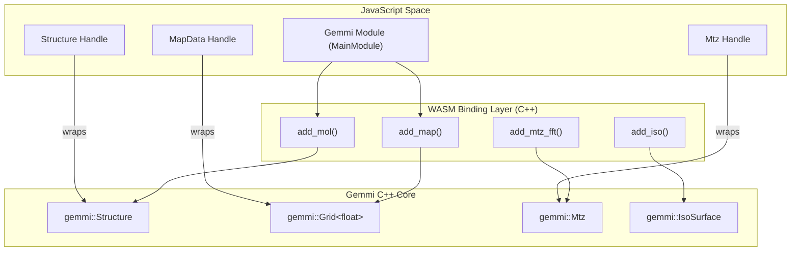
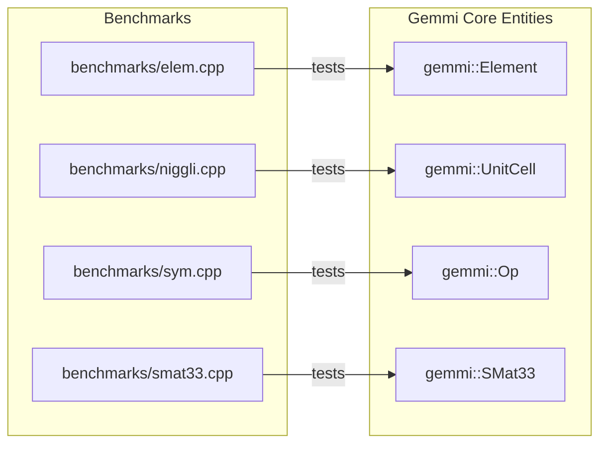

# WebAssembly and Alternative Language Bindings

Relevant source files

The following files were used as context for generating this wiki page:

- [.gitignore](.gitignore)
- [benchmarks/elem.cpp](benchmarks/elem.cpp)
- [benchmarks/mod.cpp](benchmarks/mod.cpp)
- [benchmarks/niggli.cpp](benchmarks/niggli.cpp)
- [benchmarks/resinfo.cpp](benchmarks/resinfo.cpp)
- [benchmarks/round.cpp](benchmarks/round.cpp)
- [benchmarks/smat33.cpp](benchmarks/smat33.cpp)
- [benchmarks/stoi.cpp](benchmarks/stoi.cpp)
- [benchmarks/sym.cpp](benchmarks/sym.cpp)
- [fortran/ftest.f90](fortran/ftest.f90)
- [include/gemmi/dsn6.hpp](include/gemmi/dsn6.hpp)
- [include/gemmi/isosurface.hpp](include/gemmi/isosurface.hpp)
- [include/gemmi/mc_tables.hpp](include/gemmi/mc_tables.hpp)
- [wasm/Makefile](wasm/Makefile)
- [wasm/README.md](wasm/README.md)
- [wasm/cell.cpp](wasm/cell.cpp)
- [wasm/common.h](wasm/common.h)
- [wasm/gemmi.cpp](wasm/gemmi.cpp)
- [wasm/gemmi.d.ts](wasm/gemmi.d.ts)
- [wasm/iso.cpp](wasm/iso.cpp)
- [wasm/map.cpp](wasm/map.cpp)
- [wasm/mol.cpp](wasm/mol.cpp)
- [wasm/mol.test.js](wasm/mol.test.js)
- [wasm/mtz.d.ts](wasm/mtz.d.ts)
- [wasm/mtz_fft.cpp](wasm/mtz_fft.cpp)
- [wasm/mtz_fft.test.js](wasm/mtz_fft.test.js)
- [wasm/package.json](wasm/package.json)
- [wasm/pre.js](wasm/pre.js)

Gemmi provides extensive support for environments beyond the standard C++ and Python ecosystems. This includes a robust WebAssembly (WASM) build for browser-based molecular visualization, as well as infrastructure for Fortran and C bindings and performance benchmarking.

## 1. WebAssembly (WASM)

The WebAssembly build allows Gemmi's core crystallographic and structural functions to run in web browsers. It is primarily used by molecular viewers to handle heavy lifting such as CIF/PDB parsing, MTZ reflection data processing, and isosurface extraction from density maps.

### 1.1. Build System and Implementation
The WASM build uses **Emscripten** and the `embind` library to create C++/JavaScript bindings [wasm/Makefile:1-26](). The build process compiles a subset of Gemmi's core C++ files along with specific WASM-binding wrappers [wasm/Makefile:33-38]().

**Key Build Components:**
*   **`em++`**: The Emscripten compiler [wasm/Makefile:4]().
*   **`embind`**: Used to expose C++ classes and functions to JS [wasm/gemmi.cpp:6-13]().
*   **`MODULARIZE=1`**: Ensures the output is a clean JS module [wasm/Makefile:24]().
*   **`ALLOW_MEMORY_GROWTH=1`**: Necessary for handling large molecular structures or maps [wasm/Makefile:23]().

### 1.2. Core WASM Classes and Data Flow
The following diagram illustrates how the WASM module exposes C++ entities to the JavaScript environment.

**WASM Binding Architecture**

Sources: [wasm/gemmi.cpp:6-13](), [wasm/mol.cpp:208-216](), [wasm/mtz_fft.cpp:200-210](), [wasm/gemmi.d.ts:56-62]()

### 1.3. Structural Data Handling
Structural files (PDB, mmCIF, mmJSON) are read into memory buffers and parsed into a `gemmi::Structure` object [wasm/mol.cpp:33-38](). The hierarchy (Model → Chain → Residue → Atom) is traversed using `.at(index)` methods [wasm/gemmi.d.ts:61-95]().

*   **Selection**: The `SelectionResult` class allows JavaScript to query the structure using Gemmi's selection syntax (CID) and retrieve a list of atom indices [wasm/mol.cpp:180-206]().
*   **Bonds**: The `BondInfo` class uses the Monomer Library (`MonLib`) and structural connections to calculate bond lines for visualization [wasm/mol.cpp:110-178]().

### 1.4. Map and Reflection Data
Gemmi WASM supports reading CCP4, DSN6, and MTZ files directly from `ArrayBuffer` objects in JS [wasm/pre.js:2-30]().

*   **MTZ to Map**: The `MtzFft` class performs Fast Fourier Transforms (FFT) using `pocketfft` to generate electron density maps from reflection data labels (e.g., FWT/PHWT) [wasm/mtz_fft.cpp:119-158]().
*   **Isosurface Extraction**: Both `MapData` and `MtzMap` provide `extract_isosurface()` which returns vertex and segment (triangle) data for rendering [wasm/mtz_fft.cpp:69-83](), [wasm/iso.cpp:7-44]().

**Sources:** [wasm/mol.cpp:33-38](), [wasm/mtz_fft.cpp:119-158](), [wasm/gemmi.d.ts:140-174](), [wasm/pre.js:2-30]()

---

## 2. Fortran and C Bindings (SHROUD)

Gemmi supports generation of Fortran and C interfaces using the **SHROUD** tool. This is essential for integrating Gemmi's modern C++ crystallographic logic into legacy software suites or high-performance Fortran codes.

### 2.1. Implementation
The infrastructure for these bindings is located in the `fortran/` directory. SHROUD processes Gemmi headers and YAML configuration files to generate:
*   **C Wrappers**: Extern "C" functions that bridge C++ classes.
*   **Fortran Modules**: Idiomatic Fortran 2003+ interfaces using `iso_c_binding`.

The `.gitignore` file indicates that SHROUD produces several intermediate files such as `*_types.yaml`, `wrap*`, and `types*.h` [fortran/.gitignore:75-81](). Test programs like `fsym` and `ftest` are used to verify the integrity of the Fortran bindings [fortran/.gitignore:84-85]().

**Sources:** [.gitignore:74-86](), [fortran/ftest.f90]()

---

## 3. Benchmarking Infrastructure

Gemmi includes a suite of microbenchmarks located in the `benchmarks/` directory to track the performance of core algorithms. These benchmarks primarily utilize the `google/benchmark` library [benchmarks/elem.cpp:4-10]().

### 3.1. Key Benchmarks
The benchmarking suite covers high-frequency operations:

| Benchmark File | Target Component | Description |
| :--- | :--- | :--- |
| `elem.cpp` | `find_element` | Performance of element lookup and Cromer-Liberman f' calculation [benchmarks/elem.cpp:12-54](). |
| `niggli.cpp` | `UnitCell` | Lattice reduction algorithms (Niggli, Selling-Delaunay). |
| `smat33.cpp` | `SMat33` | Operations on symmetric 3x3 matrices used in ADPs. |
| `stoi.cpp` | `gemmi::string_to_int` | High-performance string-to-integer conversion used in CIF parsing. |
| `sym.cpp` | `Symmetry` | Symmetry operation application and space group lookup. |

### 3.2. Code Entity to Benchmark Mapping

Sources: [benchmarks/elem.cpp:7-10](), [benchmarks/niggli.cpp](), [benchmarks/sym.cpp](), [benchmarks/smat33.cpp]()

**Sources:** [benchmarks/elem.cpp:1-54](), [benchmarks/stoi.cpp](), [benchmarks/sym.cpp]()

---