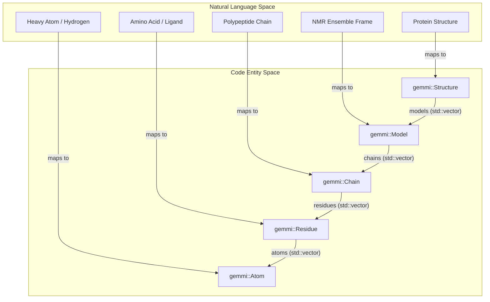
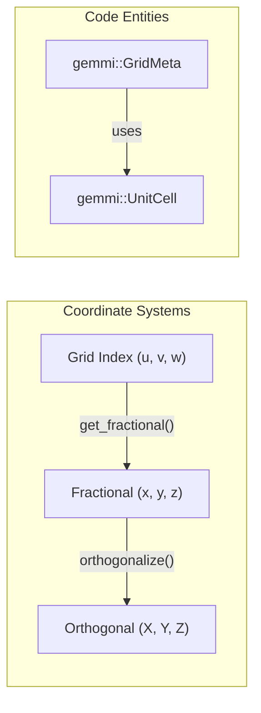
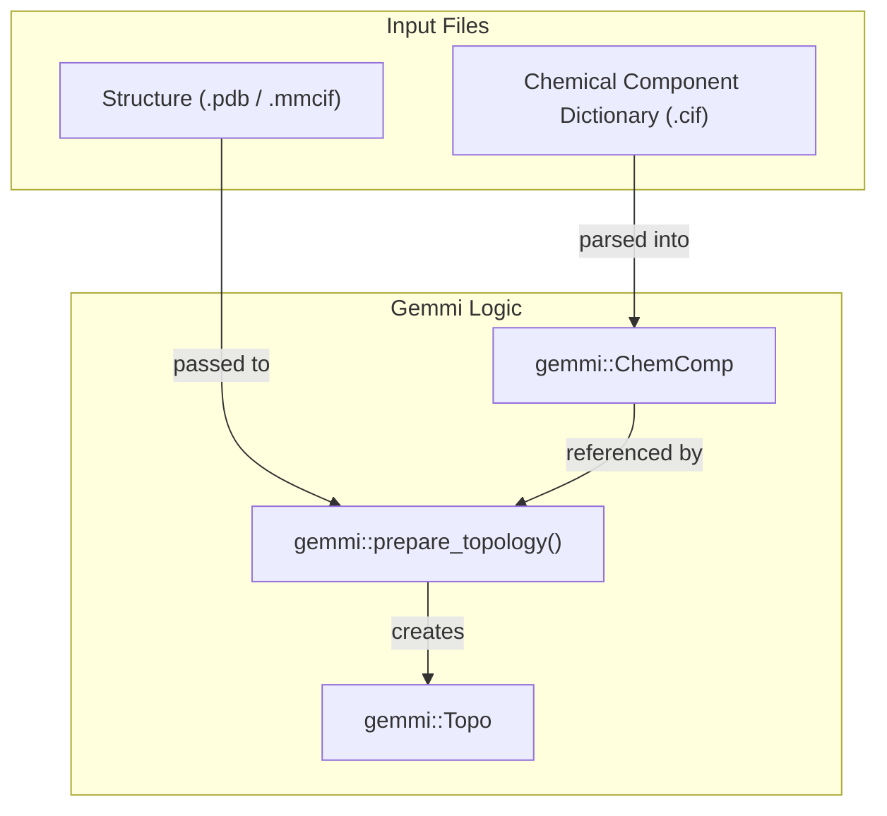

# Glossary

Relevant source files

The following files were used as context for generating this wiki page:

- [docs/cif.rst](docs/cif.rst)
- [docs/code/sym.cpp](docs/code/sym.cpp)
- [docs/components.cif](docs/components.cif)
- [docs/drg-help.txt](docs/drg-help.txt)
- [docs/grid.rst](docs/grid.rst)
- [docs/hkl.rst](docs/hkl.rst)
- [docs/mol.rst](docs/mol.rst)
- [docs/symmetry.rst](docs/symmetry.rst)
- [include/gemmi/ace_cc.hpp](include/gemmi/ace_cc.hpp)
- [include/gemmi/ace_graph.hpp](include/gemmi/ace_graph.hpp)
- [include/gemmi/acedrg_tables.hpp](include/gemmi/acedrg_tables.hpp)
- [include/gemmi/calculate.hpp](include/gemmi/calculate.hpp)
- [include/gemmi/cellred.hpp](include/gemmi/cellred.hpp)
- [include/gemmi/chemcomp.hpp](include/gemmi/chemcomp.hpp)
- [include/gemmi/cifdoc.hpp](include/gemmi/cifdoc.hpp)
- [include/gemmi/floodfill.hpp](include/gemmi/floodfill.hpp)
- [include/gemmi/fourier.hpp](include/gemmi/fourier.hpp)
- [include/gemmi/grid.hpp](include/gemmi/grid.hpp)
- [include/gemmi/math.hpp](include/gemmi/math.hpp)
- [include/gemmi/mmcif.hpp](include/gemmi/mmcif.hpp)
- [include/gemmi/model.hpp](include/gemmi/model.hpp)
- [include/gemmi/mtz.hpp](include/gemmi/mtz.hpp)
- [include/gemmi/pdb.hpp](include/gemmi/pdb.hpp)
- [include/gemmi/solmask.hpp](include/gemmi/solmask.hpp)
- [include/gemmi/symmetry.hpp](include/gemmi/symmetry.hpp)
- [include/gemmi/to_chemcomp.hpp](include/gemmi/to_chemcomp.hpp)
- [include/gemmi/to_cif.hpp](include/gemmi/to_cif.hpp)
- [include/gemmi/to_mmcif.hpp](include/gemmi/to_mmcif.hpp)
- [include/gemmi/to_pdb.hpp](include/gemmi/to_pdb.hpp)
- [include/gemmi/topo.hpp](include/gemmi/topo.hpp)
- [include/gemmi/twin.hpp](include/gemmi/twin.hpp)
- [include/gemmi/unitcell.hpp](include/gemmi/unitcell.hpp)
- [prog/drg.cpp](prog/drg.cpp)
- [prog/mask.cpp](prog/mask.cpp)
- [prog/sg.cpp](prog/sg.cpp)
- [python/chemcomp.cpp](python/chemcomp.cpp)
- [python/cif.cpp](python/cif.cpp)
- [python/grid.cpp](python/grid.cpp)
- [python/hkl.cpp](python/hkl.cpp)
- [python/mol.cpp](python/mol.cpp)
- [python/mtz.cpp](python/mtz.cpp)
- [python/sym.cpp](python/sym.cpp)
- [python/unitcell.cpp](python/unitcell.cpp)
- [src/ace_cc.cpp](src/ace_cc.cpp)
- [src/ace_graph.cpp](src/ace_graph.cpp)
- [src/acedrg_tables.cpp](src/acedrg_tables.cpp)
- [src/calculate.cpp](src/calculate.cpp)
- [src/symmetry.cpp](src/symmetry.cpp)
- [tests/ace_graph.cpp](tests/ace_graph.cpp)
- [tests/main.cpp](tests/main.cpp)
- [tests/test_cif.py](tests/test_cif.py)
- [tests/test_grid.py](tests/test_grid.py)
- [tests/test_hkl.py](tests/test_hkl.py)
- [tests/test_mol.py](tests/test_mol.py)
- [tests/test_symmetry.py](tests/test_symmetry.py)
- [tests/test_twin.py](tests/test_twin.py)
- [tests/test_unitcell.py](tests/test_unitcell.py)

This page provides definitions and technical details for codebase-specific terms, domain concepts, and abbreviations used throughout Gemmi. It serves as a reference for onboarding engineers to understand the mapping between crystallographic nomenclature and the C++ implementation.

## 1. Molecular Hierarchy

Gemmi represents macromolecular structures using a nested hierarchy that maps directly to the PDB/mmCIF logical models.

| Term | Class / Code Entity | Description |
| :--- | :--- | :--- |
| **Structure** | `gemmi::Structure` | The root container for a single file's data, including metadata (cell, spacegroup) and one or more models. |
| **Model** | `gemmi::Model` | Represents one state of the system (e.g., one NMR frame or the asymmetric unit). |
| **Chain** | `gemmi::Chain` | A polymer or a collection of non-polymer residues (ligands, waters). |
| **Residue** | `gemmi::Residue` | A monomer or chemical component. Identified by `ResidueId` (seqid and name). |
| **Atom** | `gemmi::Atom` | The leaf node containing coordinates (`pos`), B-factors (`b_iso`), and element data. |

### Natural Language to Code Entity Mapping: Molecular Structure
The following diagram bridges the gap between biological concepts and the `gemmi` C++ classes.

**Sources:** [include/gemmi/model.hpp:8-216](), [docs/mol.rst:8-18]()

---

## 2. Crystallographic Symmetry

Gemmi handles symmetry using fractional coordinate transformations.

*   **Op (Operation):** A symmetry operation consisting of a $3 \times 3$ rotation matrix and a translation vector. Internally, values are stored as integers with a denominator `DEN = 24` to avoid floating-point drift [include/gemmi/symmetry.hpp:30-36]().
*   **GroupOps:** A collection of `Op` objects representing a space group's symmetry operations, including centering and inversion [include/gemmi/symmetry.hpp:460-465]().
*   **SpaceGroup:** High-level representation including Hall symbols, H-M names, and number. It provides access to `GroupOps` [include/gemmi/symmetry.hpp:600-610]().
*   **Reciprocal ASU:** The Asymmetric Unit in reciprocal space, used to determine if a reflection $(h, k, l)$ is unique or needs to be reduced [include/gemmi/symmetry.hpp:830-840]().

**Sources:** [include/gemmi/symmetry.hpp:24-185](), [src/symmetry.cpp:10-50]()

---

## 3. Grids and Maps

Gemmi uses 3D grids to store volumetric data, such as electron density.

*   **Grid:** A generic 3D container for data points $(u, v, w)$.
*   **AxisOrder:** Defines the fast-to-slow index mapping. `XYZ` means $X$ is the fastest index (consecutive in memory) [include/gemmi/grid.hpp:24-29]().
*   **Fractional/Orthogonal Mapping:** The `Grid` uses the `UnitCell` to transform between grid indices and Cartesian space [include/gemmi/grid.hpp:176-181]().

### Grid Implementation Logic

**Sources:** [include/gemmi/grid.hpp:168-210](), [include/gemmi/unitcell.hpp:30-50]()

---

## 4. Reflection Data (HKL)

Reflection data is the experimental result of X-ray diffraction, stored as Miller indices ($h, k, l$) and associated values.

*   **MTZ:** A binary format for reflection data. Gemmi uses the `Mtz` class to represent this, maintaining a hierarchy of `Dataset` and `Column` [include/gemmi/mtz.hpp:71-90]().
*   **Column Type:** A single-character code in MTZ files indicating the data type (e.g., 'F' for Amplitude, 'Q' for Standard Deviation, 'I' for Intensity) [docs/hkl.rst:209-215]().
*   **Unmerged Data:** Reflection data where multiple observations of the same $(h, k, l)$ are kept, usually linked via a `BATCH` column [docs/hkl.rst:34-43]().

**Sources:** [include/gemmi/mtz.hpp:1-175](), [docs/hkl.rst:1-112]()

---

## 5. Chemical Restraints and Topology

Terms related to the refinement and validation of molecular models.

*   **ChemComp (Chemical Component):** Definition of a molecule (monomer) including its atoms and standard restraints. Parsed from CIF files (CCD or Monomer Library) [include/gemmi/chemcomp.hpp:20-50]().
*   **Restraints:** Geometric constraints on bonds, angles, torsions, and chiralities. Represented by the `Restraints` struct within `ChemComp` [include/gemmi/chemcomp.hpp:100-150]().
*   **Topo (Topology):** A specific realization of restraints for a `Structure`, where generic chemical components are mapped to specific residues in a chain [include/gemmi/topo.hpp:15-40]().
*   **AceDRG Tables:** COD/CSD-based atom classification used for generating restraints for novel ligands [src/acedrg_tables.cpp:3-10]().

### Restraint Generation Data Flow

**Sources:** [include/gemmi/chemcomp.hpp:1-60](), [src/ace_cc.cpp:159-210](), [include/gemmi/topo.hpp:1-50]()

---

## 6. Common Abbreviations

| Abbreviation | Full Term | Context |
| :--- | :--- | :--- |
| **ASU** | Asymmetric Unit | The smallest volume of a crystal that can produce the entire crystal by symmetry [include/gemmi/symmetry.hpp:830](). |
| **NCS** | Non-Crystallographic Symmetry | Symmetry between molecules within the same ASU [python/mol.cpp:7](). |
| **CCD** | Chemical Component Dictionary | The standard library of chemical definitions used by the PDB [docs/mol.rst:111](). |
| **ADP** | Atomic Displacement Parameter | Also known as B-factor or temperature factor; describes atom vibration [include/gemmi/model.hpp:149](). |
| **ISYM** | Symmetry Identifier | Integer encoding the symmetry operation applied to a reflection in MTZ files [include/gemmi/mtz.hpp:29-40](). |

**Sources:** [include/gemmi/model.hpp:149-151](), [include/gemmi/mtz.hpp:29-40](), [docs/mol.rst:111-114]()