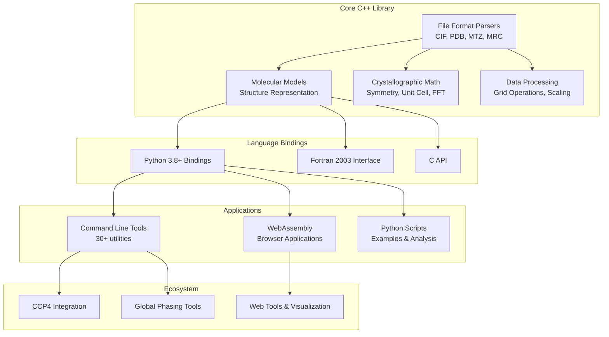

**GEMMI** is a comprehensive open-source library and toolkit designed for **structural biology** and **macromolecular crystallography** (MX). This powerful C++14 library provides unified access to macromolecular structure data, reflection data, and crystallographic computations with high-performance implementations and cross-platform compatibility [README.md](README.md#L1-L32).

## What is GEMMI?

GEMMI (GEneral MacroMolecular I/O) serves as a unified interface for working with diverse structural biology data formats and computational tasks. The library excels in handling:

- **Macromolecular models** from PDB, PDBx/mmCIF, and mmJSON files
- **Refinement restraints** and small molecule models from CIF files  
- **Crystallographic reflection data** in MTZ and mmCIF formats
- **Electron density maps** and masks in MRC/CCP4 format
- **Crystallographic symmetries** and space group operations
- **CIF/STAR file parsing** with the fastest open-source implementation available [docs/index.rst](docs/index.rst#L9-L25)

## Architecture Overview

GEMMI follows a modular C++ architecture with multiple language interfaces:



## Key Features and Capabilities

### File Format Support

GEMMI provides comprehensive support for major structural biology file formats:

| Category | Formats | Key Capabilities |
|----------|---------|------------------|
| **Coordinate Files** | PDB, mmCIF, mmJSON | Reading/writing, validation, conversion |
| **Reflection Data** | MTZ, SF-mmCIF | Indexing, merging, scaling operations |
| **Map Files** | MRC/CCP4 | FFT operations, masking, interpolation |
| **Metadata Files** | CIF/STAR | Fast parsing, DOM/SAX interfaces |
| **Restraint Files** | CIF dictionaries | Chemical topology validation |

### Performance Characteristics

GEMMI is engineered for high-performance computing:

- **Fast CIF parsing**: Benchmarked as the fastest open-source implementation
- **Memory efficiency**: Optimized data structures for large macromolecular assemblies
- **Parallel processing**: Multi-threaded support for computationally intensive operations
- **Cross-platform compatibility**: Linux, Windows, macOS, and WebAssembly

### Language Interfaces

| Interface | Status | Use Cases |
|-----------|--------|-----------|
| **C++ Core** | Production | High-performance computing, library integration |
| **Python Bindings** | Production | Scripting, data analysis, rapid prototyping |
| **Fortran Interface** | In Progress | Legacy crystallographic software integration |
| **WebAssembly** | Partial | Browser-based tools and visualization |

## Project Structure

The repository follows a well-organized structure supporting multiple development workflows:

```
gemmi/
├── include/gemmi/          # C++ header files (70+ modules)
├── src/                    # Core C++ implementation
├── python/                 # Python binding source
├── prog/                   # Command-line tools (30+ utilities)
├── examples/               # Usage examples and tutorials
├── tests/                  # Comprehensive test suite
├── docs/                   # Documentation and help files
├── benchmarks/             # Performance benchmarks
└── wasm/                   # WebAssembly build and demos
```

## Getting Started

GEMMI offers multiple entry points depending on your needs:

### For Python Users
```python
import gemmi
# Read a structure
structure = gemmi.read_structure('protein.pdb')
# Access chains and residues
for model in structure:
    for chain in model:
        for residue in chain:
            print(residue.name)
```

### For C++ Developers
```cpp
#include <gemmi/mmread.hpp>
#include <gemmi/model.hpp>

// Read and process structures
gemmi::Structure structure = gemmi::read_structure_file("protein.cif");
for (gemmi::Model& model : structure.models) {
    // Process model data
}
```

### For Command-Line Users
GEMMI provides 30+ specialized tools accessible through the `gemmi` command:
- `gemmi convert` - Format conversion between PDB, mmCIF, and others
- `gemmi contact` - Interatomic contact analysis
- `gemmi map2sf` - Map to structure factor conversion
- `gemmi validate` - Structure validation and geometry checks

[prog/main.cpp](prog/main.cpp#L9-L41) shows the comprehensive command-line interface with tools for format conversion, analysis, and data processing.

## Scientific Applications

GEMMI is actively used in various structural biology workflows:

- **Structure determination**: Data processing and refinement pipelines
- **Validation**: Geometry checks and structure quality assessment  
- **Analysis**: Superposition, alignment, and comparative studies
- **Visualization**: Data preparation for molecular graphics
- **Bioinformatics**: Large-scale database analysis and mining

## Community and Support

GEMMI is a collaborative project between **CCP4** and **Global Phasing Ltd**, two major providers of crystallographic software [README.md](README.md#L29-L32). The project maintains:

- **Active development**: Regular releases and continuous integration
- **Comprehensive documentation**: API reference, tutorials, and examples
- **Community support**: GitHub discussions and issue tracking
- **Scientific validation**: Published in the Journal of Open Source Software

## Next Steps

To begin using GEMMI, follow this logical progression:

1. **[Installation and Setup](3-installation-and-setup)** - Get GEMMI running on your system
2. **[Quick Start](2-quick-start)** - Learn basic usage patterns with examples
3. **[Command Line Tools Introduction](4-command-line-tools-introduction)** - Explore the utility programs
4. **[Library Structure and Design Philosophy](5-library-structure-and-design-philosophy)** - Understand the architecture
5. **[Python Bindings Architecture](7-python-bindings-architecture)** - For Python users

The project maintains extensive documentation at [http://gemmi.readthedocs.io/](http://gemmi.readthedocs.io/) and provides web-based tools at [https://project-gemmi.github.io/wasm/](https://project-gemmi.github.io/wasm/) for immediate exploration without installation [docs/index.rst](docs/index.rst#L26-L28).