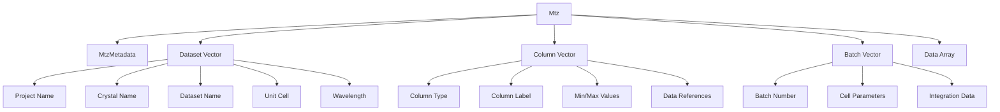

Gemmi provides comprehensive support for MTZ reflection data files, the standard format used in crystallography for storing diffraction data. The MTZ implementation offers both low-level C++ APIs and high-level Python bindings for efficient processing of crystallographic reflection data.

## Core Architecture

The MTZ processing architecture is built around several key components that work together to provide a complete solution for reflection data handling:

### Data Structure Hierarchy

The main `Mtz` class serves as the central container for all MTZ file data, inheriting from `MtzMetadata` which stores file-level information. The structure follows a hierarchical organization:



### Memory Layout and Performance

Gemmi uses a **column-major memory layout** for reflection data storage, where all values for a specific column are stored contiguously in memory. This design enables efficient vectorized operations and cache-friendly access patterns when processing individual data types.

The `Column` class provides iterator-based access to its data through `StrideIter<float>`, allowing seamless integration with STL algorithms while maintaining the underlying column-major storage [include/gemmi/mtz.hpp](include/gemmi/mtz.hpp#L95-L108).

## File Format Support

### Reading MTZ Files

Gemmi supports reading both standard and compressed MTZ files with automatic byte order detection. The reading process handles:

- **Header parsing**: Extracts metadata including space group, unit cell, and resolution limits
- **Dataset information**: Processes multiple datasets with their specific parameters
- **Column definitions**: Reads column types, labels, and data ranges
- **Batch headers**: Processes integration batch information for unmerged data
- **Reflection data**: Loads the main data array with proper type conversion

```cpp
Mtz mtz = read_mtz_file("data.mtz.gz");
```

### Writing MTZ Files

The writing functionality supports creating new MTZ files or modifying existing ones:

```cpp
Mtz mtz(true);  // with_base=true adds HKL columns
mtz.set_spacegroup(spacegroup);
mtz.set_cell_for_all(unit_cell);
mtz.add_dataset("project", "crystal", "dataset");
mtz.add_column("F", 'F', dataset_id);
mtz.write_to_file("output.mtz");
```

## Data Access Patterns

### Column-Based Access

The primary interface for accessing reflection data is through column objects:

```python
mtz = gemmi.read_mtz_file("data.mtz")
intensity = mtz.column_with_label('I')
sigma = mtz.column_with_label('SIGI')

# Direct array access
i_values = intensity.array
sigma_values = sigma.array

# Iterator-based access
for i, sig in zip(intensity, sigma):
    ratio = i / sig
```

### Miller Index Processing

For unmerged MTZ files, Gemmi provides the `UnmergedHklMover` class to handle asymmetric unit transformations:

```cpp
UnmergedHklMover mover(spacegroup);
std::array<int, 3> hkl = {h, k, l};
int isym = mover.move_to_asu(hkl);
```

## Advanced Features

### Batch Processing

The MTZ format supports multiple batch headers for unmerged data, containing integration-specific information:

- **Unit cell parameters** per batch
- **Orientation matrices** (U-matrices)
- **Wavelength** and **oscillation ranges**
- **Integration flags** and statistics

```cpp
for (const Mtz::Batch& batch : mtz.batches) {
    UnitCell batch_cell = batch.get_cell();
    float wavelength = batch.wavelength();
    Mat33 orientation = batch.matrix_U();
}
```

### Data Validation and Statistics

Gemmi includes comprehensive data validation capabilities:

```python
# Check ASU compliance
mtz.check_asu("ccp4")  # or "tnt"

# Calculate statistics
for column in mtz.columns:
    print(f"{column.label}: min={column.min_value}, max={column.max_value}")
```

### Resolution and Completeness

The library automatically calculates resolution limits from the data:

```cpp
double high_res = mtz.resolution_high();  // 1/d_max
double low_res = mtz.resolution_low();     // 1/d_min
```

## Integration with Other Formats

Gemmi provides seamless conversion between MTZ and other crystallographic formats:

### MTZ to CIF Conversion

```python
mtz = gemmi.read_mtz_file("data.mtz")
cif_doc = gemmi.mtz_to_mmcif(mtz)
cif_doc.write_file("data.cif")
```

### Merging with mmCIF Data

The library enables combining reflection data from different sources:

```python
# Load MTZ and mmCIF data
mtz = gemmi.read_mtz_file("reflections.mtz")
cif_block = gemmi.cif.read("structure.cif")[0]

# Create merged dataset
merged_data = merge_mtz_mmcif_data(mtz, cif_block)
```

## Performance Optimizations

### Memory Efficiency

- **Lazy loading**: Data is loaded on-demand when accessed
- **Zero-copy operations**: Direct memory access without unnecessary copying
- **Column-major storage**: Optimized for analytical operations

### Vectorized Operations

The column-based layout enables efficient vectorized processing:

```python
# Vectorized calculations
i_over_sigma = mtz.column_with_label('I').array / mtz.column_with_label('SIGI').array
resolution_array = mtz.make_1_d2_array()  # 1/d² values
```

## Command-Line Tools

Gemmi includes the `mtz` command-line utility for common MTZ operations:

```bash
# Display file information
gemmi mtz data.mtz --dump

# Print column statistics
gemmi mtz data.mtz --stats

# Export as TSV
gemmi mtz data.mtz --tsv

# Check ASU compliance
gemmi mtz data.mtz --check-asu=ccp4

# Compare two MTZ files
gemmi mtz file1.mtz --compare=file2.mtz
```

## Python API Integration

The Python bindings provide idiomatic access to MTZ functionality:

```python
import gemmi
import numpy as np

# Load and analyze MTZ data
mtz = gemmi.read_mtz_file("data.mtz")

# Access specific columns
f_obs = mtz.column_with_label('F')
sigf = mtz.column_with_label('SIGF')

# Convert to numpy arrays for analysis
f_array = np.array(f_obs)
sigf_array = np.array(sigf)

# Calculate statistics
completeness = calculate_completeness(mtz)
r_merge = calculate_r_merge(mtz)
```

> [!TIP]
> The column-major memory layout in Gemmi's MTZ implementation is specifically optimized for crystallographic data analysis, where operations typically process entire columns (e.g., all intensity values) rather than individual reflections.

> [!TIP]
> When working with large MTZ files, use the iterator-based access patterns to avoid loading entire columns into memory when only subsets are needed for analysis.

## Error Handling and Validation

Gemmi provides robust error handling for MTZ processing:

- **Format validation**: Checks for MTZ file format compliance
- **Data consistency**: Validates column types and data ranges
- **Memory safety**: Bounds checking for all data access
- **Logging system**: Detailed error reporting through the Logger class

```cpp
try {
    Mtz mtz = read_mtz_file("data.mtz");
    // Process data
} catch (const std::exception& e) {
    std::cerr << "Error reading MTZ: " << e.what() << std::endl;
}
```

The MTZ reflection data processing capabilities in Gemmi provide a comprehensive foundation for crystallographic data analysis, combining performance, flexibility, and ease of use for both C++ and Python developers.