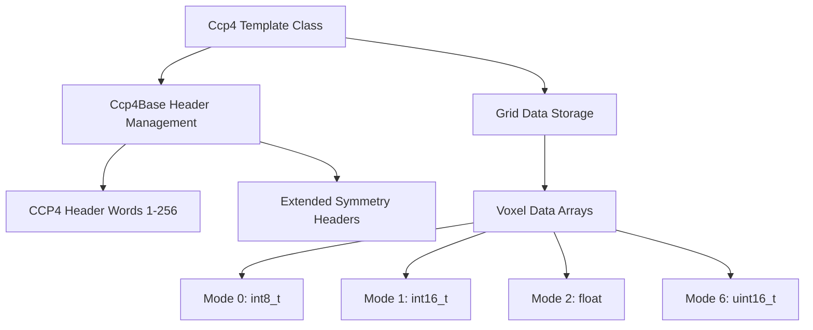
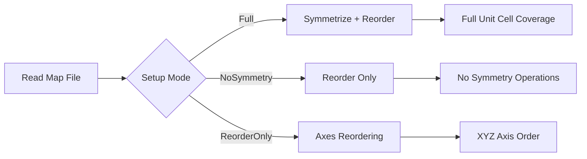

GEMMI provides comprehensive support for MRC/CCP4 map file formats, which are the standard formats for electron density maps and masks in structural biology. This documentation covers the core architecture, file format handling, and practical operations for working with these volumetric data structures.

## Core Architecture and File Format Overview

The MRC/CCP4 map support is centered around the `Ccp4<T>` template class in [`include/gemmi/ccp4.hpp`](include/gemmi/ccp4.hpp#L1), which provides a complete interface for reading, writing, and manipulating map files. The architecture follows a layered design:



The template parameter `T` determines the internal data representation, while the file format supports multiple data modes that are automatically converted during I/O operations. This design allows for efficient in-memory processing while maintaining full compatibility with the CCP4/MRC specifications.

## File Format Structure and Header Management

### CCP4 Header Architecture

The CCP4 format uses a 1024-byte header divided into 256 32-bit words, followed by optional extended symmetry headers. The [`Ccp4Base`](include/gemmi/ccp4.hpp#L25) class provides comprehensive header management:

- **Core metadata**: Grid dimensions (words 1-3), cell parameters (words 11-16), space group (word 23)
- **Axis mapping**: Fast/medium/slow axis definitions (words 17-19) for different storage orders
- **Data statistics**: Minimum, maximum, mean, and RMS values (words 20-22, 55)
- **Origin and transformations**: MRC origin (words 50-52) and optional skew matrix (words 25-37)

> [!TIP]
> The header includes both CCP4-specific extensions and MRC format compatibility fields. The machine stamp (word 54) handles endianness detection and conversion automatically.

### Data Mode Support

GEMMI supports four primary data modes for different use cases:

| Mode | Data Type | Use Case | Memory Efficiency |
|------|-----------|----------|-------------------|
| 0 | `int8_t` | Binary masks | High |
| 1 | `int16_t` | Small integer maps | Medium |
| 2 | `float` | Standard density maps | Standard |
| 6 | `uint16_t` | Unsigned integer maps | Medium |

The automatic mode detection in [`mode_for_data()`](include/gemmi/ccp4.hpp#L264) ensures proper type conversion between file storage and memory representation.

## Map Operations and Data Processing

### Reading and Setup Operations

The primary workflow for map processing involves reading followed by optional setup operations:



The [`setup()`](include/gemmi/ccp4.hpp#L395) method handles three distinct processing modes:

1. **MapSetup::Full**: Expands to full unit cell with symmetry operations
2. **MapSetup::NoSymmetry**: Expands to full cell without applying symmetry
3. **MapSetup::ReorderOnly**: Only reorders axes to X,Y,Z orientation

### Data Access and Manipulation

The underlying [`Grid<T>`](include/gemmi/grid.hpp#L1) class provides efficient random access to voxel data through spatial indexing. Key operations include:

- **Subarray extraction**: [`get_subarray()`](include/gemmi/ccp4.hpp#L447) for region-of-interest processing
- **Extent management**: [`set_extent()`](include/gemmi/ccp4.hpp#L425) for cropping maps to specific regions
- **Symmetry operations**: [`symmetrize_nondefault()`](include/gemmi/ccp4.hpp#L395) for applying space group symmetry

> [!TIP]
> Memory-efficient chunked I/O operations in [`impl::read_data()`](include/gemmi/ccp4.hpp#L234) and [`impl::write_data()`](include/gemmi/ccp4.hpp#L245) handle large maps without loading entire datasets into memory at once.

## Command Line Interface and Utilities

The `gemmi map` command-line tool provides comprehensive map analysis capabilities:

### Core Operations

- **Map summary**: Default operation showing dimensions, statistics, and metadata
- **Reordering**: `--write-xyz` converts between different axis orderings
- **Full expansion**: `--write-full` expands asymmetric units to complete unit cells
- **Mask generation**: `--write-mask` creates binary masks from density thresholds

### Analysis Features

The tool includes statistical analysis options accessible through the command-line interface in [`prog/map.cpp`](prog/map.cpp#L1):

```cpp
// Statistics calculation and histogram generation
template<typename T>
void print_info(const gemmi::Ccp4<T>& map, const gemmi::DataStats& st) {
    // Displays comprehensive map metadata and statistics
    std::printf("Map mode: %d\n", map.header_i32(4));
    std::printf("Number of columns, rows, sections: %5d %5d %5d\n", 
                grid.nu, grid.nv, grid.nw);
}
```

## Integration with Crystallographic Computing

Map operations integrate seamlessly with GEMMI's broader crystallographic computing framework:

- **Unit cell mathematics**: Direct integration with [`UnitCell`](include/gemmi/unitcell.hpp#L1) class for coordinate transformations
- **Space group symmetry**: Automatic symmetry operation handling through [`SpaceGroup`](include/gemmi/symmetry.hpp#L1) integration
- **FFT compatibility**: Maps can be converted to structure factors using [`sf2map`](prog/sf2map.cpp#L1) and [`map2sf`](prog/map2sf.cpp#L1) tools

## Performance Considerations and Best Practices

### Memory Management

- Use appropriate data types (`int8_t` for masks, `float` for density maps)
- Leverage chunked I/O for large files to minimize memory footprint
- Consider axis ordering (XYZ vs ZYX) for optimal cache performance

### Processing Workflows

Typical map processing follows this pattern:

1. **Read**: Load map with automatic format detection
2. **Setup**: Apply appropriate symmetry and ordering operations
3. **Process**: Perform analysis or modification operations
4. **Write**: Export with updated statistics and headers

The convenience functions [`read_ccp4_map()`](src/ccp4.cpp#L7) and [`read_ccp4_mask()`](src/ccp4.cpp#L13) provide simplified interfaces for common use cases.

## Next Steps

For comprehensive understanding of map operations in crystallographic context, continue with:

- [Fast Fourier Transform and Reciprocal Space](14-fast-fourier-transform-and-reciprocal-space) - Understanding the mathematical foundations of map generation
- [Electron Density Calculations](15-electron-density-calculations) - Advanced density computation techniques
- [Unit Cell Mathematics and Transformations](13-unit-cell-mathematics-and-transformations) - Coordinate system fundamentals

The map operations described here form the foundation for advanced structural analysis workflows in GEMMI.