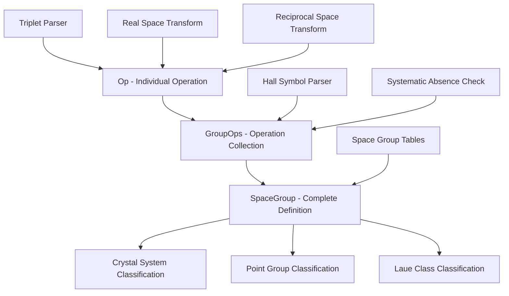

The Gemmi library provides a comprehensive implementation of crystallographic symmetry operations and space groups, forming the mathematical foundation for macromolecular crystallography computations. This documentation explores the core architecture, data structures, and algorithms that enable precise symmetry operations in both real and reciprocal space.

## Core Architecture Overview

The symmetry system is built around three fundamental abstractions: individual symmetry operations (`Op`), collections of operations (`GroupOps`), and space group definitions (`SpaceGroup`). These components work together to provide a complete mathematical framework for crystallographic symmetry.



## Individual Symmetry Operations

### Mathematical Representation

The `Op` struct represents a single symmetry operation using Seitz matrix notation with integer arithmetic for maximum precision [symmetry.hpp](include/gemmi/symmetry.hpp#L25-L26):

```cpp
struct Op {
    static constexpr int DEN = 24;  // Common denominator for fractional coordinates
    typedef std::array<std::array<int, 3>, 3> Rot;  // 3×3 rotation matrix
    typedef std::array<int, 3> Tran;              // Translation vector
    Rot rot;
    Tran tran;
    char notation = ' ';  // 'x' for real space, 'h' for reciprocal space
};
```

The use of a common denominator (`DEN = 24`) enables exact representation of common crystallographic fractions (1/2, 1/3, 1/4, 1/6, 1/8, 1/12, 1/24) while maintaining integer arithmetic precision [symmetry.hpp](include/gemmi/symmetry.hpp#L28).

### Operation Composition and Inversion

Operations can be combined using matrix multiplication following the group theory principles:

```cpp
Op combine(const Op& b) const {
    Op r;
    for (int i = 0; i != 3; ++i) {
        r.tran[i] = tran[i] * Op::DEN;
        for (int j = 0; j != 3; ++j) {
            r.rot[i][j] = (rot[i][0] * b.rot[0][j] +
                          rot[i][1] * b.rot[1][j] +
                          rot[i][2] * b.rot[2][j]) / Op::DEN;
            r.tran[i] += rot[i][j] * b.tran[j];
        }
        r.tran[i] /= Op::DEN;
    }
    r.notation = notation;
    return r;
}
```

The inverse operation is computed using standard matrix inversion algorithms with careful handling of the determinant [symmetry.hpp](include/gemmi/symmetry.hpp#L118-L135).

### Real and Reciprocal Space Applications

The same `Op` structure serves both real and reciprocal space transformations, with the `notation` field distinguishing between them:

- **Real space**: `notation = 'x'`, used for atomic coordinate transformations
- **Reciprocal space**: `notation = 'h'`, used for Miller index transformations

Real space application directly transforms coordinates [symmetry.hpp](include/gemmi/symmetry.hpp#L95-L103):

```cpp
std::array<double, 3> apply_to_xyz(const std::array<double, 3>& xyz) const {
    std::array<double, 3> out;
    for (int i = 0; i != 3; ++i)
        out[i] = (rot[i][0] * xyz[0] + rot[i][1] * xyz[1] + 
                  rot[i][2] * xyz[2] + tran[i]) / Op::DEN;
    return out;
}
```

Reciprocal space operations handle Miller indices with proper division [symmetry.hpp](include/gemmi/symmetry.hpp#L105-L113):

```cpp
Miller apply_to_hkl(const Miller& hkl) const {
    return divide_hkl_by_DEN(apply_to_hkl_without_division(hkl));
}
```

## Group Operations and Symmetry Groups

### GroupOps Structure

The `GroupOps` class manages collections of symmetry operations, separating symmetry operations from centering vectors [symmetry.hpp](include/gemmi/symmetry.hpp#L218-L219):

```cpp
struct GroupOps {
    std::vector<Op> sym_ops;      // Symmetry operations
    std::vector<Op::Tran> cen_ops; // Centering vectors
    int order() const { return static_cast<int>(sym_ops.size()*cen_ops.size()); }
};
```

This separation enables efficient algorithms for:
- Systematic absence determination
- Epsilon factor calculation
- Grid factor determination for FFT operations

### Centering Vector Management

Centering vectors are pre-computed for all standard lattice types [symmetry.hpp](include/gemmi/symmetry.hpp#L170-L195):

```cpp
inline std::vector<Op::Tran> centring_vectors(char centring_type) {
    constexpr int h = Op::DEN / 2;  // 1/2
    constexpr int t = Op::DEN / 3;  // 1/3
    constexpr int d = 2 * t;        // 2/3
    switch (centring_type & ~0x20) {
        case 'P': return {{0, 0, 0}};
        case 'A': return {{0, 0, 0}, {0, h, h}};
        case 'B': return {{0, 0, 0}, {h, 0, h}};
        case 'C': return {{0, 0, 0}, {h, h, 0}};
        case 'I': return {{0, 0, 0}, {h, h, h}};
        case 'F': return {{0, 0, 0}, {0, h, h}, {h, 0, h}, {h, h, 0}};
        // ... additional cases for rhombohedral settings
    }
}
```

> [!TIP]
> The centering vector implementation uses bit manipulation (`& ~0x20`) to handle both uppercase and lowercase lattice type designations, ensuring robust input handling.

### Group Generation Algorithm

The library implements Dimino's algorithm for generating complete symmetry groups from a set of generators [symmetry.hpp](include/gemmi/symmetry.hpp#L410-L445):

```cpp
inline void GroupOps::add_missing_elements() {
    // Dimino's algorithm implementation
    // https://physics.stackexchange.com/a/351400/95713
    std::vector<Op> gen(sym_ops.begin() + 1, sym_ops.end());
    sym_ops.resize(2);
    const Op::Rot idrot = Op::identity().rot;
    
    // Generate cyclic subgroup from first generator
    for (Op g = sym_ops[1] * sym_ops[1]; g.rot != idrot; g *= sym_ops[1]) {
        sym_ops.push_back(g);
        if (sym_ops.size() > max_size)
            fail("Too many elements in the group - bad generators");
    }
    
    // Add remaining generators using coset enumeration
    add_missing_elements_part2(gen, max_size, false);
}
```

## Space Group Classification System

### Hierarchical Classification

Gemmi implements a complete space group classification system following International Tables for Crystallography conventions:

1. **Crystal Systems** (7 types): Triclinic, Monoclinic, Orthorhombic, Tetragonal, Trigonal, Hexagonal, Cubic
2. **Point Groups** (32 types): Symmetry operations without translations
3. **Laue Classes** (11 types): Centrosymmetric point groups for diffraction symmetry

### SpaceGroup Data Structure

The `SpaceGroup` struct contains comprehensive metadata for each of the 230 space groups [symmetry.hpp](include/gemmi/symmetry.hpp#L733-L742):

```cpp
struct SpaceGroup {
    int number;           // International Tables number (1-230)
    int ccp4;            // CCP4 numbering convention
    char hm[11];         // Hermann-Mauguin notation
    char ext;            // Extension for setting (H, R, etc.)
    char qualifier[5];    // Additional qualifiers
    char hall[15];       // Hall symbol for operations
    int basisop_idx;     // Index for change-of-basis operations
};
```

### Space Group Properties and Classification

The library provides efficient classification functions using pre-computed lookup tables [symmetry.hpp](include/gemmi/symmetry.hpp#L680-L710):

```cpp
inline unsigned char point_group_index_and_category(int space_group_number) {
    // 0x20=Sohncke, 0x40=enantiomorphic, 0x80=symmorphic
    enum : unsigned char { S=0x20, E=(0x20|0x40), Y=0x80, Z=(0x20|0x80) };
    static const unsigned char indices[230] = {
        0|Z,  1|Y,  2|Z,  2|S,  2|Z,  3|Y,  3,    3|Y,  3,    4|Y,  // 1-10
        // ... complete table for all 230 space groups
    };
    return indices[space_group_number-1];
}
```

This enables fast classification:
- **Sohncke groups**: 65 chiral space groups for protein crystals
- **Enantiomorphic pairs**: 22 space groups forming 11 enantiomorphic pairs
- **Symmorphic groups**: 73 space groups with no screw axes or glide planes

## Triplet Notation Parsing

### Coordinate Triplet Parser

The library includes a sophisticated parser for symmetry operation triplets like "x,1/2-y,z+1/4" [symmetry.cpp](src/symmetry.cpp#L10-L95):

```cpp
std::array<int, 4> parse_triplet_part(const std::string& s, char& notation, double* decimal_fract) {
    // Handles multiple notations: xyz, abc, hkl
    // Supports decimal fractions for non-crystallographic operations
    // Comprehensive error handling for malformed input
}
```

The parser supports:
- Multiple coordinate notations (xyz, abc, hkl)
- Fractional and decimal representations
- Mixed operations with multiple terms
- Comprehensive error detection and reporting

### Hall Symbol Processing

Hall symbols provide a compact notation for generating complete space group operations. The library implements the full Hall symbol specification to generate symmetry operations programmatically [symmetry.hpp](include/gemmi/symmetry.hpp#L540-L541):

```cpp
GEMMI_DLL GroupOps generators_from_hall(const char* hall);
inline GroupOps symops_from_hall(const char* hall) {
    GroupOps ops = generators_from_hall(hall);
    ops.add_missing_elements();
    return ops;
}
```

## Advanced Symmetry Applications

### Systematic Absence Determination

The `GroupOps` class implements algorithms for determining systematic absences based on centering vectors and symmetry operations [symmetry.hpp](include/gemmi/symmetry.hpp#L365-L385):

```cpp
bool is_systematically_absent(const Op::Miller& hkl) const {
    // Check centering vector phase shifts
    for (auto i = cen_ops.begin() + 1; i != cen_ops.end(); ++i)
        if (has_phase_shift(*i, hkl))
            return true;
    
    // Check symmetry operation phase shifts
    Op::Miller denh = {{Op::DEN * hkl[0], Op::DEN * hkl[1], Op::DEN * hkl[2]}};
    for (auto op = sym_ops.begin() + 1; op != sym_ops.end(); ++op)
        if (op->apply_to_hkl_without_division(hkl) == denh) {
            for (const Op::Tran& c : cen_ops)
                if (has_phase_shift({{op->tran[0] + c[0],
                                    op->tran[1] + c[1],
                                    op->tran[2] + c[2]}}, hkl))
                    return true;
        }
    return false;
}
```

### Grid Factor Determination

For FFT-based calculations, the library determines minimal grid multiplicity factors based on translation components [symmetry.hpp](include/gemmi/symmetry.hpp#L395-L405):

```cpp
std::array<int, 3> find_grid_factors() const {
    const int T = Op::DEN;
    int r[3] = {T, T, T};
    for (Op op : *this)
        for (int i = 0; i != 3; ++i)
            if (op.tran[i] != 0 && op.tran[i] < r[i])
                r[i] = op.tran[i];
    return {T / r[0], T / r[1], T / r[2]};
}
```

> [!TIP]
> The grid factor algorithm ensures that FFT grids have sufficient sampling to properly represent all symmetry operations, critical for accurate electron density calculations and structure factor computations.

### Change-of-Basis Operations

The library supports change-of-basis transformations for converting between different space group settings [symmetry.hpp](include/gemmi/symmetry.hpp#L387-L393):

```cpp
void change_basis_impl(const Op& cob, const Op& inv) {
    // Apply change-of-basis to symmetry operations
    for (auto op = sym_ops.begin() + 1; op != sym_ops.end(); ++op)
        *op = cob.combine(*op).combine(inv).wrap();
    
    // Handle centering vector transformation
    // ... complex logic for lattice point generation
}
```

This enables conversion between:
- Primitive and centered settings
- Different axis conventions
- Rhombohedral hexagonal vs rhombohedral settings

## Integration with Crystallographic Workflows

### Space Group Lookup and Validation

The library provides multiple lookup mechanisms for space group identification [symmetry.hpp](include/gemmi/symmetry.hpp#L870-L910):

```cpp
// Lookup by number
inline const SpaceGroup* find_spacegroup_by_number(int ccp4) noexcept;

// Lookup by name with setting preferences
GEMMI_DLL const SpaceGroup* find_spacegroup_by_name(std::string name,
                                  double alpha=0., double gamma=0.,
                                  const char* prefer=nullptr);

// Lookup by operations
inline const SpaceGroup* find_spacegroup_by_ops(const GroupOps& gops);
```

### Coordinate System Integration

Symmetry operations integrate seamlessly with coordinate systems through unit cell transformations. The `apply_to_xyz` method handles fractional coordinate transformations, while unit cell matrices provide conversion to Cartesian coordinates when needed.

## Performance Considerations

### Integer Arithmetic Precision

The use of integer arithmetic with a common denominator eliminates floating-point rounding errors in symmetry operations, ensuring mathematical exactness for all standard crystallographic transformations.

### Memory Efficiency

The compact representation of operations (44 bytes per space group) enables efficient storage and rapid access, critical for large-scale crystallographic computations involving millions of symmetry operations.

### Algorithmic Optimization

Pre-computed lookup tables and efficient group generation algorithms minimize computational overhead while maintaining mathematical rigor.

## Next Steps

For practical applications of symmetry operations, see:
- [Unit Cell Mathematics and Transformations](13-unit-cell-mathematics-and-transformations) for coordinate system integration
- [Fast Fourier Transform and Reciprocal Space](14-fast-fourier-transform-and-reciprocal-space) for FFT grid considerations
- [Macromolecular Model Representation](16-macromolecular-model-representation) for coordinate handling

The symmetry system forms the mathematical foundation for all crystallographic computations in Gemmi, providing the precision and performance required for modern structural biology applications.