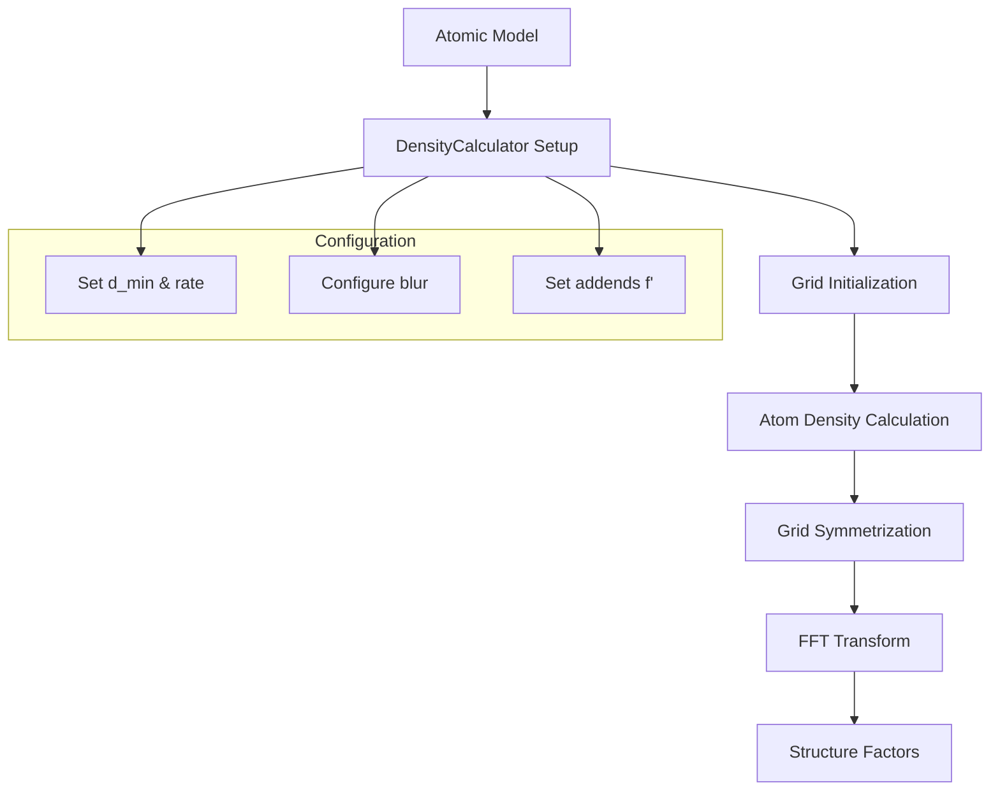

Electron density calculations in Gemmi provide the foundation for crystallographic structure analysis, enabling the transformation between atomic coordinates and reciprocal space representations. This system implements efficient algorithms for calculating electron density from atomic models using Gaussian approximation methods and optimized grid-based computations.

## Core Architecture

The electron density calculation system centers around the `DensityCalculator` template class, which orchestrates the conversion of atomic models into electron density grids. This architecture leverages template-based design for flexibility while maintaining high performance through optimized mathematical operations.

```cpp
template <typename Table, typename GReal>
struct DensityCalculator {
  Grid<GReal> grid;
  double d_min = 0.;
  double rate = 1.5;
  double blur = 0.;
  float cutoff = 1e-5f;
  Addends addends;
};
```

The calculation pipeline follows a structured workflow:



## Atomic Form Factor Calculations

The foundation of electron density calculations lies in atomic form factors, which are approximated using sums of Gaussian functions. Gemmi implements this through the `ExpSum` template structure that efficiently computes electron density contributions:

```cpp
template<int N, typename Real>
struct ExpSum {
  Real a[N], b[N];
  
  Real calculate(Real r2) const {
    Real density = 0;
    for (int i = 0; i < N; ++i)
      density += a[i] * std::exp(b[i] * r2);
    return density;
  }
};
```

The system supports multiple scattering factor tables, primarily IT92 and C4322, which provide different approximations for atomic electron distributions. These tables contain pre-computed coefficients for each element, enabling rapid density calculations without requiring expensive quantum mechanical computations.

## Grid-Based Density Computation

Electron density is calculated on a 3D grid that represents the unit cell. The grid spacing is determined by the resolution parameter `d_min` and sampling rate:

```cpp
double requested_grid_spacing() const { 
  return d_min / (2 * rate); 
}
```

For each atom in the model, the calculator adds its contribution to nearby grid points within a calculated cutoff radius. The implementation optimizes this process through:

- **Isotropic atoms**: Use spherical symmetry with radius estimation based on B-factor and cutoff threshold
- **Anisotropic atoms**: Apply ellipsoidal density distributions using the full anisotropic displacement parameters

```cpp
void add_atom_density_to_grid(const Atom& atom) {
  Element el = atom.element;
  const auto& coef = Table::get(el, atom.charge, atom.serial);
  do_add_atom_density_to_grid(atom, coef, addends.get(el));
}
```

## Cutoff Radius Determination

The system employs sophisticated algorithms to determine the effective radius of each atom's electron density contribution. The `determine_cutoff_radius` function ensures computational efficiency by limiting calculations to regions where the density exceeds the specified threshold:

```cpp
template<int N, typename Real>
Real determine_cutoff_radius(Real x1, const ExpSum<N, Real>& precal, Real cutoff_level) {
  // Iterative refinement to find radius where density drops below cutoff
  Real y1, dy;
  std::tie(y1, dy) = precal.calculate_with_derivative(x1);
  while (std::copysign(dy, y1 * dy) > 0) {
    x1 += 1.0f;
    std::tie(y1, dy) = precal.calculate_with_derivative(x1);
  }
  // ... interpolation for precise cutoff point
}
```

## Advanced Features

### Blurring and B-factor Modification

The density calculator supports applying additional blurring to simulate thermal motion or experimental conditions. The blur parameter can be automatically calculated to match Refmac compatibility:

```cpp
void set_refmac_compatible_blur(const Model& model, bool allow_negative=false) {
  double spacing = requested_grid_spacing();
  double b_min = calculate_b_aniso_range(model).first;
  blur = u_to_b() / 1.1 * sq(spacing) - b_min;
  if (!allow_negative && blur < 0)
    blur = 0.;
}
```

### Mott-Bethe Scattering

For electron diffraction calculations, the system includes Mott-Bethe scattering factor computations:

```cpp
double mott_bethe_factor(const Miller& hkl) const {
  double inv_d2 = grid.unit_cell.calculate_1_d2(hkl);
  double factor = -mott_bethe_const() / inv_d2;
  return blur == 0 ? factor : factor * reciprocal_space_multiplier(inv_d2);
}
```

### Anomalous Scattering Support

The `Addends` system allows incorporation of anomalous scattering factors (f' and f'') for specific wavelengths, enabling accurate modeling of resonant scattering effects:

```cpp
void add_c_contribution_to_grid(const Atom& atom, float c) {
  do_add_atom_density_to_grid(atom, GaussianCoef<0, 1, CReal>{0}, c);
}
```

## Performance Optimizations

The implementation includes several performance optimizations:

- **Unsafe exponential approximation**: Uses fast exp approximation for cases where precision requirements are moderate
- **Grid access patterns**: Optimized memory access patterns for cache efficiency
- **Early termination**: Cutoff radius calculations minimize unnecessary computations
- **Template specialization**: Different code paths for isotropic vs anisotropic atoms

```cpp
inline float unsafe_expapprox(float x) {
  static_assert(std::numeric_limits<float>::is_iec559, "float is not IEEE 754?");
  float val = 12102203.1615614f * x + 1065353216.f;
  std::int32_t vali = static_cast<std::int32_t>(val);
  // ... bit manipulation for fast exp
}
```

## Integration with FFT Pipeline

After density calculation on the grid, the system integrates with the FFT pipeline to convert between real and reciprocal space representations. The `reciprocal_space_multiplier` function applies the appropriate B-factor corrections in Fourier space:

```cpp
double reciprocal_space_multiplier(double inv_d2) const {
  return std::exp(blur * 0.25 * inv_d2);
}
```

## Usage Patterns

The typical workflow for electron density calculations involves:

1. **Configuration**: Set resolution, sampling rate, and optional parameters
2. **Grid setup**: Initialize grid with appropriate dimensions based on unit cell
3. **Density calculation**: Add atomic contributions to the grid
4. **Symmetrization**: Apply space group symmetry operations
5. **FFT transformation**: Convert to structure factors for further analysis

This system provides the computational foundation for crystallographic structure determination, model validation, and electron density analysis in Gemmi.