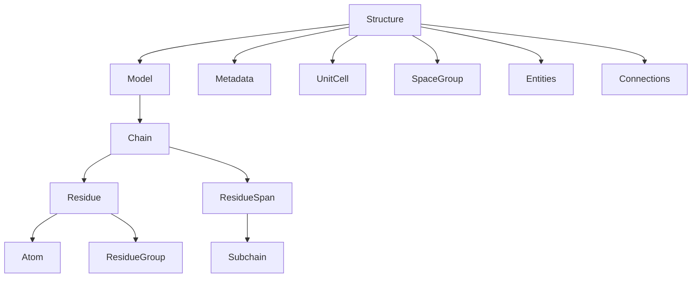

Gemmi provides a comprehensive hierarchical data structure for representing macromolecular models, designed to handle the complexity of biological macromolecules while maintaining efficient memory usage and intuitive access patterns. The representation follows a natural hierarchy from atoms to complete structures, supporting multiple conformations, microheterogeneity, and various molecular entity types.

## Core Hierarchical Architecture

The macromolecular model representation in Gemmi follows a strict hierarchical organization that mirrors the biological structure of macromolecules:



At the foundation lies the **Atom** structure [include/gemmi/model.hpp#L120-L165], which represents individual atomic sites with comprehensive metadata:

- **Positional Data**: 3D coordinates and anisotropic displacement parameters
- **Chemical Identity**: Element type, name, and charge
- **Conformation Information**: Alternative location indicators and occupancy
- **Validation Flags**: Calculation status and custom flags

The **Residue** structure [include/gemmi/model.hpp#L167-L250] extends this by grouping atoms into chemical units, providing:

- **Sequence Identification**: Both author and label sequence numbers
- **Entity Classification**: Polymer, non-polymer, water, or branched entities
- **Subchain Organization**: mmCIF asym_id mapping for complex assemblies
- **Convenient Accessors**: Quick access to backbone atoms for peptides and nucleic acids

## Advanced Structural Concepts

### Alternative Conformations and Microheterogeneity

Gemmi handles structural complexity through sophisticated grouping mechanisms:

**ResidueGroup** [include/gemmi/model.hpp#L380-L400] represents microheterogeneity where multiple residue types occupy the same sequence position. This is common in partial occupancy scenarios or modeling uncertainty.

**AtomGroup** [include/gemmi/model.hpp#L155-L165] manages alternative locations for atoms, allowing multiple conformations of the same atomic site with different positions and occupancies.

The library provides intelligent iteration through these complexities:

```cpp
// Access only first conformer, skipping alternatives
for (const auto& residue : chain.first_conformer()) {
    // Process only primary conformation
}

// Handle all alternative locations
for (const auto& atom_group : residue.get("CA")) {
    // Process each alternative location
}
```

### Subchain Architecture

**Subchains** [include/gemmi/model.hpp#L520-L550] represent a key innovation in handling complex macromolecular assemblies:

- **Logical Grouping**: Chains may contain multiple subchains representing different molecular entities
- **Entity Mapping**: Each subchain maps to a specific entity type (polymer, ligand, water)
- **Flexible Access**: Subchains can be extracted and manipulated independently

This design enables proper handling of:
- Antibody structures with separate heavy and light chains
- Protein-ligand complexes where ligands are part of the same chain
- Multi-domain proteins with different entity classifications

## Memory Management and Performance

### Efficient Container Design

Gemmi employs **span-based views** [include/gemmi/model.hpp#L310-L370] for zero-overhead access to structural elements:

- **ResidueSpan**: Non-owning view into consecutive residues
- **ConstResidueSpan**: Immutable version for read-only operations
- **MutableVectorSpan**: In-place modification capabilities

These spans provide efficient iteration without memory allocation overhead while maintaining the flexibility to work with sub-regions of structures.

### Template-Based Operations

The library uses template programming to provide consistent interfaces across the hierarchy [include/gemmi/model.hpp#L45-L65]:

```cpp
template<typename T>
struct ItemGroup {
    // Common operations for groups of items
    std::string name() const;
    T& by_altloc(char alt);
    // ... other common methods
};
```

This approach enables:
- **Code Reuse**: Same operations work on atoms, residues, and chains
- **Type Safety**: Compile-time verification of operations
- **Performance**: Template specialization eliminates virtual function overhead

## Integration with Crystallographic Data

### Entity Management

The **Structure** class [include/gemmi/model.hpp#L850-L950] integrates macromolecular models with crystallographic metadata:

- **Entity Definitions**: Chemical entity descriptions and polymer classifications
- **Connection Information**: Covalent and non-covalent interactions
- **Assembly Instructions**: Biological assembly generation rules
- **Symmetry Operations**: NCS operators and space group information

### Coordinate System Support

The representation supports multiple coordinate systems:

- **Fractional Coordinates**: For crystallographic operations
- **Cartesian Coordinates**: For molecular calculations
- **Transform Matrices**: ORIGX and symmetry transformations

## Advanced Query and Navigation

### Hierarchical Addressing

Gemmi provides sophisticated addressing mechanisms [include/gemmi/model.hpp#L600-L650]:

```cpp
// Chain-Residue-Atom (CRA) addressing
CRA cra = model.find_cra(atom_address);

// Efficient reverse lookup
auto indices = model.get_indices(chain_ptr, residue_ptr, atom_ptr);
```

### Bidirectional Iteration

The **CraProxy** [include/gemmi/model.hpp#L680-L720] enables bidirectional iteration through all atoms in a structure:

- **Forward Iteration**: Natural traversal order
- **Reverse Iteration**: Efficient backward navigation
- **Random Access**: Direct indexing when needed

## Practical Usage Patterns

### Structure Manipulation

Common operations are streamlined through the hierarchical interface:

```cpp
// Extract specific subchain
ResidueSpan ligand = model.get_subchain("L");

// Find water molecules
ResidueSpan waters = chain.get_waters();

// Access polymer sequence
std::vector<std::string> sequence = chain.get_polymer().extract_sequence();
```

### Conformation Handling

The library provides flexible approaches to conformation management:

- **First Conformer**: Quick access to primary structure
- **All Conformers**: Complete structural information
- **Alternative Selection**: User-specified conformation choices

> [!TIP]
> The hierarchical design in Gemmi ensures that complex operations like conformation handling and subchain extraction have minimal performance impact through careful memory layout and zero-overhead abstractions.

> [!TIP]
> Template-based operations across the hierarchy enable consistent API design while maintaining compile-time type safety and optimal performance through template specialization.

This representation provides a robust foundation for macromolecular analysis, supporting everything from simple coordinate access to complex multi-conformational modeling while maintaining computational efficiency essential for large-scale structural biology applications.

For comprehensive understanding of file format handling and reading operations, see [PDB and mmCIF Coordinate File Handling](9-pdb-and-mmcif-coordinate-file-handling). To explore how these structures interact with symmetry operations, refer to [Symmetry Operations and Space Groups](12-symmetry-operations-and-space-groups).