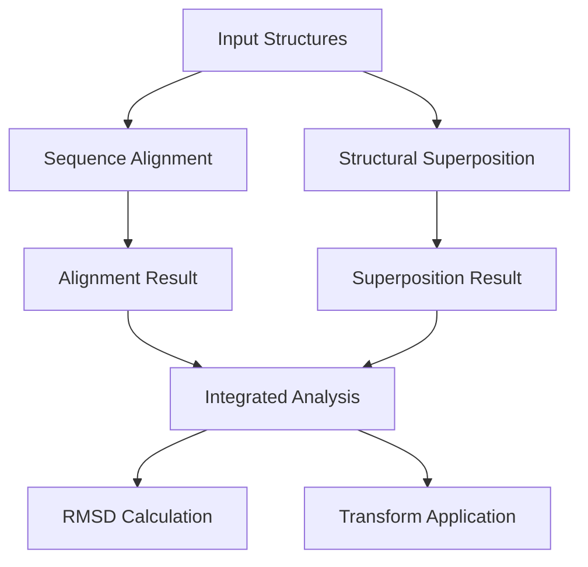

Gemmi provides comprehensive capabilities for structural superposition and sequence alignment, enabling precise comparison of macromolecular structures through both geometric and sequence-based approaches. The framework combines quaternion-based superposition algorithms with sophisticated sequence alignment methods, supporting various polymer types including proteins, RNA, and DNA.

## Core Architecture

The alignment and superposition functionality is organized around three key components: sequence alignment algorithms, structural superposition calculations, and integrated sequence-structure mapping. The architecture leverages the quaternion characteristic polynomial (QCP) method for optimal rotation matrix computation, providing both accuracy and computational efficiency.



## Sequence Alignment Framework

Gemmi implements a robust sequence alignment system that supports both protein and nucleic acid sequences. The core alignment functionality resides in [`include/gemmi/seqalign.hpp`](include/gemmi/seqalign.hpp#L1-L325) and provides multiple scoring schemes:

### Alignment Scoring Systems

The framework includes three predefined scoring matrices:

| Scoring Type | Match | Mismatch | Gap Open | Gap Extend | Use Case |
|--------------|-------|----------|----------|------------|----------|
| Simple | 1 | -1 | -1 | -1 | Basic sequence comparison |
| Partial Model | 100 | -10000 | -10000 | -1 | Model-to-full sequence alignment |
| BLOSUM62 | Variable | Variable | -10 | -1 | Protein sequence homology |

The partial model scoring system is particularly valuable for aligning partially modeled structures to their complete sequences, using aggressive gap penalties to handle missing residues appropriately [include/gemmi/seqalign.hpp](include/gemmi/seqalign.hpp#L44-L48).

### Alignment Result Structure

The [`AlignmentResult`](include/gemmi/seqalign.hpp#L85-L100) structure captures comprehensive alignment information:

- **Score**: Numerical alignment quality metric
- **Match Count**: Number of aligned positions
- **Match String**: Visual representation of alignment
- **CIGAR String**: Compact encoding of alignment operations using M (match), I (insertion), and D (deletion)

## Structural Superposition

Gemmi's structural superposition capabilities are built around the QCP algorithm implemented in [`include/gemmi/qcp.hpp`](include/gemmi/qcp.hpp#L1-L357). This method provides rapid calculation of the optimal rotation matrix for macromolecular superpositions with guaranteed convergence.

### SupResult Structure

The superposition results are encapsulated in the [`SupResult`](include/gemmi/qcp.hpp#L67-L72) structure:

```cpp
struct SupResult {
  double rmsd;           // Root-mean-square deviation
  size_t count;          // Number of atoms used
  Position center1, center2;  // Centers of mass
  Transform transform;    // Optimal transformation matrix
};
```

### Superposition Selection Modes

Gemmi supports three atom selection strategies for superposition [include/gemmi/align.hpp](include/gemmi/align.hpp#L140-L146):

| Mode | Atoms Used | Best For |
|------|------------|----------|
| CaP | Cα atoms (proteins) or P atoms (nucleic acids) | Backbone comparison |
| MainChain | All main-chain atoms | Detailed backbone analysis |
| All | All matching atoms | Complete structure comparison |

## Integrated Sequence-Structure Alignment

The most powerful feature of Gemmi's alignment system is the integration of sequence alignment with structural superposition. The [`align_sequence_to_polymer`](include/gemmi/align.hpp#L47-L69) function performs sequence alignment considering structural connectivity:

```cpp
AlignmentResult align_sequence_to_polymer(
  const std::vector<std::string>& full_seq,
  const ConstResidueSpan& polymer,
  PolymerType polymer_type,
  const AlignmentScoring* scoring=nullptr
);
```

> [!TIP]
> The alignment system automatically detects polymer connectivity gaps and adjusts gap penalties accordingly. Connected residues receive favorable gap opening penalties (0), while unexpected gaps incur penalties (-2), enabling biologically meaningful alignments [include/gemmi/align.hpp](include/gemmi/align.hpp#L25-L37).

## Advanced Superposition Methods

### Moving Window Superposition

For detailed structural analysis, Gemmi provides [`calculate_superpositions_in_moving_window`](include/gemmi/align.hpp#L280-L318), which performs local superpositions using a sliding window approach:

- **Default Radius**: 10.0 Å from each Cα atom
- **Selection**: Main-chain atoms within the radius
- **Output**: Vector of local superposition results

This method is particularly useful for identifying flexible regions and domain movements within macromolecular structures.

### Iterative Refinement with Trimming

The [`calculate_superposition`](include/gemmi/align.hpp#L230-L278) function includes optional iterative refinement to improve alignment quality:

```cpp
SupResult calculate_superposition(
  ConstResidueSpan fixed,
  ConstResidueSpan movable,
  PolymerType ptype,
  SupSelect sel,
  int trim_cycles=0,
  double trim_cutoff=2.0,
  char altloc='\0'
);
```

The refinement process removes outlier atoms that deviate significantly from the mean position, enhancing the robustness of the superposition.

> [!TIP]
> Iterative trimming uses a cutoff of 2.0×RMSD by default, effectively removing atoms that contribute disproportionately to the deviation while preserving the core structural alignment.

## Command-Line Interface

The alignment functionality is accessible through the `gemmi align` command-line tool [`prog/align.cpp`](prog/align.cpp#L1-L368), which supports multiple operation modes:

### Usage Patterns

1. **Internal Alignment**: Compare model sequence to SEQRES within the same file
2. **Cross-File Alignment**: Align chains from different structure files
3. **Text Alignment**: Direct string alignment for testing and validation

### Key Options

- `--query=[+|@]CHAIN`: Specify query chain (prefix '+' for SEQRES, '@' for entity)
- `--target=[+|@]CHAIN`: Specify target chain
- `--check-mmcif`: Validate alignment against mmCIF label_seq_id
- `--rmsd`: Calculate structural RMSD after alignment

## Integration with Structure Validation

The alignment system seamlessly integrates with Gemmi's structure validation framework. The [`assign_label_seq_id`](include/gemmi/align.hpp#L175-L188) function uses sequence alignment to assign consistent residue numbering across models:

```cpp
void assign_label_seq_id(Structure& st, bool force);
```

This function handles three scenarios:
1. **Exact Match**: Direct assignment when sequences match perfectly
2. **Sequence Alignment**: Use alignment to map residues when sequences differ
3. **Forced Assignment**: Assign sequential IDs when no reference sequence exists

## Performance Considerations

The QCP algorithm provides optimal performance for structural superposition with O(n) complexity where n is the number of atoms. The sequence alignment uses efficient dynamic programming with optional SSE optimizations in the original ksw2 implementation.

For large-scale comparisons, consider:
- Using CaP selection for rapid backbone comparison
- Limiting trim cycles to avoid excessive iterations
- Pre-filtering sequences to reduce alignment complexity

## Next Steps

For comprehensive structure analysis, combine superposition with [Neighbor Search and Contact Analysis](18-neighbor-search-and-contact-analysis) to examine structural conservation beyond aligned regions. The [Topology and Chemical Restraints](19-topology-and-chemical-restraints) framework provides additional validation capabilities for assessing structural quality after alignment.