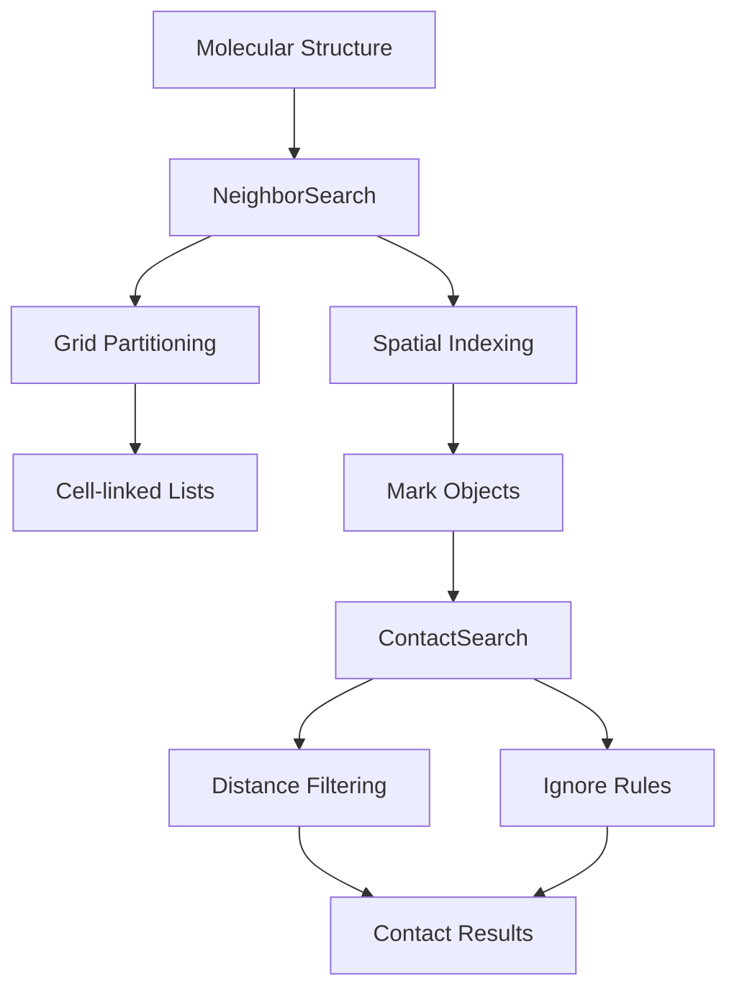

Gemmi provides a sophisticated framework for neighbor searching and contact analysis in macromolecular structures, leveraging efficient cell-linked list algorithms and comprehensive contact detection capabilities. This system is essential for tasks ranging from structure validation to intermolecular interaction analysis.

## Core Architecture

The neighbor search system is built around two primary classes: `NeighborSearch` and `ContactSearch`. The `NeighborSearch` class implements a cell-linked list method (also known as grid search or binning) that spatially partitions atoms into a 3D grid for efficient proximity queries [neighbor.hpp](include/gemmi/neighbor.hpp#L1-L10). This approach reduces the time complexity from O(n²) for brute-force searches to approximately O(n) for typical molecular systems.

The `ContactSearch` class builds upon `NeighborSearch` to provide specialized contact detection with configurable filtering options and distance criteria [contact.hpp](include/gemmi/contact.hpp#L8-L15). Together, these classes form a comprehensive framework for spatial analysis of molecular structures.



## NeighborSearch Implementation

### Grid-based Spatial Partitioning

The `NeighborSearch` class creates a 3D grid that subdivides the unit cell or bounding box into smaller cells [neighbor.hpp](include/gemmi/neighbor.hpp#L35-L45). Each cell contains a vector of `Mark` objects that store atom positions, element types, and indexing information:

```cpp
struct Mark {
    Position pos;
    char altloc;
    Element element;
    short image_idx;
    int chain_idx;
    int residue_idx;
    int atom_idx;
};
```

The grid size is automatically calculated based on the specified search radius, ensuring optimal performance by balancing cell size against search efficiency [neighbor.hpp](include/gemmi/neighbor.hpp#L340-L345). For crystal structures, the system respects periodic boundary conditions, while for non-crystal structures, it creates a bounding box that encompasses all atoms including NCS images.

### Population and Query Methods

The `populate()` method fills the grid with atoms from the structure, optionally including hydrogen atoms and symmetry images [neighbor.hpp](include/gemmi/neighbor.hpp#L250-L270). Each atom is placed in its corresponding grid cell along with any symmetry-generated images:

```cpp
inline void NeighborSearch::add_atom(const Atom& atom,
                                     int n_ch, int n_res, int n_atom) {
    const UnitCell& gcell = grid.unit_cell;
    Fractional frac0 = gcell.fractionalize(atom.pos);
    {
        Fractional frac = frac0.wrap_to_unit();
        Position pos = use_pbc ? gcell.orthogonalize(frac) : atom.pos;
        get_subcell(frac).emplace_back(pos, atom.altloc, atom.element.elem,
                                       0, n_ch, n_res, n_atom);
    }
    // Add symmetry images...
}
```

> [!TIP]
> The grid uses fractional coordinates internally, allowing efficient handling of periodic boundary conditions and symmetry operations. This design enables seamless searching across unit cell boundaries.

## ContactSearch Functionality

### Configurable Search Parameters

The `ContactSearch` class provides extensive customization options for contact detection [contact.hpp](include/gemmi/contact.hpp#L16-L30):

- **Distance criteria**: Fixed radius or element-specific covalent radii
- **Ignore rules**: Filter contacts by residue, chain, or ASU relationships
- **Occupancy filtering**: Exclude low-occupancy atoms
- **Special position handling**: Avoid duplicate contacts from symmetry

### Advanced Filtering Capabilities

The system supports multiple ignore levels to control which contacts are reported [contact.hpp](include/gemmi/contact.hpp#L11-L15):

```cpp
enum class Ignore {
    Nothing=0, SameResidue, AdjacentResidues, SameChain, SameAsu
};
```

This allows fine-grained control over contact analysis, from including all atom pairs to only reporting inter-ASU contacts. The `AdjacentResidues` option is particularly useful for protein structure analysis, as it can exclude contacts between sequentially connected residues while preserving other intra-chain interactions.

### Element-specific Distance Calculations

For chemistry-aware contact analysis, the system can use covalent radii to determine appropriate distance thresholds [contact.hpp](include/gemmi/contact.hpp#L31-L40):

```cpp
void setup_atomic_radii(double multiplier, double tolerance) {
    radii.resize((size_t)El::END);
    for (int i = 0; i != (int) El::END; ++i)
        radii[i] = float(multiplier * Element(i).covalent_r() + tolerance / 2);
}
```

This approach enables detection of chemically relevant contacts such as hydrogen bonds, van der Waals interactions, and potential covalent linkages.

## Command Line Interface

The `gemmi contact` program provides a comprehensive interface for contact analysis with extensive command-line options [contact.cpp](prog/contact.cpp#L18-L65):

| Option | Description | Default |
|--------|-------------|---------|
| `-d, --maxdist=D` | Maximum distance in Å | 3.0 |
| `--cov=TOL` | Use covalent radii sum + TOL | - |
| `--covmult=M` | Use M × covalent radii sum + TOL | - |
| `--ignore=N` | Ignore same: 0=none, 1=residue, 2=adjacent, 3=chain, 4=asu | 2 |
| `--nosym` | Ignore symmetry mates | false |
| `--noh` | Ignore hydrogen atoms | false |
| `--count` | Print only contact count | false |

> [!TIP]
> The contact program can output symmetry operation information, making it valuable for understanding crystal packing and intermolecular interactions in biological assemblies.

## Performance Optimization

### Efficient Search Algorithms

The system employs several optimization strategies to ensure high performance:

1. **Adaptive k-value selection**: The `sufficient_k()` method determines the optimal search radius based on the specified distance [neighbor.hpp](include/gemmi/neighbor.hpp#L95-L100)
2. **Early termination**: Distance checks are performed before expensive coordinate transformations
3. **Memory-efficient storage**: Grid cells use vectors with pre-allocated capacity based on expected atom density

### Scalability Considerations

The cell-linked list approach scales linearly with the number of atoms, making it suitable for large macromolecular complexes. The grid size automatically adapts to the molecular system, ensuring optimal performance across different structure sizes and densities.

## Integration with Structure Analysis

The neighbor search and contact analysis system integrates seamlessly with other Gemmi components:

- **Structure validation**: Contact detection helps identify geometric outliers and potential modeling errors
- **Biological assembly analysis**: Symmetry-aware contact detection reveals intermolecular interfaces
- **Ligand binding analysis**: Precise distance calculations enable accurate identification of ligand-protein interactions
- **Crystal packing studies**: Comprehensive contact mapping supports understanding of crystal formation

This integration makes the contact analysis system a fundamental tool for structural biology and computational chemistry applications.

## Next Steps

For understanding how neighbor search integrates with the broader molecular representation, see [Macromolecular Model Representation](16-macromolecular-model-representation). To learn about symmetry operations that affect contact analysis, refer to [Symmetry Operations and Space Groups](12-symmetry-operations-and-space-groups).