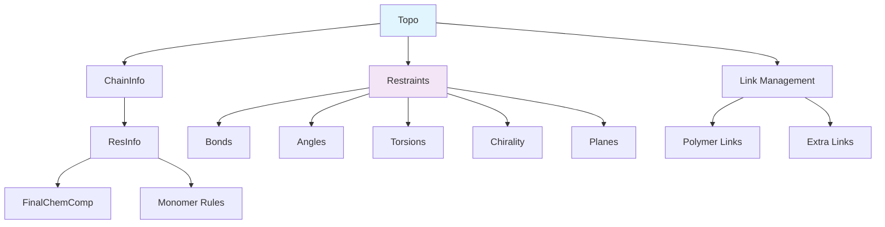

The topology and chemical restraints system in Gemmi provides a comprehensive framework for applying geometric constraints to macromolecular structures, ensuring chemical validity during refinement and validation. This system bridges the gap between theoretical chemical knowledge and experimental coordinate data.

## Core Architecture

The topology system centers around the `Topo` class [topo.hpp](include/gemmi/topo.hpp#L23), which serves as the main container for all restraints applied to a molecular model. The architecture follows a hierarchical design where restraints are organized by type and indexed for efficient lookup.



## Restraint Types and Implementation

### Bond Restraints
Bond restraints maintain appropriate interatomic distances between covalently bonded atoms. Each bond contains both electron cloud and nucleus distance parameters [chemcomp.hpp](include/gemmi/chemcomp.hpp#L71-L92):

```cpp
struct Bond {
    AtomId id1, id2;
    BondType type;
    bool aromatic;
    double value;           // electron cloud distance
    double esd;             // estimated standard deviation
    double value_nucleus;    // nucleus distance
    double esd_nucleus;
};
```

The system supports various bond types including single, double, triple, aromatic, delocalized, and metal bonds [chemcomp.hpp](include/gemmi/chemcomp.hpp#L20-L21).

### Angular Restraints
Angular restraints enforce proper bond angles between three consecutive atoms. Each angle restraint includes the ideal angle value and uncertainty [chemcomp.hpp](include/gemmi/chemcomp.hpp#L94-L103):

```cpp
struct Angle {
    AtomId id1, id2, id3;
    double value;  // degrees
    double esd;
};
```

### Torsional Restraints
Torsion restraints control dihedral angles between four atoms, crucial for maintaining proper conformational geometry. These include periodicity information for rotational symmetry [chemcomp.hpp](include/gemmi/chemcomp.hpp#L105-L115):

```cpp
struct Torsion {
    std::string label;
    AtomId id1, id2, id3, id4;
    double value;
    double esd;
    int period;           // periodicity for rotational symmetry
};
```

### Chirality and Planarity
Chirality restraints enforce stereochemical configuration at chiral centers, while plane restraints ensure atoms remain coplanar in aromatic systems or other planar groups [chemcomp.hpp](include/gemmi/chemcomp.hpp#L117-L139).

## Chemical Component Integration

The system integrates with chemical component definitions from monomer libraries, enabling automatic application of appropriate restraints based on residue types. Each `ChemComp` contains a complete set of restraints for its chemical group [chemcomp.hpp](include/gemmi/chemcomp.hpp#L141-L145).

For residues without library definitions, Gemmi can generate restraints automatically from coordinates using the `make_chemcomp_with_restraints()` function [topo.cpp](src/topo.cpp#L13-L118). This function:
- Identifies covalent bonds based on atomic distances and covalent radii
- Constructs angle restraints from bonded atom triplets
- Applies appropriate standard deviations based on chemical intuition

## Polymer Link Management

The topology system handles polymer-specific links between residues, with special support for peptides and nucleic acids. The `add_polymer_links()` function [topo.cpp](src/topo.cpp#L189-L323) automatically detects and creates appropriate links:

### Peptide Bonds
For polypeptides, the system identifies C-N peptide bonds and determines cis/trans configuration based on omega angles [topo.cpp](src/topo.cpp#L247-L257):
- Cis peptide bonds use "PCIS", "NMCIS", or "CIS" link IDs
- Trans peptide bonds use "PTRANS", "NMTRANS", or "TRANS" link IDs
- Selection depends on terminal residue types and configuration

### Nucleotide Links
For polynucleotides, the system connects O3'-P atoms between consecutive residues [topo.cpp](src/topo.cpp#L269-L323), handling various nucleotide types and modifications.

## Indexing and Lookup System

The topology system maintains efficient indexing structures for rapid restraint lookup [topo.hpp](include/gemmi/topo.hpp#L204-L207):

```cpp
std::multimap<const Atom*, Bond*> bond_index;       // indexes both atoms
std::multimap<const Atom*, Angle*> angle_index;     // only middle atom
std::multimap<const Atom*, Torsion*> torsion_index; // two middle atoms
std::multimap<const Atom*, Plane*> plane_index;     // all atoms
```

These indices enable O(log n) lookup operations for finding restraints involving specific atoms, essential for efficient refinement and validation algorithms.

## Modification Handling

The system supports chemical modifications through `ChemMod` applications, allowing dynamic alteration of restraint sets. Each `ResInfo` maintains a list of modifications and corresponding final chemical components [topo.hpp](include/gemmi/topo.hpp#L113-L136).

> [!TIP]
> Modifications are applied by creating new ChemComp instances with altered restraints, enabling complex chemical transformations while maintaining traceability to original definitions.

## Validation and Quality Assessment

Each restraint type includes methods for calculating Z-scores, providing quantitative measures of geometric quality:

- **Bonds**: `calculate_z()` compares observed distance to ideal value [topo.hpp](include/gemmi/topo.hpp#L38-L39)
- **Angles**: `calculate_z()` assesses angular deviation [topo.hpp](include/gemmi/topo.hpp#L47)
- **Torsions**: Z-score calculation accounts for periodicity [topo.hpp](include/gemmi/topo.hpp#L56-L57)
- **Chirality**: `calculate_z()` evaluates stereochemical correctness [topo.hpp](include/gemmi/topo.hpp#L67-L73)

## Integration with Refinement Workflows

The topology system integrates seamlessly with refinement programs like Refmac through the `initialize_refmac_topology()` method [topo.hpp](include/gemmi/topo.hpp#L266-L267). This method:
- Sets up chain information and residue groupings
- Applies monomer library restraints
- Establishes inter-residue links
- Creates efficient lookup indices

> [!TIP]
> The system maintains non-const pointers to model atoms, requiring careful lifecycle management to avoid dangling references during structural modifications.

## Next Steps

For comprehensive understanding of molecular structure handling, explore [Macromolecular Model Representation](16-macromolecular-model-representation) to learn how coordinates are organized, or proceed to [Structure Validation and Geometry Checks](23-structure-validation-and-geometry-checks) to see how these restraints are applied in practice.