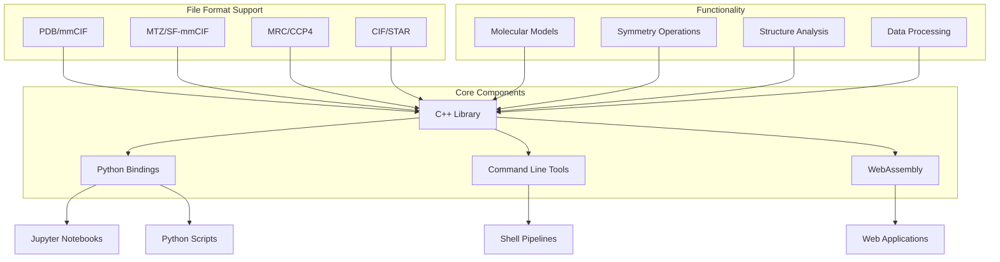

Welcome to Gemmi, a comprehensive library for macromolecular crystallography and structural biology. This quick start guide will help you get up and running with Gemmi's core functionality for working with molecular structures, crystallographic data, and various file formats.

## What Can Gemmi Do For You?

Gemmi is designed for structural biologists and crystallographers who need to work with:

- **Macromolecular models** from PDB, mmCIF, and mmJSON files
- **Refinement restraints** and small molecule models
- **Crystallographic reflections** from MTZ and SF-mmCIF files  
- **Electron density maps** in MRC/CCP4 format
- **Crystallographic symmetries** and space group operations
- **General CIF/STAR file processing** with the fastest open-source parser available

## Installation Options

### Python Installation (Recommended for Beginners)

The easiest way to get started is with the Python package:

```bash
pip install gemmi
```

This installs pre-compiled wheels for most platforms, giving you immediate access to both the library and command-line tools.

### C++ Library Integration

For C++ projects, you have several integration options:

**Using CMake (Recommended):**
```cmake
# Option 1: Install and find
find_package(gemmi 0.7.0 CONFIG REQUIRED)
target_link_libraries(your_target PRIVATE gemmi::gemmi_cpp)

# Option 2: Git submodule
add_subdirectory(gemmi EXCLUDE_FROM_ALL)
target_link_libraries(your_target PRIVATE gemmi::gemmi_cpp)
```

**Header-only usage** (for CIF parsing only):
```bash
git clone https://github.com/project-gemmi/gemmi.git
c++ -Igemmi/include -O2 your_program.cpp
```

## Your First Gemmi Programs

### Reading CIF Files in Python

Let's start with a simple example to read chemical component information from CIF files:

```python
#!/usr/bin/env python
import sys
from gemmi import cif

for path in sys.argv[1:]:
    try:
        doc = cif.read_file(path)
        for block in doc:
            for cc in block.find("_chem_comp.", ["id", "formula_weight"]):
                print(cc[0], "weights", cc[1])
    except Exception as e:
        print("Error:", e)
```

Save this as `read_compounds.py` and run:
```bash
python read_compounds.py your_file.cif
```

### Command-line Tool Usage

Gemmi comes with a comprehensive command-line interface. Here are some essential commands:

**File information:**
```bash
gemmi contents structure.pdb
gemmi mtz reflections.mtz
gemmi map density.map
```

**File format conversion:**
```bash
# Convert mmCIF to PDB
gemmi convert input.mmcif output.pdb

# Convert CIF to JSON
gemmi cif2json data.cif > data.json

# Convert MTZ to mmCIF
gemmi mtz2cif reflections.mtz > reflections.cif
```

**Structure validation:**
```bash
# Validate CIF syntax
gemmi validate file.cif

# Validate geometry against monomer library
gemmi rmsz structure.pdb
```

## Project Architecture Overview



## Essential Examples

### Amino Acid Frequency Analysis

This example demonstrates processing multiple structure files to analyze amino acid composition:

```python
#!/usr/bin/env python
import sys
from collections import Counter
from gemmi import cif, CifWalk

totals = Counter()
for path in CifWalk(sys.argv[1]):
    block = cif.read(path).sole_block()
    seq = block.find('_entity_poly_seq.', ['entity_id', 'mon_id'])
    entity_types = dict(block.find('_entity_poly.', ['entity_id', 'type']))
    
    aa_counter = Counter(row.str(1) for row in seq
                         if 'polypeptide' in entity_types[row.str(0)])
    totals += aa_counter
    print(block.name, *(f'{m}:{c}' for (m, c) in aa_counter.most_common()))

# Print percentages
f = 100.0 / sum(totals.values())
print('TOTAL', *(f'{m}:{c*f:.2f}%' for (m, c) in totals.most_common(20)))
```

### Structure Search and Filtering

Find structures with specific characteristics:

```python
#!/usr/bin/env python
"Find PDB entries with more than 50,000 anisotropic B-factors."

import sys
from gemmi import cif, CifWalk

for path in CifWalk(sys.argv[1]):
    block = cif.read(path).sole_block()
    anis = block.find_values("_atom_site_anisotrop.id")
    if len(anis) > 50000:
        print(block.name, len(anis))
```

## Key Features at a Glance

| Feature | Python API | Command Line | C++ Library |
|---------|------------|--------------|-------------|
| File Reading | ✅ | ✅ | ✅ |
| Format Conversion | ✅ | ✅ | ✅ |
| Structure Analysis | ✅ | ✅ | ✅ |
| Symmetry Operations | ✅ | ✅ | ✅ |
| Map Processing | ✅ | ✅ | ✅ |
| Batch Processing | ✅ | ✅ | ✅ |
| Custom Extensions | ✅ | ❌ | ✅ |

## Common Workflows

### 1. Structure Preparation Pipeline

```bash
# Convert and clean structure
gemmi convert input.pdb temp.mmcif
gemmi h --add temp.mmcif final.mmcif

# Validate geometry
gemmi rmsz final.mmcif
```

### 2. Data Processing Workflow

```bash
# Convert reflection data
gemmi cif2mtz reflections.cif reflections.mtz

# Calculate structure factors
gemmi sfcalc model.pdb --mtz reflections.mtz

# Generate electron density map
gemmi sf2map reflections.mtz map.mtz density.map
```

### 3. Batch Analysis with Python

```python
from gemmi import cif, CifWalk
import multiprocessing as mp

def analyze_structure(path):
    block = cif.read(path).sole_block()
    # Your analysis logic here
    return result

# Parallel processing
with mp.Pool() as pool:
    results = pool.map(analyze_structure, CifWalk("directory/"))
```

## Getting Help

- **Documentation**: http://gemmi.readthedocs.io/en/latest/
- **GitHub Issues**: https://github.com/project-gemmi/gemmi/issues
- **Discussions**: https://github.com/project-gemmi/gemmi/discussions
- **Online Tools**: https://project-gemmi.github.io/wasm/

## Next Steps

Now that you have the basics, explore these areas:

- **[Installation and Setup](3-installation-and-setup)** - Detailed installation instructions for all platforms
- **[Command Line Tools Introduction](4-command-line-tools-introduction)** - Comprehensive guide to all available commands
- **[Library Structure and Design Philosophy](5-library-structure-and-design-philosophy)** - Understanding Gemmi's architecture

For specific applications, dive into:
- **[PDB and mmCIF Coordinate File Handling](9-pdb-and-mmcif-coordinate-file-handling)** for structure manipulation
- **[MTZ Reflection Data Processing](10-mtz-reflection-data-processing)** for crystallographic data
- **[Macromolecular Model Representation](16-macromolecular-model-representation)** for detailed structure analysis

Happy crystallographing!