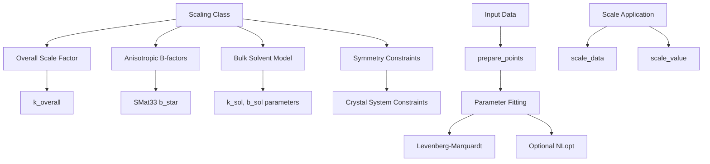

The scaling and bulk solvent correction functionality in Gemmi provides sophisticated algorithms for refining crystallographic data to account for overall scale factors, anisotropic displacement parameters, and solvent contributions. This system implements both traditional scaling methods and advanced optimization techniques for improving the agreement between observed and calculated structure factors.

## Architecture Overview

The scaling system is built around the `Scaling<Real>` template class which coordinates multiple scaling components:



## Core Scaling Model

The scaling model combines three main components that work together to correct structure factors:

### Overall Scale Factor (k_overall)

The primary scale factor `k_overall` accounts for the overall intensity scaling between observed and calculated data [include/gemmi/scaling.hpp#L40]. This factor is refined during the fitting process to minimize the differences between observed and calculated structure factors.

### Anisotropic B-factors

The anisotropic displacement parameters are stored as `b_star`, which represents the B-factor tensor in reciprocal space [include/gemmi/scaling.hpp#L41]. The system provides automatic conversion between cartesian and star coordinates:

```cpp
void set_b_overall(const SMat33<double>& b_overall) {
  b_star = b_overall.transformed_by(cell.frac.mat);
}
SMat33<double> get_b_overall() const {
  return b_star.transformed_by(cell.orth.mat);
}
```

### Bulk Solvent Correction

The bulk solvent model uses a two-parameter exponential function to approximate the contribution of disordered solvent:

- **k_sol**: Solvent scale factor (default: 0.35)
- **b_sol**: Solvent B-factor (default: 46.0)

The solvent contribution is calculated as: `k_sol * exp(-b_sol * stol²)` where `stol²` is the squared sine of the Bragg angle divided by wavelength squared [include/gemmi/scaling.hpp#L207].

## Symmetry Constraints

The system enforces crystallographic symmetry constraints on anisotropic B-factors through the `adp_symmetry_constraints` function [include/gemmi/scaling.hpp#L15-L65]. This function returns constraint vectors based on the crystal system:

| Crystal System | Independent Parameters | Constraint Pattern |
|----------------|----------------------|-------------------|
| Triclinic | 6 | Full 6×6 identity |
| Monoclinic | 4 | 3 diagonal + 1 off-diagonal |
| Orthorhombic | 3 | Only diagonal elements |
| Tetragonal | 2 | [1,1,0] and [0,0,1] directions |
| Hexagonal/Trigonal | 2 | System-specific patterns |
| Cubic | 1 | Isotropic constraint |

## Data Preparation Workflow

The scaling process requires careful preparation of input data through the `prepare_points` method [include/gemmi/scaling.hpp#L163-L200]:

1. **Data Matching**: Aligns calculated and observed reflection data by Miller indices
2. **Solvent Mask Integration**: Optionally incorporates bulk solvent mask data
3. **Quality Filtering**: Excludes weak reflections (F_obs < 1 or F_obs < σ)
4. **Point Assembly**: Creates `Point` structures containing all necessary scaling information

## Parameter Optimization Methods

### Levenberg-Marquardt Fitting

The primary optimization method uses the Levenberg-Marquardt algorithm through the `fit_parameters` method [include/gemmi/scaling.hpp#L301]. This approach:

- Minimizes the weighted sum of squared residuals
- Provides robust convergence for nonlinear problems
- Automatically computes analytical derivatives

### NLopt Integration (Optional)

For advanced users, Gemmi provides NLopt integration when compiled with `WITH_NLOPT` [include/gemmi/scaling.hpp#L334-L430]. This offers:

- Multiple optimization algorithms
- Customizable parameter bounds
- Enhanced convergence options

The system sets reasonable bounds for each parameter type:
- **k_overall**: 0.7× to 1.2× current value
- **k_sol**: 0.15 to 0.5
- **b_sol**: 10 to 80
- **B-factor components**: -0.01 to 0.01

## Initialization Strategies

### Approximate Isotropic B-factor Fitting

The `fit_isotropic_b_approximately` method provides quick initial parameter estimation [include/gemmi/scaling.hpp#L215-L240]. This linear regression approach:

1. Calculates log ratios of observed to calculated amplitudes
2. Fits a linear relationship against sin²θ/λ²
3. Extracts initial k_overall and isotropic B-factor
4. Sets anisotropic B-factor to isotropic value

### B-star Approximation

For testing purposes, the system includes `fit_b_star_approximately` [include/gemmi/scaling.hpp#L242-L298], which estimates anisotropic B-factors following the method of Afonine et al. (2013).

## Scaling Applications

### Data Scaling

The `scale_data` method applies the complete scaling model to reflection data [include/gemmi/scaling.hpp#L103-L120]:

```cpp
void scale_data(AsuData<std::complex<Real>>& asu_data,
                const AsuData<std::complex<Real>>* mask_data) const {
  // Apply solvent correction if enabled
  if (use_solvent) {
    double stol2 = cell.calculate_stol_sq(hv.hkl);
    hv.value += (Real)get_solvent_scale(stol2) * mask_data->v[i].value;
  }
  // Apply overall scaling
  if (use_scaling)
    hv.value *= (Real) get_overall_scale_factor(hv.hkl);
}
```

### Individual Reflection Scaling

For single reflection operations, the `scale_value` method provides efficient scaling with optional solvent contribution [include/gemmi/scaling.hpp#L122-L129].

## Quality Assessment

The system includes R-factor calculation through `calculate_r_factor` [include/gemmi/scaling.hpp#L303-L310], providing immediate feedback on scaling quality:

```
R = Σ|F_obs - F_calc| / ΣF_obs
```

## Python Interface

The scaling functionality is exposed to Python through comprehensive bindings [python/scaling.cpp#L10-L44]:

```python
# Create scaling object
scaling = gemmi.Scaling(unit_cell, space_group)

# Configure parameters
scaling.use_solvent = True
scaling.k_sol = 0.35
scaling.b_sol = 46.0

# Prepare data and fit
scaling.prepare_points(calc_data, obs_data, mask_data)
scaling.fit_parameters()

# Apply scaling
scaled_data = scaling.scale_data(asu_data, mask_data)
```

> [!TIP]
> The scaling system automatically handles the conversion between cartesian and reciprocal space B-factor representations, ensuring mathematical consistency throughout the refinement process.

> [!TIP]
> For optimal results, ensure that input reflection data is properly sorted by Miller indices before calling `prepare_points`, as the algorithm relies on ordered data for efficient matching.

## Related Documentation

For comprehensive understanding of scaling and bulk solvent correction, consider exploring these related topics:

- [MTZ Reflection Data Processing](10-mtz-reflection-data-processing) - Understanding reflection data formats and handling
- [Unit Cell Mathematics and Transformations](13-unit-cell-mathematics-and-transformations) - Mathematical foundations of crystallographic transformations
- [Electron Density Calculations](15-electron-density-calculations) - Structure factor calculations and density map generation
- [Fast Fourier Transform and Reciprocal Space](14-fast-fourier-transform-and-reciprocal-space) - FFT operations and reciprocal space concepts

The scaling system integrates seamlessly with Gemmi's broader crystallographic computing framework, providing a robust foundation for structure refinement and validation workflows.