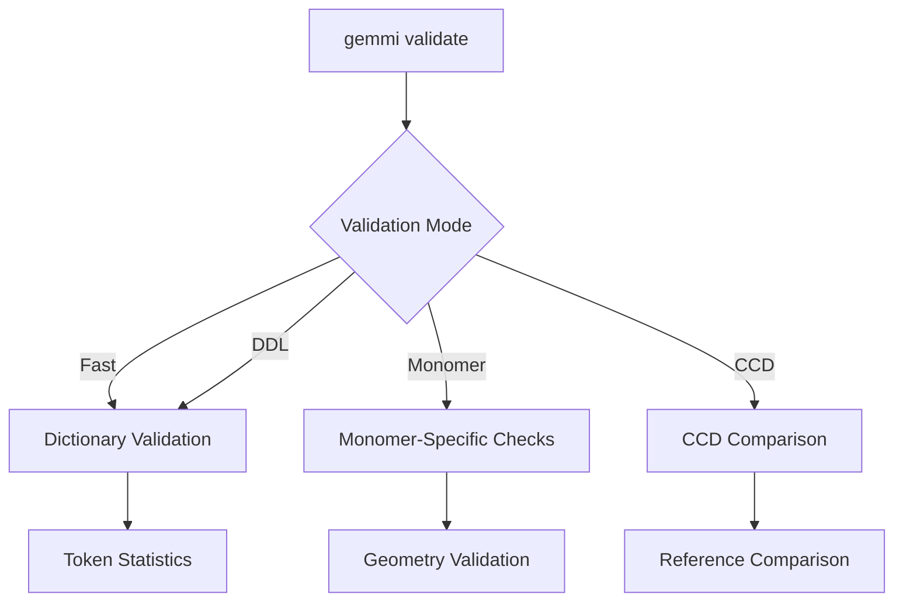
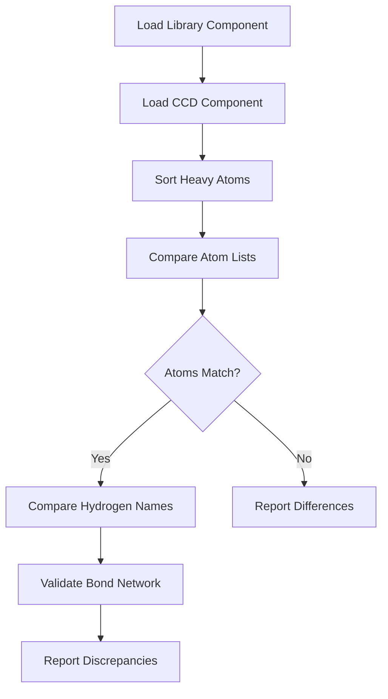

Gemmi provides comprehensive structure validation and geometry checking capabilities through both command-line tools and programmatic APIs. The validation framework supports CIF/mmCIF dictionary validation, monomer-specific checks, and geometry verification against chemical restraints.

## Command-Line Validation Tool

The primary validation interface is the `gemmi validate` command-line tool, which offers multiple validation modes and extensive configuration options [validate.cpp](prog/validate.cpp#L238-L291).

### Core Validation Modes



### Validation Options

| Option | Purpose | Default |
|--------|---------|---------|
| `-f, --fast` | Syntax-only validation | Disabled |
| `-d, --ddl=PATH` | Dictionary file for validation | None |
| `-m, --monomer` | Monomer-specific validation | Disabled |
| `--ccd=PATH` | CCD file for comparison | None |
| `--z-score=Z` | Z-score threshold for geometry | 2.0 |

Additional DDL2-specific options include regex checking, mandatory tag validation, unique key verification, and parent-child relationship checks [validate.cpp](prog/validate.cpp#L30-L47).

## Dictionary-Based Validation

Gemmi supports both DDL1 and DDL2 dictionary validation through the `cif::Ddl` class [ddl.hpp](include/gemmi/ddl.hpp#L18-L86). The validation engine performs comprehensive checks including:

- **Mandatory item verification**: Ensures required data items are present
- **Type checking**: Validates data types against dictionary specifications
- **Regex validation**: Checks string patterns using regular expressions
- **Unique key enforcement**: Verifies category key uniqueness
- **Parent-child relationships**: Validates linked item dependencies

The validation process is highly configurable through boolean flags that control different aspects of the checking algorithm [ddl.hpp](include/gemmi/ddl.hpp#L25-L35).

## Monomer-Specific Validation

For chemical component dictionaries, Gemmi provides specialized monomer validation through dedicated functions in [validate_mon.cpp](prog/validate_mon.cpp#L305-L323).

### Chemical Structure Checks

The monomer validation performs multiple layers of chemical verification:

1. **Valency verification** [validate_mon.cpp](prog/validate_mon.cpp#L20-L40): Checks bond valency for atoms, with special rules for hydrogen (valency = 1) and phosphorus (valency = 3, 5, or 5.5)

2. **Bond-angle consistency** [validate_mon.cpp](prog/validate_mon.cpp#L42-L56): Verifies that all defined angles and torsions involve bonded atoms and have reasonable values

3. **Restraint integrity** [validate_mon.cpp](prog/validate_mon.cpp#L58-L78): Ensures no duplicate atoms appear in bond, angle, torsion, chirality, or plane restraints

### Geometry Outlier Detection

The most sophisticated validation compares atomic coordinates against chemical restraints using Z-score analysis [validate_mon.cpp](prog/validate_mon.cpp#L80-L120). This process:

- Calculates actual bond lengths, angles, and torsions from coordinates
- Compares measured values against ideal restraints
- Flags outliers exceeding the specified Z-score threshold
- Handles periodicity for torsion angles correctly
- Validates chirality signs and planarity deviations

## CCD Comparison Framework

Gemmi enables comprehensive comparison between local monomer definitions and the Chemical Component Dictionary (CCD) through the `compare_monomer_with_ccd` function [validate_mon.cpp](prog/validate_mon.cpp#L319-L320).

### Comparison Algorithm

The CCD comparison uses a sophisticated atom-matching algorithm:



### Validation Checks

- **Heavy atom correspondence** [validate_mon.cpp](prog/validate_mon.cpp#L122-L180): Verifies identical atom counts and element types
- **Protonation patterns** [validate_mon.cpp](prog/validate_mon.cpp#L155-L165): Checks hydrogen count and naming consistency
- **Bond network validation** [validate_mon.cpp](prog/validate_mon.cpp#L182-L195): Ensures identical connectivity between library and CCD
- **Audit trail verification** [validate_mon.cpp](prog/validate_mon.cpp#L175-L180): Tracks modification history when available

## Programmatic Validation API

For integration into custom workflows, Gemmi provides a complete programmatic interface:

```cpp
// Basic dictionary validation
cif::Ddl dict;
dict.read_ddl(std::move(dictionary_doc));
bool is_valid = dict.validate_cif(document);

// Monomer-specific validation
check_monomer(block, z_score_threshold);

// CCD comparison
compare_monomer_with_ccd(library_block, ccd_block, verbose);
```

The validation system uses a configurable logger interface that allows fine-grained control over output verbosity and filtering [ddl.hpp](include/gemmi/ddl.hpp#L21-L23).

## Performance Considerations

The validation framework is optimized for large-scale processing:

- **Fast mode**: Syntax-only checking skips expensive dictionary operations
- **Recursive processing**: Handles directory trees efficiently through `CifWalk` [validate.cpp](prog/validate.cpp#L280-L285)
- **Memory management**: Uses move semantics to minimize copying during document processing
- **Selective validation**: Optional checks can be disabled for performance-critical applications

## Integration with Other Gemmi Components

The validation system integrates seamlessly with other Gemmi modules:

- **Topology generation** [topo.hpp]: Creates molecular topology for geometry calculations
- **Chemical restraints** [chemcomp.hpp]: Provides the reference data for validation
- **Coordinate handling** [mmcif.hpp]: Manages atomic positions for geometry checks
- **Mathematical utilities** [calculate.hpp]: Supplies geometric calculation functions

This integration ensures that validation uses the same underlying data structures and algorithms as other Gemmi operations, maintaining consistency across the entire library.

## Next Steps

For comprehensive structure analysis, consider exploring:
- [Topology and Chemical Restraints](19-topology-and-chemical-restraints) for understanding restraint generation
- [Macromolecular Model Representation](16-macromolecular-model-representation) for coordinate handling
- [Symmetry Operations and Space Groups](12-symmetry-operations-and-space-groups) for crystallographic validation